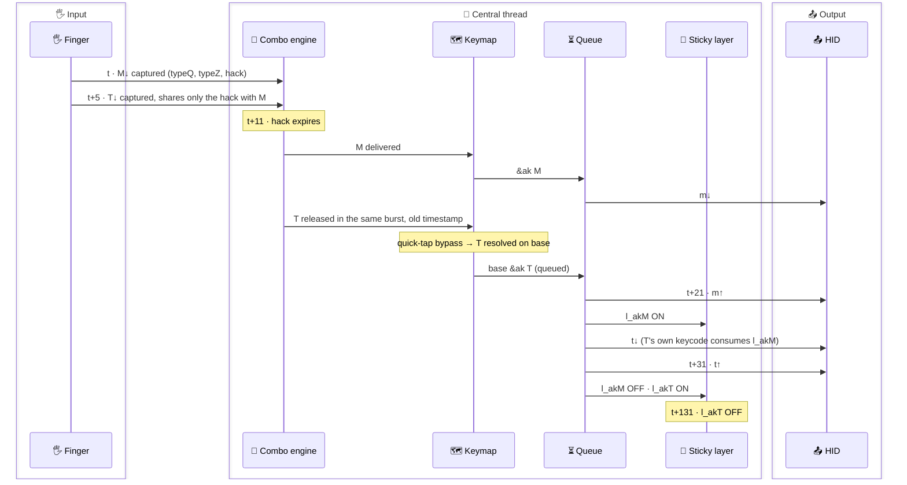
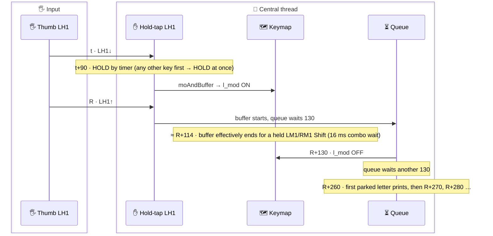
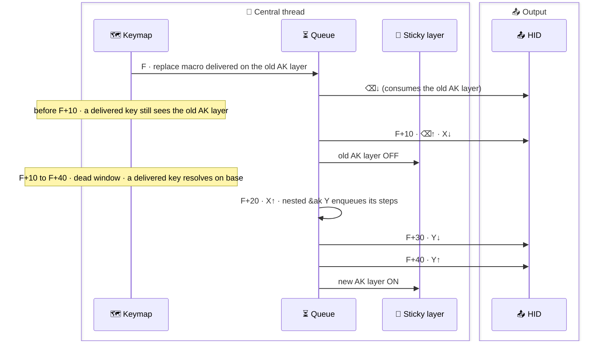
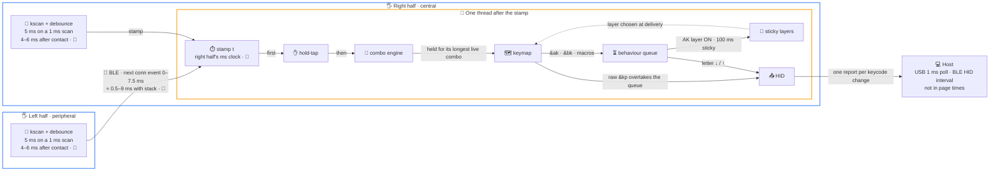
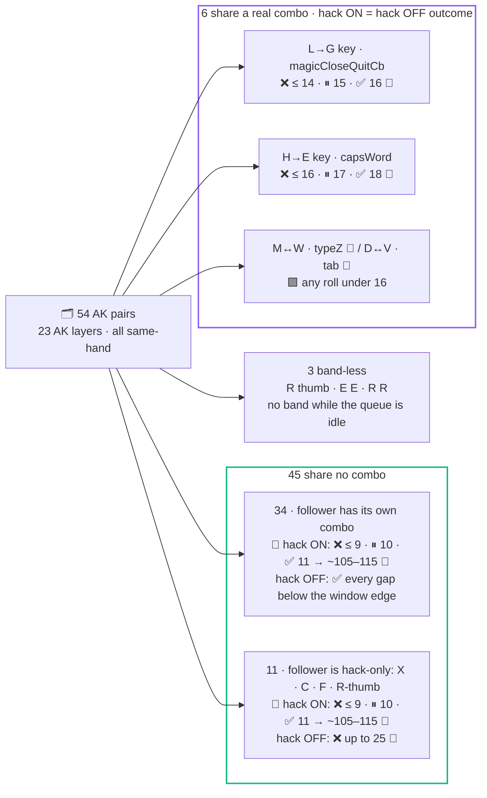

# 📄 FACTS — what the AK timing page may state, with proof

> [!note] What this file is
>
> - The **specification the website is built from**
> - Each section = one page concept (§1–§5) or an extra the page needs (§6–§7), scanned in four passes:
>   - 🗣️ facts the page may state, each with its proof pointer
>   - 🎬 worked examples on Flo's real keys, with full timelines
>   - ⛔ must-NOT-say lines, each with the test that killed it
>   - ⚠️ honest caveats
> - Then 🔄 what changed vs the old page/docs, and the ❓ OPEN list

- **Built from**
  - `MODEL_v2.md` (authoritative model)
  - `results/CORRECTIONS-FINAL.md` (#1–#51, F1–F5)
  - `PAIRS.md`, `results/T-02 … T-23.md`, `ARB-*`, `S-*`
  - review `RVA-*`/`RVB-*`/`FIX-*` logs (`results/FIX-LOG.md`)
- **Firmware**
  - fork `4211ad74` = ZMK `6e03a0bb` (2024-09-12) · Zephyr 3.5 · right half = central · NAQUADAH as compiled

> [!warning] PAIRS.md erratum (MODEL_v2 §(e))
>
> - Its δ ∈ (0.03, 1.05] / ~95 % / ~5 % lines and "≈5 % MISS" notes apply at most to left-hand triggers (❓ OPEN)
> - R-R pairs (H→E, A→RT2) stall deterministically on BLE
> - Its "no sub-ms risk" (S-N_LT4-d11) is outcome-only
> - ⛔ Its ~~R13 Δ = 0 strand~~ is refuted

> [!tip] Chase a proof pointer
>
> - [TESTS.md](TESTS.md) → index of every case, the rigs, the native ↔ board arithmetic
> - `T-02` … `T-23` → one write-up per family in [results/](results/), e.g. [results/T-23.md](results/T-23.md)
> - `S-*` → [results/S.excerpts.md](results/S.excerpts.md)
> - `ARB-*`, flags `F1`–`F5`, items `#1`–`#51` → [results/CORRECTIONS-FINAL.md](results/CORRECTIONS-FINAL.md)
> - `RVA-*`, `RVB-*`, `FIX-*` → [results/FIX-LOG.md](results/FIX-LOG.md)
> - `MODEL_v2 §…` → [MODEL.md](MODEL.md) · pair classes and the sweep → [PAIRS.md](PAIRS.md)

---

## 🧭 Read this first (stated once on the page)

> [!important] One clock on the page
>
> - **All numbers are board engine time**
>   - Milliseconds on the right half's clock
>   - Counted from the trigger key's timestamp `t`

### ⏱️ Three clocks

| Clock | Measured from | Offset vs board engine time |
|---|---|---|
| **Board engine** (what the page prints) | the trigger key's stamp `t`, right half's clock | — |
| **Native log** (the proof) | native_posix test logs | + 1 ms per relative timer crossed · key-driven instants: + 0 |
| **End-to-end** (input side only) | finger contact | + 4–6 ms debounce (every key) + ≈ 0.5–9 ms BLE (left-hand keys), before `t` |

- **Native runs every relative timer +1 ms late**
  - Timers: combo rung, 10 ms queue tick, 100 ms sticky, hold-tap term
  - An `&ak` key delivered by a combo rung crosses two timers before its layer is on
  - Native time = board time + number of timers crossed
  - Key-driven instants carry no offset
  - 🧪 T-01-r1; T-02 reconciliation `[00:00:00.018,000] … in 10ms` → `[00:00:00.029,000]`
- **End-to-end covers the input side only**
  - 4–6 ms debounce on every key
  - ≈ 0.5–9 ms BLE on left-hand keys, before `t`
    - 0–7.5 ms wait for the next connection event + stack
    - median ≈ 4.5 · +7.5 per skipped event
  - Host transport (USB 1 ms poll, BLE HID interval) is not included
  - 📜 src / 🧮 INFERRED (BLE)

### 🏷️ Legend

Same glyphs in every file under `Design/Timing`.

| Evidence | Meaning | Pointer format |
|---|---|---|
| 🧪 | PROVEN by a test | `T-xx[-case] [hh:mm:ss.mmm,uuu]` = native_posix log line (same for `S-*`, `ARB-*`, `RVA-*`/`RVB-*`, `FIX-*`) |
| 📜 | PROVEN by source | `src file:line` = source only |
| 🔮 | PREDICTED · `BOARD-ONLY` | native band differs (given); mechanism proven, the hardware band itself not measured |
| 🧮 | `INFERRED` | derived, not executed |
| ⛔ | REFUTED | kept struck through so nobody re-states it |
| ❓ | OPEN | numbered in the OPEN list at the end |

| Outcome | Meaning |
|---|---|
| ✅ HIT | adapted |
| ❌ MISS | base letter |
| ⏸ STALL | follower waits for your next key-up, or a later press that shares none of its combos; a letter pressed up to 10 ms after the follower's own press (inside its 11 ms hack window, T − 1 rule) shares the hack and joins the wait |
| ⚖️ | unresolved on hardware |
| 🟪 | a real combo fires instead |

- **Firmware actors** (headings, tables, diagrams)
  - 🧩 combo engine · 🗺️ keymap · ⏳ behaviour queue · 📌 sticky layer
  - ✋ hold-tap · 📤 HID · 📡 BLE split link · 🔲 kscan/debounce

### 🗂️ Key map used in the examples

| key | position | base binding | real combos (layer 0) | lone delay (board) |
|---|---|---|---|---|
| M | LT2 | `&ak 13 M` | typeQ 16, typeZ 16 | 16 |
| W | LT3 | `&ak 22 W` | typeZ 16 | 16 |
| X | LT4 | `&ak 23 X` | — (hack only) | 11 |
| P | LT1 | `&ak 16 P` | typeQ 16, space 16 | 16 |
| K | LT0 | `&ak 11 K` | space 16 | 16 |
| C | LM4 | `&ak 4 C` | — (hack only) | 11 |
| N | LM2 | `&ak 14 N` | wispr 16 | 16 |
| T | LM1 | `&ak 19 T` | entr 16 | 16 |
| G | LB3 | `&ak 8 G` | magicCloseQuitCb 16 | 16 |
| L | LB2 | `&ak 12 L` | esc2 16, magicCloseQuitCb 16 | 16 |
| A | RM1 | `&ak 2 A` | entr2 16, bspc 16, delWord 18, capsWord 18 | 18 |
| E | RM2 | `&ak 6 E` | bspc, del 16, delWord, capsWord 18 | 18 |
| H | RM4 | `&ak 9 H` | capsWord 18 | 18 |
| I | RM3 | `&ak 999 I` (arms nothing) | del 16, delWord 18, capsWord 18 | 18 |
| `=`/`-` | RT2 | `&lk_bk MINUS EQUAL` | typeExcl 16, typeQues 16 | 16 |
| R thumb | LH0 | `&blt_akR 25 0` (tap R, hold nav, 200 ms) | — (hack only) | 11 |
| Callum thumb | LH1 | `&htls 26 LSHIFT` | — (hack only) | 11 |

- 📜 compiled `zephyr.dts`
- Source: `RIG.md` R2 table, `D-config.md` §6.3/§10, PAIRS.md

---

## 🧩 §1 · Concept 1 — The AK consistency hack

> [!important] The headline
>
> - "An 11 ms hold that makes adaptation reliable from 11 ms up, at the cost of rolls under 11 ms"
> - 45 ordinary pairs: ❌ ≤ 9 ms · ⏸ 10 ms · ✅ 11 ms → window edge — 🔮 board band (native ❌ ≤ 10 · ✅ 11, 🧪 T-04, S-*)
> - Net trade: costs 34 pairs every roll ≤ 9 ms · rescues 11 pairs for 11–25 ms — 🔮 board bands · 🧪 T-23, PAIRS classes

Ex 1.1 as a sequence: both keys leave at t+11, and T resolves on base 10 ms before `l_akM` comes on.

### 🗣️ May state

1. **The hack = a 36-key combo that never fires**
    - Layers 0–24 · 11 ms timeout · `&none` binding
    - 📜 `adaptive_keys/combos.dtsi:64-65` at HEAD `83aa2ab` (the uncommitted 2026-10 header note shifts it to 70-71), `zephyr.dts`
2. **A press is held for its longest live combo**
    - 11 ms (8 hack-only keys) · 16 ms (most) · 18 ms (A E I H)
    - A key-up ends the hold early: a tap shorter than its hold is released at its key-up
    - 🧪 T-11-c/d; T-12-a `[00:00:00.118,000]` +17 native; T-01-r2-map RM1 `[00:00:01.126,000]` +19 native; T-08-b release flush `[00:00:00.016,000]`
3. **A key typed alone pays the hack's +11 ms only on the 8 hack-only positions**
    - LT4 X, RT0, LM4 C, LB4 F, LH2, LH1, LH0, RH0
    - Other keys are held 16/18 ms anyway
    - In a roll faster than 11 ms, the first key waits until 11 ms on every position
      - Without the hack it leaves at the second key's press
    - A fast real combo waits for its deadline (fact 13)
    - 🧪 T-11-c vs T-11-d pos 3 `[00:00:01.159,000]` vs `[00:00:01.147,000]`; T-02-a `[00:00:00.018,000] … keycode 0x04` (t+12) vs T-02-b-nohack `[00:00:00.012,000]` (t+6), same events, 16 ms position
4. **45 pairs sharing no combo: a follower pressed from 11 ms lands after the AK layer is on**
    - Holds up to the window edge (≈ 105–115 ms)
    - Margin = max(11, follower's combo) − 10 ≥ 1 ms
    - The 6 shared-combo pairs keep failing to 14–16 ms (§7)
    - Left-hand hack-only followers (the 11 H0 pairs)
      - The 1 ms can shrink to ≈ 0 (still adapted) at 11–15 ms
      - Phase-dependent at 16 ms
      - 🧮 INFERRED, ❓ OPEN #3
    - 🧪 T-04-d11 `[00:00:00.033,000]` layer / `[00:00:00.034,000]` Q; T-05; S-N_LT4-d11 `[00:00:00.033,000]` / `[00:00:00.034,000]`; T-23-d1 `[00:00:00.030,000] … layer_id: 0 position: 21` at 13 ms
5. **Below 11 ms the hack makes things worse for most pairs**
    - Both keys leave together at the trigger's 11 ms mark
    - The follower lands on the base layer
    - 🧪 T-02-a `[00:00:00.018,000] … layer_id: 0 position: 1`; T-23-a `[00:00:00.017,000] … layer_id: 0 position: 13`
6. **The reason: ZMK's quick-tap check**
    - The trigger's letter is stamped "now"
    - The follower keeps its old press time → the combo engine waves it straight through
    - 🧪 T-02-c control: disabling the check flips the follower to `[00:00:00.018,000] … capturing position event 1`
7. **Fast-roll band on the board, 45 ordinary pairs**
    - ❌ ≤ 9 ms → base letter
    - ⏸ exactly 10 ms → predicted STALL
      - The follower waits for your next key-up or a later press (a press up to 10 ms after the follower's own press joins the wait)
      - Then usually adapts late
    - ✅ ≥ 11 ms → adapted
    - 🔮 BOARD-ONLY, predicted not measured
      - Native: ≤ 10 ms base, 11 adapted — 🧪 T-04-d9/d10/d11, S-*-d10/d11
      - Join mechanism 🧪 RVB-strand-join
8. **Both canonical examples are inside the failure band**
    - Docs' M→T at 5 ms types "mt"
    - Page's C→P at 6 ms types "cp"
    - 🧪 T-23-a, T-23-b
9. **Without the hack, C→P at 6 ms adapts ("tp")**
    - C has no combo and leaves at once
    - P waits 16 ms for its own combos
    - 🧪 T-23-c `[00:00:00.029,000] … layer_id: 4 position: 3, binding name: flo-macro-replace-char-with-bigram-TP`
10. **Without the hack, 34 pairs adapt at every gap below the window edge (94–112 ms)**
    - These are the pairs whose follower has its own combo that it does NOT share with the trigger
    - 🧪 T-23-c, T-06-c · PAIRS enumeration
11. **Without the hack, the 11 hack-only-follower pairs miss up to 25 ms**
    - Follower is a hack-only key: X, C, F, R-thumb positions
    - The hack rescues exactly those, from 11 to 25 ms
    - 🧪 T-23-e3 `[00:00:00.040,000] … layer_id: 0 position: 0`; T-23-d3 HIT at 13 `[00:00:00.038,000] … layer_id: 12 position: 0`
    - 🔮 BOARD-ONLY 25/26/27 (native 27/28)
12. **The hack does not change the outcome for the 6 shared-combo pairs (→ §7)**
    - Only timing differs
      - M then W 5 ms apart: Z at t+16 with the hack, at the W press without
      - 🧮 INFERRED, R1 analog T-09-c
    - 🧪 T-23-e5, S-M_LT3-d15-nohack, S-H_RM2-d17-nohack
13. **The hack delays a fast real 2-key combo to its 16 ms deadline**
    - Applies when typed faster than 11 ms and it is the only real combo left
    - Cost: 16 − gap
    - `bspc` and `del` are never alone (delWord/capsWord 18 ms stay alive)
      - They always fire at t+18 or at your next key event, with or without the hack
    - 🧪 S-M_LT3-d5 Z at `[00:00:00.022,000]` = t+17 native; T-09-a vs T-09-c; RVB-bspc-d12 `[00:00:00.031,000] … keycode 0x2A` = t+19 native; RVB-bspc-d5-nohack `[00:00:00.024,000] … keycode 0x2A` = t+19 native
14. **Net trade on Flo's 54 pairs**
    - Costs 34 pairs every roll ≤ 9 ms (exactly 10 ms stalls, usually a late adaptation)
    - Rescues 11 pairs for rolls of 11–25 ms
    - 🧪 classes · PAIRS.md · 🔮 BOARD-ONLY (10 ms)
15. **Upstream ZMK v0.3.0+ silently drops the hack**
    - Combos with ≥ 20 keys are not compiled
    - So upstream behaves like "hack off"
    - 📜 upstream `app/src/combo.c:100-101`, F §2

### 🎬 Worked examples (Flo's real keys)

#### Ex 1.1 · M→T at 5 ms, hack ON → "mt" ❌

- Pair class N · l_akM LM1 = `&bk N` → adapted would be "mn"
- 🧪 T-23-a

| board | native line | event |
|---|---|---|
| t | `[00:00:00.005,000]` | M↓ captured (typeQ, typeZ, hack) |
| t+5 | `[00:00:00.010,000]` | T↓ captured; it shares only the hack with M |
| t+11 | `[00:00:00.017,000]` (t+12) | hack expires → M delivered → **m↓**; T released in the same burst with its old timestamp → quick-tap bypass → resolved on **base** `&ak T` (queued) |
| t+21 | `[00:00:00.028,000]` (t+23) | m↑ · l_akM ON · **t↓** (T's own keycode consumes l_akM) |
| t+31 | `[00:00:00.039,000]` (t+34) | t↑ · l_akM OFF · l_akT ON |
| t+131 | `[00:00:00.140,000]` (t+135) | l_akT OFF |

#### Ex 1.2 · C→P at 6 ms, hack ON → "cp" ❌

- Class N, trigger hack-only · l_akC LT1 = `CP_to_TP`
- 🧪 T-23-b

| board | native line | event |
|---|---|---|
| t | `[00:00:00.006,000]` | C↓ captured (hack only) |
| t+6 | `[00:00:00.012,000]` | P↓ captured (shares the hack) |
| t+11 | `[00:00:00.018,000]` (t+12) | hack expires → **c↓**; P bypassed → base `&ak P` |
| t+21 | `[00:00:00.029,000]` (t+23) | c↑ · l_akC ON · **p↓** (consumes l_akC) |
| t+31 | `[00:00:00.040,000]` (t+34) | p↑ · l_akC OFF · l_akP ON |
| t+131 | `[00:00:00.141,000]` (t+135) | l_akP OFF |

#### Ex 1.3 · C→P at 6 ms, hack OFF → "tp" ✅

- 🧪 T-23-c

| board | native line | event |
|---|---|---|
| t | `[00:00:00.006,000]` | C↓ — no combo → **c↓** at once |
| t+6 | `[00:00:00.012,000]` | P↓ captured by space/typeQ (16 ms) |
| t+10 | `[00:00:00.017,000]` (t+11) | c↑ · l_akC ON |
| t+22 | `[00:00:00.029,000]` (t+23) | P delivered on **l_akC** → `CP_to_TP` → **⌫↓** (consumes l_akC) |
| t+32 | `[00:00:00.040,000]` (t+34) | ⌫↑ · l_akC OFF · **t↓** |
| t+42 | `[00:00:00.051,000]` (t+45) | t↑ · no-op Shift releases · nested `&ak P` starts |
| t+52 | `[00:00:00.062,000]` (t+56) | **p↓** |
| t+62 | `[00:00:00.073,000]` (t+67) | p↑ · l_akP ON |
| t+162 | `[00:00:00.174,000]` (t+168) | l_akP OFF |

#### Ex 1.4 · C→P at 11 ms, hack ON → "tp" ✅

- 🧮 INFERRED for this pair
- The Δ = dA case (hack-only trigger, follower pressed at its deadline) 🧪 T-04-d11 `[00:00:00.033,000]` layer / `[00:00:00.034,000]` Q, R1 pos 1 hack-only
- No native column: this pair was not run

| board | event |
|---|---|
| t | C↓ captured (hack only) |
| t+11 | P↓ arrives at C's deadline (key or hack expiry first: same result) → **c↓**; P gets a fresh set (space/typeQ/hack) |
| t+21 | c↑ · l_akC ON |
| t+27 | P delivered on l_akC → `CP_to_TP` (⌫ t+27, t t+37, p t+57, l_akP ON t+67) |

### ⛔ Must NOT say

| Never print | Truth instead | Killed by |
|---|---|---|
| ~~"How a 1 ms margin makes 23 adaptive keys reliable"~~ | the margin only exists from 11 ms on; below 11 ms 45 pairs fail; there are 54 pairs | 🧪 T-02-a, T-23-a/b · PAIRS.md |
| ~~"Key 1 is released from the normal combo the moment key 2 is pressed"~~ (for gaps ≤ 10 ms) | both wait for the hack | 🧪 T-02-a (A at `[00:00:00.018,000]` = t+12, not t+6) |
| ~~"Key 2 is delayed 11 ms after its own press, so the layer is always ready"~~ | for gaps ≤ 9 it lands in the same ms as key 1, on base | 🧪 T-02-a, T-04-d9/d10, T-23-a |
| ~~"M then T 5 ms apart types MN"~~ | types "mt" | 🧪 T-23-a |
| ~~"C→P at 6 ms: TP with the hack, CP without"~~ | exactly reversed | 🧪 T-23-b/c |
| ~~"Without the hack both keys are released at once at the 16 ms timeout"~~ | a non-member key empties the set at once; the follower then waits for its own combos | 🧪 T-02-b, T-06-c, T-23-c |
| ~~"Every key press is delayed 11 ms"~~ | most are held 16/18 ms anyway; the hack adds nothing to them | 🧪 T-11-c/d |
| ~~"The hack never interferes with real combos (11 < 16)"~~ | a 2-key combo typed under 11 ms fires at its 16 ms deadline, not at completion; `bspc`/`del` fire at their 18 ms siblings' t+18, hack or not (fact 13) | 🧪 T-09-a, S-M_LT3-d5; RVB-bspc-d12, RVB-bspc-d5-nohack |
| ~~"Every follower that is in a real combo adapts at any gap without the hack"~~ | not when that combo is shared with the trigger | 🧪 T-23-e5 |
| ~~"The hack rescues 12 pairs and breaks all 23 for Δ ≤ 10"~~ | rescues 11, costs 34, 6 unaffected, out of 54 | PAIRS.md |
| ~~Slider verdict "adds N ms of unnecessary latency" applied to every key~~ | for a key typed alone it applies only to the 8 hack-only positions (in rolls < 11 ms the first key waits on every position, fact 3) | 🧪 T-11-c/d |

> [!note] Resolved: the generic "fires at its own deadline" lines now carry the `bspc`/`del` exception
>
> - "At its own deadline" holds only for a combo that is the sole live candidate; `bspc`/`del` always complete with delWord/capsWord (18 ms) alive → t+18 or your next key event, hack or not
> - 🧪 RVB-bspc-d12 `[00:00:00.031,000] … keycode 0x2A` (gap 12, t+19 native) · RVB-bspc-d5-nohack `[00:00:00.024,000] … keycode 0x2A` (gap 5, hack off, t+19 native) · 📜 `combo.c:448-452` (complete + ≥ 2 alive → pending)

### ⚠️ Honest caveats

- **The 10 ms STALL is a board-only prediction** 🔮
  - Native cannot reproduce it
  - The mechanism is proven: 🧪 T-02-c, T-03, RVB-strand-join
  - The board band is not measured (T-24a)
  - Print neither "at 10 ms the board types the base letter" nor its negation as fact
  - Native's plain miss at 10 (T-04-d10 `[00:00:00.022,000] … layer_id: 0 position: 3`) comes from its +1 timer
  - Left-hand triggers and USB workqueue blocking can turn the board cell into a MISS (🧮 INFERRED)
- **A letter pressed up to 10 ms after a stalled follower's own press joins the stall** (its 11 ms hack window, T − 1 rule · ≈ 10 ms trigram)
  - Both leave at your next key-up or a later press
  - The third key is then typed on whatever layer is on, not the follower's
  - 🧮 INFERRED · mechanism 🧪 RVB-strand-join: follower `[00:00:00.012,000]`, third press `[00:00:00.020,000] … capturing position event 0` (gap 8), no rung line at native 24 ms (the follower's deadline 23 + 1), flush `[00:00:00.073,000]` · 📜 `combo.c:228` (`timeout_at > ts`)
- **Left-hand triggers: the 10 ms cell can also come out as a MISS**
  - They are stamped at BLE receipt with an arbitrary sub-ms phase
  - Happens in a small fraction of presses (🧮 INFERRED, ❓ OPEN)
- **42 of 54 pairs are left-left: physical gaps reach the engine quantised to ~7.5 ms**
  - "10 ms" rarely occurs there
  - A 9 ms roll may arrive as 7–8 (❌) or 14–16 (✅)
  - 🧮 INFERRED (T-24)
- **The hack-off numbers are also upstream v0.3+'s numbers** (hack dropped there)

> [!note] Resolved: a press joins a stall up to 10 ms after the follower's own press
>
> - The follower's fresh hack candidate expires at its `ts + 11`; acceptance is strict (`timeout_at > ts`, the T − 1 rule) → gaps 0–10 join, 11 does not
> - 📜 `combo.c:228` · 🧪 RVB-strand-join `[00:00:00.020,000] … capturing position event 0` (gap 8 joins; no rung line at native 24 ms, the follower's own deadline) · T-22-a/b (the same T − 1 rule on real combos)
> - Fact 7, the ⏸ legend and the caveat above now all say "up to 10 ms"

---

## 🎛️ §2 · Concept 2 — The Callum mod buffer

> [!important] Two edges after the thumb release R
>
> - **R+130** → `l_mod` OFF — 🧪 T-18-a
> - **R+260** → the queue unblocks: first parked letter prints, then one per 10 ms — 🧪 T-18-a, RVB-park-two
> - A mod key counts only if **delivered** before R+130
>   - Held LM1/RM1 Shift (16 ms combo wait) → effective end ≈ R+114 — 🧪 T-18-g, RVA-callum-close245 · 🔮 exact edge ⚖️

### 🗣️ May state

1. **LH1 = hold-preferred hold-tap (90 ms)**
    - Held alone: `l_mod` on at press + 90 ms
    - The hack's 11 ms is not added — unless LH1 was pressed ≤ 9 ms after a letter (fact 17)
    - 🧪 T-17-c `[00:00:00.212,000] … decided hold-timer` = t+91 native
2. **Any other key pressed while LH1 is undecided turns `l_mod` on immediately**
    - Hold-interrupt, even inside the first 90 ms
    - 🧪 T-17-a/a3 `[00:00:00.062,000] … decided hold-interrupt`
3. **Tapped alone, LH1 gives a sticky Shift (`skms`)**
    - The sticky lasts 1500 ms from the thumb PRESS, not from the tap
    - 🧪 T-17-b2 press `[00:00:00.051,000]`, Shift↑ `[00:00:01.552,000]`
4. **After the thumb is lifted at R, `l_mod` stays on until R+130**
    - 🧪 T-18-a `[00:00:00.242,000]` → `[00:00:00.373,000] … layer 4 state 0`, native R+131
5. **The thumb release also blocks the behaviour queue until R+260**
    - The first letter that reaches the keymap in (R, R+260) appears at R+260
    - Each further one 10 ms later (R+270, R+280 …)
    - What counts is delivery, not the press
      - A letter pressed in the last 16–18 ms before R+260 is delivered after it and is not held by the block
    - 🧪 T-18-a `[00:00:00.504,000] … keycode 0x05` = R+262 native; same in a2/e/f/g; RVB-park-two 2nd letter `[00:00:00.515,000]` = R+273 native → board R+270
    - 🧮 INFERRED (late-press case)
6. **Raw `&kp` keys are not blocked**
    - Only queue-routed output (`&ak`, `&bk`, macros) waits
    - 🧪 T-18-c `[00:00:00.402,000] … 0x09`
7. **The `l_mod` keys are `&htm` hold-taps (130 ms, hold-while-undecided)**
    - The modifier goes down when the key is delivered
    - A tap converts it to a sticky mod (1500 ms from the press)
    - 🧪 T-19-a `[00:00:00.081,000]` / `[00:00:00.113,000]`; T-19-d `[00:00:01.563,000]`
8. **Ctrl (LM4/RM4), Alt and Gui on `l_mod` are not in any combo there**
    - The mod is down in the same ms as the thumb decision
    - 🧪 T-17-a3 `[00:00:00.062,000] … keycode 0xE0`
9. **Shift on LM1 sits in the Enter combo (`entr`, LM1+LM0), live on `l_mod`**
    - Shift goes down 16 ms after LM1's press (or at its key-up if sooner)
    - 🧪 T-17-a4 `[00:00:00.079,000] … keycode 0xE1` = decision + 17 native; T-18-f Shift↓ at key-up `[00:00:00.215,000]`
10. **RM1 Shift sits in `entr2` and behaves the same**
    - Shift goes down 16 ms after RM1's press
    - 🧪 RVA-callum-relaxed180 `[00:00:00.280,000] … capturing position event 16` → `[00:00:00.297,000] … layer_id: 26 position: 16, binding name: hold_tap_mod` + `keycode 0xE1`, +17 native
11. **A mod key resolves on `l_mod` only if it is DELIVERED before R+130**
    - LM1/RM1 Shift held past their 16 ms combo wait: the buffer effectively ends at R+114
    - 🧪 T-18-g; RVA-callum-close245 `[00:00:00.362,000] … layer_id: 0 position: 16` · 🔮 BOARD-ONLY (edge)
12. **A Shift pressed in the buffer's last ~16 ms and still held at R+130 becomes the base letter**
    - LM1 types "t", RM1 types "a", both held to R+260
      - Capitalised only if a sticky Shift was armed earlier: RVA-callum-close245's "A" comes from the scenario's LM1 tap (`[00:00:00.215,000] … 13 new sticky_key`); T-18-g has no Shift and types a plain "t"
    - A quick Shift tap released before R+130 is delivered at its key-up and stays Shift
    - 🧪 T-18-g `[00:00:00.378,000] … layer_id: 0 position: 13` → `[00:00:00.504,000] … keycode 0x17`; RVA-callum-close245 `[00:00:00.362,000] … layer_id: 0 position: 16, binding name: flo,behavior-adaptive-key`; T-18-f Shift↓ at key-up `[00:00:00.215,000]`
13. **A sticky Shift armed before the thumb release survives the 260 ms block**
    - It shifts the late letter
    - 🧪 T-18-f `[00:00:00.483,000] … keycode 0x04` + `Modifiers set to 0x02`
14. **The page's "late" and "close" scenarios both type a capital "A" at 380**
    - "Late" (thumb 0–120, Shift tap at 100, next key at 260): capital "A" at 380, ~100 ms late — not a lowercase "a"
    - "Close" (next key at 245) is identical
      - The A key reaches the keymap at 261, after `l_mod` is off (250) → "A" at 380
    - 🧪 T-18-f, native R+262; RVA-callum-close245 `[00:00:00.483,000] … keycode 0x04` + `Modifiers set to 0x02` · 🧮 board arithmetic (380)
15. **Releasing an `htm` mod after a HOLD unregisters it twice**
    - Harmless alone
    - It cancels a same-mod sticky armed earlier
    - 🧪 T-19-b `[00:00:00.225,000] <err> …`; T-19-fix-c-hold-refcount2 `[00:00:00.325,000]`
16. **A sticky Shift typed inside an AK window pins the AK layer until the next letter's key-up**
    - At most one extra adapted letter
    - 🧪 T-20-c `[00:00:00.154,000]` / `[00:00:00.377,000]`
17. **LH1 pressed ≤ 9 ms after an adaptive letter is forced to TAP at that letter's delivery**
    - You get a sticky Shift
    - `l_mod` never turns on, however long you hold the thumb
    - 🧪 RVA-htls-forcedtap-d5: T at 5, LH1 at 10, held to 260; `[00:00:00.017,000] … 31 decided tap (hold-preferred decision moment quick-tap)` → `… keycode 0xE1`; no layer 26 line
    - 🔮 BOARD-ONLY band ≤ 9 (native ≤ 10)
18. **The page's "relaxed" scenario (next key at 180) types no letter on Flo's keymap**
    - The A key (RM1) is Shift on `l_mod` → it adds a second Shift
    - The page's success/fail split at 250 does not exist for that key
    - 🧪 RVA-callum-relaxed180 `[00:00:00.297,000] … layer_id: 26 position: 16, binding name: hold_tap_mod`; zero `keycode 0x04` lines
19. **Letters typed during the block never adapt to each other**
    - Each one's layer is chosen when it reaches the keymap
    - The earlier letters' AK layers are still blocked at that moment
    - 🧪 RVB-park-two A `[00:00:00.426,000] … layer_id: 0 position: 0`; `layer 2 state 1` only at `[00:00:00.515,000]`
20. **⌘ keys on `l_mod` that sit in an any-layer combo are also held 16 ms**
    - ⌘V/⌘K `space`, ⌘A `entr`, ⇧⌘Z/⌘W/⌘S `magicCloseQuitCb`/`esc2`/`tab`
    - They lose the buffer's last 16 ms
    - Rolling two of them fast fires the combo (⌘V then ⌘K → space; Shift then ⌘A → Enter)
    - 🧮 INFERRED — src `layers_C_extra.dtsi:41-43`, D §6.2

### 🎬 Worked examples

#### Ex 2.1 · The "t"-instead-of-Shift trap → "t" ❌

- LH1 held 0–121, LM1 Shift pressed at 240 and held 30
- 🧪 T-18-g, Flo's keymap · t = abs 121

| board | native line | event |
|---|---|---|
| t | `[00:00:00.121,000]` | LH1↓ (hack-only → hold-tap created at t+11) |
| t+90 | `[00:00:00.212,000]` (t+91) | HOLD by timer → `moAndBuffer` → **l_mod ON** |
| R = t+121 | `[00:00:00.242,000]` | LH1↑ → buffer starts, queue waits 130 |
| t+240 | `[00:00:00.361,000]` | LM1↓ → captured by `entr` (live on l_mod), deadline t+256 |
| R+130 = t+251 | `[00:00:00.373,000]` (t+252) | **l_mod OFF** · queue waits another 130 |
| t+256 | `[00:00:00.378,000]` (t+257) | LM1 delivered → l_mod already off → **base `&ak T`** (queued, blocked) |
| R+260 = t+381 | `[00:00:00.504,000]` (t+383) | **t↓** |
| t+391 | `[00:00:00.515,000]` (t+394) | t↑ · l_akT ON |

- No Shift anywhere
- Ctrl on LM4 pressed at the same moment would have landed on `l_mod` (no combo wait; 🧮 INFERRED, ❓ OPEN #8)

#### Ex 2.2 · The page's "late" scenario on Flo's keymap → "A" (shifted) at R+260 ✅ shifted, ⏱️ late

- 🧪 T-18-f · t = abs 100

| board | native line | event |
|---|---|---|
| t | `[00:00:00.100,000]` | LH1↓ |
| t+90 | `[00:00:00.191,000]` (t+91) | HOLD → l_mod ON |
| t+100 | `[00:00:00.200,000]` | LM1↓ captured by `entr` |
| t+115 | `[00:00:00.215,000]` | LM1↑ flushes it → `&htm LSHIFT` → **Shift↓** → tap → sticky Shift |
| R = t+121 | `[00:00:00.221,000]` | LH1↑ → queue waits 130 |
| R+130 = t+251 | `[00:00:00.352,000]` (t+252) | l_mod OFF |
| t+262 | `[00:00:00.362,000]` | RM1↓ on base, held 18 ms by its combos |
| t+280 | `[00:00:00.381,000]` (t+281) | RM1 → `&ak A` (queued, blocked) |
| R+260 = t+381 | `[00:00:00.483,000]` (t+383) | **A↓ with Shift** (report mods 0x02) |
| t+391 | `[00:00:00.494,000]` (t+394) | A↑ · Shift↑ · l_akA ON |

- **Page's own round numbers** (thumb up 120, key at 260)
  - l_mod off at 250, "A" at 380
- **Page "close"** (key at t+245) → same as "late" — 🧪 RVA-callum-close245
  - RM1 captured on `l_mod` by `entr2` `[00:00:00.345,000]`
  - l_mod OFF `[00:00:00.352,000]` (t+251 board)
  - RM1 delivered t+261 (`[00:00:00.362,000]`, t+262) on **base** → `&ak A` parked
  - **"A" with Shift** at R+260 = t+381 (`[00:00:00.483,000]`)
- **Page "relaxed"** (key at t+180) → a second Shift, **no letter** — 🧪 RVA-callum-relaxed180
  - RM1 delivered t+196 (`[00:00:00.297,000]`, t+197) on **l_mod** → `&htm LSHIFT`

#### Ex 2.3 · Ctrl vs Shift at the interrupt

- 🧪 T-17-a3/a4

| board | LH1 + LM4 (Ctrl) | LH1 + LM1 (Shift) |
|---|---|---|
| t | LH1↓ | LH1↓ |
| t+31 | LM4↓ → HOLD · l_mod ON · **Ctrl↓** (`[00:00:00.062,000]`) | LM1↓ → HOLD · l_mod ON · LM1 re-captured by `entr` (`[00:00:00.062,000]`) |
| t+47 | — | **Shift↓** (`[00:00:00.079,000]`, t+48 native) |

### ⛔ Must NOT say

| Never print | Truth instead | Killed by |
|---|---|---|
| ~~"The layer stays 130 ms after hold detection"~~ | 130 ms after the thumb RELEASE | 🧪 T-17-c, T-18-a |
| ~~"After the buffer, nothing else is affected"~~ / ~~"queue parked 130 ms"~~ | queued output is blocked until R+260 | 🧪 T-18-a |
| ~~"Late key types lowercase 'a'" (Ctrl gone → alpha)~~ | the armed sticky Shift survives: "A"; and RM1 is Shift on `l_mod`, Ctrl is LM4/RM4 | 🧪 T-18-f |
| ~~"Tap < 90 ms = sticky Shift"~~ unconditionally | only when nothing else is pressed first | 🧪 T-17-a |
| ~~"Holding LH1 always gives the mod layer"~~ | not when it is pressed ≤ 9 ms after a letter (forced sticky Shift) | 🧪 RVA-htls-forcedtap-d5 |
| ~~Page "relaxed"/"close" scenarios: "A (shifted!)" at the next key~~ | relaxed gives a second Shift and no letter; close gives "A" ~100 ms late at 380 | 🧪 RVA-callum-relaxed180, RVA-callum-close245 |
| ~~"Letters typed during the buffer all appear at R+260"~~ | one per 10 ms from R+260, and they don't adapt to each other | 🧪 RVB-park-two |
| ~~"Mod keys on the layer are bare `skm` taps"~~ | they are `&htm` hold-taps; the mod is down from delivery | 🧪 T-19-a |
| ~~"The modifier is down from the key press"~~ | from delivery (LM1/RM1: +16 ms) | 🧪 T-17-a4 |
| ~~"Order matters, timing doesn't"~~ | a Shift pressed in the buffer's last ~16 ms and held past R+130 becomes "t" (LM1) or "a" (RM1) | 🧪 T-18-g, RVA-callum-close245 |
| ~~"Sticky mods last 1500 ms after the tap"~~ | after the press | 🧪 T-17-b2, T-19-d |
| ~~"Buffer = 130 ms for every mod key"~~ | ~114 for a held LM1/RM1 Shift (and, 🧮 INFERRED, for the ⌘ keys in any-layer combos); 130 for Ctrl/Alt/Gui (🧮 INFERRED) | 🧪 T-18-g, RVA-callum-close245 (+ T-18-fix-b-htm232 R1 combo-held analog) |

### ⚠️ Honest caveats

- **LH1 and LM1 are left-hand keys**
  - The 130/260 ms are anchored to the central's stamp of the thumb-up
  - That stamp arrives ≈ 5.5–15 ms after the physical release (release debounce 5–6 ms while the thumb is held + BLE ≈ 0.5–9 ms) — 📜 C §1 · 🧮 INFERRED (BLE)
- **RM1 Shift (lag and closing edge) is PROVEN on Flo's keymap** (🧪 RVA-callum-*)
  - "Ctrl/Alt/Gui keep the full 130" is still inferred
  - No no-combo key was run at the R+130 edge
    - T-18-b2 is mid-window
    - T-18-fix-b-htm232 is combo-held
- **Exact boundaries are ⚖️ on the board**
  - The sticky Shift timer and every 130/260 edge carry the board's sub-ms ⚖️ at their exact boundary

> [!note] Resolved: press and release debounce differently, so both numbers stand
>
> - A press from idle flips after 4–5 ms (5–6 while any key is held) → Ex 6.1's +4…6 debounce, +4.5…15 stamp
> - A release always runs on the 1 ms poll (the key itself is held) → 5–6 ms, + BLE ≈ 0.5–9 → the thumb-up stamp at ≈ 5.5–15 (caveat above, was "5–15")
> - 📜 C §1 (`zmk,kscan-gpio-matrix.yaml:22-37`: `debounce-press-ms 5`, `debounce-release-ms 5`, `debounce-scan-period-ms 1`) · 🧮 BLE term (C §3)

---

## ⌨️ §3 · Concept 3 — The AK keystroke flow

> [!important] The flow in three rules
>
> - `&ak X L`: X↓ at delivery D · X↑ + AK layer ON 10 ms later · 100 ms sticky — 📜 `macros.dtsi:25-39` · 🧪 T-12-a
> - The layer is chosen when a key **reaches the keymap**, not when the finger presses it — 🧪 T-12-b, T-18-b
> - After a replace macro: dead window (F+10, F+40) resolves on **base** — 🧪 T-21-a, ARB-F3 · 🔮 both ends ⚖️

Replace-macro timeline, generic (F = the macro's delivery; Ex 1.3 and Ex 3.3 are instances).

### 🗣️ May state

1. **`&ak X L` is a 4-step queue program**
    - X↓ at delivery D · wait 10 · X↑ · AK layer L ON with a 100 ms sticky
    - 📜 `adaptive_keys/macros.dtsi:25-39` · 🧪 T-12-a
2. **A lone key's timeline: t → t+16 → t+26 → t+126**
    - Press t → letter↓ t+16 (most keys) → letter↑ + AK layer ON t+26 → layer OFF t+126 if nothing follows
    - 🧪 T-12-a `[00:00:00.118,000]`, `[00:00:00.129,000]`, `[00:00:00.230,000]` = +17/+28/+129 native
3. **The AK layer turns on 10 ms after the letter reaches the keymap**
    - Not after the finger press
    - 🧪 T-12-a
4. **The layer is chosen when a key reaches the keymap**
    - After its combo hold, not when the finger presses it
    - 🧪 T-12-b, T-18-b `[00:00:00.380,000] … layer_id: 0 position: 5`
5. **The first keycode that reaches the keymap after the layer is on consumes it**
    - The layer then turns off at that keycode's release
    - 🧪 T-12-b-d110 OFF on T↑ `[00:00:00.188,000]`
6. **Chaining is gapless**
    - The follower's `&ak` turns off the old layer and turns on its own in the same instant
    - 🧪 T-12-c `[00:00:00.118,000]` layer 13 OFF → layer 3 ON
7. **The window ends at 105–115 ms between key-downs, not 100**
    - Depends on the two keys (110 for most)
    - 🧪 T-12-b-d110/d111/d112 · 🔮 BOARD-ONLY (E_b; native 2 ms wider)
8. **A modifier pressed inside the window pins the AK layer**
    - Until whichever comes first:
      - the modifier is released
      - the next key that types through `&ak` (a `&trans` letter, an adapted `&ak`, a replace macro — most AK-layer keys)
    - Only `&bk`-adapted keys keep the pin
    - 🧪 on R1 with a raw `&kp LSHIFT`: T-20-a `[00:00:00.465,000]`, T-20-e `[00:00:00.446,000]`, `&bk` followers; RVB-pin-akfollower `[00:00:00.173,000] … mo_keymap_binding_released: position 0 layer 1`, Shift↑ only `[00:00:00.263,000]`
    - Rig caveat: Flo's alpha has no raw modifier
      - His `htls` sticky Shift pins ≤ 1 letter (§2 fact 16)
      - The `l_mod` mods are 🧮 INFERRED (❓ OPEN #10)
9. **A modifier already held when the trigger is typed does not pin**
    - The layer still times out
    - 🧪 T-20-d `[00:00:00.211,000]`
10. **Replace types (`REPLACE_CHAR_WITH_BIGRAM`) run 12 queue steps**
    - ⌫ at F · X at F+10 · Y at F+30 · the new AK layer ON at F+40
    - 🧪 T-21-a; T-23-c on Flo's keys
11. **Dead window: a key delivered between F+10 and F+40 resolves on the base layer**
    - The old AK layer was consumed by ⌫; the new one is not on yet
    - 🧪 T-21-a `[00:00:00.090,000] … layer_id: 0`, ARB-F3-b/c/d · 🔮 BOARD-ONLY (ends ⚖️)
12. **A key delivered before F+10 still sees the old AK layer**
    - 🧪 T-21-f `[00:00:00.074,000] … layer_id: 1`; ARB-F3-c `[00:00:00.086,000]`
13. **Every macro key shares one FIFO queue, item by item**
    - The nested `&ak` inside a replace macro adds its steps only at F+20
    - A buffered key delivered before then is typed before Y
    - 🧪 T-21-c `[00:00:00.111,000]` before `[00:00:00.122,000]`; T-21-e
14. **A raw `&kp` never enters the queue and overtakes queued letters**
    - 🧪 T-21-h `[00:00:00.074,000] … 0x10` before `[00:00:00.085,000] … 0x0F`
15. **The R thumb (LH0) is adaptive**
    - Idle queue: tapping types R and turns `l_akR` on at the same instant (0 ms tap, no +10)
    - Right after a letter (busy queue): R is queued like any `&ak` → `l_akR` comes on 10 ms after R↓
    - 🧪 T-14-c `[00:00:00.102,000]` ×3; S-S_LH0-d10 R↓ `[00:00:00.033,000]`, `layer 17 state 1` `[00:00:00.044,000]`
16. **A key held down while the R thumb is tapped is adapted on `l_akR` ("rr")**
    - With an idle queue (busy queue: 🧮 INFERRED not adapted)
    - 🧪 T-13-d `[00:00:00.093,000] … layer_id: 17 position: 0`
17. **After an R-thumb tap the queue is blocked 10 ms**
    - A queued letter resolved in that window prints at thumb-up + 10
    - 🧪 T-13-b `[00:00:00.104,000]`; T-13-fix-e-park `[00:00:00.073,000]`
18. **`l_akR` lives from thumb-up to thumb-up + 100**
    - That is with an idle queue
    - Busy queue: from R↑, 10 ms after R↓
    - 🧪 T-14-c OFF `[00:00:00.203,000]` = +101 native; S-S_LH0-d10
19. **`I` is `&ak 999 I`: it types I and arms nothing**
    - 📜 `aliases_layers_NAQUADAH.dtsi:30`, `keymap.c:142-145`

### 🎬 Worked examples

#### Ex 3.1 · M→K→G, 60 ms apart → "mbl" ✅✅

- l_akM LT0 = `&ak 3 B` · l_akB LB3 = `&bk L`
- 🧪 T-12-c · t = abs 30

| board | native line | event |
|---|---|---|
| t | `[00:00:00.030,000]` | M↓ captured (typeQ, typeZ, hack) |
| t+16 | `[00:00:00.047,000]` (t+17) | **m↓** |
| t+26 | `[00:00:00.058,000]` (t+28) | m↑ · l_akM ON |
| t+60 | `[00:00:00.090,000]` | K↓ captured on layer 13 (space, hack) |
| t+76 | `[00:00:00.107,000]` (t+77) | K delivered on **l_akM** → `&ak 3 B` → **b↓** (consumes l_akM) |
| t+86 | `[00:00:00.118,000]` (t+88) | b↑ · l_akM OFF · **l_akB ON** (same work item) |
| t+120 | `[00:00:00.150,000]` | G↓ captured |
| t+136 | `[00:00:00.167,000]` (t+137) | G delivered on **l_akB** → `&bk L` → **l↓** |
| t+146 | `[00:00:00.178,000]` (t+148) | l↑ · l_akB OFF |

#### Ex 3.2 · R thumb tapped while LT4 is held → "rr" ✅

- 🧪 T-13-d · t = abs 31

| board | native line | event |
|---|---|---|
| t | `[00:00:00.031,000]` | LH0↓ captured (hack only) |
| t+11 | `[00:00:00.043,000]` (t+12) | `blt_akR` hold-tap created (200 ms term) |
| t+31 | `[00:00:00.062,000]` | LT4↓ captured by the hold-tap |
| U = t+62 | `[00:00:00.093,000]` | LH0↑ → TAP → **r↓ r↑** · l_akR ON · LT4 re-raised → `&bk R` on l_akR (queued) |
| U+10 | `[00:00:00.104,000]` (U+11) | **r↓** |
| U+20 | `[00:00:00.115,000]` (U+22) | r↑ · l_akR OFF |

- Thumb held ≥ 200 ms → nav layer, no R
  - 📜 `CONFIG.h:6`, `adaptive_keys/behaviors.dtsi:21-27`

#### Ex 3.3 · The replace-macro dead window: C, P (20 ms later), N (25 ms after P) → "tpn" instead of "tpd" ❌

- l_akP LM2 = `&bk D`
- 🧪 RVA-ex33-cpn on Flo's keymap · t = abs 20

| board | native line | event |
|---|---|---|
| t | `[00:00:00.020,000]` | C↓ (hack only) |
| t+11 | `[00:00:00.032,000]` (t+12) | **c↓** (hack expiry) |
| t+20 | `[00:00:00.040,000]` | P↓ captured (space/typeQ/hack) |
| t+21 | `[00:00:00.043,000]` (t+23) | c↑ · l_akC ON |
| F = t+36 | `[00:00:00.057,000]` (t+37) | P delivered on l_akC → `CP_to_TP` → **⌫↓** (consumes l_akC) |
| t+45 | `[00:00:00.065,000]` | N↓ captured by `wispr` (16 ms) |
| F+10 = t+46 | `[00:00:00.068,000]` (t+48) | ⌫↑ · **l_akC OFF** · **t↓** |
| F+20 = t+56 | `[00:00:00.079,000]` (t+59) | t↑ · nested `&ak P` enqueues its steps |
| t+61 | `[00:00:00.082,000]` (t+62) | N delivered → **no AK layer on** → base `&ak N` (`layer_id: 0 position: 12`, queued after P) |
| F+30 = t+66 | `[00:00:00.090,000]` (t+70) | **p↓** |
| F+40 = t+76 | `[00:00:00.101,000]` (t+81) | p↑ · **l_akP ON** — too late: N was already resolved on base; its queued **n↓** follows in the same tick and consumes l_akP |
| t+86 | `[00:00:00.112,000]` (t+92) | n↑ · l_akP OFF · l_akN ON |

### ⛔ Must NOT say

| Never print | Truth instead | Killed by |
|---|---|---|
| ~~"The AK layer is active for 100 ms after the key press"~~ | 100 ms from layer ON, which is ~26 ms after the press; seen from key-downs the window is 105–115 ms | 🧪 T-12-a/b |
| ~~"The layer stays until the next key releases"~~ for a key that was already down when the layer came on | it neither consumes nor releases the layer; only a keycode delivered after arming does | 🧪 T-07-d5 `[00:00:00.117,000]`, T-20-d |
| ~~"Pinned by any held modifier"~~ | only a modifier pressed inside the window | 🧪 T-20-d |
| ~~"A replace macro is backspace, two taps and a shift release"~~ | 8 outer + 4 nested queue steps | 🧪 T-21-a |
| ~~"Events within and between macros keep strict ordering"~~ | FIFO per queued item; a nested macro's steps join late | 🧪 T-21-c/f |
| ~~"Thumbs are not adaptive / LH0 is NAV"~~ | LH0 taps `&ak R` | 🧪 T-14-c |
| ~~"After the R thumb, a held key is not adapted"~~ | it is | 🧪 T-13-d |
| ~~"A modifier pins the AK layer until you release it"~~ | the next `&ak`-typed key ends the pin | 🧪 RVB-pin-akfollower |

### ⚠️ Honest caveats

- **Host acceptance of the R thumb's 0 ms down/up pair is hardware-only**
  - Native shows two separate HID reports in one ms (T-14-a)
  - USB forces a host poll between them (📜 `usb_hid.c:139`)
  - BLE may pack both into one connection event (🧮 INFERRED)
- **Dead-window ends (F+10, F+40) and the window edge E_b are ⚖️ on the board**
- **Ex 3.3 depends on the queue being idle when C is delivered**
  - In longer rolls an earlier macro can shift every step (🧮 INFERRED)
- **The `&bk` rationale "10 ms prevents dropped keys" is a host-side claim native cannot test** (no host)
  - Neither print it nor "kill" it
  - What the logs show is ordering only: one FIFO queue, raw `&kp` overtakes it
  - 🧪 T-21-h `[00:00:00.074,000] … 0x10` before `[00:00:00.085,000] … 0x0F`, T-15-d

---

## ✋ §4 · Concept 4 — Linger keys

> [!important] Linger in three rules
>
> - Tap-preferred hold-tap · the 100 ms count from the finger press — 📜 `preprocessor_macros.c:69-77` · 🧪 T-15-c
> - Pressed ≤ 9 ms after an adaptive letter → forced TAP, can never linger — 🔮 board band (native ≤ 10, 🧪 T-16-a, S-A_RT2-d10) · unless the two form a 2-key combo (🧮 INFERRED)
> - Keys pressed while it is undecided wait for the decision — 🧪 T-15-d/e/f

### 🗣️ May state

1. **A linger key is a tap-preferred hold-tap with a 100 ms term**
    - Key-up before 100 ms → tap output
    - Held to 100 ms → linger output
    - 📜 `preprocessor_macros.c:69-77` · 🧪 T-15-a/c
2. **The 100 ms count from the finger press (original timestamp)**
    - Even though the combo engine holds the key first
      - 16 ms for RT1/RT2/RT4/RM0 and the RB0 morph
      - 11 ms for the RT0 morph
    - 🧪 T-15-c created `[00:00:00.113,000]`, decided `[00:00:00.202,000]` = press + 101 native · 📜 D §6.3
3. **Released at 99 ms → tap · at 101 ms → linger · exactly 100 ms → ⚖️**
    - Exactly 100 ms is unresolved on the board
    - 🧪 T-15-a `[00:00:00.198,000]`, T-15-c · 🔮 BOARD-ONLY (native 100 = tap, T-15-b `[00:00:00.200,000]`)
4. **Keys pressed while a linger key is undecided do not decide it**
    - They wait and are typed after the tap or linger output
    - 🧪 T-15-d/e/f
5. **Waiting keys: `&ak`/`&bk` at release + 10, raw `&kp` in the same ms**
    - A waiting `&ak`/`&bk` letter types at the tap's or the linger's release (+10 ms)
    - A waiting raw `&kp` types in the same ms as the linger output
    - 🧪 T-15-f `[00:00:00.134,000]` tap path; FIX-linger-hold-akfollower `[00:00:00.153,000] … keycode 0x05` linger path, `&ak` follower; T-15-e `[00:00:00.142,000]` raw `&kp` follower
6. **A linger key pressed ≤ 9 ms after an adaptive letter is forced to TAP at that letter's delivery**
    - It can never linger, however long it is held
    - Exception: the letter and the linger key form a 2-key combo → that combo fires instead (🧮 INFERRED, S2 rule)
      - A→RM0 `entr2` → Enter
      - U→RB0 `magicBracketsL`
    - 🧪 S-A_RT2-d10 `[00:00:00.022,000] … decided tap (tap-preferred decision moment quick-tap)`; T-16-a held 312 ms
    - 🔮 BOARD-ONLY band ≤ 9 (native ≤ 10)
7. **Same forced tap on the R thumb and the Callum thumb**
    - R thumb: types R, cannot become nav
    - LH1: sticky Shift, never `l_mod` (§2 fact 17)
    - By the same rule RH0 gives space, never numsym (🧮 INFERRED)
    - 🧪 S-S_LH0-d10 `[00:00:00.022,000]`; RVA-htls-forcedtap-d5 `[00:00:00.017,000]`
8. **The forced tap's output is queued behind the letter**
    - It appears 10 ms after the letter, together with the AK layer, and consumes that layer
    - 🧪 S-A_RT2-d10 `[00:00:00.033,000] … keycode 0x2E`; T-16-a `[00:00:00.029,000]`
9. **Live linger keys**
    - RT1 `.`/`:`, RT2 `=`/`-`, RT4 `'`/`"`, RM0 `,`/`;`
    - Morphs RT0 `MagicSlash` and RB0 `MagicUnder`
    - Combos `tab`, `wispr`, `magicCloseQuitCb`, `typeGrav`, `magicBrackets*`
    - 📜 D §7

### 🎬 Worked examples

#### Ex 4.1 · RT2 (`=` tap, `-` linger) alone

- Mechanism 🧪 T-15-a/b/c on R1
- RT2's 16 ms combo hold 🧮 INFERRED (src)

| board | tap (released at t+60) | hold (released at t+300) |
|---|---|---|
| t | RT2↓ captured (typeExcl, typeQues, hack) | same |
| t+16 | hold-tap created, undecided | same |
| t+60 | key-up → TAP → **=↓** | — |
| t+70 | =↑ | — |
| t+100 | — | term (from t) → LINGER → **-↓** |
| t+110 | — | -↑ |

#### Ex 4.2 · A then RT2 6 ms later → "a=" ❌, never "a-", not the adapted "au"

- 🧪 S-A_RT2-d10 (native Δ 10 = inside native band); T-16-a R1 at Δ 6

| board | native line (Δ 10 run) | event |
|---|---|---|
| t | `[00:00:00.010,000]` | A↓ captured (entr2, bspc, delWord, capsWord, hack) |
| t+6 | (`[00:00:00.020,000]` at Δ 10) | RT2↓ → shares only the hack → A's set shrinks to {hack} |
| t+11 | `[00:00:00.022,000]` (t+12) | hack expires → **a↓**; RT2 bypassed → base `lk_bk` → hold-tap created **and decided TAP at once** (quick-tap) |
| t+21 | `[00:00:00.033,000]` (t+23) | a↑ · l_akA ON · **=↓** (consumes l_akA) |
| t+31 | `[00:00:00.044,000]` (t+34) | =↑ · l_akA OFF |

- **Board at exactly 10 ms** (right-hand pair, deterministic on BLE) — 🔮 BOARD-ONLY, 🧮 INFERRED
  - RT2 stalls until your next key-up or later press E, then resolves on the layer on at E
  - E within l_akA's life (t+21 … ≈ t+121) → l_akA RT2 = `&bk U` → a late adapted "u"
  - E before t+21 → base linger key, decides normally (term from RT2's press, t+10 → t+110)
  - E after ≈ t+121 → base linger key with its 100 ms already over → "-" at once

### ⛔ Must NOT say

| Never print | Truth instead | Killed by |
|---|---|---|
| ~~"Linger verdict depends only on how long you hold"~~ | a linger key right after a letter is forced to tap | 🧪 T-16-a, S-A_RT2-d10 |
| ~~"The 100 ms start when the combo releases the key"~~ | from the press | 🧪 T-15-c |
| ~~"th/sh/gh, qu linger combos; magicArrow"~~ | not compiled (`corne.keymap:86`, combos commented) | 📜 src |
| ~~"A key pressed during the decision is typed immediately"~~ | it waits for the decision | 🧪 T-15-d/e/f |

### ⚠️ Honest caveats

- **Exactly-100 ms releases are ⚖️ on the board** (native resolves them as tap)
- **The forced-TAP band shifts with the trigger**
  - ≤ 9 ms after an `&ak` letter on the board, ≤ 10 on native
  - At exactly 10 on the board the key strands to your next key event, then resolves on whatever layer is on (Ex 4.2 note; 🧮 INFERRED)
- **Linger keys on the left half also carry BLE timing**
  - RT* keys are right-hand
  - `tab`/`magicCloseQuitCb`/`wispr` combos are left-hand

---

## 📏 §5 · Concept 5 — Combo timeout tiers

> [!important] Tiers in three rules
>
> - Two live tiers: **16 ms** (22 combos) and **18 ms** (5 combos) · the 30 ms tier has no consumers — 📜 `zephyr.dts`, `corne.keymap:86-87`
> - A combo fires iff its keys' timestamps are at most **T − 1** apart — 🧪 T-22
> - The hack is a hold, not a tier — 📜 src · 🧪 T-09-a

### 🗣️ May state

1. **Two tiers are live: 16 ms and 18 ms**
    - 16 ms: 22 combos, adjacent keys
    - 18 ms: 5 combos — delWord ×2 variants, capsWord, delWordTrans ×2
    - 📜 `zephyr.dts`, D §6.2
2. **The 30 ms two-hand tier has zero compiled combos**
    - The pronoun and h-digraph files are commented out
    - 📜 `corne.keymap:86-87`
3. **A combo fires iff its keys' timestamps are at most T − 1 apart**
    - 16 ms tier: gaps 0–15 in, 16 out
    - 🧪 T-22-a gap 15 `[00:00:00.030,000]`; T-22-b gap 16 `[00:00:00.032,000] … remaining_candidates=0 timestamp=32`; T-22-e/f at 30
4. **While the hack is alive (first 11 ms), a completed 2-key combo waits for its own deadline**
    - Or your next key event
    - M+W 5 ms apart types Z at t+16, not t+5
    - 🧪 S-M_LT3-d5 `[00:00:00.022,000] … keycode 0x1D` = t+17 native
5. **Completed between 11 ms and T − 1, it fires at the completing press**
    - Only if no other combo on those keys is still alive
    - M+W 14 ms apart → Z at t+14
    - `bspc` (A+E keys) and `del` (E+I keys) always have delWord/capsWord (18 ms) alive
      - They fire at t+18 (or at your next key event), with or without the hack
    - 🧪 S-M_LT3-d14 `[00:00:00.028,000]`; RVB-bspc-d12 `[00:00:00.031,000] … remaining_candidates=0 timestamp=30` + `keycode 0x2A` = t+19 native; RVB-bspc-d5-nohack `[00:00:00.024,000]` = t+19 native
6. **A combo key pressed just too late (gap ≥ T) starts its own wait**
    - Typed at its own press + its own longest combo, not the missed combo's T
      - 16 on most keys, 18 on A E I H, 11 on the 8 hack-only keys
    - 🧪 T-22-b `[00:00:00.049,000]`; T-01-r2-map `[00:00:01.126,000]` +19; T-11-c `[00:00:01.159,000]` +12
7. **The combo's action is released on the first key-up**
    - The second key-up is swallowed
    - 🧪 T-09-a/a2
8. **A key held alone waits for its longest combo**
    - 16 ms on most keys, 18 ms on A E I H, 11 ms (the hack) on the 8 hack-only keys
    - 🧪 T-12-a; T-01-r2-map; T-11-c
9. **3-key combos typed out of order can stall**
    - RM1, RM3 12 ms later, then RM2 before t+18 → delWord fires at your first key-up or next unrelated press
      - Because capsWord is still a candidate
    - RM2 after t+18 → "a", "i", then E after its own 18 ms
    - 🧪 T-10-e R1 analog `[00:00:00.129,000]` · 🧮 INFERRED on Flo's keys (ARB-F2 had no RM2)
10. **RM1 then RM3 12 ms later without RM2 → nothing is typed until your next key event**
    - Press or release
    - Then "a" and "i" follow 10 ms apart
    - 🧪 ARB-F2-press40 `[00:00:00.052,000] … keycode 0x04`, `[00:00:00.063,000] … keycode 0x0C`; ARB-F2-press14; ARB-F2-release40
11. **The hack itself is not a tier**
    - It is an 11 ms hold on every key of layers 0–24 that never fires
    - 📜 src
12. **`bspc` is layer-scoped, not an "any layer" combo**
    - `l_alpha_aks l_nav l_num l_nav_linwin l_numsym` = layers 0–25, 28, 29, 31
    - Absent on `l_mod`, fn and cfg
    - 📜 `hands_down/combos.dtsi:34`, D §6.2

### 🎬 Worked examples

#### Ex 5.1 · M then W key: the combo window on Flo's keys

- 🧪 S-M_LT3-d5/d14/d15/d16

| gap | board result | native line |
|---|---|---|
| 5 ms | 🟪 **Z** at t+16 (waits for the deadline) | `[00:00:00.022,000] … keycode 0x1D` (t+17) |
| 14 ms | 🟪 **Z** at t+14 | `[00:00:00.028,000]` |
| 15 ms | 🟪 **Z** at t+15 | `[00:00:00.030,000]` |
| 16 ms | ✅ **"mm"** (adapted: l_akM LT3 = `&bk M`), second m at t+32 | `[00:00:00.049,000] … layer_id: 13 position: 1` (t+33) |

#### Ex 5.2 · RM1 + RM3 stall

- 🧪 ARB-F2-press40 · t = abs 12

| board | native line | event |
|---|---|---|
| t | `[00:00:00.012,000]` | RM1↓ captured |
| t+11 | `[00:00:00.024,000]` (t+12) | hack expires; 4 candidates left |
| t+12 | `[00:00:00.024,000]` | RM3↓ → bspc/entr2 dropped; delWord + capsWord (18 ms) left; their deadline is never armed |
| t+18 … t+40 | — | **nothing** (no timer line) |
| t+40 | `[00:00:00.052,000]` | LM1↓ (unrelated) → flush → **a↓**; RM3 bypassed → base `&ak I` |
| t+50 | `[00:00:00.063,000]` (t+51) | **i↓** |
| t+56 / t+60 | `[00:00:00.069,000]` / `[00:00:00.074,000]` | LM1 delivered (entr rung) / **t↓** |

### ⛔ Must NOT say

| Never print | Truth instead | Killed by |
|---|---|---|
| ~~"Three tiers: 16 / 18 / 30"~~ | 30 has no consumers | 📜 src |
| ~~Example cards "I'm" (LT2+RM3) and "I'll" (LB2+RM3)~~ | not compiled | 📜 `corne.keymap:87` |
| ~~"Hack bar: 11 ms, all 36 keys (buffer only)" drawn as a tier~~ | fine as a hold, wrong if it implies it shortens or splits other combos; real combos under 11 ms fire at their own deadline, or at a longer sibling's (`bspc`/`del`: t+18, fact 5) | 🧪 T-09-a; RVB-bspc-d12, RVB-bspc-d5-nohack |
| ~~"Effective window is exactly T"~~ | T − 1 on timestamps (T−1…T of physical time by phase) | 🧪 T-22 |
| ~~"A late combo key is delivered immediately"~~ | it waits its own T | 🧪 T-22-b |
| ~~"RM1+RM3 hangs until you release a key"~~ | until the next press or release | 🧪 ARB-F2-press14/press40 |

### ⚠️ Honest caveats

- **Left-hand 16 ms combos sit on the ~7.5 ms BLE grid**
  - Physical gaps of 8–15 ms can land in or out by phase
  - The 18 ms tier is grid-safe
  - 🧮 INFERRED
- **The combo gap = T cell (key vs deadline) is ⚖️ on the board**
  - Its output is the same either way
- **Ex 5.1 shows only M→W (run)**
  - W→M, D→V and V→D follow the same rule but were not run (🧮 INFERRED)
  - D↔V gives Tab at the first key-up, ⌘Tab if held 100 ms (`tab` is a linger key)

---

## 🚚 §6 · Extra — Pipeline & transport

> [!note] The pipeline at a glance
>
> - Left keys cross 📡 BLE and are stamped at receipt; right keys are stamped by the central directly — 📜 `central.c:259-266`, `physical_layouts.c:178-182`
> - After the stamp everything runs on **one thread** → "races" are ordering — 📜 src · 🧪 log order

### 🗣️ May state

1. **Each half debounces 5 ms on a 1 ms scan**
    - A press reaches its half's firmware 4–6 ms after contact
    - 📜 `zmk,kscan-gpio-matrix.yaml:22-37`, C §1
2. **The right half is the central: it stamps every key with its own millisecond clock**
    - Left keys are stamped when their BLE packet arrives
    - 📜 `physical_layouts.c:178-182`, `central.c:259-266`
3. **Left keys wait 0–7.5 ms for the next BLE connection event**
    - Interval 7.5 ms
    - With stack time the BLE term is ≈ 0.5–9 ms (median ≈ 4.5, +7.5 per skipped event)
    - Left-left gaps arrive quantised to ~7.5 ms
    - 📜 params `CONFIG_ZMK_SPLIT_BLE_PREF_INT=6` · 🧮 INFERRED (distribution, C §3)
4. **Everything after the stamp runs on one thread**
    - Combo engine, hold-taps, keymap, macro queue, sticky layers
    - Nothing preempts anything; "races" are ordering
    - 📜 src · 🧪 log order
5. **Order of handling: hold-tap first, then combos, then the keymap**
    - 📜 `zmk.map` · 🧪 T-17-a
6. **Each firmware timer fires at most 0.061 ms after its nominal length**
    - Counted from the moment it was armed
    - Against the page's whole-ms times it also carries the sub-ms phase of the key that started it
      - ≈ 0.01–0.15 ms for right-hand keys (the printed times hold)
      - Up to ~1 ms for left-hand keys (stamped at BLE receipt)
    - 📜 `timeout.c:122`, C §4; `combo.c:417` · 🧮 INFERRED (phase)
7. **Timestamps never move**
    - A held key is delivered with its original press time
    - Combo deadlines, hold-tap terms and sticky-mod windows count from it
    - Exception: the AK window counts from layer ON (≈ 26 ms after the press on most keys)
    - 🧪 T-15-c, T-17-c, T-17-b2; T-12-a press `[00:00:00.101,000]`, OFF `[00:00:00.230,000]` · 📜 `behavior_queue.c:35`
8. **All 54 AK pairs are same-hand**
    - 42 left-left, 12 right-right
    - 📜 pair table, PAIRS.md
9. **HID: every keycode change is its own report**
    - ZMK merges nothing, even for the 0 ms R tap
    - 🧪 T-14-a two reports at `[00:00:00.102,000]`
10. **The engine-time picture is identical on ZMK from 2024-09 through current main**
    - Except: the hack is dropped from v0.3.0 on
    - Except: left-hand keys are stamped on the workqueue instead of in the BLE receive callback (sub-ms)
    - 📜 F §1–§5; MODEL_v2 (m)

### 🎬 Worked example

#### Ex 6.1 · T (LM1, left hand) alone, three clocks

- 🧪 T-12-a · 📜 src · 🧮 INFERRED (BLE)

| finger (end-to-end) | board engine | native line | event |
|---|---|---|---|
| 0 | — | — | contact |
| +4…6 | — | — | left half debounced |
| +4.5…15 | t | `[00:00:00.101,000]` | central stamps T (BLE receipt) |
| — | t+16 | `[00:00:00.118,000]` (t+17) | **t↓** (entr's 16 ms passed) |
| — | t+26 | `[00:00:00.129,000]` (t+28) | t↑ · l_akT ON |
| — | t+126 | `[00:00:00.230,000]` (t+129) | l_akT OFF |

### ⛔ Must NOT say

| Never print | Truth instead | Killed by |
|---|---|---|
| ~~"Board timers are up to ~1 ms late" for right-hand keys~~ | ≤ 0.061 ms after arming, and right-hand keys carry only ~0.01–0.15 ms of phase; for left-hand keys the ~1 ms is the BLE receipt phase (fact 6, caveat) | 📜 src C §4 (F1), for right-hand keys only |
| ~~"Same-ms ties on the board go to the timer" / "are 50/50" for right-hand pairs~~ | undetermined; left-left pairs: a BLE-phase race, also undetermined (caveat) | F1 |
| ~~Native harness numbers as board numbers~~ (e.g. "layer at +11", "edge at 111") | native adds 1 ms per timer | 🧪 T-02 reconciliation |
| ~~"Split skew breaks AK pairs across hands"~~ | no AK pair crosses hands | PAIRS.md |

### ⚠️ Honest caveats

- **Not measured (T-24)**
  - BLE latency distribution, the 7.5 ms quantisation and same-event packing
- **⚖️ cells: what decides them on the board**
  - Right-hand pairs: 10–200 µs firmware latencies with opposite signs
    - Native resolves them timer-first; the board's direction is unknown
  - Left-left pairs (42 of 54) — 🧮 INFERRED
    - A ⚖️ cell is a race between the two keys' BLE receipt phases, up to 1 ms wide
    - Its neighbour cells are near-certain rather than certain
- **Over USB the single thread can slip up to 1 ms**
  - The right half waits up to ~1 ms for the host poll whenever two HID reports follow each other in under 1 ms
    - e.g. the R thumb's 0 ms tap, a letter's ↑ and the next ↓ in one tick
  - Key stamps, combo deadlines and queue ticks behind it slip up to 1 ms
  - Over BLE the send does not block
  - Separately, a re-raised key that leaves a new undecided hold-tap makes ZMK sleep 10 ms per further captured key
  - 🧮 INFERRED — src `usb_hid.c:139`, `app/Kconfig:142-143`, `hog.c:259-274`, `behavior_hold_tap.c:220-222`
- **Left-hand stamps carry an arbitrary sub-ms phase**
  - Left-left 1 ms margins and STALL cells are phase-sensitive on hardware (🧮 INFERRED)

---

## 🧷 §7 · Extra — Per-pair fragility

> [!important] 54 pairs, not 23
>
> - 23 AK layers, **54 pairs**
> - 45 follow the simple rule · 6 share a real combo and stay fragile to 14–16 ms · 3 have no timing band — 🔮 board bands (native 🧪 T-23, S-*; D↔V 🧮)

### 🗣️ May state

1. **Flo's keymap compiles 54 adaptive pairs across 23 AK layers**
    - A pair = an AK-layer key whose binding differs from the base layer
    - 📜 src, PAIRS.md
2. **45 pairs follow the simple rule**
    - ❌ base letter ≤ 9 ms · ⏸ wait at 10 · ✅ adapted from 11 ms to ~105–115 ms
    - 🧪 S-*-d10/d11, T-12-b · 🔮 BOARD-ONLY
3. **6 pairs fail well past 10 ms: the two keys also form (part of) a real combo**
    - The hack does not help them
    - 🧪 T-23-d*, S-*
4. **L then the G key (LB2→LB3, shared `magicCloseQuitCb`)**
    - ❌ base "lg" for gaps ≤ 14 ms · ⏸ wait at 15 · ✅ adapted "ll" from 16
    - 🧪 T-23-d1/d5/d6, S-L_LB3-d14/d17 (native ≤ 15) · 🔮 BOARD-ONLY
5. **H then the E key (RM4→RM2, shared `capsWord`)**
    - ❌ base for ≤ 16 ms · ⏸ wait at 17 · ✅ adapted from 18
    - E is typed either way; only the next key changes ("heu" instead of "hey")
    - 🧪 S-H_RM2-d16/17/18/19 (native ≤ 17) · 🔮 BOARD-ONLY
6. **M then the W key, and W then the M key (`typeZ`): any roll under 16 ms types Z** 🟪
    - 🧪 S-M_LT3-* for M→W · 🧮 INFERRED for W→M
7. **D then the V key, and V then the D key (`tab`): any roll under 16 ms types Tab** 🟪
    - ⌘Tab if held
    - 🧮 INFERRED (same rule)
8. **5 of these 6 pairs are left-hand pairs**
    - BLE quantisation puts many 8–22 ms rolls right at the 15/16 ms boundary
    - 📜 hands · 🧮 INFERRED (quantisation)
9. **No timing band: the R thumb and the two same-key repeats**
    - Same-key repeats: E E on l_akhE, R R on l_akR
    - Holds as long as the queue is idle at the thumb-up
      - Right after a letter, `l_akR` comes on 10 ms late (S-S_LH0-d10)
    - 🧪 T-13-d, T-14-c, S-S_LH0-d10 · PAIRS.md
10. **Without the hack**
    - The 34 ordinary pairs never miss (below the window edge)
    - The 11 hack-only-follower pairs miss up to 25 ms
    - The 6 shared pairs keep their outcome
    - 🧪 T-23-c/e*, S-*-nohack · 🔮 BOARD-ONLY

### 🎬 Worked examples

#### Ex 7.1 · L→G key at 13 ms → "lg" ❌

- 🧪 T-23-d1 · t = abs 13

| board | native line | event |
|---|---|---|
| t | `[00:00:00.013,000]` | L↓ captured (esc2, magicCloseQuitCb, hack) |
| t+11 | `[00:00:00.025,000]` (t+12) | hack expires; 2 combos left |
| t+13 | `[00:00:00.026,000]` | G-key↓ → still in `magicCloseQuitCb` → captured, set not emptied |
| t+16 | `[00:00:00.030,000]` (t+17) | 16 ms deadline → **l↓**; G key released with old timestamp → bypass → base `&ak G` |
| t+26 | `[00:00:00.041,000]` (t+28) | l↑ · l_akL ON · **g↓** (consumes l_akL) |
| t+36 | `[00:00:00.052,000]` (t+39) | g↑ · l_akL OFF · l_akG ON |

#### Ex 7.2 · L→G key at 16 ms → "ll" ✅

- 🧪 T-23-d6 · t = abs 16

| board | native line | event |
|---|---|---|
| t | `[00:00:00.016,000]` | L↓ captured |
| t+11 | `[00:00:00.028,000]` (t+12) | hack expires |
| t+16 | `[00:00:00.032,000]` | G-key↓ at L's deadline → L's combos expire → **l↓**; G key gets a fresh 16 ms set |
| t+26 | `[00:00:00.043,000]` (t+27) | l↑ · l_akL ON |
| t+32 | `[00:00:00.049,000]` (t+33) | G key delivered on **l_akL** → `&bk L` → **l↓** |
| t+42 | `[00:00:00.060,000]` (t+44) | l↑ · l_akL OFF |

#### Ex 7.3 · Contrast: L→X key (LT4, l_akL = `&bk G`) at 13 ms → adapted "lg" ✅

- 🧪 T-23-d3

| board | native line | event |
|---|---|---|
| t | `[00:00:00.013,000]` | L↓ |
| t+13 | `[00:00:00.026,000]` | X-key↓ shares nothing → L flushed at once → **l↓**; X key gets a fresh hack set |
| t+23 | `[00:00:00.037,000]` (t+24) | l↑ · l_akL ON |
| t+24 | `[00:00:00.038,000]` (t+25) | X key on **l_akL** → **g↓** (1 ms margin) |

### ⛔ Must NOT say

| Never print | Truth instead | Killed by |
|---|---|---|
| ~~"23 adaptive pairs"~~ | 23 AK layers, 54 pairs | PAIRS.md |
| ~~"L→G adapts at 13 ms (artifact example)"~~ | with the G key it misses up to 15 ms (native) | 🧪 T-23-d1/d5 |
| ~~"All pairs behave the same"~~ | 4 behaviour classes plus 3 band-less pairs | PAIRS.md |
| ~~"With the hack, every pair fails only below 10 ms"~~ | the 6 shared pairs fail to 14–16 | 🧪 T-23-d5, S-H_RM2-d17 |

### ⚠️ Honest caveats

- **Board STALL cells (L→G 15, H→E 17) are derived**
  - For left-hand L→G the 15 ms cell can also be a plain miss in a small fraction of presses (🧮 INFERRED)
- **Only M→W was executed among the S2 pairs**
- **On the Windows layer `tab_linwin` adds a second complete 2-key combo for D/V**
  - The Tab fires at its 16 ms deadline even for 11–15 ms gaps (🧮 INFERRED)

---

## 🔄 What changed vs the old page/docs (input for the docs fix)

| Tag | Source |
|---|---|
| PAGE | `Design/Visuals/index.html` |
| HACK | `Design/ak-combo-hack.md` |
| DEEP | `Design/ak-deepdive.md` |
| MECH | `Design/MECHANICS.md` |
| MLOG | `Design/MECHANICS_LOG.md` |
| COOK | `Design/COOKBOOK.md` |
| CMT | `config/features/hands_down/adaptive_keys/combos.dtsi:1-63` |
| ART | earlier artifact |
| E-xx | ids from `E-claims.md` |

### 🧩 Concept 1 (hack)

- Where: PAGE:1154-1220, 1855-2020 · HACK · CMT · MECH:30 · MLOG:78-80

| old (id, location) | new | proof |
|---|---|---|
| Title "How a 1ms margin makes 23 adaptive keys reliable" (PAGE:1158, E-41/E-42) | "An 11 ms hold that makes adaptation reliable from 11 ms up, at the cost of rolls under 11 ms" | T-02, T-23-a/b |
| C→P 6 ms: hack ✅ "TP", no hack ❌ "CP" (E-39, PAGE:1855-1903) | reversed: hack ❌ "cp", no hack ✅ "tp" | T-23-b/c |
| "C buffered by combo" (E-21, E-34) | C is hack-only; with the hack it is held 11 ms, without it it has no combo at all | src D §6.3, T-23-c |
| "P invalidates → C released at 6" (E-34) | P shares the hack; both leave at 11 | T-23-b |
| "Master buffers P 11 ms, 6–17", "P hits l_akC at 17" (E-35, E-37) | P is bypassed at 11 on base; layer at 21 | T-23-b |
| "Both released at once at 16" (no-hack panel, E-21/E-22) | C at 0, P waits its own 16 → 22, adapted | T-23-c |
| M→T 5 ms → "MN" (HACK:48-73, E-38) | "mt" | T-23-a |
| "M released from the normal combo at t=5", "l_akM at 15", "T released 11 ms after its own press" (E-29–E-33) | M at 11, layer at 21, T on base at 11 | T-23-a, T-02-a |
| Caveat "two keys < 11 ms apart are released simultaneously; doesn't matter, they wanted a combo" (E-44/E-26) | that band is the normal fast-roll failure, ≤ 9 ms (board) for 45 pairs, wider for 6 | T-02, T-04, PAIRS |
| "Every keypress is buffered 11 ms" (E-28, HACK:44, CMT:31) | longest candidate: 11/16/18; typed alone, the hack adds 11 only to 8 keys; in a roll under 11 ms the first key waits to 11 on every position (fact 3) | T-11; T-02-a vs T-02-b-nohack |
| "Hack never interferes with real combos" (E-25, HACK:96) | combos typed < 11 ms fire at their own deadline (`bspc`/`del`: at their 18 ms siblings' t+18, hack or not) | T-09-a, S-M_LT3-d5; RVB-bspc-d12, RVB-bspc-d5-nohack |
| Slider "margin = v − 10 … adds N ms latency" (E-43, PAGE:2003-2020) | margin applies from 11 ms; lone-key latency only on hack-only keys; in rolls under 11 ms the first key pays 11 − gap on every position | T-04, T-11, T-02-a vs T-02-b-nohack |
| "99.9 % reliable" (E-46, CMT:51) | not measured; drop or label as Flo's experience | — |
| 4th tier bar "11 ms — all 36 keys (buffer only)" (E-52) | keep only as "hold", not as a tier | T-09 |
| `MAX_KEYS_PER_COMBO=36` at `corne.conf:58`, compile error without it (E-51) | `corne.conf:44`; upstream v0.3+ drops the combo silently | src, F §2 |

> [!note] Resolved: the docs fix carries the roll exception
>
> - Typed alone, the hack adds 11 ms only on the 8 hack-only positions; in a roll under 11 ms the first key waits to 11 ms on every position (without the hack it leaves at the second press)
> - 🧪 T-02-a `[00:00:00.018,000] … keycode 0x04` (t+12) vs T-02-b-nohack `[00:00:00.012,000] … keycode 0x04` (t+6), same events, 16 ms position · T-23-a M (16 ms LT2) `[00:00:00.017,000] … keycode 0x10` (t+12)

### 🎛️ Concept 2 (Callum)

- Where: PAGE:1240-1251, 2035-2103 · MECH:99-112 · MLOG:121-129 · COOK:411-422

| old | new | proof |
|---|---|---|
| "130 ms after hold detection" (E-103, MLOG:126) | 130 ms after thumb release; queue blocked to +260 | T-17-c, T-18-a |
| Late case → lowercase "a", "Ctrl gone" (E-109, PAGE:2077-2103) | capital "A" at 380 (sticky Shift survives; RM1 is Shift on l_mod; Ctrl is LM4/RM4) | T-18-f |
| Relaxed case (next key 180) → "A (shifted!)" (PAGE:2036-2040, 2078) | RM1 resolves on l_mod = Shift → a second Shift, no letter | RVA-callum-relaxed180 |
| Close case (next key 245) → "A (shifted!)" on time (PAGE:2041-2045, 2078) | key delivered at 261 > 250 → base, parked → "A" at 380, same as late | RVA-callum-close245 |
| Success/fail split at thumb-up + 130 (PAGE:2057 `bufferEnd`) | no such split for RM1: held Shift edge ≈ R+114; any letter delivered in (R, R+260) prints at R+260, then one per 10 ms | RVA-callum-*, T-18-g, RVB-park-two |
| (implicit) holding LH1 always reaches l_mod | LH1 ≤ 9 ms after a letter → forced sticky Shift, never l_mod | RVA-htls-forcedtap-d5 |
| Mod keys = bare `skm` taps (E-110, PAGE:2075, MECH:101) | `&htm` hold-taps: mod down at delivery, tap → `skm` | T-19-a |
| "Tap < 90 ms = sticky shift" (E-100, MECH:103) | only when nothing else is pressed; any interrupt → hold | T-17-a |
| Buffer ends at 130 for every mod | Shift on LM1/RM1 loses the last ~16 ms → the base letter: "t" (LM1) / "a" (RM1) | T-18-g, RVA-callum-close245 |
| Sticky mod lifetime unstated (E-111) | 1500 ms from the press | T-17-b2, T-19-d |
| Thumb timeline "HOLD! at 90" (E-108) | holds (90 from the press, not +11) | T-17-c |

> [!note] Resolved: the row now reads "t" (LM1) / "a" (RM1)
>
> - Both are the base `&ak` letter, parked to R+260; RM1 resolves to base at `[00:00:00.362,000] … layer_id: 0 position: 16` (RVA-callum-close245)
> - The capital "A" there comes from the scenario's own Shift tap (RVA-callum-close245 `[00:00:00.215,000] … 13 new sticky_key`), not from the mod key; T-18-g has no Shift and types a plain "t"
> - 🧪 T-18-g, RVA-callum-close245

### ⌨️ Concept 3 (flow)

- Where: PAGE:1290-1393 · DEEP:46-263 · MECH:21-48 · COOK:282-330

| old | new | proof |
|---|---|---|
| Stage chips without times (PAGE) | add times: letter t+16, layer t+26, ⌫ F, X F+10, Y F+30, new layer F+40 | T-12-a, T-23-c |
| Replace = "backspace, two taps, a shift release" (E-98, MLOG:178) | 8 outer + 4 nested queue items | T-21-a |
| "Events within and between macros keep strict ordering" (E-67, DEEP:120) | FIFO per item; nested steps join late; raw `&kp` overtakes | T-21-c/f/h |
| `&bk` rationale "10 ms prevents drops" (E-71) | ordering = single queue (T-21, T-15-d); the drop rationale is a host-side claim, unverified (native has no host) | T-21, T-15-d |
| "AK layer deactivates after 100 ms if no key pressed" (E-60, DEEP:86) | 100 ms from layer ON; pinned by a keycode delivered after arming, incl. a modifier pressed in the window; a modifier pin ends at the modifier's UP or the next `&ak`-typed key | T-12, T-20, RVB-pin-akfollower |
| "Thumbs: none are adaptive"; LH0 labelled NAV (E-80/E-81) | LH0 taps R with a 0 ms tap and arms l_akR | T-14-c |
| Macro `wait-ms` "typically 10" (E-12, MECH:143) | 0 for `&ak`/`&bk`/replace; 10 only for `TYPING_MACRO` | src |
| (missing) dead window after a replace macro | add: (F+10, F+40) resolves on base | T-21-a, ARB-F3 |

### ✋ Concept 4 (linger)

- Where: PAGE:1414-1485, 2247-2286 · MECH:54-72 · COOK:105-250

| old | new | proof |
|---|---|---|
| Gauge verdict = hold duration only (E-137) | add: forced tap ≤ 9 ms after a letter; interrupting keys wait | T-16, T-15-d |
| Active linger keys incl. th/sh/gh, qu, magicArrow (E-135) | not compiled; list the live ones | src |
| (implicit) term from combo release | term from the press | T-15-c |

### 📏 Concept 5 (tiers)

- Where: PAGE:1501-1580 · MECH:82-93 · COOK:237-243

| old | new | proof |
|---|---|---|
| Three tiers 16/18/30 (E-09, E-138) | two live tiers; 30 has no consumers | src |
| Cards I'm / I'll (E-140) | not compiled | src |
| "COMBO_ANY_* for space, backspace, enter" (E-139) | bspc is layer-scoped (alpha, AK, nav, num, numsym, nav_linwin; not l_mod/fn/cfg) | src |
| (missing) | acceptance ≤ T − 1; hack delays fast combos to their deadline; `bspc`/`del` always fire at t+18; RM1+RM3 stall | T-22, T-09, RVB-bspc-*, ARB-F2 |

### 🧾 ART (earlier artifact) claims to retire

| ⛔ Claim (id) | Replace with | Proof |
|---|---|---|
| ~~Simulator Case B `d2 = Δ + max(k2, 11)` for Δ < 11~~ (E-121) | bypass ≤ 9 / strand at 10 | T-02, T-04 |
| ~~"Key 2 always waits ≥ 11 after re-raise"~~ (E-119) | — | T-02-a |
| ~~"Exact-tie ordering depends on Zephyr scheduling" / "no exact-ms tie"~~ (E-128) | native timer-first, board undetermined | T-07-d11, F1 |
| ~~"v0.3 19-key drop" applied to the board~~ (E-127) | true only on v0.3+ | F §2 |

### 📚 Docs to fix (MECHANICS / HACK / DEEP / CMT)

| Where | Says now | Fix |
|---|---|---|
| MECH:30 | "guaranteeing the AK layer activates first. This 1ms margin is what makes the whole system reliable" | state the 11 ms band and the fast-roll failure |
| MECH:32 | "AKs can chain but don't trigger from utility layers" | keep; add that `&trans` over an alpha `&ak` still triggers (CLAIMS E-96, src) |
| HACK:101-105 | caveat | replace with the class table (§7) |
| CMT:15-25, 43-61 | the original explanation | mechanism is the quick-tap bypass; "released at once" only for ≤ 9 ms |
| DEEP:87, 211-216 | chaining | holds (T-12-c); add the pin rule and its end at the next `&ak`-typed key (T-20, RVB-pin-akfollower) |
| MLOG:160-162 | "if those values ever swap, the whole AK system breaks" | the ordering that matters is 10 < max(hack, k2); with the hack ≤ 10 only the hack-only followers would tie or miss at the band start; 16/18 ms followers keep ≥ 6 ms (🧮 INFERRED) |

---

## ❓ OPEN

- Numbers are stable: facts above cite them as "OPEN #n"
- 🧪 RESOLVED and ✅ decided rows stay listed so their numbers keep pointing somewhere

| # | Status | Open item | Closes by |
|---|---|---|---|
| 1 | ❓ | Board Δ = 10 STALL for the 45 ordinary pairs, and the S−1 STALL for L→G (15) / H→E (17); may come out as a MISS for left-hand triggers or over USB (workqueue blocking) | hardware jig with USB logging (T-24a) |
| 2 | ❓ | Board direction of every ⚖️ cell (hack-off 26, window edge E_b, combo gap = T, linger release at 100, dead-window ends, R10 Δ = 16); F1 says not claimable | hardware only |
| 3 | ❓ | Left-hand phase φ: how often a left-hand trigger's deadline floors one ms late (turning a STALL cell into a MISS, and thinning H0 margins at Δ = 16 or to ≈ 0 at 11–15); v1's ≈5 % / ≈0.05 % were this mechanism with an assumed uniform phase; left-left ⚖️ cells are phase races · 🧮 INFERRED mechanism, unmeasured | — |
| 4 | ❓ | BLE latency distribution, L→L quantisation to ~7.5 ms, and whether two left presses can share one connection event | T-24b |
| 5 | ❓ | `k_uptime_get()` in the hack handler = deadline on the board | T-24c |
| 6 | ❓ | Host acceptance of the R thumb's 0 ms down/up pair over USB and BLE | — |
| 7 | 🧪 | RESOLVED: RM1 Shift on `l_mod` (`entr2`) lag and closing edge | 🧪 RVA-callum-relaxed180, RVA-callum-close245 |
| 8 | ❓ | Ctrl/Alt/Gui keep the full 130 ms buffer on Flo's keymap (R1 analog only) | run on R2 |
| 9 | ❓ | W→LT2 (Z), D→LB0 and V→LB1 (Tab) S2 pairs; `tab_linwin` pending on the Windows layer | run on R2 |
| 10 | ❓ | A held `htm` mod pressed inside an AK window pins the layer | not run |
| 11 | ❓ | Raw `&kp` overtaking parked `&ak` output during the Callum block | not mixed-tested |
| 12 | ❓ | 3-key rolls where the queue is busy at the trigger's delivery (stale `last_tapped` → strand instead of bypass), e.g. H, E, x | not run |
| 13 | ❓ | Hack-off R10 stalls on nav/num layers · (⛔ ~~R13 equal-deadline strand~~: REFUTED by source + FIX-R13-eqmin, MODEL_v2 R13) | — |
| 14 | ❓ | Board forced-TAP cell at exactly 10 ms: predicted strand, then the layer at the next key event decides (A→RT2: late "u" inside l_akA's life, base linger key otherwise) | hardware only |
| 15 | 🧪 | RESOLVED: Ex 3.3 trigram (C, P, N → "tpn") | 🧪 RVA-ex33-cpn |
| 16 | ❓ | Linger keys on Flo's real keymap (RT2 lone hold-tap created at T+16) | run on R2 |
| 17 | ✅ decided | Page timelines in **engine time** — decided by the orchestrator 2026-10-01, Flo to veto | Flo's veto |
| 18 | ✅ decided | Show **compiled things only** (no th/sh/gh, I'm/I'll, 30 ms tier) — decided by the orchestrator 2026-10-01, Flo to veto | Flo's veto |
| 19 | ❓ | Board ≈ 10 ms trigram (A, B at +10, C at ≤ +20): C joins B's stall; which layer C lands on | hardware (native mechanism 🧪 RVB-strand-join) |
| 20 | ❓ | USB workqueue blocking: `hid_sem` waits on back-to-back reports, and the `k_msleep(10)` corner when a re-raised key leaves a new undecided hold-tap | hardware with USB logging |
| 21 | ❓ | Non-mod `l_mod` keys in any-layer combos: 16 ms hold, lost buffer edge, combo misfires on rolls (⌘V→⌘K → space; Shift→⌘A → Enter) | run on R2 |
| 22 | ❓ | RH0 (`&blt` space/numsym) forced TAP ≤ 9 ms after a letter; letter + linger 2-key combos (A→RM0, U→RB0) firing instead of a forced TAP | run on R2 |
| 23 | ❓ | `tab` combo timing: Tab at the first key-up, ⌘Tab at +100 | run on R2 |
| 24 | ❓ | Busy-queue R thumb: a key captured by the thumb resolves before `l_akR` (not adapted) | run on R2 |

---

_Raw reader reports behind the `C §`, `D §`, `E-xx` and `F §` pointers and the rig table (superseded, kept for provenance): [research/C-timestamps-transport.md](research/C-timestamps-transport.md) · [research/D-config.md](research/D-config.md) · [research/E-claims.md](research/E-claims.md) · [research/F-upstream-diff.md](research/F-upstream-diff.md) · [research/RIG.md](research/RIG.md)._
