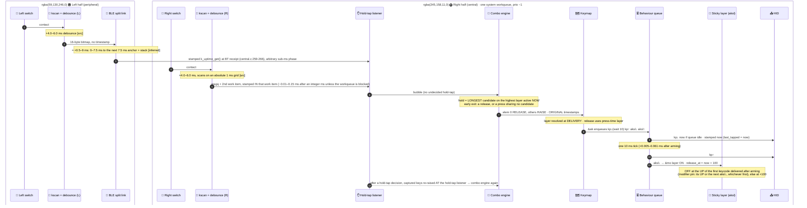
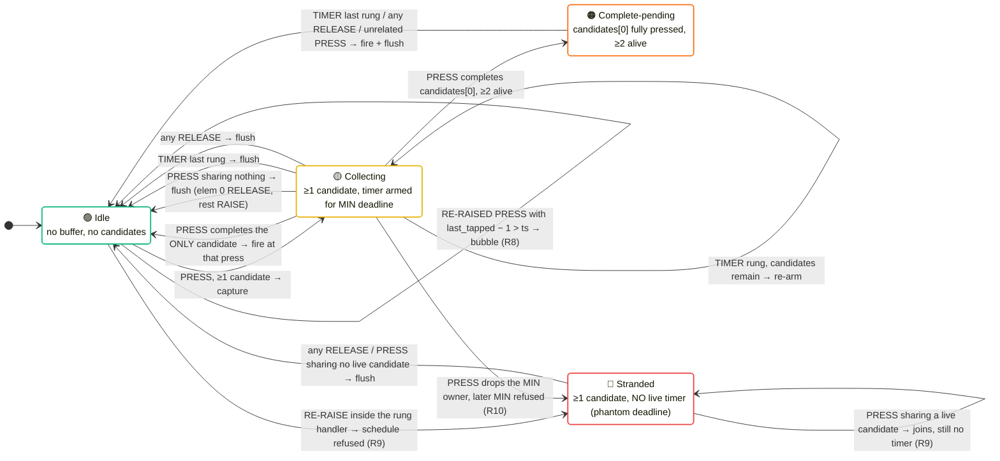
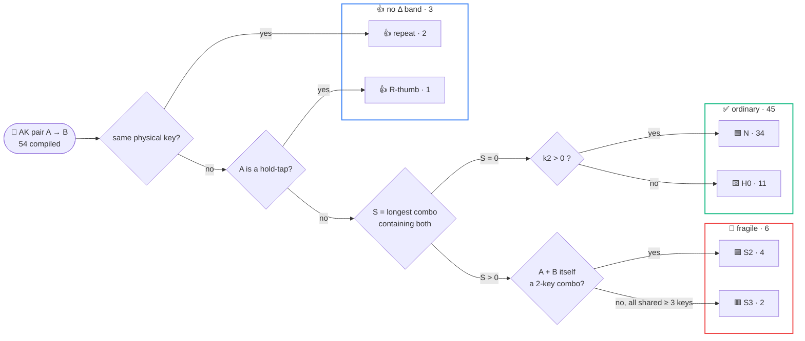
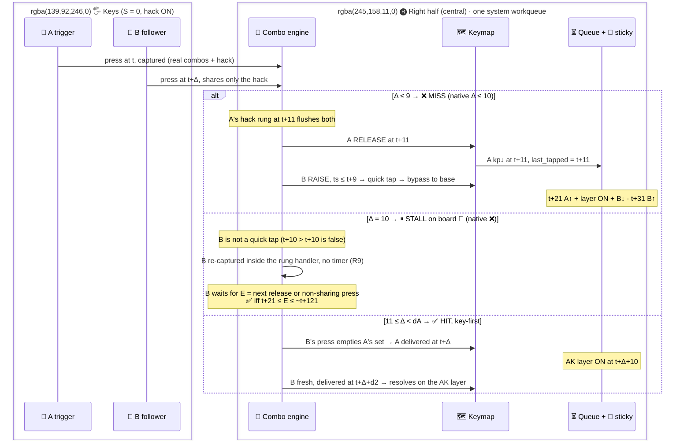

# 🧭 AK timing model

How Flo's Corne firmware times adaptive keys, as established by ZMK native_posix tests. Supersedes the v1 model; where v1 and this file differ, this file wins.

> [!note] Build under test
>
> - **Firmware** — fork `4211ad74` = upstream `6e03a0bb` (2024-09-12, pre-v0.1) + tooling only
> - **Zephyr** — `v3.5.0+zmk-fixes`
> - **Split** — right half = BLE central
> - **Keymap** — NAQUADAH as compiled (28 combos)

> [!note] Legend
>
> - **Status** (every statement carries one)
>   - 🧪 **proven by test** — observed in a native_posix log; the prefix is the log line's exact timestamp
>   - 📜 **proven by source** — read in the source that built the board; not executed
>   - 🔮 **predicted** — board band differs from native and is derived; both bands stated
>   - 🧮 **inferred** — derived from proven rules, not executed; the ones that matter are repeated under ❓ Open
>   - ⛔ **refuted** — struck line kept so page authors know what not to say; killing test named
>   - ❓ **open** — not settled
> - **Outcome** — ✅ HIT (adapted) · ❌ MISS (base letter) · ⏸ STALL (follower waits for the next key event) · ⚖️ tie, unresolved on hardware · 🟪 a real combo fires instead
> - **Actors** — 🧩 combo engine · 🗺️ keymap · ⏳ behaviour queue · 📌 sticky layer · ✋ hold-tap · 📤 HID · 📡 BLE split link · 🔲 kscan/debounce

> [!note] Shorthand
>
> - **Source paths**
>   - `combo.c` = `zmk/app/src/combo.c` · `bq` = `zmk/app/src/behavior_queue.c`
>   - `sk` = `…/behaviors/behavior_sticky_key.c` · `ht` = `…/behaviors/behavior_hold_tap.c`
>   - `timeout.c` / `work.c` = Zephyr `kernel/` · `cfg/` = `zmk-config/config`
> - **Evidence IDs**
>   - `T-xx` → `results/T-xx.md` + `results/*.raw.log` (native_posix_64); T-01 rig baseline → [research/RIG.md](research/RIG.md)
>   - `S-*` → the 54-pair sweep, [PAIRS.md](PAIRS.md) (log excerpts: [results/S.excerpts.md](results/S.excerpts.md)); its erratum sits in 🔢 Per-pair bands
>   - `ARB-*` → arbitration cases, `CORR-B/*.raw.log`
>   - Raw logs in this repo → [tests/timing/logs/](../../tests/timing/logs/) (`results/*.raw.log` and `CORR-B/*.raw.log` are the investigation-time paths)
>   - `RVA-*` · `RVB-*` · `FIX-*` → review cases, [REVIEW-A](results/REVIEW-A.md) · [REVIEW-B](results/REVIEW-B.md) · [FIX-LOG](results/FIX-LOG.md)
>   - `item n` and flags `F1–F5` → [results/CORRECTIONS-FINAL.md](results/CORRECTIONS-FINAL.md) (items #1–#51)
>   - Letters `A1` `C` `D` `E` `F` + § → raw reader reports in `research/` (`A1-combo-engine-trace.md`, `C-timestamps-transport.md`, `D-config.md`, `E-claims.md`, `F-upstream-diff.md`)

## 🎯 Ten things the page must get right

1. 🧩 **A lone press is held for its LONGEST live combo candidate**
   - Not a flat 11 ms
   - **Layers 0–24**
     - 11 ms on the 8 hack-only positions (LT4 RT0 LM4 LB4 LH2 LH1 LH0 RH0)
     - 16 ms on most keys
     - 18 ms on RM1–RM4
   - **`l_mod` (26)** — only `l_all` combos count
     - LM1/RM1 Shift 16 ms
     - The other six mod keys 0 ms
     - The ⌘ keys and `&trans` cells in `l_all` combos also 16 ms (landscape → 🧩 Combo engine)
   - **A key-up flushes earlier**
     - A key (or its partner) released before its hold is delivered at that key-up (R6)
     - So "every press is held ≥ 11 ms" is false
   - Board = native − 1
   - 🧪 T-11-c/d sweep +12/+17/+19 native · T-12-a LM1 `[00:00:00.118,000] … keycode 0x17` = +17
   - 🧪 T-01-r2-map RM1 `[00:00:01.126,000] … keycode 0x04` = +19 · T-17-a4 LM1 on l_mod `[00:00:00.079,000]`
   - 🧪 RVA-callum-relaxed180 RM1 on l_mod `[00:00:00.280,000]` → `[00:00:00.297,000]` = +17 · T-08-b release flush `[00:00:00.016,000]`

2. ⌨️ **`&ak` = kp↓ at delivery D, kp↑ + AK layer ON at D+10**
   - Layer OFF at D+110 if nothing consumed it
   - 🧪 T-12-a `[00:00:00.118,000]` T↓ · `[00:00:00.129,000] … layer 19 state 1` · `[00:00:00.230,000] … layer 19 state 0`
     - = native +17/+28/+129 → board +16/+26/+126

3. ❌ **Fast rolls fail for the 45 ordinary pairs (N + H0)**
   - Both keys leave at the trigger's hack rung
   - The follower is quick-tap-bypassed onto the base layer
   - **Board** — ❌ MISS Δ ≤ 9 · ⏸ STALL at Δ = 10 (🔮) · ✅ HIT from 11
   - **Native** — ❌ MISS Δ ≤ 10 · ✅ HIT from 11
   - ⏸ **STALL** = the follower waits for the next release or the next press sharing none of its live candidates
     - A press inside its own fresh hack window (to T+21) joins the stall (R9)
     - 🧪 RVB-strand-join (native mechanism)
   - **Both hero examples are MISSES**
     - docs' M→T @5 → "mt"
     - page's C→P @6 → "cp"
   - 🧪 T-23-a `[00:00:00.017,000] … layer_id: 0 position: 13` · T-23-b `[00:00:00.018,000] … layer_id: 0 position: 3`
   - 🧪 T-02-a · S-N_LT4-d10/d11 · S-O_RT3-d10/d11

4. ✅ **The adaptation band runs from Δ = 11 to E_b − 1, not "100 ms"**
   - Holds for those 45 pairs
     - Precondition: no combo shared by trigger and follower
   - ⚖️ cell at E_b (105–115 ms by pair)
   - **Margin at the band start** = max(11,k2) − 10 ≥ 1 ms
     - 1 ms for hack-only followers, 6 ms for 16-ms followers
     - Exception: a BLE-stamped hack-only follower (the L-L H0 pairs) can drop to ≈ 0 ms, still HIT — 🧮 (→ 📐 Hack theorem)
   - Native last HIT = E_b + 1 (2 ms wider)
   - 🧪 T-04-d11/d12 · T-05 · S-*-d11
   - 🧪 T-12-b-d111 `[00:00:00.178,000] … layer_id: 19` · d112 `[00:00:00.179,000] … layer 19 state 0` first
   - 🔮 the edge

5. 🧷 **6 of 54 pairs are fragile past 10 ms, with or without the hack**
   - The follower shares a real combo with its trigger
   - 🟥 **S3** — L→G key via `magicCloseQuitCb` 16 · H→E key via `capsWord` 18
     - Board: ❌ MISS Δ ≤ S−2 · ⏸ STALL S−1
     - Native: ❌ MISS Δ ≤ S−1
   - 🟪 **S2** — M↔W key `typeZ` · D↔V key `tab`
     - Δ ≤ 15 types **Z** / **Tab** instead of any letter
   - 🧪 T-23-d1/d5/d6/e5 · S-L_LB3-d14/d17 · S-H_RM2-d16/17/18/19 · S-M_LT3-d5/d14/d15/d16/d17
   - 🔮 the S−1 cell

6. 🔁 **The hack is a trade, not a guarantee**
   - **ON costs the 34 N pairs** every roll Δ ≤ 9 (board; native ≤ 10)
     - Board Δ = 10 is a ⏸ STALL, usually a late HIT
     - OFF they never miss below the window edge
   - **ON rescues the 11 H0 pairs** for 11 ≤ Δ ≤ 25 (board)
     - OFF they miss ≤ 25
   - **Shared-combo pairs** — same outcome ON/OFF
     - Timing differs for S2 at Δ ≤ 10: Z/Tab at t+16 ON vs at B's press OFF — 🧮 R1 analog T-09-c
   - **Latency cost**
     - A lone key: +11 ms only on the 8 hack-only positions (others are held 16/18 anyway)
     - Any roll with Δ ≤ 10: key 1 waits to t+11 on every position; OFF it leaves at key 2's press
       - 🧪 T-02-a pos 0 (R16) `[00:00:00.018,000] … keycode 0x04` = t+12 vs T-02-b-nohack `[00:00:00.012,000] … keycode 0x04` = t+6, same events
       - 🧪 T-23-a M `[00:00:00.017,000]` = t+12
     - A fast real 2-key combo waits for its own deadline (#7)
   - 🧪 T-23-c · T-23-e3/e4 · T-02-b · T-06-c · T-11-c/d · S-M_LT3-d15-nohack · S-H_RM2-d17-nohack + PAIRS enumeration

7. 📏 **Real combos under the hack**
   - **Acceptance** = ts2 − ts1 ≤ T − 1
   - **A completed combo fires at that press only if it is the sole live candidate**
     - Otherwise pending: fires at the last live candidate's deadline, or at the next release / unrelated press (R7)
   - **Hack alive (Δ < 11)** → a 2-key 16 ms combo is pending → fires at t+16, not at completion
     - Hack OFF → at completion
   - **`bspc` / `del`** always complete with delWord/capsWord (18 ms) alive
     - Fire at t+18 (or the next event), hack ON or OFF
     - Never at completion or at their own 16 ms
     - 🧪 RVB-bspc-d12 gap 12 `[00:00:00.031,000] … remaining_candidates=0 timestamp=30` + `keycode 0x2A` = t+19 native
     - 🧪 RVB-bspc-d5-nohack gap 5 `[00:00:00.024,000] … keycode 0x2A` = t+19 native
   - **A set that loses its armed deadline stalls**
     - Until the next release or the next press sharing no live candidate (R10)
   - 🧪 T-09-a/b/c · T-22-a/b/e/f · T-10-c/e/fix · ARB-F2-press40/press14/release40 · RVB-bspc-*

8. ⏳ **One thread, one behaviour queue, FIFO per queued item**
   - Queued output (`&ak`, `&bk`, macros, morph-to-macro) is serialised
     - A raw `&kp` overtakes it
   - A nested macro's steps are enqueued only when its parent item runs
   - **Consequences**
     - `moAndBuffer` parks queued output to thumb-release + 260
     - After a replace macro the base layer is live for (F+10, F+40)
     - An R-thumb tap parks the queue 10 ms
   - 🧪 T-18-a · T-18-c · T-21-a/c/e/f/h · T-15-d · T-13-b · ARB-F3-a/b/c/d

9. 🗺️ **Timestamps never move; the layer is chosen at DELIVERY**
   - **Count from the original press timestamp**
     - Combo deadlines
     - Hold-tap terms
     - Hold-tap-invoked stickies (`skms`/`skm`)
   - **The AK window does not**
     - `aksl` is invoked by the queue with `timestamp = k_uptime_get()`
     - So it counts from layer ON (D+10), not from the press (#2)
     - 📜 `bq:35`, `sk:181-186`
     - 🧪 T-12-a press `[00:00:00.101,000]`, ON `[00:00:00.129,000]`, OFF `[00:00:00.230,000]` = ON + 101 native
   - **A combo or hold-tap hold can carry a key across a layer edge**
     - Its release is dispatched on the press-time layer
   - **Consequences**
     - Mod keys re-enter combos on `l_mod` (LM1/RM1 Shift lag 16 ms)
     - A Shift pressed in the buffer's last ~16 ms AND still held at R+130 resolves on base as its `&ak` letter: LM1 → `&ak T`, RM1 → `&ak A`, parked to R+260
       - The host sees that letter with whatever modifiers are armed at R+260: in the page scenario the earlier sticky Shift is still pending and is consumed by it → shifted "A" (keycode 0x04 + mods 0x02), never a lowercase "a" (→ 🧲 Sticky Shift survives the park)
       - A quick tap released before R+130 stays Shift (delivery at its key-up)
     - The AK layer is pinned only by a keycode delivered after arming
       - The pin ends at the next follower that runs an `&ak` (→ 📌 Pin semantics)
   - 🧪 T-15-c · T-17-c · T-17-b2 · T-17-a4 · T-18-f · T-18-g · RVA-callum-close245
   - 🧪 T-20-a/d · RVB-pin-akfollower · T-12-b-d110 `[00:00:00.211,000]`

10. 📡 **Targets and transport**
    - **native_posix** fires every relative timer +1 ms and resolves same-ms ties timer-first
    - **Board ties are ⚖️ and unresolved**
      - Left-left pairs: BLE-phase races up to ~1 ms wide (→ ⚖️ Same-tick ordering)
    - **No AK pair crosses hands**
      - 42 of 54 are left-left — both via BLE, gaps quantised to ~7.5 ms (🧮)
      - 12 are right-right
    - 🧪 T-07-d11 · T-12-b-d112 · T-15-c + 📜 + 🧮 BLE

> [!note] Resolved — #9 "base letter" and the refuted "lowercase a" are two levels of the same event
>
> - The key resolves on base as `&ak A` (keycode 0x04); the pending sticky Shift from the page's LM1 tap is consumed by that keycode → the host sees shifted "A"
> - 🧪 RVA-callum-close245 `[00:00:00.362,000] … layer_id: 0 position: 16, binding name: flo,behavior-adaptive-key` → `[00:00:00.483,000] … keycode 0x04` + `Modifiers set to 0x02` · T-18-f `[00:00:00.381,000] … layer_id: 0 position: 16` → `[00:00:00.483,000] … keycode 0x04` + `Modifiers set to 0x02`
> - #9, 🎛️ Callum mods and the ⛔ list now all say "`&ak A` on base, shifted on the host"

## ⏱️ Time convention

Read once.

> [!important] The rule
>
> - **Δ** = follower timestamp − trigger timestamp, integer ms, on the central's clock ("engine time")
> - **Board numbers by default**
> - **native_posix = board +1 ms per relative timer hop crossed**

### ➕ Native offset

- **Hops that add +1 on native**
  - Combo rung, 10 ms queue tick, sticky release, hold-tap term, macro waits
  - 🧪 T-01-r1 · T-02-a reconciliation `[00:00:00.018,000] … in 10ms` → `[00:00:00.029,000]`
- **An `&ak` key delivered by a combo rung crosses two hops** before its layer is on (rung, then tick)
  - Native layer ON = t + max(11,k) + 1 + 11
- **Key-driven instants carry no offset**
  - A press that empties a set, a release, a key with no candidate

### 🎲 Board timer lateness — two different quantities

- **Per hop, after arming**
  - `K_MSEC(n)` fires n + 0.005–0.061 ms after the instant it was armed
  - 📜 `timeout.c:122`, C §4 table
- **Against the printed integer instants**
  - A timer fires at its integer target + φ + ≤ 0.061 ms per hop
  - φ = sub-ms phase of the instant that armed the chain
  - Rungs, sticky OFF and hold-tap terms are `K_MSEC(target − k_uptime_get())`
  - 📜 `combo.c:417`, `sk:182-186`, `ht:619-620`
- **Right-hand keys** — φ ≈ 0.01–0.15 ms (scan grid) → integer outcomes as printed
  - 🧮 `kscan_gpio_matrix.c:194-200`
- **Left-hand (BLE-stamped) keys** — φ ∈ [0, 1) → a timer can floor one ms late
  - 🧮 `central.c:263` · magnitude ❓
- ⛔ v1's "δ ∈ (0.03, 1.05] ms" and its ≈95 %/5 % and ≈0.05 % figures ~~as statements about every key~~
  - Wrong for right-hand keys (F1)
  - Basis restated: the same φ mechanism holds for left-hand triggers/followers
  - Its frequency depends on the unmeasured BLE receipt phase → ❓

### 🧵 Workqueue blocking (absent on native)

- **Key stamps, rungs and ticks all run on `k_sys_work_q`** — 📜 every hop is a bare `k_work_submit` / `k_work_schedule`, which Zephyr routes to `k_sys_work_q` (`work.c:405-409, 978-983`)
  - Callers: `physical_layouts.c:159`, `central.c:266`, `combo.c:417`, `bq:46`, `sk:186`, `ht:620`
- **USB** — each HID report send waits on `hid_sem` until the host polls (1 ms interval)
  - Two reports < 1 ms apart block the thread ≤ ~1 ms
  - That can shift a right-hand stamp, rung or tick by 1 ms
  - `usb_hid.c:25-27, 139`, `app/Kconfig:142-143`, `endpoints.c:123-127`, `physical_layouts.c:178-182`
- **BLE HID send is non-blocking** — `hog.c:259-274`
- **`release_captured_events`** sleeps 10 ms per further captured event
  - While a re-raised event left a new undecided hold-tap (`ht:220-222`)

### 🛣️ End-to-end, input side only

- **= engine time + 4–6 ms debounce (both halves) + ≈ 0.5–9 ms BLE (left half only)**
  - BLE: 0–7.5 ms wait for the next connection event + stack
  - Median ≈ 4.5, +7.5 per skipped event
- Host transport (USB poll, BLE HID interval) not included
- 📜 / 🧮 BLE distribution, C §3

## 🚚 Pipeline: finger → HID report

- **Listener order** — activity → hold_tap → combo → keymap
  - 📜 `zmk.map:4612-4635` in T-17-fix build
  - 🧪 T-17-a `[00:00:00.062,000] … 5 bubble` precedes `… capturing position event 5`
- **Key = second work item**
  - The kscan callback only does `k_msgq_put` + `k_work_submit`
  - So a timer expiring on the same tick runs before the key
  - 📜 `physical_layouts.c:147-160`
  - 🧪 T-07-d11 `[00:00:00.022,000] … layer 2 state 1` before `… Row: 0, col: 3`
- **Board timer arithmetic** (🎲 as in Time convention)
  - Relative `K_MSEC(n)` fires n + 0.005–0.061 ms after arming — 📜 `timeout.c:122`
  - Combo rungs and the sticky release are armed as `K_MSEC(target − k_uptime_get())`
    - They fire at the integer target + the sub-ms phase of the arming instant + ≤ 61 µs
    - 📜 `combo.c:417`, `sk:182-186`
  - Right-hand stamps sit ~0.01–0.15 ms after an integer ms
    - So right-hand timelines are integer-ms in practice on BLE
    - On USB, a workqueue blocked on `hid_sem` (back-to-back reports) can shift a stamp, rung or tick by ≤ 1 ms
    - 🧮 `kscan_gpio_matrix.c:194-200`, `physical_layouts.c:178-182`, `usb_hid.c:139`
  - Left-hand stamps carry the arbitrary phase of the BLE receipt — 🧮 `central.c:263-266`
- **Same-thread guarantee**
  - Everything above except the radio runs on `k_sys_work_q` — 📜 `work.c:405-409, 978-983, 1014-1019` (bare submit/schedule/reschedule → system queue); callers in ⏱️ Workqueue blocking, plus the scan `kscan_gpio_matrix.c:200`; only the BLE HID send has its own queue (`hog.c:259-274`)
  - Handlers never preempt each other
  - "Races" are ordering questions
  - **A handler can still block the thread** — 🧮 src · ❓ hardware
    - USB `hid_sem` wait (≤ ~1 ms per back-to-back report)
    - `k_msleep(10)` in `release_captured_events` (`ht:220-222`)
- **Combo ladder does not drift**
  - Each re-arm is relative to the absolute deadline
  - 🧪 T-11-a pos 4 `[00:00:00.797,000] … timestamp=796` · `[00:00:00.802,000] … timestamp=801` · `[00:00:00.804,000] … timestamp=803`

> [!note] Resolved — the one-workqueue claim is 📜 in both places
>
> - Every hop is a bare `k_work_submit` / `k_work_schedule` / `k_work_reschedule`; Zephyr routes those to `k_sys_work_q` (`work.c:405-409, 978-983, 1014-1019`; `system_work_q.c:20-32`, `CONFIG_SYSTEM_WORKQUEUE_PRIORITY=-1`)
> - Callers: `physical_layouts.c:159` (key), `central.c:266` (BLE key), `combo.c:417` (rung), `bq:46` (tick), `sk:186` (sticky OFF), `ht:620` (term), `kscan_gpio_matrix.c:200` (scan)
> - The 🧮 in ⏱️ Time convention was the conservative tag; it now reads 📜 with the same citations

## 🧩 Combo engine

### 🎣 Capture, filter, deadlines (R1–R3)

- **R1 Capture** — first key of a set
  - Candidates = combos on that position active on the **highest layer active now**, unless the key is a quick tap
  - Each candidate gets `timeout_at = ts + timeout_ms`
  - Captured iff ≥ 1 candidate
  - Also applies to every re-raised key (fresh set on the then-active layer)
  - 📜 `combo.c:145-161, 424-437`
  - 🧪 T-11 · T-17-a4 re-capture on l_mod `[00:00:00.062,000] … capturing position event 13`
- **R2 Filter / acceptance**
  - A later key drops candidates with `timeout_at ≤ ts` (strict `>`), then keeps only candidates containing it
  - Result: combo iff ts2 − ts1 ≤ T − 1
    - 🧪 T-22-a gap 15 `[00:00:00.030,000]` fires · T-22-b gap 16 `[00:00:00.032,000] … remaining_candidates=0 timestamp=32` · T-22-e/f at 30 ms
  - The logged count is printed **before** the position filter
    - 🧪 T-10-a `[00:00:00.024,000] … remaining_candidates=2 timestamp=24`
- **R3 Deadlines belong to key 1**
  - A re-raised key starts a fresh set anchored at its ORIGINAL timestamp
  - A deadline already past flushes at once
  - 🧪 T-04-d11 fresh set rung `[00:00:00.034,000] … timestamp=33` · T-10-fix QUEUED case

### 🪜 Ladder, flush, release (R4–R6)

- **R4 Ladder**
  - One delayable armed for the MIN deadline
  - A rung drops expired candidates and re-arms
  - `cleanup()` runs only when 0 remain → a lone key leaves at its LONGEST candidate
  - 🧪 T-12-a `[00:00:00.113,000] … remaining_candidates=1 timestamp=112` → `[00:00:00.118,000] … remaining_candidates=0 timestamp=117`
- **R5 Flush**
  - Element 0 → `ZMK_EVENT_RELEASE` (resumes after hold-tap)
  - Elements ≥ 1 → `ZMK_EVENT_RAISE` from listener 0
  - Synchronous, press order, original timestamps
  - 📜 `combo.c:273-289`
  - 🧪 T-02-a `[00:00:00.018,000] … releasing position event 0` → `… reraising position event 1`
- **R6 Release** — any release flushes the whole buffer at the release's own ms (key-driven, no +1)
  - **`&ak` key 1** → ❌ MISS
    - The follower (ts ≤ T_rel − 2) is bypassed and resolves on base
    - Its HID queues behind key 1's tap
    - 🧪 T-08-a `[00:00:00.016,000] … reraising position event 1` → `… layer_id: 0 position: 1` · B↓ `[00:00:00.027,000]`
  - **Raw `&kp` key 1** — re-capture + dupe cleanup; same outcome — 🧪 T-08-c
  - **Releasing key 2 first** flushes key 1 too — 🧪 T-08-b `[00:00:00.016,000]`
  - **Combo behaviour** released on the FIRST key up; the second key up is swallowed — 🧪 T-09-a/a2

### 🟪 Combo fire (R7)

- **Only `candidates[0]` is tested**
- **Sole survivor completed** → fires at that press
  - 🧪 T-09-b `[00:00:00.026,000]` t+13 · T-10-a `[00:00:00.028,000]` t+16
- **≥ 2 alive** → pending; fires at the last rung or the next event
  - 🧪 T-09-a `[00:00:00.023,000] … remaining_candidates=0 timestamp=22` = t+17 native
  - 🧪 T-10-e `[00:00:00.129,000] … 0x1A` at first release
- **Flo: `bspc` (RM1 RM2) and `del` (RM2 RM3)**
  - Always completed with delWord/capsWord (18) alive → pending
  - Fire at t+18 (native t+19), hack ON or OFF
  - 🧪 RVB-bspc-d12 `[00:00:00.029,000] … remaining_candidates=2 timestamp=28` → `[00:00:00.031,000] … remaining_candidates=0 timestamp=30` + `keycode 0x2A`
  - 🧪 RVB-bspc-d5-nohack `[00:00:00.024,000] … keycode 0x2A`
- **Press carries the first key's timestamp** (log-invisible) — 📜 `combo.c:349`

### ⚡ Bypass and stalls (R8–R11)

- **R8 Quick-tap bypass** — the AK-critical rule
  - `is_quick_tap = last_tapped − 1 > ts` (`require-prior-idle-ms` unset → −1)
  - `last_tapped` = timestamp of the last non-modifier keycode DOWN
    - A queued keycode (`&ak`, `&bk`, macro) is stamped at execution
    - A raw `&kp` keeps its position timestamp
  - So a key re-raised with ts ≤ now − 2 right after a queued keycode gets zero candidates → straight to the keymap
  - 🧪 T-02-c control: `require-prior-idle-ms = -100` flips the bypass into `[00:00:00.018,000] … capturing position event 1`
  - 🧪 T-03 vs T-03-bk: one binding change flips strand ↔ bypass
  - **Same skew in the hold-tap's own quick-tap check** (`ht:142-149`) — 🧪 T-16-a
  - **Same bypass for keys re-raised after a hold-tap decision**
    - 🧪 T-15-d no capture line at `[00:00:00.123,000]` vs control CB-T15-noquicktap `[00:00:00.123,000] … capturing position event 3`
- **R9 Strand (CANCELING trap)**
  - A key re-captured inside the rung handler gets no timer (`k_work_schedule` refused)
  - It waits for the next release or the next press sharing none of its live candidates
  - 🧪 T-03 B↓ only at D↑ `[00:00:00.073,000]` · T-02-c · T-10-d
  - **Join** — a press that shares a live candidate of the stranded set is captured into it
    - e.g. the stranded key's own fresh hack, live to ts+11
    - The MIN still equals the phantom deadline → `update_timeout_task` returns early, nothing is armed
    - Both leave together at the next release / non-sharing press
    - The joiner is re-raised and quick-tap-bypassed
    - 🧪 RVB-strand-join `[00:00:00.020,000] … remaining_candidates=1 timestamp=20` → `… capturing position event 0`, no rung at `[00:00:00.024,000]`, flush only at D↑ `[00:00:00.073,000]`, joiner `layer_id: 0 position: 0`
    - 📜 `combo.c:407-411, 422-433`
  - **Board Δ = 10 STALL + a third key C at ≤ T+20** (≈ 10 ms trigram) — 🧮
    - C joins
    - At the flush B adapts late
    - C resolves on whatever layer is on then (A's AK layer or base), not on B's
- **R10 Late-deadline stall**
  - `k_work_schedule` is refused while the delayable is DELAYED, QUEUED or CANCELING (only RUNNING may re-arm)
  - If a later key drops the candidate that owns the armed deadline and a later one survives
    - → the old timer early-returns and the set is timer-less
  - Exits:

    | exit | event | result | status |
    |---|---|---|---|
    | 1 | press completing the only survivor | fires at that press | 🧪 T-10-a |
    | 2 | press completing `candidates[0]` with ≥ 2 alive | fires at the first release | 🧪 T-10-e |
    | 2′ | unrelated press during exit 2 | would also end it (exit 3 + R5) | 🧮 |
    | 3 | press sharing no live candidate, or after every deadline | flush at that press | 🧪 T-10-fix `[00:00:00.037,000] … keycode 0x08` · ARB-F2-press14 `[00:00:00.026,000]`, press40 `[00:00:00.052,000]` |
    | 4 | any release | flush | 🧪 T-10-c · ARB-F2-release40 `[00:00:00.052,000]` |

  - **Flo: RM1 + RM3 @+12 alone** → A and I wait for the next event
    - 🧪 ARB-F2 on Flo's keymap: `[00:00:00.024,000]` capture, no line until the next event
  - **Flo: RM1, RM3 @+12, then RM2** — 🧮 R1 analog T-10-e (ARB-F2 had no RM2 press)
    - RM2 before t+18 → delWord pending (capsWord alive) → fires at the first release or the next unrelated press
    - RM2 after t+18 → its press flushes "a", "i" and E types after its own 18 ms
  - **Board band** — second key at 11 ≤ Δ ≤ 15; Δ = 16 ⚖️ — 🔮 (native shows the same stall)
- **R11 No poison timer**
  - In the rung handler `cleanup()` cancels the running delayable (→ CANCELING)
  - `update_timeout_task()` then sees no candidates
  - **Board (32-bit `long`)** — 📜 `combo.c:198`, `:412-418`, `work.c:967`, board path only
    - `first_candidate_timeout()` returns `LONG_MAX` ≠ `LLONG_MAX` → `k_work_schedule` refused
    - A phantom `LONG_MAX` deadline is recorded, nothing is scheduled
    - The next first key arms normally
  - **Native (64-bit `long`)** — `LONG_MAX == LLONG_MAX` → `timeout_task_timeout_at = 0` + cancel
    - No native test exercises the board path; outcome identical (re-trace REVIEW-A RVA-19)
  - ⛔ ~~A1 Defect 1: board-only poisoned timer delays B until A's release~~ — refuted (source)

### 📋 Limits, refuted R13, log reading (R12–R14)

- **R12 Limits** — 📜 `zephyr.dts`, `cfg/corne.conf:39-49`
  - 28 compiled combos: 22 × 16 ms, 5 × 18 ms, 1 × 11 ms hack (36 keys, layers 0–24), none at 30 ms
  - `MAX_PRESSED_COMBOS` 20 · `MAX_COMBOS_PER_KEY` 30 · `MAX_KEYS_PER_COMBO` 36
- ⛔ ~~**R13 Hack-off equal-deadline strand.** Hack OFF, Δ = 0, A's MIN = B's fresh MIN → B gets no timer~~ — refuted
  - **Source** — B's press runs `update_timeout_task()` with 0 candidates BEFORE `cleanup()` (`combo.c:429-433`)
    - That resets `timeout_task_timeout_at`
    - Native: `LLONG_MAX` branch → 0 (`:412-414`)
    - Board: refused schedule → phantom `LONG_MAX` (`:417-418`)
    - No stale equality is left; B's fresh set is armed
  - **Native, equal MIN at Δ = 14** (A = W30 pos 7 at 14, B = R16 pos 2 at 28, both MIN 44)
    - B delivered by its own rung
    - 🧪 FIX-R13-eqmin `[00:00:00.045,000] … remaining_candidates=0 timestamp=44` → `… releasing position event 2`
  - Δ = 0 itself is unreachable on the mock; same code path
- **R14 Log reading**
  - Key path prints the key's own ts at its own ms
  - Timer path prints the deadline, executed +1 on native
  - 🧪 T-22-b vs T-22-d `[00:00:00.118,000] … timestamp=117`

### 🗺️ Per-position candidate landscape

📜 `zephyr.dts`; D §6.3

| positions | live real combos (max ms) | lone delivery, board |
|---|---|---|
| LT4 X · RT0 / · LM4 C · LB4 F · LH2 · LH1 · LH0 · RH0 (layers 0–24) | none, hack only | **11** |
| LT0–LT3 · RT1–RT4 · LM0–LM3 · RM0 · LB0–LB3 · RB0–RB4 · RH1 RH2 (layers 0–24) | 1–3 × 16 | **16** |
| RM1 A · RM2 E · RM3 I · RM4 H (layers 0–24) | 16 + delWord/capsWord 18 | **18** |
| `l_mod` 26: LM1 Shift (`entr`) · RM1 Shift (`entr2`) | 16 | **16** (LM1 🧪 T-17-a4; RM1 🧪 RVA-callum-relaxed180 `[00:00:00.280,000]` → `[00:00:00.297,000]`) |
| `l_mod` 26: LT1 ⌘V · LT0 ⌘K (`space`) · LM0 ⌘A (`entr`) · LB3 ⇧⌘Z · LB2 ⌘W · LB1 `&trans` (`magicCloseQuitCb`, `esc2`, `tab`) · LB0 ⌘S (`tab`) · RM0 `&trans` (`entr2`) · RH1 RH2 `&trans` (`settings`) | 16 (`l_all`) | **16**; rolled pairs fire the combo (⌘V→⌘K → space, LM1 Shift→⌘A → Enter) — 🧮 `layers_C_extra.dtsi:41-43`, D §6.2 |
| `l_mod` 26: every other position, incl. LM4–LM2, RM2–RM4 mods | none (hack is 0–24 only) | **0** (🧪 T-17-a3 `[00:00:00.062,000] … keycode 0xE0`) |
| nav/num/numsym/nav_linwin | hack absent; `*Trans` 16/18 on LM1–LM3, bspc/del/delWord on RM1–RM3 | **0 / 16 / 18** (🧮) |

## ⌨️ The `&ak` keystroke

Trigger at engine timestamp T, longest candidate k, queue idle.

| instant (board) | native | what happens | status |
|---|---|---|---|
| T | T | captured (real combos + hack) | 🧪 T-12-a `[00:00:00.101,000]` |
| T+11 | T+12 | hack rung; flush if nothing else is left | 🧪 T-11-c `[00:00:01.159,000]` |
| **D** = T + max(11,k), or earlier on a release / non-sharing press | T + max(11,k) + 1 | delivered with timestamp T; layer resolved now; `&ak` → kp↓ (HID), queue waits 10 | 🧪 T-12-a `[00:00:00.118,000]` |
| D+10 | D+11 | kp↑ · `aksl↓` → AK layer ON · 100 ms armed | 🧪 T-12-a `[00:00:00.129,000]` |
| D+110 | D+112 (timer-delivered D) | layer OFF if nothing consumed it | 🧪 T-12-a `[00:00:00.230,000]` |
| physical release | same | `&ak` release branch empty → nothing; holding never repeats | 🧪 T-12-a `[00:00:00.202,000]` |

### 👁️ Visibility and consumption

- **Visibility** — the layer bit is written at D+10
  - A key flushed in the same burst as the trigger resolves before it → base — 🧪 T-02-a
  - A key delivered on the same native tick as layer ON → layer wins on native
    - 🧪 T-07-d11 · T-23-e4 `[00:00:00.056,000]`
    - Board: ⚖️ (F1)
- **Consumption** — the first keycode DOWN **delivered after arming** stops the 100 ms timer
  - It holds the layer until that keycode's UP
  - **`&bk` follower** keeps the layer 10 ms past its delivery
    - 🧪 T-12-b-d110 OFF on T↑ `[00:00:00.188,000]`
  - **`&ak` follower** → gapless chaining
    - Its kp↑ drops the old layer and its `aksl↓` turns the new one on in the same work item
    - 🧪 T-12-c `[00:00:00.118,000]` 13 OFF → 3 ON
  - **Bypass MISS** — the follower's own base keycode consumes the trigger's layer, which then serves nobody
    - 🧪 T-02-a `[00:00:00.040,000] … layer 1 state 0`
- **Pin semantics** → 📌 Pin semantics

### 🚪 Window, release, position 0

- **Window seen from key-downs**
  - Follower delivered at Δ + max(11,k2); layer alive on [D+10, D+110]
  - → upper edge E_b = max(11,k1) + 110 − max(11,k2) (→ 📐 Hack theorem)
- **Release dispatched on the press-time layer**, even after that layer is off
  - 🧪 T-12-b-d110 `[00:00:00.211,000] … layer_id: 19` after OFF `[00:00:00.188,000]`
- **Position 0** — every queued `aksl` lives at position 0
  - A new `aksl↓` releases any still-active one, pinned or not
  - This is what ends a modifier pin at the next `&ak`-running follower (→ 📌)
  - 🧪 T-12-c `0 new sticky_key` · RVB-pin-akfollower `[00:00:00.173,000] … mo_keymap_binding_released: position 0 layer 1` before `… 0 new sticky_key`
  - 📜 `sk:147-151`
- **`I` = `&ak 999 I`** — `&mo 999` is rejected silently; I types normally — 📜 `keymap.c:142-145`

### 👍 R thumb (`&blt_akR 25 0`, tap = `ak_R_macro` → `&ak 17 R`)

> [!important] Precondition
>
> - Queue idle at the thumb-up

- **Idle queue → 0 ms tap**
  - The tap runs outside the queue work, so the nested `&ak` drains synchronously
  - R↓, R↑ and `l_akR` ON all in the thumb-up ms U
  - Two separate HID reports
  - 🧪 T-14-c `[00:00:00.102,000]` ×3 · T-14-a two `zmk_endpoints_send_report` at `[00:00:00.102,000]`
- **`l_akR` lives U → U+100** (no +10)
  - 🧪 T-14-c OFF `[00:00:00.203,000]`, native U+101
- **A key held during the thumb tap** is re-raised AFTER the layer is on → ✅ adapted
  - 🧪 T-13-d `[00:00:00.093,000] … layer_id: 17 position: 0`, HID "rr"
- **Busy queue** (e.g. the forced TAP right after a letter, → 🔨 Forced-TAP band)
  - The nested `&ak R` queues normally → R↓ at the next tick, R↑ + `l_akR` ON 10 ms later
  - 🧪 S-S_LH0-d10 R↓ `[00:00:00.033,000] … keycode 0x15`, `layer 17 state 1` `[00:00:00.044,000]`
  - A key captured by the thumb would then resolve before `l_akR` → not adapted — 🧮
- **The nested call parks the queue to U+10**
  - Queued output resolved in that window emits at U+10
  - 🧪 T-13-b `[00:00:00.104,000] … 0x17` · T-13-fix-e-park `[00:00:00.067,000]` → `[00:00:00.073,000]` · T-13-fix-f-nopark `[00:00:00.077,000]`
- **Host acceptance of a 0 ms tap** → ❓ (hardware)
- ⛔ ~~"R thumb then held key → not adapted" (D T7b)~~ — 🧪 T-13-d
- **A hold-tap whose tap is a direct `&ak`** behaves like a normal `&ak`: captured key on base
  - 🧪 T-13-c `[00:00:00.093,000] … layer_id: 0 position: 1`

## 📐 The hack as a theorem

### 🧾 Setup

- **Trigger A** = an `&ak` key (not a hold-tap) · **Follower B** = any key
  - Both on a layer in `l_alpha_aks`
  - Queue idle at A's delivery
- **k1 / k2** = longest real combo containing A / B on that layer (0 if none)
  - dA = max(11, k1) · d2 = max(11, k2)
- **S** = longest real combo containing BOTH (0 if none)
- **Classes** (from [PAIRS.md](PAIRS.md))

- 🟩 **N** — S = 0, k2 > 0
- 🟨 **H0** — S = 0, k2 = 0
- 🟥 **S3** — S > 0, all shared combos ≥ 3 keys
- 🟪 **S2** — {A,B} is itself a 2-key combo

### 📊 Δ table, hack ON (current firmware)

Cell = **native · board**. ⏸ = follower delivered at the next release or non-sharing press; a press inside its fresh 11 ms joins. 🟪 = combo fires (Z / Tab).

| Δ (ms) | 🟩 N, 34 pairs | 🟨 H0, 11 pairs | 🟥 S3 L→G key (S 16) | 🟥 S3 H→E key (S 18) | 🟪 S2 ×4 (S 16) |
|---|---|---|---|---|---|
| 0–9 | ❌ · ❌ | ❌ · ❌ | ❌ · ❌ | ❌ · ❌ | 🟪 · 🟪 |
| 10 | ❌ · ⏸ | ❌ · ⏸ | ❌ · ❌ | ❌ · ❌ | 🟪 · 🟪 |
| 11–14 | ✅ · ✅ | ✅ · ✅ | ❌ · ❌ | ❌ · ❌ | 🟪 · 🟪 |
| 15 | ✅ · ✅ | ✅ · ✅ | ❌ · ⏸ | ❌ · ❌ | 🟪 · 🟪 |
| 16 | ✅ · ✅ | ✅ · ✅ | ✅ · ✅ | ❌ · ❌ | ✅ · ✅ |
| 17 | ✅ · ✅ | ✅ · ✅ | ✅ · ✅ | ❌ · ⏸ | ✅ · ✅ |
| 18 … E_b − 1 | ✅ · ✅ | ✅ · ✅ | ✅ · ✅ | ✅ · ✅ | ✅ · ✅ |
| E_b | ✅ · ⚖️ | ✅ · ⚖️ | ✅ · ⚖️ | ✅ · ⚖️ | ✅ · ⚖️ |
| E_b + 1 | ✅ · ❌ | ✅ · ❌ | ✅ · ❌ | ✅ · ❌ | ✅ · ❌ |
| ≥ E_b + 2 | ❌ · ❌ | ❌ · ❌ | ❌ · ❌ | ❌ · ❌ | ❌ · ❌ |

- 🧪 **Native cells observed**
  - N 10/11 (S-O_RT3, S-A_RT2)
  - H0 10/11 (S-N_LT4, S-S_LH0, T-23-d3/d4)
  - S3/16 at 5/13/14/15/16/17 (T-23-d2/d1, S-L_LB3-d14, T-23-d5/d6, S-L_LB3-d17)
  - S3/18 at 16–19 (S-H_RM2)
  - S2 at 5/14/15/16/17 (S-M_LT3)
  - edge 110/111/112 (T-12-b)
- 🧮 / 🔮 **All other native cells and every board cell that differs** — derived (PAIRS.md rules, 21/21 validated)
- **Board timeline behind the cells** (t = A's timestamp)

| case | board timeline |
|---|---|
| N/H0 Δ ≤ 9 | A↓ t+11 · B resolved on base t+11 · A↑ + layer + B↓ t+21 · B↑ t+31 |
| N/H0 11 ≤ Δ < dA | A↓ t+Δ · layer t+Δ+10 · B t+Δ+d2 |
| N/H0 Δ ≥ dA | A↓ t+dA · layer t+dA+10 · B t+Δ+d2 |
| S3 Δ ≤ S−2 | A↓ t+S · B on base t+S · layer + B↓ t+S+10 |
| S2 | Z at t+16 (Δ ≤ 10) or t+Δ (11–15) |
| S2 `tab` | its hold-tap is created then; Tab at the first key-up, ⌘Tab at t+100 if held (🧮) |

### 📊 Δ table, hack OFF (= upstream v0.3+)

Cell = **native · board**.

| Δ (ms) | 🟩 N | 🟨 H0 (k1 16) | 🟥 S3 / 🟪 S2 |
|---|---|---|---|
| 0–25 | ✅ · ✅ | ❌ · ❌ | identical to hack ON |
| 26 | ✅ · ✅ | ❌ · ⚖️ | identical |
| 27 | ✅ · ✅ | ❌ · ✅ | identical |
| 28 … edge − 1 | ✅ · ✅ | ✅ · ✅ | identical |
| edge (board) | k1 + 110 − k2: 94 (k1 0), 110, 112, 108 | 126 | 110 |

- 🧪 **Proven native** — N (T-23-c, T-06-c) · H0 20/28 (T-23-e3/e4) · S3 13/20/28 (T-23-e5/e1/e2) · S3/18 17 (S-H_RM2-d17-nohack) · S2 15 (S-M_LT3-d15-nohack)
- 🔮 **Board columns**

### 🚪 Window edge E_b per pair group

Board ⚖️ cell; from PAIRS.md.

| group | k1 / d2 | E_b ON | native last HIT ON | E_b OFF |
|---|---|---|---|---|
| k1 = k2 pairs: 16/16 (most N, L→G S3, all S2) · 18/18 (H→E S3) | 16 / 16 · 18 / 18 | 110 | 111 (🧪 T-12-b-d111) | 110 |
| k1 = 18 triggers (A→RT2, E→RT1/RT3, hE→RT1/RT3/RB1) | 18 / 16 | 112 | 113 | 112 |
| Y→RM4 | 16 / 18 | 108 | 109 | 108 |
| k1 = 0 triggers (C→LT1, C→LB3, F→LB3, X→LM3) | 0 / 16 | 105 | 106 | 94 |
| H0 followers (11 pairs) | 16 / 11 | 115 | 116 | 126 |

- ⛔ ~~"HIT up to dA + 110 − max(11,k2)" counted as a HIT~~ — that exact Δ is the ⚖️ cell (item 10)

### 🔬 Why each band — the mechanism

#### 🟩🟨 S = 0, hack ON (N + H0 = 45 pairs)

- **Δ ≤ 9 → ❌ MISS**
  - B shares only the hack; both leave at A's rung T+11
  - A's kp stamps `last_tapped` = T+11
  - B (ts ≤ T+9) is a quick tap → base
  - Native: Δ ≤ 10
  - 🧪 T-02-a · T-04-d9/d10 · T-23-a/b · S-N_LT4-d10 · S-O_RT3-d10 · S-A_RT2-d10 · S-S_LH0-d10
- **Δ = 10 → ⏸ STALL** — 🔮
  - B is not a quick tap (T+10 > T+10 false)
  - It is re-captured inside the rung handler and gets no timer (R9)
  - It waits for E = the next release or the next press sharing none of B's live candidates
    - A press before T+21 shares B's fresh hack and joins (R9 join)
  - Adapted iff T+21 ≤ E ≤ ~T+121
  - Native: ❌ MISS (now_flush = T+12)
  - Mechanism 🧪 T-02-c · T-03 · RVB-strand-join · board band ❓ (T-24a)
- **11 ≤ Δ < dA → ✅ HIT, key-first**
  - B's press empties A's set → A at Δ, layer Δ+10, B fresh at Δ + d2
  - 🧪 T-05 `[00:00:00.037,000]` layer / `[00:00:00.038,000]` L · T-04-d11 · S-A_RT2-d11
  - **Right hand** — both timers are armed in one handler
    - Margin ≈ 1.01 ms when B's stamp and its handler share a ms
    - 📜 src arithmetic, item 14
  - **BLE-stamped (left) B whose handler runs after a ms boundary** → still HIT, margin ≈ 0
    - Gets `K_MSEC(T_B + d2 − k_uptime_get())` = `K_MSEC(10)` for d2 = 11
    - Same tick as the layer tick, armed after it
    - Affects only the 11 H0 pairs, all L-L
    - 🧮 `central.c:263`, `combo.c:417`
- **dA ≤ Δ ≤ E_b − 1 → ✅ HIT**
  - A at dA by its ladder, layer dA+10, B at Δ + d2 ≥ dA + 11
  - 🧪 T-04-d12 · T-06-a · T-12-b-d110
- **Δ = E_b → ⚖️** (🔮) · **Δ > E_b → ❌ MISS**
  - Native last HIT = E_b + 1
  - 🧪 T-12-b-d111/d112

#### 🔁 S = 0, hack OFF

- **k2 > 0 (🟩 N, 34 pairs) → ✅ HIT for every Δ** up to the edge k1 + 110 − k2
  - 🧪 T-23-c `[00:00:00.029,000] … layer_id: 4 position: 3` · T-06-c
- **k2 = 0 (🟨 H0, 11 pairs, all k1 = 16)**
  - Board: ❌ MISS Δ ≤ k1 + 9 = 25 · ⚖️ 26 · ✅ HIT ≥ 27 — 🔮
  - Native: ❌ MISS ≤ 27 · ✅ HIT ≥ 28 (same-tick tie resolved layer-first)
  - 🧪 T-23-e3 `[00:00:00.040,000] … layer_id: 0 position: 0` · T-23-e4 `[00:00:00.056,000] … layer_id: 12 position: 0`
- **k1 = 0, k2 = 0** (R1 only, no Flo pair)
  - Native: ❌ MISS ≤ 10 · ✅ HIT ≥ 11
  - Board: ❌ MISS ≤ 9 · ⚖️ 10 · ✅ HIT ≥ 11
  - 🧪 T-07-d5/d11/d12 · T-07-fix-d10 `[00:00:00.020,000] … layer_id: 0 position: 3`

#### 🟥 S > 0, S3 (2 pairs) — hack ON = OFF

- B's press does not empty A's set (the shared combo contains B)
- Both leave at A's S-rung; B (ts ≤ T+S−2) is bypassed
- **Board** — ❌ MISS Δ ≤ S−2 · ⏸ STALL S−1 (🔮) · ✅ HIT from S
- **Native** — ❌ MISS Δ ≤ S−1 · ✅ HIT from S
- 🧪 T-23-d1 `[00:00:00.030,000] … remaining_candidates=0 timestamp=29`, `… layer_id: 0 position: 21`
- 🧪 T-23-d5 · T-23-d6 `[00:00:00.049,000] … layer_id: 12 position: 21` · T-23-e5
- 🧪 S-H_RM2-d17 `[00:00:00.036,000] … layer_id: 0 position: 17` · S-H_RM2-d18 `[00:00:00.055,000] … layer_id: 9 position: 17`

#### 🟪 S > 0, S2 (4 pairs) — outcome ON = OFF, timing differs at Δ ≤ 10

- **Δ ≤ 10** → combo pending (hack alive) → fires at the S rung, t+16; native t+17
  - 🧪 S-M_LT3-d5 `[00:00:00.022,000] … keycode 0x1D`
  - Hack OFF: sole survivor → fires at B's press — 🧮 R1 analog T-09-c `[00:00:00.012,000]`
- **11 ≤ Δ ≤ 15** → combo is the sole survivor → fires at B's press
  - 🧪 S-M_LT3-d14 `[00:00:00.028,000]` · d15 `[00:00:00.030,000]` · d15-nohack
- **Δ ≥ 16 → ✅ HIT** — 🧪 S-M_LT3-d16 `[00:00:00.049,000] … layer_id: 13 position: 1`
- **W→LT2, D→LB0, V→LB1** — same rule — 🧮
- **`tab` = `&lk LG(TAB) TAB`** (tap-preferred, 100 ms) — 🧮 D §6.2 #9, §7
  - At the fire instant the hold-tap is only created
  - Tab at the combo's first key-up, ⌘Tab at t+100 if held

### ⚠️ Preconditions and caveats

- **Queue idle at A's delivery** — 🧮
  - In 3-key rolls A's kp can be deferred behind the previous tick
  - → `last_tapped` stale → B strands instead of bypassing, on native too
- **A released inside the band** → flush at A's key-up, same verdict — 🧪 T-08-a
- **A = hold-tap (R thumb)** → no band (→ ⌨️ R thumb), with an idle queue at the thumb-up
- **Board now_flush** — 🧮 from 📜 · ❓ (T-24)
  - **Right-hand trigger** → the rung floors to its integer deadline → STALL cells as stated
    - On BLE
    - On USB a workqueue blocked on `hid_sem` can push now_flush +1 → MISS (🧮)
  - **Left-hand trigger** → the rung inherits the BLE stamp's sub-ms phase φ
    - Can floor to deadline + 1
    - → a STALL cell can resolve as MISS for a fraction of presses
- ⛔ ~~"now_flush = T+11 in ~95 % of cases" as a statement about every trigger~~
  - Wrong for right-hand triggers (F1, scan grid)
  - Basis restated for left-hand triggers: same φ mechanism, frequency ❓
- ⛔ ~~"The 1 ms margin at Δ = 11 is eaten by sub-ms phase in ≈ 0.05 % of events" as a figure~~
  - It assumed a uniform phase for every key
  - Right-hand pairs: ≥ 1 ms at every HIT cell
  - Left-hand H0 pairs at Δ = dA (rung-delivered A, fresh B): nominal 1 ms ± the two stamps' sub-ms phases
    - ❓ basis restated, magnitude unmeasured

## 🔢 Per-pair bands

- **54 compiled AK pairs**, not 23 — 📜 compiled `zephyr.dts`, `sweep_pairs.py`
  - A pair = an AK-layer position whose compiled binding differs from layer 0
  - ⛔ ~~"23 compiled AK pairs"~~ — 23 is the number of AK layers

| class | pairs | hands | rule (hack ON) | native | board | hack OFF |
|---|---|---|---|---|---|---|
| 🟩 N | 34 | 24 L-L, 10 R-R | no shared combo, follower has own combo | MISS ≤ 10 · HIT 11…E_b+1 | MISS ≤ 9 · ⏸ 10 · HIT 11…E_b−1 · ⚖️ E_b | never misses |
| 🟨 H0 | 11 | L-L | no shared combo, follower hack-only | as N | as N | board MISS ≤ 25 · ⚖️ 26 · HIT ≥ 27 |
| 🟥 S3 | 2 | 1 L-L, 1 R-R | share a ≥3-key combo | MISS ≤ S−1 | MISS ≤ S−2 · ⏸ S−1 | identical |
| 🟪 S2 | 4 | L-L | {A,B} is a 2-key combo | Z/Tab ≤ 15 | Z/Tab ≤ 15 | identical |
| 👍 R-thumb | 1 (R→LT4) | L-L | trigger is a hold-tap | no Δ band (idle queue) | no Δ band (idle queue) | no Δ band |
| 👍 repeat | 2 (E on l_akhE, R on l_akR) | 1 each | same physical key | no Δ band | no Δ band | no Δ band |

> [!tip] Check out PAIRS.md
>
> [PAIRS.md](PAIRS.md) holds:
>
> - The 54-pair sweep and its `S-*` cases
> - The rules behind every derived cell (21/21 validated)

### 🧷 The six fragile pairs

- 🟥 **L→G key** (LB2→LB3, `magicCloseQuitCb` 16)
  - Board: ❌ MISS ≤ 14, ⏸ 15
  - Output "lg" instead of "ll"
  - 🧪 native ≤ 15 (T-23-d5)
- 🟥 **H→E key** (RM4→RM2, `capsWord` 18)
  - Board: ❌ MISS ≤ 16, ⏸ 17
  - E is typed either way; only the armed layer changes (l_akE 6 instead of l_akhE 10)
  - Visible on a 3rd key at RB1: "heu" instead of "hey"
  - 🧪 native ≤ 17 (S-H_RM2-d17)
- 🟪 **M→W key, W→M key** (`typeZ`) — Δ ≤ 15 → Z
  - 🧪 M→LT3 · 🧮 W→LT2
- 🟪 **D→V key, V→D key** (`tab`) — Δ ≤ 15 → Tab (⌘Tab if lingered) — 🧮

### 🖐️ Hands, validation, Windows layer

- **No pair crosses hands** — 📜 src pair table
  - 42 L-L: all S2, all H0, L→LB3, R→LT4, 24 N, R repeat
  - 12 R-R
  - 5 of the 6 fragile pairs are L-L; H→E is R-R
- **Validation** — 21/21 sweep outcomes as predicted + 14 T-23 cases
  - One timing deviation, outcome unchanged: a MISSed hold-tap follower is force-TAPped at delivery (→ 🔨 Forced-TAP band)
  - 🧪 S-A_RT2-d10 · S-S_LH0-d10
- **Windows alpha (layer 1)** — same classes — 🧮
  - On the Windows layer `tab_linwin` + `tab` are both complete 2-key candidates
  - So even 11 ≤ Δ < 16 is pending until the 16 rung

> [!warning] Erratum for PAIRS.md
>
> Written before F1 and this review; read it with these corrections
>
> - Its 🔣 Symbols `now_flush` line "δ ∈ (0.03, 1.05] → now_flush = deadline in ~95 %, +1 in ~5 %" and its 📏 Bands-per-class S3 cell "STALL S−1 (≈5 % MISS)"
>   - Hold at most for left-hand triggers, frequency ❓ (⏱️ Time convention, 📐 Hack theorem)
> - Validation-row notes "≈5 % MISS" on S-H_RM2-d17 and S-A_RT2-d10
>   - Both are R-R pairs → deterministic STALL on BLE (USB caveat in 📐 Hack theorem)
>   - On S-N_LT4-d10 (L-L) the MISS fraction is ❓
> - S-N_LT4-d11 "no sub-ms risk"
>   - The HIT holds; the margin can shrink to ≈ 0 for a BLE-stamped follower (📐 Hack theorem)
> - Its 🧾 Corrections section, R13 hack-off Δ = 0 strand → ⛔ refuted (🧩 R13, FIX-R13-eqmin)
> - "R-thumb / repeat: no Δ band" needs an idle queue at the thumb-up (⌨️ R thumb)

## ✋ Linger keys (`LK` = hold-tap, tap-preferred, 100 ms)

- **Combo hold first**
  - RT1 `.`/`:`, RT2 `=`/`-`, RT4 `'`/`"`, RM0 `,`/`;` and the RB0 morph `MagicUnder` (in the `magicBracketsL` combo RB0 RB1) sit in 16 ms combos
    - → the hold-tap is created at T+16
  - The RT0 morph is hack-only → T+11
  - 📜 D §6.3, §7
  - 🧪 creation after the rung, on R1 (T-15-c created `[00:00:00.113,000]` = +12 native)
- **Term counts from the original press, not from creation**
  - The combo hold is not added
  - 🧪 T-15-c `[00:00:00.202,000] … decided hold-timer` = press + 101 native
- **Boundary (key-up stamp)**

  | key-up | decision | status |
  |---|---|---|
  | ≤ T+99 | TAP | 🧪 T-15-a `[00:00:00.198,000] … decided tap` |
  | T+100 | board ⚖️ · native TAP | 🧪 T-15-b `[00:00:00.200,000]` + 🔮 |
  | ≥ T+101 | HOLD (timer, or forced by `ht:636`) | 🧪 T-15-c |

- **Interrupting keys are captured, never decide**
  - **TAP path** — tap↓ → captured keys re-raised
    - A raw `&kp` emits in that ms (before tap↑)
    - Queued followers emit after tap↑ at the next tick
    - 🧪 T-15-d `[00:00:00.123,000] … keycode 0x07` before `[00:00:00.134,000] … keycode_released: … keycode 0x1C` · T-15-f `[00:00:00.134,000]`
  - **HOLD path** — linger↓, then captured keys re-raised in the same instant
    - A raw `&kp` follower emits there
      - 🧪 T-15-e `[00:00:00.142,000] … layer_id: 0 position: 3, binding name: key_press`
    - A queued `&ak`/`&bk` follower resolves there but emits after the linger's ↑, at the next tick (+10; native +11)
      - 🧪 FIX-linger-hold-akfollower `[00:00:00.142,000] … layer_id: 0 position: 1, binding name: flo,behavior-adaptive-key` → `[00:00:00.153,000] … keycode 0x05` with X↑ in the same ms
  - Captured keys then re-enter the combo engine (→ 🎛️ Mod-layer re-capture)
- **Forced-TAP band** → 🔨 Forced-TAP band
- **On upstream / hack OFF** — hack-only linger keys are created at T, not T+11; decisions unchanged
  - 🧪 T-11-d `[00:00:03.319,000]`

## 🎛️ Callum mods

### 👇 `htls` (LH1, hold-preferred 90, hack-only)

- **Hold-tap created at T+11** (native +12) — 🧪 T-17-c `[00:00:00.133,000]`
- **Interrupted by any other key DOWN** → HOLD in that key's ms
  - `&mo l_mod` runs synchronously
  - 🧪 T-17-a/a3 `[00:00:00.062,000] … decided hold-interrupt`
- **Held alone** → HOLD at T+90; the hack's 11 ms is not added
  - 🧪 T-17-c `[00:00:00.212,000]` = T+91 native
  - Exception: pressed right after a letter (next bullet)
- **Forced TAP after a letter**
  - LH1 (default `require-prior-idle-ms` −1) pressed ≤ 9 ms (board; ≤ 10 native) after any `&ak` letter
  - Quick-tap-bypassed and decided TAP at the letter's delivery
  - → sticky Shift, and `l_mod` never comes on however long LH1 is held
  - 🧪 RVA-htls-forcedtap-d5: T at 5, LH1 at 10, held to `[00:00:00.260,000]`
    - `[00:00:00.017,000] … 31 decided tap (hold-preferred decision moment quick-tap)` → `… keycode 0xE1`; no `layer 26` line
  - 📜 `mods/behaviors.dtsi:45-55`, `ht:142-149`
  - Board Δ = 10 → strand (→ 🔨 Forced-TAP band)
  - RH0 `&blt l_numsym SPACE` (tap-preferred, same default) → space, never numsym — 🧮
- **Tapped alone** → `skms LSHIFT` at key-up
  - The sticky expires 1500 ms after the THUMB PRESS
  - 🧪 T-17-b2 thumb↓ `[00:00:00.051,000]`, Shift↑ `[00:00:01.552,000]`
- **A key buffered with the thumb by the hack** also forces HOLD, at the flush — 🧪 T-17-d `[00:00:00.018,000]`
- ⛔ ~~"Tap < 90 ms = sticky Shift" without the "alone" condition~~ — 🧪 T-17-a

### 🔄 Mod-layer re-capture

After the interrupt decision the interrupting key is re-raised at the hold-tap listener. It passes the combo engine again with `l_mod` highest.

- **LM1 Shift** (`entr`, layers 0–31) → mod at ts + 16 (native +17)
  - 🧪 T-17-a4 `[00:00:00.062,000] … capturing position event 13` → `[00:00:00.079,000] … keycode 0xE1`
- **RM1 Shift** (`entr2`) → same
  - 🧪 RVA-callum-relaxed180 `[00:00:00.280,000] … capturing position event 16` → `[00:00:00.297,000] … remaining_candidates=0 timestamp=296` → `… layer_id: 26 position: 16, binding name: hold_tap_mod` + `keycode 0xE1`
- **LM4 Ctrl and the other five mods** → mod in the decision ms
  - 🧪 T-17-a3 `[00:00:00.062,000] … keycode 0xE0`
- **A letter pressed within those 16 ms** is captured with LM1 and flushes it at its press — 🧮
  - LM0 (⌘A) instead completes `entr` → Enter

### 🎚️ `htm` (l_mod keys, tap-preferred 130, hold-while-undecided + linger)

- **Mod DOWN at the key's delivery** (after any l_mod combo hold), not at the press
  - 🧪 T-19-a `[00:00:00.081,000]` vs T-19-fix-a-nocombo `[00:00:00.062,000]`
- **Tap** → `skm` (ignore-modifiers, 1500 ms from the press)
  - Refcount 2 → 1; `keycode_released … 0xE0` is logged but the mod byte stays
  - 🧪 T-19-a `[00:00:00.113,000]` · T-19-d `[00:00:01.563,000]`
- **A key captured during an `htm` tap** reaches the keymap after the sticky arms → it is the sticky's consumer — 🧪 T-19-c
- **HOLD release unregisters the mod twice**
  - Harmless alone; cancels a co-held same-mod sticky early
  - 🧪 T-19-b `[00:00:00.225,000] <err> …` · T-19-fix-c-hold-refcount2 `[00:00:00.325,000]`
- ⛔ ~~"htm mod is down from the press" / "l_mod keys are bare `skm` taps"~~ — 🧪 T-19-a, T-17-a4

### 🅿️ `moAndBuffer` release — the park

- **Thumb up R → `l_mod` OFF at R+130 → queue parked to R+260**
  - Native R+131 / R+262
  - 🧪 T-18-a `[00:00:00.242,000] … in 130ms` → `[00:00:00.373,000] … layer 4 state 0` → `[00:00:00.504,000] … keycode 0x05`
- **One parked letter per tick**
  - The first queued key delivered in (R, R+260) emits HID↓ at R+260
  - Each further parked `&ak` letter follows one 10 ms tick later (R+270, R+280 …)
  - 🧪 T-18-a, a2, e, f, g: one parked key each, t+383 native
  - 🧪 RVB-park-two B↓ `[00:00:00.504,000]` = R+262 native, A↓ `[00:00:00.515,000]` = R+273 native → board R+270
- **It is DELIVERY that must fall in (R, R+260)** — 🧮 delivery rule
  - A letter pressed in its last 16–18 ms of combo wait before R+260 is delivered after it
  - It is not held by the park: it emits at delivery, behind any queued output
- **No adaptation inside the park**
  - Each parked letter's layer is chosen at its delivery, while every earlier letter's `aksl` is still parked
  - → AK pairs typed inside the park resolve on base
  - 🧪 RVB-park-two A `[00:00:00.426,000] … layer_id: 0 position: 0`, `layer 2 state 1` only at `[00:00:00.515,000]`
- **Raw `&kp` is not parked** — 🧪 T-18-c `[00:00:00.402,000] … 0x09`
- **Anchored to the central's stamp of the thumb-up** (left thumb: +debounce +BLE) — 📜
- ⛔ ~~"Layer stays 130 ms after hold detection"~~ — 🧪 T-17-c, T-18-a
- ⛔ ~~"Queue parked 130 ms"~~ — 🧪 T-18-a

### ⏲️ Closing edge (R+130)

- **A key pressed inside the buffer resolves on `l_mod` iff its DELIVERY precedes R+130**
  - Delivery = min(own key-up, press + k)
  - k = longest `l_mod`-live combo on that position
- **LM1/RM1 Shift lose the last ≈ 16 ms**
  - Held past R+130 with their deadline after it → resolve on base as `&ak T` / `&ak A`, parked to R+260
  - 🧪 T-18-g `[00:00:00.373,000] … layer 26 state 0` → `[00:00:00.378,000] … layer_id: 0 position: 13` → `[00:00:00.504,000] … keycode 0x17`
  - 🧪 RVA-callum-close245 `[00:00:00.352,000] … layer 26 state 0` → `[00:00:00.362,000] … layer_id: 0 position: 16` → `[00:00:00.483,000] … keycode 0x04` + `Modifiers set to 0x02`
- **A Shift tap released before R+130** is delivered at its key-up → still Shift — 🧪 T-18-f `[00:00:00.215,000]`
- **The ⌘ keys / `&trans` cells of `l_mod` in `l_all` combos** (landscape) lose the same last 16 ms — 🧮
- **Ctrl/Alt/Gui positions keep the full 130** — 🧮 from the delivery rule (no `l_mod` combo → delivered at the press)
  - Not run at the R+130 edge
  - T-18-b2 is a no-combo key mid-window (`[00:00:00.361,000] … layer_id: 4 position: 3` = R+119)
  - T-18-fix-b-htm232 is a combo-held key at the R+130−k edge (`[00:00:00.370,000]`/`[00:00:00.372,000]` rungs → `layer_id: 4`)

### ⬆️ Shift-on-LM1 in `entr`

- In the page's own scenario the LM1 Shift tap is held by `entr` until its key-up
- So Shift goes down at the key-up, not the press
- 🧪 T-18-f LM1↓ `[00:00:00.200,000]`, Shift↓ `[00:00:00.215,000]`

### 🧲 Sticky Shift survives the park

- **Consumed by the parked key's queued kp↓**, released with that key's kp↑, before its AK layer ON
  - 🧪 T-18-f `[00:00:00.483,000] … keycode 0x04` + `Modifiers set to 0x02` → `[00:00:00.494,000] … keycode_released: … keycode 0xE1` → `layer 2 state 1`
  - The letter itself is the base `&ak A` (keycode 0x04); the capital comes from the pending sticky Shift, not from the key

| page scenario | path | result |
|---|---|---|
| "late" | — | `&ak A` on base, shifted "A" at R+260 (page clock 380, R = 120), not lowercase "a" — 🧪 T-18-f |
| "close" (key at thumb-press + 245) | RM1 captured on `l_mod` by `entr2`, delivered at +261 > R+130 (+251) → base `&ak A` → parked | identical to "late": shifted "A" at R+260 (page clock 380) |
| "relaxed" (key at +180) | RM1 delivered at +196 on `l_mod` = `&htm LSHIFT` | a second Shift, no letter at all |

- 🧪 RVA-callum-close245 `[00:00:00.345,000] … capturing position event 16` → `[00:00:00.352,000] … layer 26 state 0` → `[00:00:00.362,000] … layer_id: 0 position: 16, binding name: flo,behavior-adaptive-key` → `[00:00:00.483,000] … keycode 0x04` + `Modifiers set to 0x02`
- 🧪 RVA-callum-relaxed180 `[00:00:00.297,000] … layer_id: 26 position: 16, binding name: hold_tap_mod`; zero `keycode 0x04` lines
- **The page's success/fail split at R+130 does not exist for RM1**
- ⛔ ~~"Late key types lowercase 'a'"~~ — 🧪 T-18-f (it is `&ak A` on base, shifted by the pending sticky Shift)
- ⛔ ~~"Relaxed/close: 'A (shifted!)' at the next key"~~ — 🧪 RVA-callum-relaxed180, RVA-callum-close245

## 📌 Pin semantics

> [!important] The rule
>
> - Only a keycode whose DOWN is **delivered after `aksl` arms** consumes or pins the AK layer — 🧪 T-20-a/d
> - A modifier pressed inside the window pins the layer until its UP **or until the next follower that runs an `&ak`, whichever comes first**

- **`&bk` / raw-keycode followers keep the pin**
  - 🧪 T-20-a Shift↓ `[00:00:00.119,000]` → K adapted `[00:00:00.414,000] … layer_id: 1 position: 1` → OFF with Shift↑ `[00:00:00.465,000]`
  - 🧪 T-20-e second follower `[00:00:00.446,000]`, OFF `[00:00:00.477,000]`; both followers `flo,behavior-buffered-key`
- **An `&ak`-running follower ends the pin**
  - Covers: adapted `&ak`, a replace macro's nested `&ak`, or a `&trans` cell falling through to a base `&ak` letter (most of Flo's AK-layer cells)
  - It resolves on the pinned layer
  - Then its own `aksl↓` at position 0 releases the pinned sticky while the modifier is still held
  - 🧪 RVB-pin-akfollower `[00:00:00.162,000] … layer_id: 1 position: 7, binding name: transparent` → base `&ak` → `[00:00:00.173,000] … mo_keymap_binding_released: position 0 layer 1` → `layer 1 state 0` → `layer 3 state 1`; Shift↑ only `[00:00:00.263,000]`
  - 📜 `sk:85-92, 147-151`
- **Rig caveat** — proven only with a raw `&kp LSHIFT` (R1 pos 11)
  - Flo's alpha has no raw modifier
  - His are the `htls` sticky Shift (≤ 1 letter, below) and the `l_mod` `&htm` mods (🧮, below)
- **A modifier already held when the trigger is typed does not pin** — the layer times out at D+110
  - 🧪 T-20-d OFF `[00:00:00.211,000]`, Shift↑ only `[00:00:00.346,000]`
- **A key down before arming** neither consumes the layer nor releases it with its UP
  - 🧪 T-07-d5 timeout `[00:00:00.117,000] … layer 2 state 0`
- **A sticky `skms` Shift pins only until the next letter's key-up** (≤ 1 extra adapted letter)
  - 🧪 T-20-c Shift↓ `[00:00:00.154,000]`, OFF with Shift↑ `[00:00:00.377,000]`
- **`ignore-modifiers` on `aksl` removes the pin** — 🧪 T-20-b `[00:00:00.180,000] … layer 1 state 0`
  - Flo's `aksl` does not set it — 📜 `adaptive_keys/behaviors.dtsi:1-9`
- **A held `htm` mod pressed inside the window pins the same way** — 🧮
- **Board pin condition** — 🔮
  - The modifier's delivery (after its own 11–18 ms combo wait or hold-tap decision) must precede ≈ D+110
- ⛔ ~~"Pinned by any held modifier"~~ — 🧪 T-20-d

## 🔨 Forced-TAP band

> [!important] The rule
>
> A hold-tap with the default `require-prior-idle-ms`, pressed ≤ 9 ms (board) after an `&ak` trigger
>
> - Is bypassed by the combo engine **and** force-decided TAP at the trigger's delivery D
> - Covers linger keys, R thumb LH0, Callum thumb LH1 (RH0 `&blt` 🧮)
> - Both checks compare the same queue-stamped keycode
> - Native band ≤ 10

- 🧪 T-16-a `[00:00:00.018,000] … decided tap (tap-preferred decision moment quick-tap)` · T-16-c-d10 `[00:00:00.022,000]` · T-16-d-d11 normal `[00:00:00.123,000] … decided hold-timer`
- **The tap output (`&bk`) queues behind the trigger**
  - HID↓ at D+10 with the AK layer ON, ↑ at D+20
  - The layer lives only (D+10, D+20] and is consumed by the forced tap
  - 🧪 T-16-a `[00:00:00.029,000] … 0x1C`
- **It never lingers**, however long it is held
  - The term timer fires as a no-op
  - 🧪 T-16-a, held 312 ms
- **On Flo's keymap**
  - A→RT2 → "=" never "-"
  - S→R thumb → R; the thumb cannot become nav
  - T→LH1 → sticky Shift, never `l_mod`
  - 🧪 S-A_RT2-d10 `[00:00:00.022,000]`, `[00:00:00.033,000] … keycode 0x2E` · S-S_LH0-d10 `[00:00:00.022,000]` · RVA-htls-forcedtap-d5 `[00:00:00.017,000]`
- **Exception** — a letter and a linger key that form a 2-key combo fire the combo instead (S2 rule) — 🧮 `hands_down/combos.dtsi:26, 55`
  - A→RM0 `entr2` → Enter
  - U→RB0 `magicBracketsL`
- **Board Δ = 10** — 🔮 · 🧮 (mechanism 🧪 T-02-c, T-03; 📜 `ht:619-620`; normal decision 🧪 T-16-d-d11 `[00:00:00.034,000]` created, `[00:00:00.123,000]` HOLD = ts + 101 native)
  - Not a quick tap → B stranded inside the rung handler (R9) until E = the next release or non-sharing press
  - Integer comparison → deterministic for right-hand triggers on BLE, not a ⚖️ tie
  - Native at 10 = forced TAP
  - **Outcome by E** (A→RT2 numbers, layer on [T+21, ~T+121])
    - **T+21 ≤ E ≤ ~T+121** → B resolves on the AK layer
      - On every Flo hold-tap-follower pair (A/U→RT2, E/hE/O→RT1, S→LH0) that cell is a plain `&bk` letter
      - → a late adapted letter ("u" for A→RT2)
    - **E < T+21** → base hold-tap, created undecided
      - Term from B's ts (T+10) → decides normally
    - **E > ~T+121** → base hold-tap
      - Its term counts from T+10: T+110 for linger keys, T+210 for LH0
      - Term already over → `K_MSEC(≤ 0)` fires at once → HOLD (linger "-"; nav for LH0)
      - Else it decides normally
- **Raw `&kp` tap binding** → the tap emits at D (overlapped roll) and the AK layer goes unconsumed
  - 🧪 T-16-fix-a-kptap `[00:00:00.018,000] … 0x1C`, OFF by timer `[00:00:00.130,000]`

## 🪟 Dead window after a replace macro

- **`REPLACE_CHAR_WITH_BIGRAM(X, Y)` = 8 outer queue items + 4 nested** — 🧪 T-21-a
  - ⛔ ~~"backspace, two taps, a shift release"~~ — 🧪 T-21-a

### ⏳ Queue timeline (F = the replace key's delivery)

| step | board | native | status |
|---|---|---|---|
| ⌫↓ (consumes the old AK layer) | F | F | 🧪 T-21-a `[00:00:00.078,000]` |
| ⌫↑ · old AK layer OFF · X↓ | F+10 | F+11 | 🧪 T-21-a `[00:00:00.089,000]` |
| X↑ · no-op Shift releases · nested `&ak`↓ | F+20 | F+22 | 🧪 T-21-a `[00:00:00.100,000]` |
| Y↓ | F+30 | F+33 | 🧪 T-21-a `[00:00:00.111,000]` |
| Y↑ · new AK layer (l_akY) ON | F+40 | F+44 | 🧪 T-21-a `[00:00:00.122,000]` |
| new AK layer OFF | F+140 | F+145 | 🧪 T-21-a `[00:00:00.223,000]` |

- **Same steps on Flo's keys** (C→P hack OFF, `CP_to_TP`)
  - ⌫ `[00:00:00.029,000]`, T `[00:00:00.040,000]`, P `[00:00:00.062,000]`, l_akP ON `[00:00:00.073,000]`
  - 🧪 T-23-c

### 🗺️ Resolution of a key delivered at…

| delivered at | resolves on | status |
|---|---|---|
| [F, F+10) | **old** AK layer | 🧪 T-21-f `[00:00:00.074,000] … layer_id: 1` · ARB-F3-c F+5 `[00:00:00.086,000] … layer_id: 1` |
| (F+10, F+40) | **base** — neither bigram layer is on | 🧪 T-21-a `[00:00:00.090,000] … layer_id: 0` · T-21-d `[00:00:00.108,000]` |
| F+10 · F+40 exactly | board ⚖️ | 🔮 |
| after F+40 | the nested `&ak`'s layer: adapts again | — |

- **Native ends** — key-driven [F+11, F+44) base, rung-driven (F+11, F+44] base
  - 🧪 ARB-F3-d `[00:00:00.092,000] … layer_id: 0` · ARB-F3-b `[00:00:00.125,000] … layer_id: 3` · ARB-F3-a `[00:00:00.125,000] … layer_id: 0`

### 📤 Output order (FIFO per item)

- **Queued followers**
  - Delivered in (F, F+20) → lands **before** Y
  - Delivered after F+20 → lands after Y
- **A raw `&kp`** emits at delivery, ahead of all queued output
- 🧪 T-21-c D `[00:00:00.111,000]` before B `[00:00:00.122,000]` · T-21-e B `[00:00:00.114,000]` then D `[00:00:00.125,000]` · T-21-h M `[00:00:00.074,000]` before L `[00:00:00.085,000]`
- ⛔ ~~"Events within and between macros keep strict ordering" (E-67)~~ — 🧪 T-21-c/f
- **A raw `&kp` of the macro's own letter is pre-released, not dropped**
  - The host sees two X downs
  - The macro's X↑ releases the held key early
  - 🧪 T-21-g `[00:00:00.085,000] … since it was already pressed`

## ⚖️ Same-tick ordering

> [!important] The rule
>
> - Native tie outcomes are harness facts, never board facts

- **Native rule** — on one tick, expiring timers run in deadline-then-arming order
  - A key's position event runs after them (second work item)
  - 📜 `timeout.c:125-131`, `work.c:277`, `physical_layouts.c:147-160`
  - Layer ON beats a same-tick key — 🧪 T-07-d11 `[00:00:00.022,000]`, T-23-e4 `[00:00:00.056,000]`
  - A combo rung beats a same-tick key — 🧪 T-04-d12 `[00:00:00.024,000] … timestamp=23` before `Row: 0, col: 3` · T-22-c
  - The hold-tap term beats a same-tick release → HOLD — 🧪 T-15-c `[00:00:00.202,000]`
  - Two timers on one tick run in arming order (sticky OFF before the follower's rung) — 🧪 T-12-b-d112 `[00:00:00.179,000]`
- **Board** — every ⚖️ cell is a timer-vs-key tie — 📜 / ❓ (hardware)
  - The ⚖️ cells: hack-off k1+10, window edge E_b, combo gap = T, linger release at T+100, dead-window ends, R10 Δ = 16
  - **No direction is claimable**
  - **Right-hand pairs** — decided by firmware latencies of 10–200 µs pulling in opposite directions
    - The 1 ms scan grid makes a given pair probably consistent, direction unknown
  - **Left-left pairs (42/54, all H0)** — 🧮 `central.c:263`, `combo.c:417` · ❓
    - The timer carries A's BLE receipt phase φ_A, the key B's φ_B → a race up to ~1 ms wide
    - The neighbour cells are near-certain rather than certain
    - e.g. H0 hack-OFF Δ = 27 MISS iff φ_A − φ_B > 1 − ε
  - **The forced-TAP / bypass Δ = 10 cell is not a tie**
    - It is an integer comparison (now_flush − 1 > ts)
    - → deterministic STALL for right-hand triggers on BLE (📐 Hack theorem, 🔨 Forced-TAP band)
- ⛔ ~~"Board ties lean to the timer"~~ and ~~"board ties are ≈ 50/50 coin flips"~~ — F1
- ⛔ ~~"No exact-ms tie exists in the 2-key model"~~ — item 9

## 📏 Combo tiers

- **Live tiers: 16 ms (22 combos) and 18 ms (5)** — 📜 `zephyr.dts`, `cfg/corne.keymap:86-87`
  - The 30 ms tier has zero consumers
  - `pronouns/combos.dtsi` and `h_digraphs/combos.dtsi` are commented out
- **Acceptance** ts2 − ts1 ≤ T − 1, identical on board (timestamp comparison, not timer) — 🧪 T-22
- **Near miss**
  - A same-combo key at gap ≥ T starts a fresh set → delivered at ts2 + T
  - A non-member key at gap T bubbles at once
  - 🧪 T-22-b `[00:00:00.049,000]` · T-22-fix-g `[00:00:00.032,000]`
- **Hack cost on real combos**
  - Completed at Δ < 11 as the sole remaining real candidate → fires at T, not at Δ (cost T − Δ)
  - Hack OFF → fires at completion
  - 🧪 T-09-a `[00:00:00.023,000]` vs T-09-c `[00:00:00.012,000]`
  - **`bspc` / `del` are never sole survivors** (delWord/capsWord 18 alive)
    - → t+18 or the next event, hack ON or OFF → no hack cost
    - 🧪 RVB-bspc-d12, RVB-bspc-d5-nohack
  - ⛔ ~~"The hack never interferes with real combos (11 < 16)"~~ — 🧪 T-09-a
- **Out-of-order 3-key combos** → R10 — 🧪 T-10-e, ARB-F2
- **Left-hand 16 ms combos sit on the 7.5 ms BLE grid** — 🧮
  - Physical 8–15 ms gaps land in or out by phase
  - 18 ms is grid-safe
- **`bspc` scope** — `COMBO_LAY_ONE_HAND(l_alpha_aks l_nav l_num l_nav_linwin l_numsym)` (layers 0–25, 28, 29, 31), not `COMBO_ANY_*`
  - Absent on `l_mod`
  - 📜 `hands_down/combos.dtsi:34`

## 🔀 What differs on upstream ZMK (v0.3.0+ / main 2026-09)

> [!important] Page-safe version line
>
> - "ZMK main from 2024-09 (pre-v0.1) through v0.3.x and current main, except the 36-key consistency hack, which is dropped from v0.3.0 on."

- **The 36-key hack is silently dropped** — 📜 HEAD `app/src/combo.c:100-101`, F §2
  - `combos[]` built by `LISTIFY(20, …)`; two `#warning`s; build succeeds
  - Hack-only keys go back to 0 ms
  - The H0 hack-off band returns
  - The N pairs stop missing at Δ ≤ 10
- **Combo semantics otherwise identical** — 📜 F §1, fork `:273-289` vs HEAD `:263-279`
  - Capture/bubble, RELEASE-then-RAISE, first-key timestamp
  - Deadline = ts1 + min timeout, shortest-first winner
  - Quick-tap, R9/R10 quirks
- **Behaviour queue and macro timing identical** — 📜 F §3
  - Macro release fix `1bac680c` is a no-op for Flo's shapes
- **Hold-tap unchanged** — 📜 F §4
  - Sticky key matches (position, behaviour, param) — unreachable difference for `aksl`
- **Left-hand timestamp** taken on the workqueue instead of the BT RX callback: sub-ms — 📜 / 🧮 magnitude

## 🔍 Confidence

### 🧪 Proven by a native_posix test

Selection; every row above carries its own pointer.

- Lone-key latency = longest candidate (T-11, T-12-a, T-01-r2-map)
- `&ak` offsets, consumption, chaining, release on press-time layer (T-12)
- Bypass MISS (T-02, T-04, T-23-a/b, S-*-d10); key-first HIT and 1 ms margin (T-04-d11, T-05, S-*-d11)
- Shared-combo bands on native (T-23-d*, S-L_LB3, S-H_RM2, S-M_LT3)
- Hack-off outcomes (T-23-c/e*, T-02-b, T-06-c, T-07)
- R6 release flush (T-08); R7 firing (T-09); R10 stall + exits (T-10, ARB-F2); acceptance (T-22)
- R thumb 0 ms tap, adapted captured key, 10 ms park (T-13, T-14)
- Linger boundary, interrupt order, forced TAP (T-15, T-16, S-A_RT2-d10)
- Callum: hold-preferred, mod-layer re-capture, htm, park 260, closing edge, shifted late letter (T-17, T-18, T-19)
- Pin semantics (T-20); replace-macro dead window + FIFO per item (T-21, ARB-F3); same-tick order (T-07-d11, T-12-b-d112, T-15-c)
- **Review cases**
  - RM1 Shift lag + closing edge on `l_mod`, page "relaxed"/"close" scenarios (RVA-callum-relaxed180/close245)
  - Forced TAP of the Callum thumb (RVA-htls-forcedtap-d5)
  - Ex 3.3 trigram "tpn" (RVA-ex33-cpn)
  - Pin ends at the next `aksl↓` (RVB-pin-akfollower)
  - `bspc` at t+18 hack ON/OFF (RVB-bspc-d12, -d5-nohack)
  - Strand join (RVB-strand-join)
  - One parked letter per tick, no adaptation in the park (RVB-park-two)
  - No strand at equal MIN (FIX-R13-eqmin)
  - Queued follower on the linger HOLD path (FIX-linger-hold-akfollower)

### 📜 Proven by source only

- Listener order, timer arithmetic (`timeout.c:122`), scan grid, BLE stamping point, combo limits, upstream diff, 30 ms tier unused, `I` = 999
- R11 phantom `LONG_MAX` deadline (board path only; native takes the `LLONG_MAX` branch)
- AK window counts from `aksl`'s queue stamp (`bq:35`)

### 🔮 Predicted, board-only (both bands stated in place)

- Δ = 10 STALL (N/H0) and S−1 STALL (S3); bypass band ≤ 9 vs native ≤ 10
- Window edge E_b (board ⚖️, native last HIT E_b + 1)
- Hack-off H0 ⚖️ at 26 (native MISS ≤ 27)
- Linger release at T+100 ⚖️; dead-window ends ⚖️
- Forced-TAP Δ = 10 → strand → resolves on the layer active at the next event (AK-layer `&bk` letter, or base hold-tap)

### 🧮 Inferred (not executed)

- BLE latency distribution and L-L quantisation; left-hand rung phase effect on STALL cells and on H0 Δ = dA margins
- W→LT2, D→LB0, V→LB1 S2 behaviour; `tab_linwin` pending on Windows layer
- Ctrl/Alt/Gui keep full 130; letter captured with LM1 during the 16 ms lag; non-mod `l_mod` keys in `l_all` combos held 16 ms (combo misfires on rolls)
- Held `htm` pins the AK layer; raw `&kp` overtakes parked `&ak` (not mixed-tested)
- 3-key-roll stale `last_tapped`; hack-off nav/num R10 stalls; board ≈ 10 ms trigram joins a STALL
- RH0 `&blt` forced TAP; letter + linger 2-key combos (A→RM0, U→RB0) fire instead of a forced TAP; board forced-TAP Δ = 10 outcome by next event; `tab` hold-tap emits at key-up / +100; delWord exit with RM2
- BLE-stamped follower margin ≈ 0 at 11 ≤ Δ < dA (H0); left-left ⚖️ cells as phase races; USB `hid_sem` / `k_msleep(10)` workqueue blocking
- Busy-queue R thumb: captured key resolves before `l_akR`

### ⛔ Refuted (do not print)

- ~~Every press is held 11 ms~~ (T-11)
- ~~Key 1 is released "from the normal combo" at Δ when Δ ≤ 10~~ (T-02-a: A at the hack rung)
- ~~Key 2 is delayed 11 ms after its own press~~ (T-02-a, T-04-d9/d10)
- ~~M→T at 5 ms adapts~~ (T-23-a)
- ~~C→P at 6 ms: TP with the hack, CP without~~ (T-23-b/c, reversed)
- ~~Without the hack, buffered keys are released at once at 16 ms~~ (T-02-b, T-06-c, T-23-c)
- ~~The hack rescues 12 pairs / breaks all 23~~ (PAIRS: rescues 11 H0, costs 34 N, 6 shared unaffected)
- ~~Every follower in a real combo adapts for all Δ without the hack~~ (T-23-e5)
- ~~The 1 ms margin is what makes AKs reliable~~ (T-02, T-04: the failure band is below 11; margin is max(11,k2) − 10)
- ~~The AK window is 100 ms between key-downs~~ (T-12-b: 105–115)
- ~~δ ∈ (0.03, 1.05] ms; ≈95 %/5 %; ≈0.05 % as statements about every key~~ (F1: right-hand keys sit on the scan grid)
  - Left-hand keys: basis restated, magnitude ❓ (⏱️ Time convention)
- ~~Board ties lean to the timer / are coin flips~~ (F1)
- ~~No exact-ms tie in the 2-key model~~ (item 9)
- ~~Any held modifier pins the AK layer~~ (T-20-d)
- ~~R thumb then held key → not adapted~~ (T-13-d)
- ~~A 0 ms tap means a 0 ms queue~~ (T-13-b)
- ~~A captured raw `&kp` waits for the linger's tap↑~~ (T-15-d)
- ~~`htm` mod is down from the press~~ (T-19-a, T-17-a4)
- ~~`l_mod` stays 130 ms after hold detection~~ (T-17-c)
- ~~Queue parked 130 ms~~ (T-18-a)
- ~~The late key types lowercase "a"~~ (T-18-f, RVA-callum-close245: base `&ak A`, shifted by the pending sticky Shift)
- ~~Sticky Shift lasts 1500 ms from the tap~~ (T-17-b2: from the press)
- ~~`&bk` keeps strict ordering between macros~~ (T-21-c/f)
- ~~RM1 + RM3 (no RM2) hangs until a release~~ (ARB-F2: next event, press or release)
- ~~Any out-of-order 3-key combo stalls~~ (T-10-a: needs a live sibling)
- ~~A1: board-only poisoned timer~~ (src)
- ~~E artifact Case B `d2 = Δ + max(k2,11)` for Δ < 11~~ (T-02, T-04)
- ~~Linger verdict depends only on hold duration~~ (T-16)
- ~~23 compiled AK pairs~~ (PAIRS: 54)
- ~~Sticky windows (incl. the AK window) count from the press~~ (T-12-a, src `bq:35`: the AK window counts from layer ON)
- ~~A modifier pin lasts until the modifier's UP~~ (RVB-pin-akfollower: the next `&ak`-running follower ends it)
- ~~Every parked key emits at R+260~~ (RVB-park-two: one per 10 ms tick, no adaptation inside the park)
- ~~`bspc`/`del` fire at completion or at their own 16 ms~~ (RVB-bspc-d12, RVB-bspc-d5-nohack: t+18)
- ~~A strand ends at the next press~~ (RVB-strand-join: a sharing press joins it)
- ~~R13 hack-off equal-deadline strand~~ (src `combo.c:429-433`; FIX-R13-eqmin)
- ~~LH1 held alone always reaches `l_mod` at T+90~~ (RVA-htls-forcedtap-d5: forced sticky Shift ≤ 9 ms after a letter)
- ~~Page Callum "relaxed"/"close": "A (shifted!)" at the next key~~ (RVA-callum-relaxed180: a Shift, no letter; RVA-callum-close245: "A" at 380)
- ~~Board forced-TAP Δ = 10 → always HOLD~~ (term counts from the follower; FIX-LOG RVA-05/RVB-11)
- ~~The R thumb is a 0 ms tap whatever the queue state~~ (S-S_LH0-d10)
- ~~The hack adds latency only to the 8 hack-only positions~~ (T-02-a vs T-02-b-nohack: in rolls < 11 ms key 1 waits on every position)

### ❓ Open

> [!tip] The OPEN list lives in FACTS.md
>
> - See the OPEN list at the end of [FACTS.md](FACTS.md)
> - Same items, page-oriented

### 🗳️ Needs a decision, not a test

- Page timelines in engine time (recommended) or end-to-end (+4–6 ms debounce, +BLE for the left half)
- Whether to show uncompiled examples (th/sh/gh linger combos, I'm/I'll two-hand combos, the 30 ms tier)

---

_Supersedes the v1 predictions in [research/MODEL-v1-predictions.md](research/MODEL-v1-predictions.md). Test write-ups live in [results/](results/); the raw reader reports (superseded) live in [research/](research/); the test catalogue is [TESTS.md](TESTS.md)._
