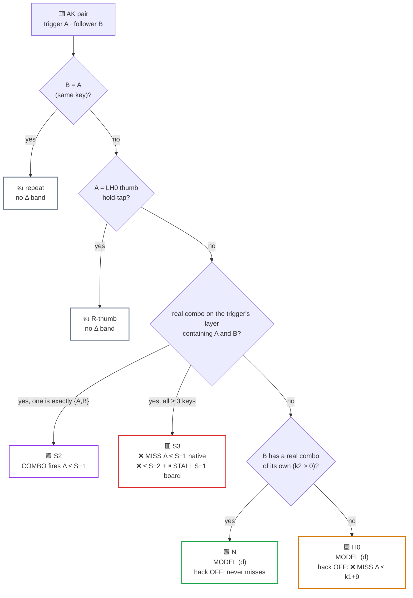
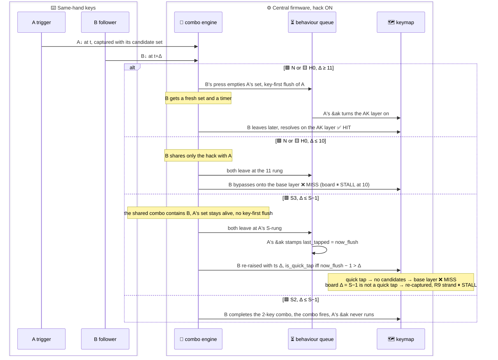

# ⌨️ PAIRS — every compiled AK pair on NAQUADAH: failure band, derivation, R2 validation

> [!note] Status
>
> - **Complete**
>   - 54 pairs enumerated from the compiled R2 devicetree
>   - Bands derived from MODEL R1–R9 + the T-23 shared-combo finding
>   - 21 R2 (real keymap) native_posix cases on 7 pairs, all run on 2026-10-01
> - **Verdict: derivation holds**
>   - All 21 outcomes are as predicted (HIT / MISS / COMBO, adapted letter, layer ids)
> - **One timing deviation, outcome unchanged**
>   - A MISSed follower whose base binding is a hold-tap (RT2 `&lk_bk`, LH0 `&blt_akR`) is force-decided TAP at delivery
>   - Log line: `decided tap (tap-preferred decision moment quick-tap)`
>   - Its char comes at t+23 (native), not at key-up

> [!note] Reading the bands
>
> - **Δ** = follower timestamp − trigger timestamp (engine time, integer ms)
> - **Board** = nRF52840 central (right half)
> - **Native** = native_posix (+1 ms per timer hop)
> - **Evidence:** 🧪 PROVEN by a test (S-xx = this sweep's logs, T-xx = earlier test) · 📜 PROVEN by source (`file:line`) · 🔮 PREDICTED (board-only) · 🧮 INFERRED (derived, not executed) · ❓ OPEN
> - **Outcome:** ✅ HIT · ❌ MISS · ⏸ STALL · ⚖️ tie / unresolved on hardware · 🟪 a real combo fires instead
> - **Classes:** 🟥 S3 · 🟪 S2 · 🟩 N · 🟨 H0 · 👍 R-thumb / repeat
> - **†** = superseded timer-phase line, kept verbatim → erratum in 📐 Band rules

## 🎯 Result

> [!important] What the page can state
>
> - 🟩🟨 **45 of 54 pairs follow one rule** (with the consistency hack)
>   - Follower pressed ≤ 9 ms after its trigger → ❌ base letter
>   - At 10 ms → ⏸ the board strands it until the next key event (usually a late adaptation)
>   - From 11 ms up to ≈ 105–115 ms → ✅ adapts
> - 🟥🟪 **6 pairs are fragile well beyond 10 ms**, and the hack does not help them
>   - Their follower shares a real combo with the trigger
>   - That shared combo keeps the trigger's candidate set alive
>   - Both keys leave the combo engine together, at the combo's deadline
>   - The re-raised follower is quick-tap-bypassed onto the base layer
> - 👍 **R thumb + the 2 same-key repeats** → no timing band at all
> - **Without the hack** (upstream ZMK v0.3+)
>   - 🟩 34 ordinary pairs would never miss
>   - 🟨 11 hack-only-follower pairs would miss up to Δ ≈ 25
>   - 🟥🟪 6 shared-combo pairs would behave exactly as they do now

### 🔢 54 pairs, 6 classes

- **A pair** = an AK-layer position whose compiled binding differs from layer 0
  - "23 pairs" in MODEL/CLAIMS/D means the 23 AK layers
  - D §10's 75 non-`&trans` cells include 21 trigger cells that equal the base binding (📜 compiled `zephyr.dts`, layers 2–24)
    - The 2 trigger cells that differ, `&ak 10 E` on l_akhE and `&ak 17 R` on l_akR, are the 2 repeat pairs

| class | rule | pairs | hands |
|---|---|---|---|
| 🟥 **S3** | follower shares only ≥3-key real combos with the trigger | 2: H→RM2 (capsWord 18), L→LB3 (magicCloseQuitCb 16) | 1 R-R, 1 L-L |
| 🟪 **S2** | follower + trigger = a 2-key real combo | 4: M→LT3, W→LT2 (typeZ 16), D→LB0, V→LB1 (tab 16) | L-L |
| 🟩 **N** | no shared real combo, follower has its own real combo (k2 16/18) | 34 | 24 L-L, 10 R-R |
| 🟨 **H0** | no shared real combo, follower is hack-only (k2 = 0) | 11: B→LM4, D→LT4, D→LM4, G→LM4, G→LB4, L→LT4, N→LT4, P→LM4, S→LT4, S→LH0, W→LT4 | L-L |
| 👍 **R-thumb** | trigger = LH0 hold-tap (`&blt_akR`) | 1: R→LT4 | L-L |
| 👍 **repeat** | same physical key, AK binding ≠ base | 2: E→RM2 on l_akhE (`&ak 10 E` vs `&ak 6 E`), R→LH0 on l_akR (`&ak 17 R` vs `&blt_akR`) | 1 R-R, 1 L-L |

### 🟥🟪 6 pairs fragile beyond 10 ms, with or without the hack

In each, the follower shares a real combo with its trigger.

| pair | keys | shared real combo | board band | on screen | hand |
|---|---|---|---|---|---|
| 🟥 **H→E key** | RM4→RM2 | capsWord 18 ms | ❌ MISS Δ ≤ 16 · ⏸ STALL 17 | E either way (layer differs, below) | R-R |
| 🟥 **L→G key** | LB2→LB3 | magicCloseQuitCb 16 ms | ❌ MISS Δ ≤ 14 · ⏸ STALL 15 | "lg" instead of "ll" | L-L |
| 🟪 **M→W key** | LT2→LT3 | typeZ 16 ms | 🟪 Δ ≤ 15 fires the combo, board and native | **Z** instead of any letter | L-L |
| 🟪 **W→M key** | LT3→LT2 | typeZ 16 ms | 🟪 Δ ≤ 15 fires the combo, board and native | **Z** instead of any letter | L-L |
| 🟪 **D→V key** | LB1→LB0 | tab 16 ms | 🟪 Δ ≤ 15 fires the combo, board and native | **Tab** (tap) / ⌘Tab (linger) instead of any letter | L-L |
| 🟪 **V→D key** | LB0→LB1 | tab 16 ms | 🟪 Δ ≤ 15 fires the combo, board and native | **Tab** (tap) / ⌘Tab (linger) instead of any letter | L-L |

- 🟥 **H→E is invisible in the pair's own output**
  - E is typed either way
  - What changes is the layer that gets armed: akE 6 instead of akhE 10
  - Only a 3rd key on RB1 shows it: Y becomes U ("u" not "y")
- 🟪 **M↔W and D↔V are 2-key combos in their own right**
  - Any roll under 16 ms types Z or Tab instead
- 📡 **All except H→E sit on the left (BLE) half**
  - The 7.5 ms connection grid blurs the boundary there

### 🟩🟨 45 pairs follow MODEL (d) exactly (34 N + 11 H0)

- **Native** → ❌ MISS Δ ≤ 10, then ✅ HIT
- **Board** → ❌ MISS Δ ≤ 9 · ⏸ STALL at 10 · ✅ HIT from 11 up to the window edge
- **Hack OFF**
  - 🟩 The 34 N pairs never miss
  - 🟨 The 11 H0 pairs miss for Δ ≤ 25 on the board (k1 = 16 for all 11)

### 👍 R thumb (R→LT4) and the 2 repeats have no Δ band

- R's layer turns on at the thumb's tap decision (0 ms nested tap, 🧪 T-14)
- A follower pressed during the hold is re-raised onto l_akR (🧪 T-13 d)

### 📡 No cross-hand pair

- **42 pairs are L-L**
  - Both keys arrive over BLE from the peripheral
  - The apparent Δ is quantised to the 7.5 ms anchor grid (🧮 INFERRED, T-24)
- **12 pairs are R-R** (central, Δ preserved ±1)
- 5 of the 6 fragile pairs are L-L; H→E is R-R

### 🧪 Validation: 21/21 outcomes as predicted

- 🟥 **S3 16** → L→LB3 14/17
- 🟪 **S2 16** → M→LT3 5/14/15/16/17 + hack-off 15
- 🟥 **S3 18** → H→RM2 16/17/18/19 + hack-off 17
- 🟨 **H0** → N→LT4 10/11, S→LH0 10/11
- 🟩 **N** → O→RT3 10/11, A→RT2 10/11
- With T-23 (L→LB3 5/13/15/16, hack-off 13/20/28) → both 16- and 18-ms shared-combo boundaries are bracketed on native

## 📐 Band rules

> [!tip] Check out MODEL.md for the rules behind every band
>
> [MODEL.md](MODEL.md) holds:
>
> - Combo-engine rules R1–R9 cited here (R6, R7, R9)
> - The board time convention behind the † erratum
> - The full erratum for this page (→ 🔢 Per-pair bands, "Erratum for PAIRS.md")
>
> MODEL (c), (d) and (e) are section letters of the model this sweep corrects → [research/MODEL-v1-predictions.md](research/MODEL-v1-predictions.md)

### 🔣 Symbols

- `k1` = longest real combo containing the trigger, active on the layer the trigger is pressed on
  - That is layer 0, or layer 9 for the hE trigger
- `k2` = the same for the follower
  - Identical on the AK layer, checked for all 54 pairs
- `S` = longest real combo containing **both** keys (0 if none)
- `dA = max(11, k1)`, `d2 = max(11, k2)` with the hack
  - Without it: `k1`, `k2` (0 = delivered immediately)
- `now_flush` = `k_uptime_get()` when the trigger's `&ak` runs
  - Board: the rung fires at `deadline + δ`, δ ∈ (0.03, 1.05] → `now_flush` = deadline in ~95 %, deadline + 1 in ~5 % †
  - Native: deadline + 1 exactly
- `E_b` = board upper window edge, `E_n` = native last HIT (= E_b + 1) → 🪟 Upper window edge

> [!warning] Erratum: the † timer-phase lines are superseded, R13 is refuted
>
> The source's board-timer phase figures are kept verbatim but no longer hold as written
>
> - Superseded: δ ∈ (0.03, 1.05] ms, and the ≈95 % / ≈5 % split of `now_flush`
> - Board timers are late by ≤ 0.061 ms per hop
> - The ~1 ms phase applies only to left-hand (BLE-stamped) keys → ❓ OPEN
>
> Where the † lines sit:
>
> - 🔣 Symbols → the `now_flush` board line
> - 📏 Bands per class → 🟥 S3 board "(≈5 % MISS)"
> - 🗂️ Per-case evidence → 🔮 board line of S-H_RM2-d17 (R-R) and S-A_RT2-d10 (R-R): "≈5 % MISS"
> - 🗂️ Per-case evidence → 🔮 board line of S-N_LT4-d10 (L-L): "≈5 % MISS"
> - 🗂️ Per-case evidence → 🔮 board line of S-N_LT4-d11 (L-L): "no sub-ms risk"
>   - Outcome-only: the HIT holds, the margin can shrink to ≈ 0 for a BLE-stamped follower
>
> Also corrected after this sweep:
>
> - ⛔ 🧾 Corrections → "New: hack-OFF Δ = 0 strand" (R13) is refuted
>   - B's press runs `update_timeout_task()` with 0 candidates before `cleanup()` (📜 `combo.c:429-433`), so no stale equality survives
>   - 🧪 FIX-R13-eqmin: equal MIN at Δ = 14, B delivered by its own rung
> - 👍 R-thumb / repeat "no Δ band" holds only with an idle queue at the thumb-up
>
> Kept verbatim so the correction stays visible => **don't quote a † figure; the left-hand phase effect stays ❓ OPEN**
>
> _Correction record: [results/CORRECTIONS-FINAL.md](results/CORRECTIONS-FINAL.md), RVB-03 in [results/REVIEW-B.md](results/REVIEW-B.md), RVA-12 + FIX-R13-eqmin in [results/FIX-LOG.md](results/FIX-LOG.md); full list in [MODEL.md](MODEL.md) "Erratum for PAIRS.md"_

### 🌳 Which class is a pair?



### 📏 Bands per class (hack ON = current firmware)

| class | native_posix | board | hack OFF (= upstream v0.3+) |
|---|---|---|---|
| 🟥 S3 | ❌ MISS Δ ≤ S−1 · ✅ HIT S…E_n | ❌ MISS Δ ≤ S−2 · ⏸ STALL S−1 (≈5 % MISS †) · ✅ HIT S…E_b−1 · ⚖️ E_b | identical to hack ON |
| 🟪 S2 | 🟪 COMBO Δ ≤ S−1 · ✅ HIT S…E_n | 🟪 COMBO Δ ≤ S−1 · ✅ HIT S…E_b−1 · ⚖️ E_b | identical |
| 🟩 N | ❌ MISS Δ ≤ 10 · ✅ HIT 11…E_n | ❌ MISS Δ ≤ 9 · ⏸ STALL 10 · ✅ HIT 11…E_b−1 · ⚖️ E_b | ✅ HIT Δ ≥ 0 … |
| 🟨 H0 | as N | as N | board ❌ MISS Δ ≤ k1+9 · ⚖️ k1+10 · ✅ HIT k1+11… (native: MISS ≤ k1+11, tie k1+12 resolved layer-first, T-23 e4) |
| 👍 R-thumb | ✅ HIT for follower↓ in [thumb↓, thumb↑+88] | ⚖️ at thumb↑+89 | ✅ HIT to thumb↑+99 |
| 👍 repeat | no band | no band | no band |

> [!note] Two source tensions, settled
>
> - 🟪 **S2 board** — the source said "same" as native; it is the N band once Δ ≥ S, so the board edge is E_b − 1 with ⚖️ at E_b, as the 📊 Band profiles table gives
>   - From Δ = S on, B's press empties A's set and B gets a fresh set, the N path (🧪 S-M_LT3-d16 `[00:00:00.032,000] … remaining_candidates=0 timestamp=32` → `reraising position event 1` → `capturing position event 1`)
>   - The edge of that path is 🧪 T-12-b-d110/d111/d112 for a 16/16 pair: native HIT 110, 111, MISS 112 → E_b = 110, E_n = 111
> - 🟩 **N hack OFF = ✅ HIT Δ ≥ 0** stands; the 🧮 Δ = 0 equal-deadline strand (R13) that contradicted it is ⛔ refuted
>   - 📜 `combo.c:429-433`: B's press runs `update_timeout_task()` with 0 candidates before `cleanup()`, so no stale deadline survives to B's re-raise
>   - 🧪 FIX-R13-eqmin, equal MIN at Δ = 14: `[00:00:00.045,000] … remaining_candidates=0 timestamp=44` → `releasing position event 2`, B delivered by its own rung
>   - Δ = 0 itself is unreachable on the mock (1 ms minimum gap) → that cell is 🧮 from the same code path

### ⚙️ Mechanism per class



- 🟥 **S3**
  - B's press keeps A's candidate set alive: the shared combo contains B (📜 `combo.c:163-195`)
  - No key-first flush
  - Both leave at A's S-rung (📜 `:472-481`)
  - A's `&ak` stamps `last_tapped = now_flush` (📜 `bq:35`, `combo.c:496-502`)
  - B is re-raised with ts Δ → `is_quick_tap` iff `now_flush − 1 > Δ` (📜 `:141-143`) → no candidates → base layer
  - On the board `now_flush` = S, so Δ = S−1 is not a quick tap
    - B is re-captured inside the handler → R9 strand
- 🟪 **S2**
  - B completes the 2-key combo
  - Hack alive (Δ < 11) → pending (R7), fires at the S-rung or first release
  - Hack gone (11 ≤ Δ < S) → the only candidate, fires at Δ (📜 `:442-447`)
  - A's `&ak` never runs
  - At Δ = S the combo is out (📜 `:228` strict `>`)
- 🟩 **N** = MODEL (d)
  - B shares only the hack
  - Both leave at the 11 rung → bypass
  - From 11 on, B's press empties A's set → key-first flush → B gets a fresh set and a timer
- 🟨 **H0** = MODEL (d)
  - Without the hack, B has no candidate → delivered immediately, before A's layer (k1+10)
- 👍 **R-thumb** = tap-preferred 200 ms hold-tap
  - `ak_R_macro` runs outside the queue → layer ON at the tap decision (🧪 T-14)
  - A follower pressed during the hold is captured by the hold-tap and re-raised onto l_akR (🧪 T-13 d)
  - Thumb held ≥ 200 → nav hold, no R
- 👍 **repeat**
  - 2nd press needs the 1st release
  - The release flushes A (R6), so the layer comes on ≤ 10 ms after it
  - The 2nd press is not a quick tap and waits ≥ 11 (hack) or 18 (E)
  - Thumb: 0 ms tap → layer on at the 1st release
  - Output letter identical either way

### 🪟 Upper window edge (MODEL (c), refined)

- **Board E_b = dA + 110 − d2**, hack ON
  - Hack OFF: `k1 + 110 − k2`
- **At Δ = E_b → ⚖️ unresolved on hardware** (F1)
  - The sticky-release timer and B's delivery timer have the same integer deadline
  - Which runs first is set by the firmware's own µs-scale latencies, not by the typist; this investigation could not determine the direction
  - Native resolves such ties timer-first (a harness fact, not the board's answer)
  - ✅ HIT for Δ ≤ E_b − 1, ❌ MISS for Δ ≥ E_b + 1
  - MODEL counts E_b itself as HIT
- **Native last HIT = E_b + 1**
  - 🧪 T-12: T→LB3 HIT at 111, MISS at 112; E_b = 110

| pairs | E_b hack ON | hack OFF |
|---|---|---|
| 16/16 pairs | 110 | 110 |
| k1 = 18 pairs (A→RT2, E→RT1/RT3, hE→RT1/RT3/RB1) | 112 | 112 |
| Y→RM4 (k2 = 18) | 108 | 108 |
| k1 = 0 triggers (C→LT1, C→LB3, F→LB3, X→LM3) | 105 | 94 |
| H0 (d2 = 11) | 115 | 126 |

## 📋 All 54 pairs (sorted worst first: board hack-ON band, then hack-OFF band)

- **Column key**
  - `k1`/`k2` = longest real combo (ms) on the trigger's layer, 0 = none
  - `hack-only`: T0 = trigger has no real combo · F0 = follower has none · rep = same key
  - `miss → adapted`: `X·akN` = `&ak N X` (types X, arms layer N) · `⌫XY` = `replace_char_with_bigram_XY`
  - `hand`: L-L = both via BLE · R-R = central
  - `bands` → the 📊 band profile the pair follows
- **Band notation**
  - Δ in ms · `…N` = last HIT · ⚖️ = tie, unresolved on hardware (F1)
  - Every band is 🧮 derived from 📐 Band rules · board columns are 🔮 · a native point is 🧪 only where an S-case or T-xx ran it
- **Sources**
  - Combos and keymap from the compiled `zephyr.dts` of case T-23-a-MT-d5 (28 combos)
    - Build output, gitignored: `zmk/app/build/zmk-config-timing/T-23-a-MT-d5/zephyr/zephyr.dts`; regenerate with `tests/timing/run.sh T-23-a-MT-d5`
  - Binding names from the investigation's preprocessed copy `tmp-cpp/expanded_symbolic.dts` (scratch, not in the repo), cross-checked cell by cell (non-`&trans` sets and behaviour names identical for layers 0–24)
  - That copy's `tmp-cpp/config` was byte-identical to `zmk-config/config` (`diff -r`: only an extra nested `config/` dir in the copy)

### 📊 Band profiles

| bands | pairs (#) | native, hack ON | board, hack ON | board, hack OFF | window edge ON / OFF |
|---|---|---|---|---|---|
| 🟥 `S3-18` | 1 (#1) | ❌ MISS Δ≤17 · ✅ HIT 18…111 | ❌ MISS Δ≤16 · ⏸ STALL 17 · ✅ HIT 18…109 · ⚖️110 | ❌ MISS Δ≤16 · ⏸ STALL 17 · ✅ HIT 18…109 · ⚖️110 | 110 / 110 |
| 🟥 `S3-16` | 1 (#2) | ❌ MISS Δ≤15 · ✅ HIT 16…111 | ❌ MISS Δ≤14 · ⏸ STALL 15 · ✅ HIT 16…109 · ⚖️110 | ❌ MISS Δ≤14 · ⏸ STALL 15 · ✅ HIT 16…109 · ⚖️110 | 110 / 110 |
| 🟪 `S2` | 4 (#3–6) | 🟪 COMBO Δ≤15 · ✅ HIT 16…111 | 🟪 COMBO Δ≤15 · ✅ HIT 16…109 · ⚖️110 | 🟪 COMBO Δ≤15 · ✅ HIT 16…109 · ⚖️110 | 110 / 110 |
| 🟨 `H0` | 11 (#7–17) | ❌ MISS Δ≤10 · ✅ HIT 11…116 | ❌ MISS Δ≤9 · ⏸ STALL 10 · ✅ HIT 11…114 · ⚖️115 | ❌ MISS Δ≤25 · ⚖️26 · ✅ HIT 27…125 · ⚖️126 | 115 / 126 |
| 🟩 `N-110` | 23 (#19–20, 23–24, 28–29, 33–49) | ❌ MISS Δ≤10 · ✅ HIT 11…111 | ❌ MISS Δ≤9 · ⏸ STALL 10 · ✅ HIT 11…109 · ⚖️110 | ✅ HIT 0…109 · ⚖️110 | 110 / 110 |
| 🟩 `N-112` | 6 (#18, 25–26, 30–32) | ❌ MISS Δ≤10 · ✅ HIT 11…113 | ❌ MISS Δ≤9 · ⏸ STALL 10 · ✅ HIT 11…111 · ⚖️112 | ✅ HIT 0…111 · ⚖️112 | 112 / 112 |
| 🟩 `N-108` | 1 (#51) | ❌ MISS Δ≤10 · ✅ HIT 11…109 | ❌ MISS Δ≤9 · ⏸ STALL 10 · ✅ HIT 11…107 · ⚖️108 | ✅ HIT 0…107 · ⚖️108 | 108 / 108 |
| 🟩 `N-105` | 4 (#21–22, 27, 50) | ❌ MISS Δ≤10 · ✅ HIT 11…106 | ❌ MISS Δ≤9 · ⏸ STALL 10 · ✅ HIT 11…104 · ⚖️105 | ✅ HIT 0…93 · ⚖️94 | 105 / 94 |

- 👍 **`thumb`** (#52), window edge thumb↑+89 / thumb↑+100
  - Native, hack ON → no Δ band: HIT for follower↓ anywhere in [thumb↓, thumb↑+88] (thumb↑ < 200 = tap)
  - Board, hack ON → no Δ band: HIT for follower↓ in [thumb↓, thumb↑+88], ⚖️ thumb↑+89
  - Board, hack OFF → no Δ band: HIT for follower↓ in [thumb↓, thumb↑+99], ⚖️ thumb↑+100
- 👍 **`rep-E`** (#53), window edge 110 / 110
  - All three columns → no Δ band (same key: 2nd↓ after 1st↑; 1st flushed at its ↑ or at 18, layer ≤ +10; 2nd held ≥ 11) → HIT to edge
- 👍 **`rep-R`** (#54), window edge 110 / 110
  - Native + board, hack ON → no Δ band (thumb tap = 0 ms nested &ak → layer on at 1st↑; 2nd↓ held ≥ 11 by the hack) → HIT to edge
  - Board, hack OFF → no Δ band (0 ms tap: layer on at 1st↑, before any 2nd↓) → HIT to edge

### 🗃️ Pair table

| # | class | layer | trigger (k1) | follower pos (base key) | k2 | real combos shared by BOTH | hack-only | miss → adapted output | hand | bands |
|---|---|---|---|---|---|---|---|---|---|---|
| 1 | 🟥 S3 | l_akH | H RM4 (18) | RM2 (E) | 18 | capsWord(RM1/RM2/RM3/RM4,18ms,4-key) | — | E·ak6 → E·ak10 | R-R | `S3-18` |
| 2 | 🟥 S3 | l_akL | L LB2 (16) | LB3 (G) | 16 | magicCloseQuitCb(LB3/LB2/LB1,16ms,3-key) | — | G·ak8 → L | L-L | `S3-16` |
| 3 | 🟪 S2 | l_akD | D LB1 (16) | LB0 (V) | 16 | tab(LB1/LB0,16ms,2-key) | — | **Tab (tap) / ⌘Tab (linger)** (combo, Δ<16) · V·ak21 → ⌫LV | L-L | `S2` |
| 4 | 🟪 S2 | l_akM | M LT2 (16) | LT3 (W) | 16 | typeZ(LT3/LT2,16ms,2-key) | — | **Z** (combo, Δ<16) · W·ak22 → M | L-L | `S2` |
| 5 | 🟪 S2 | l_akV | V LB0 (16) | LB1 (D) | 16 | tab(LB1/LB0,16ms,2-key) | — | **Tab (tap) / ⌘Tab (linger)** (combo, Δ<16) · D·ak5 → L | L-L | `S2` |
| 6 | 🟪 S2 | l_akW | W LT3 (16) | LT2 (M) | 16 | typeZ(LT3/LT2,16ms,2-key) | — | **Z** (combo, Δ<16) · M·ak13 → ⌫LM | L-L | `S2` |
| 7 | 🟨 H0 | l_akB | B LM0 (16) | LM4 (C) | 0 | — | F0 | C·ak4 → B | L-L | `H0` |
| 8 | 🟨 H0 | l_akD | D LB1 (16) | LM4 (C) | 0 | — | F0 | C·ak4 → D | L-L | `H0` |
| 9 | 🟨 H0 | l_akD | D LB1 (16) | LT4 (X) | 0 | — | F0 | X·ak23 → V | L-L | `H0` |
| 10 | 🟨 H0 | l_akG | G LB3 (16) | LB4 (F) | 0 | — | F0 | F·ak7 → S | L-L | `H0` |
| 11 | 🟨 H0 | l_akG | G LB3 (16) | LM4 (C) | 0 | — | F0 | C·ak4 → G | L-L | `H0` |
| 12 | 🟨 H0 | l_akL | L LB2 (16) | LT4 (X) | 0 | — | F0 | X·ak23 → G | L-L | `H0` |
| 13 | 🟨 H0 | l_akN | N LM2 (16) | LT4 (X) | 0 | — | F0 | X·ak23 → M | L-L | `H0` |
| 14 | 🟨 H0 | l_akP | P LT1 (16) | LM4 (C) | 0 | — | F0 | C·ak4 → T | L-L | `H0` |
| 15 | 🟨 H0 | l_akS | S LM3 (16) | LH0 (R) | 0 | — | F0 | R (tap) / nav (hold) → W | L-L | `H0` |
| 16 | 🟨 H0 | l_akS | S LM3 (16) | LT4 (X) | 0 | — | F0 | X·ak23 → F | L-L | `H0` |
| 17 | 🟨 H0 | l_akW | W LT3 (16) | LT4 (X) | 0 | — | F0 | X·ak23 → S | L-L | `H0` |
| 18 | 🟩 N | l_akA | A RM1 (18) | RT2 (=) | 16 | — | — | = (tap) / - (linger) → U | R-R | `N-112` |
| 19 | 🟩 N | l_akB | B LM0 (16) | LB1 (D) | 16 | — | — | D·ak5 → L | L-L | `N-110` |
| 20 | 🟩 N | l_akB | B LM0 (16) | LB3 (G) | 16 | — | — | G·ak8 → L | L-L | `N-110` |
| 21 | 🟩 N | l_akC | C LM4 (0) | LB3 (G) | 16 | — | T0 | G·ak8 → C | L-L | `N-105` |
| 22 | 🟩 N | l_akC | C LM4 (0) | LT1 (P) | 16 | — | T0 | P·ak16 → ⌫TP | L-L | `N-105` |
| 23 | 🟩 N | l_akD | D LB1 (16) | LM0 (B) | 16 | — | — | B·ak3 → ⌫LB | L-L | `N-110` |
| 24 | 🟩 N | l_akD | D LB1 (16) | LT0 (K) | 16 | — | — | K·ak11 → ⌫LK | L-L | `N-110` |
| 25 | 🟩 N | l_akE | E RM2 (18) | RT1 (.) | 16 | — | — | . (tap) / : (linger) → E | R-R | `N-112` |
| 26 | 🟩 N | l_akE | E RM2 (18) | RT3 (-) | 16 | — | — | - → O | R-R | `N-112` |
| 27 | 🟩 N | l_akF | F LB4 (0) | LB3 (G) | 16 | — | T0 | G·ak8 → F | L-L | `N-105` |
| 28 | 🟩 N | l_akG | G LB3 (16) | LT0 (K) | 16 | — | — | K·ak11 → ⌫LK | L-L | `N-110` |
| 29 | 🟩 N | l_akG | G LB3 (16) | LT1 (P) | 16 | — | — | P·ak16 → ⌫LP | L-L | `N-110` |
| 30 | 🟩 N | l_akhE | E RM2 (18) via l_akH | RB1 (U) | 16 | — | — | U·ak20 → Y | R-R | `N-112` |
| 31 | 🟩 N | l_akhE | E RM2 (18) via l_akH | RT1 (.) | 16 | — | — | . (tap) / : (linger) → E | R-R | `N-112` |
| 32 | 🟩 N | l_akhE | E RM2 (18) via l_akH | RT3 (-) | 16 | — | — | - → O | R-R | `N-112` |
| 33 | 🟩 N | l_akK | K LT0 (16) | LB1 (D) | 16 | — | — | D·ak5 → L | L-L | `N-110` |
| 34 | 🟩 N | l_akK | K LT0 (16) | LB3 (G) | 16 | — | — | G·ak8 → L | L-L | `N-110` |
| 35 | 🟩 N | l_akK | K LT0 (16) | LT2 (M) | 16 | — | — | M·ak13 → ⌫BM | L-L | `N-110` |
| 36 | 🟩 N | l_akM | M LT2 (16) | LM1 (T) | 16 | — | — | T·ak19 → N | L-L | `N-110` |
| 37 | 🟩 N | l_akM | M LT2 (16) | LT0 (K) | 16 | — | — | K·ak11 → B·ak3 | L-L | `N-110` |
| 38 | 🟩 N | l_akN | N LM2 (16) | LT3 (W) | 16 | — | — | W·ak22 → N | L-L | `N-110` |
| 39 | 🟩 N | l_akO | O RB2 (16) | RT1 (.) | 16 | — | — | . (tap) / : (linger) → O | R-R | `N-110` |
| 40 | 🟩 N | l_akO | O RB2 (16) | RT3 (-) | 16 | — | — | - → E | R-R | `N-110` |
| 41 | 🟩 N | l_akP | P LT1 (16) | LB3 (G) | 16 | — | — | G·ak8 → L | L-L | `N-110` |
| 42 | 🟩 N | l_akP | P LT1 (16) | LM0 (B) | 16 | — | — | B·ak3 → ⌫NB | L-L | `N-110` |
| 43 | 🟩 N | l_akP | P LT1 (16) | LM2 (N) | 16 | — | — | N·ak14 → D | L-L | `N-110` |
| 44 | 🟩 N | l_akP | P LT1 (16) | LT3 (W) | 16 | — | — | W·ak22 → P | L-L | `N-110` |
| 45 | 🟩 N | l_akS | S LM3 (16) | LB1 (D) | 16 | — | — | D·ak5 → S | L-L | `N-110` |
| 46 | 🟩 N | l_akT | T LM1 (16) | LB0 (V) | 16 | — | — | V·ak21 → ⌫NV | L-L | `N-110` |
| 47 | 🟩 N | l_akT | T LM1 (16) | LB3 (G) | 16 | — | — | G·ak8 → T | L-L | `N-110` |
| 48 | 🟩 N | l_akU | U RB1 (16) | RT2 (=) | 16 | — | — | = (tap) / - (linger) → A | R-R | `N-110` |
| 49 | 🟩 N | l_akV | V LB0 (16) | LM1 (T) | 16 | — | — | T·ak19 → N | L-L | `N-110` |
| 50 | 🟩 N | l_akX | X LT4 (0) | LM3 (S) | 16 | — | T0 | S·ak18 → C | L-L | `N-105` |
| 51 | 🟩 N | l_akY | Y RB3 (16) | RM4 (H) | 18 | — | — | H·ak9 → I | R-R | `N-108` |
| 52 | 👍 R-thumb | l_akR | R LH0 (0) | LT4 (X) | 0 | — | T0 F0 | X·ak23 → R | L-L | `thumb` |
| 53 | 👍 repeat | l_akhE | E RM2 (18) via l_akH | RM2 (E) | 18 | — | rep | E·ak6 → E·ak10 | R-R | `rep-E` |
| 54 | 👍 repeat | l_akR | R LH0 (0) | LH0 (R) | 0 | — | T0 F0 rep | R (tap) / nav (hold) → R·ak17 | L-L | `rep-R` |

## 🧪 Validation (R2 = Flo's real keymap, native_posix)

### 🛠️ Rig

- **Cases** → [tests/timing/cases/](../../tests/timing/cases/) `S-<pair>-d<Δ>[-nohack]` (run during the investigation as `zmk/app/tests/ak-truth/S-*`)
  - Generated by `tests/timing/tools/S.mkcases.py` from `_rig_R2` (template untouched)
  - Only the `&kscan { events }` block is appended
  - `-nohack` adds `/ { combos { /delete-node/ combo_ak_consistency_hack; }; };`
  - The compiled `zephyr.dts` of both `-nohack` cases has 0 `combo_ak_consistency_hack` nodes; hack-on cases have 1
- **Events** (RIG mock rule)
  - `PRESS(A, Δ−1)` → A↓ abs Δ = t
  - `PRESS(B, h1)` → B↓ t+Δ
  - `RELEASE(A, h2)` → A↑ t+Δ+h1+1
  - `RELEASE(B, 300)`
  - h1/h2 = 60/40 by default
  - 30/28 for the hold-tap-base followers (A_RT2, S_LH0), so B↑ falls at t+Δ+60, inside their 100/200 ms term
- **Integrity**
  - `sed 's/.*> //' raw.log | md5` == `md5 build/…/keycode_events_full.log` for **all 21** (builds under `zmk/app/build/zmk-config-timing/<case>/`)
  - A second `run-test.sh` (ZMK's runner, no auto-accept; today `tests/timing/run.sh`) → `PASS` for S-H_RM2-d17, S-M_LT3-d15 and S-N_LT4-d11
  - A second `--no-rt` run of S-H_RM2-d17 gave the same raw-log md5 `13915840f47a6001318c9dd752695234`
- **🔮 Board column**
  - Subtract native's +1 per timer hop (combo rung, queue tick)
  - Key-driven flushes carry no offset
  - ⏸ STALL = re-captured inside the rung handler (R9), delivered at the next position event
  - In these schedules that is A↑

### 🔬 Bracket picture (native, observed; T-23 rows marked)

| Δ | 5 | 13 | 14 | 15 | 16 | 17 | 18 | 19 |
|---|---|---|---|---|---|---|---|---|
| 🟥 L→LB3 (S3/16) | ❌ T-23 | ❌ T-23 (also hack off) | ❌ | ❌ T-23 | ✅ T-23 | ✅ | · | · |
| 🟪 M→LT3 (S2/16) | 🟪 Z | · | 🟪 Z | 🟪 Z (also hack off) | ✅ | ✅ | · | · |
| 🟥 H→RM2 (S3/18) | · | · | · | · | ❌ | ❌ (also hack off) | ✅ | ✅ |

| Δ | 10 | 11 |
|---|---|---|
| 🟨 N→LT4 (H0) | ❌ "NX" | ✅ "NM" |
| 🟨 S→LH0 (H0, thumb) | ❌ "SR" | ✅ "SW" |
| 🟩 O→RT3 (N) | ❌ "O-" | ✅ "OE" |
| 🟩 A→RT2 (N, k1 18) | ❌ "A=" | ✅ "AU" |

- `·` = no case at that Δ

### ⚠️ Deviations (facts)

1. **S-A_RT2-d10**
   - Predicted `=` at RT2↑ (t+70)
   - Observed `decide_hold_tap: 7 decided tap (tap-preferred decision moment quick-tap)` at `[00:00:00.022,000]` and `keycode 0x2E` at `[00:00:00.033,000]` = t+23
   - Cause: the `lk_bk` hold-tap is created at t+12 with its original ts t+10
     - A's `kp` was stamped t+12 → `ht:142-147` `is_quick_tap` → TAP at once (MODEL (e), T-16)
   - Outcome (MISS, `=`) as predicted
2. **S-S_LH0-d10** = same mechanism on the thumb
   - `decide_hold_tap: 32 decided tap (… quick-tap)` `[00:00:00.022,000]`, R `keycode 0x15` at t+23
   - The thumb's `ak_R_macro` ran while S's queue item was pending
   - There is no 0 ms nested tap here: R↓ t+23, `layer 17 state 1` at t+34 (`[00:00:00.044,000]`)
   - Outcome (MISS, "SR") as predicted
3. **No other deviation**
   - The other 19 cases match the prediction to the ms
   - All 21 HID sequences, delivery layers and layer ids match the prediction; only the char time of items 1–2 differs

> [!note] Item 3 vs items 1–2, settled
>
> - One deviation, the forced TAP of a hold-tap-base follower, seen in 2 cases; the outcome is unchanged
>   - 🧪 S-A_RT2-d10 `[00:00:00.033,000] … keycode 0x2E` and S-S_LH0-d10 `[00:00:00.033,000] … keycode 0x15` = t+23, predicted at B↑ = t+70
> - "To the ms" therefore holds for 19 of 21 cases, and for the HID sequence, delivery layer and layer ids of all 21

### 🗂️ Per-case evidence (verbatim, up to the first physical release)

- **Filter** (`tests/timing/tools/S.excerpt.py`) keeps
  - presses
  - combo capture / filter / flush
  - `layer_id:` deliveries
  - HID downs
  - `layer_changed`
  - hold-tap decisions
- It drops the per-event `bubble (no undecided hold_tap active)` line
  - Full logs: [tests/timing/logs/](../../tests/timing/logs/) `S-*.raw.log`
- **Keycodes:** G 0x0A · L 0x0F · M 0x10 · N 0x11 · O 0x12 · R 0x15 · S 0x16 · U 0x18 · W 0x1A · X 0x1B · Z 0x1D · H 0x0B · E 0x08 · A 0x04 · `-` 0x2D · `=` 0x2E
- **Layers:** l_akA 2 · l_akE 6 · l_akG 8 · l_akH 9 · l_akhE 10 · l_akL 12 · l_akM 13 · l_akN 14 · l_akO 15 · l_akR 17 · l_akS 18 · l_akX 23

#### S-L_LB3-d14 · native ❌ · board ❌

- **L→LB3 · 🟥 S3/16** · Δ 14 · hack on
- 🧮 **Predicted (native)** — MISS "LG": L t+17, G key on layer 0 t+17, G↓ t+28
- 🧪 **Observed (native, verbatim ts)** — ✓ as predicted
  - L↓ `[00:00:00.031,000]` (t+17)
  - `layer_id: 0 position: 21` `[00:00:00.031,000]`
  - `keycode 0x0A` `[00:00:00.042,000]` (t+28)
- 🔮 **Board (translated)** — MISS (Δ ≤ S−2): L ≈ t+16, G ≈ t+26

```log
[00:00:00.014,000] <dbg> zmk: zmk_physical_layouts_kscan_process_msgq: Row: 2, col: 3, position: 22, pressed: true
[00:00:00.014,000] <dbg> zmk: position_state_down: combo: capturing position event 22
[00:00:00.026,000] <dbg> zmk: filter_timed_out_candidates: after filtering out timed out combo candidates: remaining_candidates=2 timestamp=25
[00:00:00.028,000] <dbg> zmk: zmk_physical_layouts_kscan_process_msgq: Row: 2, col: 2, position: 21, pressed: true
[00:00:00.028,000] <dbg> zmk: filter_timed_out_candidates: after filtering out timed out combo candidates: remaining_candidates=2 timestamp=28
[00:00:00.028,000] <dbg> zmk: position_state_down: combo: capturing position event 21
[00:00:00.031,000] <dbg> zmk: filter_timed_out_candidates: after filtering out timed out combo candidates: remaining_candidates=0 timestamp=30
[00:00:00.031,000] <dbg> zmk: release_pressed_keys: combo: releasing position event 22
[00:00:00.031,000] <dbg> zmk: zmk_keymap_apply_position_state: layer_id: 0 position: 22, binding name: flo,behavior-adaptive-key
[00:00:00.031,000] <dbg> zmk: hid_listener_keycode_pressed: usage_page 0x07 keycode 0x0F implicit_mods 0x00 explicit_mods 0x00
[00:00:00.031,000] <dbg> zmk: release_pressed_keys: combo: reraising position event 21
[00:00:00.031,000] <dbg> zmk: zmk_keymap_apply_position_state: layer_id: 0 position: 21, binding name: flo,behavior-adaptive-key
[00:00:00.042,000] <dbg> zmk: set_layer_state: layer_changed: layer 12 state 1
[00:00:00.042,000] <dbg> zmk: hid_listener_keycode_pressed: usage_page 0x07 keycode 0x0A implicit_mods 0x00 explicit_mods 0x00
[00:00:00.053,000] <dbg> zmk: set_layer_state: layer_changed: layer 12 state 0
[00:00:00.053,000] <dbg> zmk: set_layer_state: layer_changed: layer 8 state 1
```

#### S-L_LB3-d17 · native ✅ · board ✅

- **L→LB3 · 🟥 S3/16** · Δ 17 · hack on
- 🧮 **Predicted (native)** — HIT "LL": L t+17, layer 12 t+28, LB3 → l_akL t+34
- 🧪 **Observed (native, verbatim ts)** — ✓ as predicted
  - rung first (`remaining_candidates=0 timestamp=33` before the `Row:` line, both `[00:00:00.034,000]`)
  - `layer 12 state 1` `[00:00:00.045,000]`
  - `layer_id: 12 position: 21 … buffered-key` + `keycode 0x0F` `[00:00:00.051,000]` (t+34)
- 🔮 **Board (translated)** — HIT: L ≈ t+16, layer ≈ t+26, 2nd L ≈ t+33

```log
[00:00:00.017,000] <dbg> zmk: zmk_physical_layouts_kscan_process_msgq: Row: 2, col: 3, position: 22, pressed: true
[00:00:00.017,000] <dbg> zmk: position_state_down: combo: capturing position event 22
[00:00:00.029,000] <dbg> zmk: filter_timed_out_candidates: after filtering out timed out combo candidates: remaining_candidates=2 timestamp=28
[00:00:00.034,000] <dbg> zmk: filter_timed_out_candidates: after filtering out timed out combo candidates: remaining_candidates=0 timestamp=33
[00:00:00.034,000] <dbg> zmk: release_pressed_keys: combo: releasing position event 22
[00:00:00.034,000] <dbg> zmk: zmk_keymap_apply_position_state: layer_id: 0 position: 22, binding name: flo,behavior-adaptive-key
[00:00:00.034,000] <dbg> zmk: hid_listener_keycode_pressed: usage_page 0x07 keycode 0x0F implicit_mods 0x00 explicit_mods 0x00
[00:00:00.034,000] <dbg> zmk: zmk_physical_layouts_kscan_process_msgq: Row: 2, col: 2, position: 21, pressed: true
[00:00:00.034,000] <dbg> zmk: position_state_down: combo: capturing position event 21
[00:00:00.045,000] <dbg> zmk: set_layer_state: layer_changed: layer 12 state 1
[00:00:00.046,000] <dbg> zmk: filter_timed_out_candidates: after filtering out timed out combo candidates: remaining_candidates=1 timestamp=45
[00:00:00.051,000] <dbg> zmk: filter_timed_out_candidates: after filtering out timed out combo candidates: remaining_candidates=0 timestamp=50
[00:00:00.051,000] <dbg> zmk: release_pressed_keys: combo: releasing position event 21
[00:00:00.051,000] <dbg> zmk: zmk_keymap_apply_position_state: layer_id: 12 position: 21, binding name: flo,behavior-buffered-key
[00:00:00.051,000] <dbg> zmk: hid_listener_keycode_pressed: usage_page 0x07 keycode 0x0F implicit_mods 0x00 explicit_mods 0x00
[00:00:00.062,000] <dbg> zmk: set_layer_state: layer_changed: layer 12 state 0
```

#### S-M_LT3-d5 · native 🟪 · board 🟪

- **M→LT3 · 🟪 S2/16** · Δ 5 · hack on
- 🧮 **Predicted (native)** — COMBO Z at the 16 rung, t+17; no M, no W
- 🧪 **Observed (native, verbatim ts)** — ✓ as predicted
  - `remaining_candidates=1 timestamp=16` `[00:00:00.017,000]`
  - `remaining_candidates=0 timestamp=21` + `keycode 0x1D` `[00:00:00.022,000]` (t+17)
- 🔮 **Board (translated)** — COMBO Z ≈ t+16

```log
[00:00:00.005,000] <dbg> zmk: zmk_physical_layouts_kscan_process_msgq: Row: 0, col: 3, position: 2, pressed: true
[00:00:00.005,000] <dbg> zmk: position_state_down: combo: capturing position event 2
[00:00:00.010,000] <dbg> zmk: zmk_physical_layouts_kscan_process_msgq: Row: 0, col: 2, position: 1, pressed: true
[00:00:00.010,000] <dbg> zmk: filter_timed_out_candidates: after filtering out timed out combo candidates: remaining_candidates=3 timestamp=10
[00:00:00.010,000] <dbg> zmk: position_state_down: combo: capturing position event 1
[00:00:00.017,000] <dbg> zmk: filter_timed_out_candidates: after filtering out timed out combo candidates: remaining_candidates=1 timestamp=16
[00:00:00.022,000] <dbg> zmk: filter_timed_out_candidates: after filtering out timed out combo candidates: remaining_candidates=0 timestamp=21
[00:00:00.022,000] <dbg> zmk: hid_listener_keycode_pressed: usage_page 0x07 keycode 0x1D implicit_mods 0x00 explicit_mods 0x00
```

#### S-M_LT3-d14 · native 🟪 · board 🟪

- **M→LT3 · 🟪 S2/16** · Δ 14 · hack on
- 🧮 **Predicted (native)** — COMBO Z at Δ (sole candidate), t+14
- 🧪 **Observed (native, verbatim ts)** — ✓ as predicted
  - `keycode 0x1D` `[00:00:00.028,000]` (t+14)
  - same ms as LT3's `Row:`
- 🔮 **Board (translated)** — COMBO Z t+14

```log
[00:00:00.014,000] <dbg> zmk: zmk_physical_layouts_kscan_process_msgq: Row: 0, col: 3, position: 2, pressed: true
[00:00:00.014,000] <dbg> zmk: position_state_down: combo: capturing position event 2
[00:00:00.026,000] <dbg> zmk: filter_timed_out_candidates: after filtering out timed out combo candidates: remaining_candidates=2 timestamp=25
[00:00:00.028,000] <dbg> zmk: zmk_physical_layouts_kscan_process_msgq: Row: 0, col: 2, position: 1, pressed: true
[00:00:00.028,000] <dbg> zmk: filter_timed_out_candidates: after filtering out timed out combo candidates: remaining_candidates=2 timestamp=28
[00:00:00.028,000] <dbg> zmk: position_state_down: combo: capturing position event 1
[00:00:00.028,000] <dbg> zmk: hid_listener_keycode_pressed: usage_page 0x07 keycode 0x1D implicit_mods 0x00 explicit_mods 0x00
```

#### S-M_LT3-d15 · native 🟪 · board 🟪

- **M→LT3 · 🟪 S2/16** · Δ 15 · hack on
- 🧮 **Predicted (native)** — COMBO Z t+15
- 🧪 **Observed (native, verbatim ts)** — ✓ as predicted
  - `keycode 0x1D` `[00:00:00.030,000]` (t+15)
- 🔮 **Board (translated)** — COMBO Z t+15

```log
[00:00:00.015,000] <dbg> zmk: zmk_physical_layouts_kscan_process_msgq: Row: 0, col: 3, position: 2, pressed: true
[00:00:00.015,000] <dbg> zmk: position_state_down: combo: capturing position event 2
[00:00:00.027,000] <dbg> zmk: filter_timed_out_candidates: after filtering out timed out combo candidates: remaining_candidates=2 timestamp=26
[00:00:00.030,000] <dbg> zmk: zmk_physical_layouts_kscan_process_msgq: Row: 0, col: 2, position: 1, pressed: true
[00:00:00.030,000] <dbg> zmk: filter_timed_out_candidates: after filtering out timed out combo candidates: remaining_candidates=2 timestamp=30
[00:00:00.030,000] <dbg> zmk: position_state_down: combo: capturing position event 1
[00:00:00.030,000] <dbg> zmk: hid_listener_keycode_pressed: usage_page 0x07 keycode 0x1D implicit_mods 0x00 explicit_mods 0x00
```

#### S-M_LT3-d15-nohack · native 🟪 · board 🟪

- **M→LT3 · 🟪 S2/16** · Δ 15 · hack **off**
- 🧮 **Predicted (native)** — COMBO Z t+15 (hack-independent)
- 🧪 **Observed (native, verbatim ts)** — ✓ as predicted
  - `keycode 0x1D` `[00:00:00.030,000]` (t+15); no `timestamp=26` hack rung
- 🔮 **Board (translated)** — COMBO Z t+15

```log
[00:00:00.015,000] <dbg> zmk: zmk_physical_layouts_kscan_process_msgq: Row: 0, col: 3, position: 2, pressed: true
[00:00:00.015,000] <dbg> zmk: position_state_down: combo: capturing position event 2
[00:00:00.030,000] <dbg> zmk: zmk_physical_layouts_kscan_process_msgq: Row: 0, col: 2, position: 1, pressed: true
[00:00:00.030,000] <dbg> zmk: filter_timed_out_candidates: after filtering out timed out combo candidates: remaining_candidates=2 timestamp=30
[00:00:00.030,000] <dbg> zmk: position_state_down: combo: capturing position event 1
[00:00:00.030,000] <dbg> zmk: hid_listener_keycode_pressed: usage_page 0x07 keycode 0x1D implicit_mods 0x00 explicit_mods 0x00
```

#### S-M_LT3-d16 · native ✅ · board ✅

- **M→LT3 · 🟪 S2/16** · Δ 16 · hack on
- 🧮 **Predicted (native)** — HIT "MM": key-first M t+16, layer 13 t+27, LT3 → l_akM t+33
- 🧪 **Observed (native, verbatim ts)** — ✓ as predicted
  - `remaining_candidates=0 timestamp=32` at LT3's press
  - M↓ `[00:00:00.032,000]` (t+16)
  - `layer 13 state 1` `[00:00:00.043,000]`
  - `layer_id: 13 position: 1` + `keycode 0x10` `[00:00:00.049,000]` (t+33)
- 🔮 **Board (translated)** — HIT (key vs rung at t+16 is a board tie, F1; either order gives B a fresh set): 2nd M ≈ t+32

```log
[00:00:00.016,000] <dbg> zmk: zmk_physical_layouts_kscan_process_msgq: Row: 0, col: 3, position: 2, pressed: true
[00:00:00.016,000] <dbg> zmk: position_state_down: combo: capturing position event 2
[00:00:00.028,000] <dbg> zmk: filter_timed_out_candidates: after filtering out timed out combo candidates: remaining_candidates=2 timestamp=27
[00:00:00.032,000] <dbg> zmk: zmk_physical_layouts_kscan_process_msgq: Row: 0, col: 2, position: 1, pressed: true
[00:00:00.032,000] <dbg> zmk: filter_timed_out_candidates: after filtering out timed out combo candidates: remaining_candidates=0 timestamp=32
[00:00:00.032,000] <dbg> zmk: position_state_down: combo: capturing position event 1
[00:00:00.032,000] <dbg> zmk: release_pressed_keys: combo: releasing position event 2
[00:00:00.032,000] <dbg> zmk: zmk_keymap_apply_position_state: layer_id: 0 position: 2, binding name: flo,behavior-adaptive-key
[00:00:00.032,000] <dbg> zmk: hid_listener_keycode_pressed: usage_page 0x07 keycode 0x10 implicit_mods 0x00 explicit_mods 0x00
[00:00:00.032,000] <dbg> zmk: release_pressed_keys: combo: reraising position event 1
[00:00:00.032,000] <dbg> zmk: position_state_down: combo: capturing position event 1
[00:00:00.043,000] <dbg> zmk: set_layer_state: layer_changed: layer 13 state 1
[00:00:00.044,000] <dbg> zmk: filter_timed_out_candidates: after filtering out timed out combo candidates: remaining_candidates=1 timestamp=43
[00:00:00.049,000] <dbg> zmk: filter_timed_out_candidates: after filtering out timed out combo candidates: remaining_candidates=0 timestamp=48
[00:00:00.049,000] <dbg> zmk: release_pressed_keys: combo: releasing position event 1
[00:00:00.049,000] <dbg> zmk: zmk_keymap_apply_position_state: layer_id: 13 position: 1, binding name: flo,behavior-buffered-key
[00:00:00.049,000] <dbg> zmk: hid_listener_keycode_pressed: usage_page 0x07 keycode 0x10 implicit_mods 0x00 explicit_mods 0x00
[00:00:00.060,000] <dbg> zmk: set_layer_state: layer_changed: layer 13 state 0
```

#### S-M_LT3-d17 · native ✅ · board ✅

- **M→LT3 · 🟪 S2/16** · Δ 17 · hack on
- 🧮 **Predicted (native)** — HIT "MM": M t+17, 2nd M t+34
- 🧪 **Observed (native, verbatim ts)** — ✓ as predicted
  - rung first `[00:00:00.034,000]`
  - `layer 13 state 1` `[00:00:00.045,000]`
  - `layer_id: 13 position: 1` `[00:00:00.051,000]` (t+34)
- 🔮 **Board (translated)** — HIT, 2nd M ≈ t+33

```log
[00:00:00.017,000] <dbg> zmk: zmk_physical_layouts_kscan_process_msgq: Row: 0, col: 3, position: 2, pressed: true
[00:00:00.017,000] <dbg> zmk: position_state_down: combo: capturing position event 2
[00:00:00.029,000] <dbg> zmk: filter_timed_out_candidates: after filtering out timed out combo candidates: remaining_candidates=2 timestamp=28
[00:00:00.034,000] <dbg> zmk: filter_timed_out_candidates: after filtering out timed out combo candidates: remaining_candidates=0 timestamp=33
[00:00:00.034,000] <dbg> zmk: release_pressed_keys: combo: releasing position event 2
[00:00:00.034,000] <dbg> zmk: zmk_keymap_apply_position_state: layer_id: 0 position: 2, binding name: flo,behavior-adaptive-key
[00:00:00.034,000] <dbg> zmk: hid_listener_keycode_pressed: usage_page 0x07 keycode 0x10 implicit_mods 0x00 explicit_mods 0x00
[00:00:00.034,000] <dbg> zmk: zmk_physical_layouts_kscan_process_msgq: Row: 0, col: 2, position: 1, pressed: true
[00:00:00.034,000] <dbg> zmk: position_state_down: combo: capturing position event 1
[00:00:00.045,000] <dbg> zmk: set_layer_state: layer_changed: layer 13 state 1
[00:00:00.046,000] <dbg> zmk: filter_timed_out_candidates: after filtering out timed out combo candidates: remaining_candidates=1 timestamp=45
[00:00:00.051,000] <dbg> zmk: filter_timed_out_candidates: after filtering out timed out combo candidates: remaining_candidates=0 timestamp=50
[00:00:00.051,000] <dbg> zmk: release_pressed_keys: combo: releasing position event 1
[00:00:00.051,000] <dbg> zmk: zmk_keymap_apply_position_state: layer_id: 13 position: 1, binding name: flo,behavior-buffered-key
[00:00:00.051,000] <dbg> zmk: hid_listener_keycode_pressed: usage_page 0x07 keycode 0x10 implicit_mods 0x00 explicit_mods 0x00
[00:00:00.062,000] <dbg> zmk: set_layer_state: layer_changed: layer 13 state 0
```

#### S-H_RM2-d16 · native ❌ · board ❌

- **H→RM2 · 🟥 S3/18** · Δ 16 · hack on
- 🧮 **Predicted (native)** — MISS: H t+19, RM2 on layer 0 (`&ak 6 E`), E↓ t+30, arms layer 6
- 🧪 **Observed (native, verbatim ts)** — ✓ as predicted
  - `remaining_candidates=1 timestamp=32` at RM2's press (capsWord alive)
  - H↓ + `layer_id: 0 position: 17` `[00:00:00.035,000]` (t+19)
  - `keycode 0x08` `[00:00:00.046,000]`
  - `layer 6 state 1` `[00:00:00.057,000]`
- 🔮 **Board (translated)** — MISS (Δ ≤ S−2): H ≈ t+18

```log
[00:00:00.016,000] <dbg> zmk: zmk_physical_layouts_kscan_process_msgq: Row: 1, col: 10, position: 19, pressed: true
[00:00:00.016,000] <dbg> zmk: position_state_down: combo: capturing position event 19
[00:00:00.028,000] <dbg> zmk: filter_timed_out_candidates: after filtering out timed out combo candidates: remaining_candidates=1 timestamp=27
[00:00:00.032,000] <dbg> zmk: zmk_physical_layouts_kscan_process_msgq: Row: 1, col: 8, position: 17, pressed: true
[00:00:00.032,000] <dbg> zmk: filter_timed_out_candidates: after filtering out timed out combo candidates: remaining_candidates=1 timestamp=32
[00:00:00.032,000] <dbg> zmk: position_state_down: combo: capturing position event 17
[00:00:00.035,000] <dbg> zmk: filter_timed_out_candidates: after filtering out timed out combo candidates: remaining_candidates=0 timestamp=34
[00:00:00.035,000] <dbg> zmk: release_pressed_keys: combo: releasing position event 19
[00:00:00.035,000] <dbg> zmk: zmk_keymap_apply_position_state: layer_id: 0 position: 19, binding name: flo,behavior-adaptive-key
[00:00:00.035,000] <dbg> zmk: hid_listener_keycode_pressed: usage_page 0x07 keycode 0x0B implicit_mods 0x00 explicit_mods 0x00
[00:00:00.035,000] <dbg> zmk: release_pressed_keys: combo: reraising position event 17
[00:00:00.035,000] <dbg> zmk: zmk_keymap_apply_position_state: layer_id: 0 position: 17, binding name: flo,behavior-adaptive-key
[00:00:00.046,000] <dbg> zmk: set_layer_state: layer_changed: layer 9 state 1
[00:00:00.046,000] <dbg> zmk: hid_listener_keycode_pressed: usage_page 0x07 keycode 0x08 implicit_mods 0x00 explicit_mods 0x00
[00:00:00.057,000] <dbg> zmk: set_layer_state: layer_changed: layer 9 state 0
[00:00:00.057,000] <dbg> zmk: set_layer_state: layer_changed: layer 6 state 1
```

#### S-H_RM2-d17 · native ❌ · board ⏸

- **H→RM2 · 🟥 S3/18** · Δ 17 · hack on
- 🧮 **Predicted (native)** — MISS (native now_flush = t+19 → 18 > 17)
- 🧪 **Observed (native, verbatim ts)** — ✓ as predicted
  - `remaining_candidates=0 timestamp=35` + `layer_id: 0 position: 17` `[00:00:00.036,000]` (t+19)
  - `keycode 0x08` `[00:00:00.047,000]`
  - `layer 6 state 1` `[00:00:00.058,000]`
- 🔮 **Board (translated)** — **STALL** (now_flush ≈ t+18 → 17 > 17 false → R9): E delivered at H↑ (t+78) on layer 9 → `&ak 10 E`, late HIT. ≈5 % MISS †

```log
[00:00:00.017,000] <dbg> zmk: zmk_physical_layouts_kscan_process_msgq: Row: 1, col: 10, position: 19, pressed: true
[00:00:00.017,000] <dbg> zmk: position_state_down: combo: capturing position event 19
[00:00:00.029,000] <dbg> zmk: filter_timed_out_candidates: after filtering out timed out combo candidates: remaining_candidates=1 timestamp=28
[00:00:00.034,000] <dbg> zmk: zmk_physical_layouts_kscan_process_msgq: Row: 1, col: 8, position: 17, pressed: true
[00:00:00.034,000] <dbg> zmk: filter_timed_out_candidates: after filtering out timed out combo candidates: remaining_candidates=1 timestamp=34
[00:00:00.034,000] <dbg> zmk: position_state_down: combo: capturing position event 17
[00:00:00.036,000] <dbg> zmk: filter_timed_out_candidates: after filtering out timed out combo candidates: remaining_candidates=0 timestamp=35
[00:00:00.036,000] <dbg> zmk: release_pressed_keys: combo: releasing position event 19
[00:00:00.036,000] <dbg> zmk: zmk_keymap_apply_position_state: layer_id: 0 position: 19, binding name: flo,behavior-adaptive-key
[00:00:00.036,000] <dbg> zmk: hid_listener_keycode_pressed: usage_page 0x07 keycode 0x0B implicit_mods 0x00 explicit_mods 0x00
[00:00:00.036,000] <dbg> zmk: release_pressed_keys: combo: reraising position event 17
[00:00:00.036,000] <dbg> zmk: zmk_keymap_apply_position_state: layer_id: 0 position: 17, binding name: flo,behavior-adaptive-key
[00:00:00.047,000] <dbg> zmk: set_layer_state: layer_changed: layer 9 state 1
[00:00:00.047,000] <dbg> zmk: hid_listener_keycode_pressed: usage_page 0x07 keycode 0x08 implicit_mods 0x00 explicit_mods 0x00
[00:00:00.058,000] <dbg> zmk: set_layer_state: layer_changed: layer 9 state 0
[00:00:00.058,000] <dbg> zmk: set_layer_state: layer_changed: layer 6 state 1
```

#### S-H_RM2-d17-nohack · native ❌ · board ⏸

- **H→RM2 · 🟥 S3/18** · Δ 17 · hack **off**
- 🧮 **Predicted (native)** — identical to hack on
- 🧪 **Observed (native, verbatim ts)** — ✓ as predicted
  - same ts as d17 (`[00:00:00.036,000]` H↓ + `layer_id: 0 position: 17`, `layer 6 state 1` `[00:00:00.058,000]`); no `timestamp=28` hack rung
- 🔮 **Board (translated)** — STALL, as d17

```log
[00:00:00.017,000] <dbg> zmk: zmk_physical_layouts_kscan_process_msgq: Row: 1, col: 10, position: 19, pressed: true
[00:00:00.017,000] <dbg> zmk: position_state_down: combo: capturing position event 19
[00:00:00.034,000] <dbg> zmk: zmk_physical_layouts_kscan_process_msgq: Row: 1, col: 8, position: 17, pressed: true
[00:00:00.034,000] <dbg> zmk: filter_timed_out_candidates: after filtering out timed out combo candidates: remaining_candidates=1 timestamp=34
[00:00:00.034,000] <dbg> zmk: position_state_down: combo: capturing position event 17
[00:00:00.036,000] <dbg> zmk: filter_timed_out_candidates: after filtering out timed out combo candidates: remaining_candidates=0 timestamp=35
[00:00:00.036,000] <dbg> zmk: release_pressed_keys: combo: releasing position event 19
[00:00:00.036,000] <dbg> zmk: zmk_keymap_apply_position_state: layer_id: 0 position: 19, binding name: flo,behavior-adaptive-key
[00:00:00.036,000] <dbg> zmk: hid_listener_keycode_pressed: usage_page 0x07 keycode 0x0B implicit_mods 0x00 explicit_mods 0x00
[00:00:00.036,000] <dbg> zmk: release_pressed_keys: combo: reraising position event 17
[00:00:00.036,000] <dbg> zmk: zmk_keymap_apply_position_state: layer_id: 0 position: 17, binding name: flo,behavior-adaptive-key
[00:00:00.047,000] <dbg> zmk: set_layer_state: layer_changed: layer 9 state 1
[00:00:00.047,000] <dbg> zmk: hid_listener_keycode_pressed: usage_page 0x07 keycode 0x08 implicit_mods 0x00 explicit_mods 0x00
[00:00:00.058,000] <dbg> zmk: set_layer_state: layer_changed: layer 9 state 0
[00:00:00.058,000] <dbg> zmk: set_layer_state: layer_changed: layer 6 state 1
```

#### S-H_RM2-d18 · native ✅ · board ✅

- **H→RM2 · 🟥 S3/18** · Δ 18 · hack on
- 🧮 **Predicted (native)** — HIT: key-first H t+18, layer 9 t+29, RM2 → l_akH `&ak 10 E` t+37, arms layer 10
- 🧪 **Observed (native, verbatim ts)** — ✓ as predicted
  - `remaining_candidates=0 timestamp=36` at RM2's press
  - `layer 9 state 1` `[00:00:00.047,000]`
  - `layer_id: 9 position: 17` + `keycode 0x08` `[00:00:00.055,000]` (t+37)
  - `layer 10 state 1` `[00:00:00.066,000]`
- 🔮 **Board (translated)** — HIT, E ≈ t+36

```log
[00:00:00.018,000] <dbg> zmk: zmk_physical_layouts_kscan_process_msgq: Row: 1, col: 10, position: 19, pressed: true
[00:00:00.018,000] <dbg> zmk: position_state_down: combo: capturing position event 19
[00:00:00.030,000] <dbg> zmk: filter_timed_out_candidates: after filtering out timed out combo candidates: remaining_candidates=1 timestamp=29
[00:00:00.036,000] <dbg> zmk: zmk_physical_layouts_kscan_process_msgq: Row: 1, col: 8, position: 17, pressed: true
[00:00:00.036,000] <dbg> zmk: filter_timed_out_candidates: after filtering out timed out combo candidates: remaining_candidates=0 timestamp=36
[00:00:00.036,000] <dbg> zmk: position_state_down: combo: capturing position event 17
[00:00:00.036,000] <dbg> zmk: release_pressed_keys: combo: releasing position event 19
[00:00:00.036,000] <dbg> zmk: zmk_keymap_apply_position_state: layer_id: 0 position: 19, binding name: flo,behavior-adaptive-key
[00:00:00.036,000] <dbg> zmk: hid_listener_keycode_pressed: usage_page 0x07 keycode 0x0B implicit_mods 0x00 explicit_mods 0x00
[00:00:00.036,000] <dbg> zmk: release_pressed_keys: combo: reraising position event 17
[00:00:00.036,000] <dbg> zmk: position_state_down: combo: capturing position event 17
[00:00:00.047,000] <dbg> zmk: set_layer_state: layer_changed: layer 9 state 1
[00:00:00.048,000] <dbg> zmk: filter_timed_out_candidates: after filtering out timed out combo candidates: remaining_candidates=4 timestamp=47
[00:00:00.053,000] <dbg> zmk: filter_timed_out_candidates: after filtering out timed out combo candidates: remaining_candidates=2 timestamp=52
[00:00:00.055,000] <dbg> zmk: filter_timed_out_candidates: after filtering out timed out combo candidates: remaining_candidates=0 timestamp=54
[00:00:00.055,000] <dbg> zmk: release_pressed_keys: combo: releasing position event 17
[00:00:00.055,000] <dbg> zmk: zmk_keymap_apply_position_state: layer_id: 9 position: 17, binding name: flo,behavior-adaptive-key
[00:00:00.055,000] <dbg> zmk: hid_listener_keycode_pressed: usage_page 0x07 keycode 0x08 implicit_mods 0x00 explicit_mods 0x00
[00:00:00.066,000] <dbg> zmk: set_layer_state: layer_changed: layer 9 state 0
[00:00:00.066,000] <dbg> zmk: set_layer_state: layer_changed: layer 10 state 1
```

#### S-H_RM2-d19 · native ✅ · board ✅

- **H→RM2 · 🟥 S3/18** · Δ 19 · hack on
- 🧮 **Predicted (native)** — HIT: H t+19, RM2 t+38 on layer 9
- 🧪 **Observed (native, verbatim ts)** — ✓ as predicted
  - rung first `[00:00:00.038,000]`
  - `layer_id: 9 position: 17` `[00:00:00.057,000]` (t+38)
  - `layer 10 state 1` `[00:00:00.068,000]`
- 🔮 **Board (translated)** — HIT, E ≈ t+37

```log
[00:00:00.019,000] <dbg> zmk: zmk_physical_layouts_kscan_process_msgq: Row: 1, col: 10, position: 19, pressed: true
[00:00:00.019,000] <dbg> zmk: position_state_down: combo: capturing position event 19
[00:00:00.031,000] <dbg> zmk: filter_timed_out_candidates: after filtering out timed out combo candidates: remaining_candidates=1 timestamp=30
[00:00:00.038,000] <dbg> zmk: filter_timed_out_candidates: after filtering out timed out combo candidates: remaining_candidates=0 timestamp=37
[00:00:00.038,000] <dbg> zmk: release_pressed_keys: combo: releasing position event 19
[00:00:00.038,000] <dbg> zmk: zmk_keymap_apply_position_state: layer_id: 0 position: 19, binding name: flo,behavior-adaptive-key
[00:00:00.038,000] <dbg> zmk: hid_listener_keycode_pressed: usage_page 0x07 keycode 0x0B implicit_mods 0x00 explicit_mods 0x00
[00:00:00.038,000] <dbg> zmk: zmk_physical_layouts_kscan_process_msgq: Row: 1, col: 8, position: 17, pressed: true
[00:00:00.038,000] <dbg> zmk: position_state_down: combo: capturing position event 17
[00:00:00.049,000] <dbg> zmk: set_layer_state: layer_changed: layer 9 state 1
[00:00:00.050,000] <dbg> zmk: filter_timed_out_candidates: after filtering out timed out combo candidates: remaining_candidates=4 timestamp=49
[00:00:00.055,000] <dbg> zmk: filter_timed_out_candidates: after filtering out timed out combo candidates: remaining_candidates=2 timestamp=54
[00:00:00.057,000] <dbg> zmk: filter_timed_out_candidates: after filtering out timed out combo candidates: remaining_candidates=0 timestamp=56
[00:00:00.057,000] <dbg> zmk: release_pressed_keys: combo: releasing position event 17
[00:00:00.057,000] <dbg> zmk: zmk_keymap_apply_position_state: layer_id: 9 position: 17, binding name: flo,behavior-adaptive-key
[00:00:00.057,000] <dbg> zmk: hid_listener_keycode_pressed: usage_page 0x07 keycode 0x08 implicit_mods 0x00 explicit_mods 0x00
[00:00:00.068,000] <dbg> zmk: set_layer_state: layer_changed: layer 9 state 0
[00:00:00.068,000] <dbg> zmk: set_layer_state: layer_changed: layer 10 state 1
```

#### S-N_LT4-d10 · native ❌ · board ⏸

- **N→LT4 · 🟨 H0** · Δ 10 · hack on
- 🧮 **Predicted (native)** — MISS "NX": N t+12, X key on layer 0, X↓ t+23
- 🧪 **Observed (native, verbatim ts)** — ✓ as predicted
  - `layer_id: 0 position: 12` + `keycode 0x11` + `layer_id: 0 position: 0` `[00:00:00.022,000]` (t+12)
  - `keycode 0x1B` `[00:00:00.033,000]` (t+23)
- 🔮 **Board (translated)** — **STALL** (now_flush ≈ t+11): X key delivered at N↑ (t+71) on layer 14 → `&bk M`, late HIT. ≈5 % MISS †

```log
[00:00:00.010,000] <dbg> zmk: zmk_physical_layouts_kscan_process_msgq: Row: 1, col: 3, position: 12, pressed: true
[00:00:00.010,000] <dbg> zmk: position_state_down: combo: capturing position event 12
[00:00:00.020,000] <dbg> zmk: zmk_physical_layouts_kscan_process_msgq: Row: 0, col: 1, position: 0, pressed: true
[00:00:00.020,000] <dbg> zmk: filter_timed_out_candidates: after filtering out timed out combo candidates: remaining_candidates=2 timestamp=20
[00:00:00.020,000] <dbg> zmk: position_state_down: combo: capturing position event 0
[00:00:00.022,000] <dbg> zmk: filter_timed_out_candidates: after filtering out timed out combo candidates: remaining_candidates=0 timestamp=21
[00:00:00.022,000] <dbg> zmk: release_pressed_keys: combo: releasing position event 12
[00:00:00.022,000] <dbg> zmk: zmk_keymap_apply_position_state: layer_id: 0 position: 12, binding name: flo,behavior-adaptive-key
[00:00:00.022,000] <dbg> zmk: hid_listener_keycode_pressed: usage_page 0x07 keycode 0x11 implicit_mods 0x00 explicit_mods 0x00
[00:00:00.022,000] <dbg> zmk: release_pressed_keys: combo: reraising position event 0
[00:00:00.022,000] <dbg> zmk: zmk_keymap_apply_position_state: layer_id: 0 position: 0, binding name: flo,behavior-adaptive-key
[00:00:00.033,000] <dbg> zmk: set_layer_state: layer_changed: layer 14 state 1
[00:00:00.033,000] <dbg> zmk: hid_listener_keycode_pressed: usage_page 0x07 keycode 0x1B implicit_mods 0x00 explicit_mods 0x00
[00:00:00.044,000] <dbg> zmk: set_layer_state: layer_changed: layer 14 state 0
[00:00:00.044,000] <dbg> zmk: set_layer_state: layer_changed: layer 23 state 1
```

#### S-N_LT4-d11 · native ✅ · board ✅

- **N→LT4 · 🟨 H0** · Δ 11 · hack on
- 🧮 **Predicted (native)** — HIT "NM": key-first N t+11, layer 14 t+22, LT4 → l_akN t+23 (1 ms margin)
- 🧪 **Observed (native, verbatim ts)** — ✓ as predicted
  - N↓ `[00:00:00.022,000]` (t+11)
  - `layer 14 state 1` `[00:00:00.033,000]`
  - `layer_id: 14 position: 0` + `keycode 0x10` `[00:00:00.034,000]` (t+23)
- 🔮 **Board (translated)** — HIT: layer ≈ t+21, M ≈ t+22. Same-origin timers, so the 1 ms margin carries no sub-ms risk †

```log
[00:00:00.011,000] <dbg> zmk: zmk_physical_layouts_kscan_process_msgq: Row: 1, col: 3, position: 12, pressed: true
[00:00:00.011,000] <dbg> zmk: position_state_down: combo: capturing position event 12
[00:00:00.022,000] <dbg> zmk: zmk_physical_layouts_kscan_process_msgq: Row: 0, col: 1, position: 0, pressed: true
[00:00:00.022,000] <dbg> zmk: filter_timed_out_candidates: after filtering out timed out combo candidates: remaining_candidates=1 timestamp=22
[00:00:00.022,000] <dbg> zmk: position_state_down: combo: capturing position event 0
[00:00:00.022,000] <dbg> zmk: release_pressed_keys: combo: releasing position event 12
[00:00:00.022,000] <dbg> zmk: zmk_keymap_apply_position_state: layer_id: 0 position: 12, binding name: flo,behavior-adaptive-key
[00:00:00.022,000] <dbg> zmk: hid_listener_keycode_pressed: usage_page 0x07 keycode 0x11 implicit_mods 0x00 explicit_mods 0x00
[00:00:00.022,000] <dbg> zmk: release_pressed_keys: combo: reraising position event 0
[00:00:00.022,000] <dbg> zmk: position_state_down: combo: capturing position event 0
[00:00:00.033,000] <dbg> zmk: set_layer_state: layer_changed: layer 14 state 1
[00:00:00.034,000] <dbg> zmk: filter_timed_out_candidates: after filtering out timed out combo candidates: remaining_candidates=0 timestamp=33
[00:00:00.034,000] <dbg> zmk: release_pressed_keys: combo: releasing position event 0
[00:00:00.034,000] <dbg> zmk: zmk_keymap_apply_position_state: layer_id: 14 position: 0, binding name: flo,behavior-buffered-key
[00:00:00.034,000] <dbg> zmk: hid_listener_keycode_pressed: usage_page 0x07 keycode 0x10 implicit_mods 0x00 explicit_mods 0x00
[00:00:00.045,000] <dbg> zmk: set_layer_state: layer_changed: layer 14 state 0
```

#### S-O_RT3-d10 · native ❌ · board ⏸

- **O→RT3 · 🟩 N** · Δ 10 · hack on
- 🧮 **Predicted (native)** — MISS "O-": O t+12, RT3 on layer 0 `&bk MINUS`, `-` t+23
- 🧪 **Observed (native, verbatim ts)** — ✓ as predicted
  - `layer_id: 0 position: 8, binding name: flo,behavior-buffered-key` `[00:00:00.022,000]`
  - `keycode 0x2D` `[00:00:00.033,000]`
- 🔮 **Board (translated)** — STALL → RT3 at O↑ on layer 15 → E, late

```log
[00:00:00.010,000] <dbg> zmk: zmk_physical_layouts_kscan_process_msgq: Row: 2, col: 8, position: 27, pressed: true
[00:00:00.010,000] <dbg> zmk: position_state_down: combo: capturing position event 27
[00:00:00.020,000] <dbg> zmk: zmk_physical_layouts_kscan_process_msgq: Row: 0, col: 9, position: 8, pressed: true
[00:00:00.020,000] <dbg> zmk: filter_timed_out_candidates: after filtering out timed out combo candidates: remaining_candidates=2 timestamp=20
[00:00:00.020,000] <dbg> zmk: position_state_down: combo: capturing position event 8
[00:00:00.022,000] <dbg> zmk: filter_timed_out_candidates: after filtering out timed out combo candidates: remaining_candidates=0 timestamp=21
[00:00:00.022,000] <dbg> zmk: release_pressed_keys: combo: releasing position event 27
[00:00:00.022,000] <dbg> zmk: zmk_keymap_apply_position_state: layer_id: 0 position: 27, binding name: flo,behavior-adaptive-key
[00:00:00.022,000] <dbg> zmk: hid_listener_keycode_pressed: usage_page 0x07 keycode 0x12 implicit_mods 0x00 explicit_mods 0x00
[00:00:00.022,000] <dbg> zmk: release_pressed_keys: combo: reraising position event 8
[00:00:00.022,000] <dbg> zmk: zmk_keymap_apply_position_state: layer_id: 0 position: 8, binding name: flo,behavior-buffered-key
[00:00:00.033,000] <dbg> zmk: set_layer_state: layer_changed: layer 15 state 1
[00:00:00.033,000] <dbg> zmk: hid_listener_keycode_pressed: usage_page 0x07 keycode 0x2D implicit_mods 0x00 explicit_mods 0x00
[00:00:00.044,000] <dbg> zmk: set_layer_state: layer_changed: layer 15 state 0
```

#### S-O_RT3-d11 · native ✅ · board ✅

- **O→RT3 · 🟩 N** · Δ 11 · hack on
- 🧮 **Predicted (native)** — HIT "OE": O t+11, layer 15 t+22, RT3 t+28
- 🧪 **Observed (native, verbatim ts)** — ✓ as predicted
  - `layer 15 state 1` `[00:00:00.033,000]`
  - `layer_id: 15 position: 8` + `keycode 0x08` `[00:00:00.039,000]` (t+28)
- 🔮 **Board (translated)** — HIT, E ≈ t+27

```log
[00:00:00.011,000] <dbg> zmk: zmk_physical_layouts_kscan_process_msgq: Row: 2, col: 8, position: 27, pressed: true
[00:00:00.011,000] <dbg> zmk: position_state_down: combo: capturing position event 27
[00:00:00.022,000] <dbg> zmk: zmk_physical_layouts_kscan_process_msgq: Row: 0, col: 9, position: 8, pressed: true
[00:00:00.022,000] <dbg> zmk: filter_timed_out_candidates: after filtering out timed out combo candidates: remaining_candidates=1 timestamp=22
[00:00:00.022,000] <dbg> zmk: position_state_down: combo: capturing position event 8
[00:00:00.022,000] <dbg> zmk: release_pressed_keys: combo: releasing position event 27
[00:00:00.022,000] <dbg> zmk: zmk_keymap_apply_position_state: layer_id: 0 position: 27, binding name: flo,behavior-adaptive-key
[00:00:00.022,000] <dbg> zmk: hid_listener_keycode_pressed: usage_page 0x07 keycode 0x12 implicit_mods 0x00 explicit_mods 0x00
[00:00:00.022,000] <dbg> zmk: release_pressed_keys: combo: reraising position event 8
[00:00:00.022,000] <dbg> zmk: position_state_down: combo: capturing position event 8
[00:00:00.033,000] <dbg> zmk: set_layer_state: layer_changed: layer 15 state 1
[00:00:00.034,000] <dbg> zmk: filter_timed_out_candidates: after filtering out timed out combo candidates: remaining_candidates=2 timestamp=33
[00:00:00.039,000] <dbg> zmk: filter_timed_out_candidates: after filtering out timed out combo candidates: remaining_candidates=0 timestamp=38
[00:00:00.039,000] <dbg> zmk: release_pressed_keys: combo: releasing position event 8
[00:00:00.039,000] <dbg> zmk: zmk_keymap_apply_position_state: layer_id: 15 position: 8, binding name: flo,behavior-buffered-key
[00:00:00.039,000] <dbg> zmk: hid_listener_keycode_pressed: usage_page 0x07 keycode 0x08 implicit_mods 0x00 explicit_mods 0x00
[00:00:00.050,000] <dbg> zmk: set_layer_state: layer_changed: layer 15 state 0
```

#### S-A_RT2-d10 · native ❌ · board ⏸

- **A→RT2 · 🟩 N (k1 18)** · Δ 10 · hack on
- 🧮 **Predicted (native)** — MISS: A t+12, RT2 on layer 0 → `lk_bk`; predicted tap `=` at RT2↑ (t+70)
- 🧪 **Observed (native, verbatim ts)** — ✓ outcome · ⚠️ time
  - `layer_id: 0 position: 7, binding name: lk_bk` + `decide_hold_tap: 7 decided tap (tap-preferred decision moment quick-tap)` `[00:00:00.022,000]`
  - `keycode 0x2E` `[00:00:00.033,000]` (t+23)
- 🔮 **Board (translated)** — STALL → RT2 at A↑ (t+41) on layer 2 → U, late. ≈5 % MISS "A=" †

```log
[00:00:00.010,000] <dbg> zmk: zmk_physical_layouts_kscan_process_msgq: Row: 1, col: 7, position: 16, pressed: true
[00:00:00.010,000] <dbg> zmk: position_state_down: combo: capturing position event 16
[00:00:00.020,000] <dbg> zmk: zmk_physical_layouts_kscan_process_msgq: Row: 0, col: 8, position: 7, pressed: true
[00:00:00.020,000] <dbg> zmk: filter_timed_out_candidates: after filtering out timed out combo candidates: remaining_candidates=5 timestamp=20
[00:00:00.020,000] <dbg> zmk: position_state_down: combo: capturing position event 7
[00:00:00.022,000] <dbg> zmk: filter_timed_out_candidates: after filtering out timed out combo candidates: remaining_candidates=0 timestamp=21
[00:00:00.022,000] <dbg> zmk: release_pressed_keys: combo: releasing position event 16
[00:00:00.022,000] <dbg> zmk: zmk_keymap_apply_position_state: layer_id: 0 position: 16, binding name: flo,behavior-adaptive-key
[00:00:00.022,000] <dbg> zmk: hid_listener_keycode_pressed: usage_page 0x07 keycode 0x04 implicit_mods 0x00 explicit_mods 0x00
[00:00:00.022,000] <dbg> zmk: release_pressed_keys: combo: reraising position event 7
[00:00:00.022,000] <dbg> zmk: zmk_keymap_apply_position_state: layer_id: 0 position: 7, binding name: lk_bk
[00:00:00.022,000] <dbg> zmk: on_hold_tap_binding_pressed: 7 new undecided hold_tap
[00:00:00.022,000] <dbg> zmk: decide_hold_tap: 7 decided tap (tap-preferred decision moment quick-tap)
[00:00:00.033,000] <dbg> zmk: set_layer_state: layer_changed: layer 2 state 1
[00:00:00.033,000] <dbg> zmk: hid_listener_keycode_pressed: usage_page 0x07 keycode 0x2E implicit_mods 0x00 explicit_mods 0x00
[00:00:00.044,000] <dbg> zmk: set_layer_state: layer_changed: layer 2 state 0
```

#### S-A_RT2-d11 · native ✅ · board ✅

- **A→RT2 · 🟩 N (k1 18)** · Δ 11 · hack on
- 🧮 **Predicted (native)** — HIT "AU": A t+11 (key-first despite k1 18), RT2 t+28
- 🧪 **Observed (native, verbatim ts)** — ✓ as predicted
  - `layer 2 state 1` `[00:00:00.033,000]`
  - `layer_id: 2 position: 7` + `keycode 0x18` `[00:00:00.039,000]` (t+28)
- 🔮 **Board (translated)** — HIT, U ≈ t+27

```log
[00:00:00.011,000] <dbg> zmk: zmk_physical_layouts_kscan_process_msgq: Row: 1, col: 7, position: 16, pressed: true
[00:00:00.011,000] <dbg> zmk: position_state_down: combo: capturing position event 16
[00:00:00.022,000] <dbg> zmk: zmk_physical_layouts_kscan_process_msgq: Row: 0, col: 8, position: 7, pressed: true
[00:00:00.022,000] <dbg> zmk: filter_timed_out_candidates: after filtering out timed out combo candidates: remaining_candidates=4 timestamp=22
[00:00:00.022,000] <dbg> zmk: position_state_down: combo: capturing position event 7
[00:00:00.022,000] <dbg> zmk: release_pressed_keys: combo: releasing position event 16
[00:00:00.022,000] <dbg> zmk: zmk_keymap_apply_position_state: layer_id: 0 position: 16, binding name: flo,behavior-adaptive-key
[00:00:00.022,000] <dbg> zmk: hid_listener_keycode_pressed: usage_page 0x07 keycode 0x04 implicit_mods 0x00 explicit_mods 0x00
[00:00:00.022,000] <dbg> zmk: release_pressed_keys: combo: reraising position event 7
[00:00:00.022,000] <dbg> zmk: position_state_down: combo: capturing position event 7
[00:00:00.033,000] <dbg> zmk: set_layer_state: layer_changed: layer 2 state 1
[00:00:00.034,000] <dbg> zmk: filter_timed_out_candidates: after filtering out timed out combo candidates: remaining_candidates=2 timestamp=33
[00:00:00.039,000] <dbg> zmk: filter_timed_out_candidates: after filtering out timed out combo candidates: remaining_candidates=0 timestamp=38
[00:00:00.039,000] <dbg> zmk: release_pressed_keys: combo: releasing position event 7
[00:00:00.039,000] <dbg> zmk: zmk_keymap_apply_position_state: layer_id: 2 position: 7, binding name: flo,behavior-buffered-key
[00:00:00.039,000] <dbg> zmk: hid_listener_keycode_pressed: usage_page 0x07 keycode 0x18 implicit_mods 0x00 explicit_mods 0x00
[00:00:00.050,000] <dbg> zmk: set_layer_state: layer_changed: layer 2 state 0
```

#### S-S_LH0-d10 · native ❌ · board ⏸

- **S→LH0 (thumb) · 🟨 H0** · Δ 10 · hack on
- 🧮 **Predicted (native)** — MISS "SR": thumb on layer 0 → `blt_akR`; predicted tap at thumb↑ (t+70)
- 🧪 **Observed (native, verbatim ts)** — ✓ outcome · ⚠️ time
  - `layer_id: 0 position: 32, binding name: blt_akR` + `decide_hold_tap: 32 decided tap (tap-preferred decision moment quick-tap)` `[00:00:00.022,000]`
  - `keycode 0x15` `[00:00:00.033,000]` (t+23)
  - `layer 17 state 1` `[00:00:00.044,000]`
- 🔮 **Board (translated)** — STALL → thumb at S↑ on layer 18 → W, late

```log
[00:00:00.010,000] <dbg> zmk: zmk_physical_layouts_kscan_process_msgq: Row: 1, col: 2, position: 11, pressed: true
[00:00:00.010,000] <dbg> zmk: position_state_down: combo: capturing position event 11
[00:00:00.020,000] <dbg> zmk: zmk_physical_layouts_kscan_process_msgq: Row: 3, col: 5, position: 32, pressed: true
[00:00:00.020,000] <dbg> zmk: filter_timed_out_candidates: after filtering out timed out combo candidates: remaining_candidates=2 timestamp=20
[00:00:00.020,000] <dbg> zmk: position_state_down: combo: capturing position event 32
[00:00:00.022,000] <dbg> zmk: filter_timed_out_candidates: after filtering out timed out combo candidates: remaining_candidates=0 timestamp=21
[00:00:00.022,000] <dbg> zmk: release_pressed_keys: combo: releasing position event 11
[00:00:00.022,000] <dbg> zmk: zmk_keymap_apply_position_state: layer_id: 0 position: 11, binding name: flo,behavior-adaptive-key
[00:00:00.022,000] <dbg> zmk: hid_listener_keycode_pressed: usage_page 0x07 keycode 0x16 implicit_mods 0x00 explicit_mods 0x00
[00:00:00.022,000] <dbg> zmk: release_pressed_keys: combo: reraising position event 32
[00:00:00.022,000] <dbg> zmk: zmk_keymap_apply_position_state: layer_id: 0 position: 32, binding name: blt_akR
[00:00:00.022,000] <dbg> zmk: on_hold_tap_binding_pressed: 32 new undecided hold_tap
[00:00:00.022,000] <dbg> zmk: decide_hold_tap: 32 decided tap (tap-preferred decision moment quick-tap)
[00:00:00.033,000] <dbg> zmk: set_layer_state: layer_changed: layer 18 state 1
[00:00:00.033,000] <dbg> zmk: hid_listener_keycode_pressed: usage_page 0x07 keycode 0x15 implicit_mods 0x00 explicit_mods 0x00
[00:00:00.044,000] <dbg> zmk: set_layer_state: layer_changed: layer 18 state 0
[00:00:00.044,000] <dbg> zmk: set_layer_state: layer_changed: layer 17 state 1
```

#### S-S_LH0-d11 · native ✅ · board ✅

- **S→LH0 (thumb) · 🟨 H0** · Δ 11 · hack on
- 🧮 **Predicted (native)** — HIT "SW": S t+11, layer 18 t+22, LH0 → l_akS `&bk W` t+23
- 🧪 **Observed (native, verbatim ts)** — ✓ as predicted
  - `layer 18 state 1` `[00:00:00.033,000]`
  - `layer_id: 18 position: 32` + `keycode 0x1A` `[00:00:00.034,000]` (t+23)
- 🔮 **Board (translated)** — HIT, W ≈ t+22

```log
[00:00:00.011,000] <dbg> zmk: zmk_physical_layouts_kscan_process_msgq: Row: 1, col: 2, position: 11, pressed: true
[00:00:00.011,000] <dbg> zmk: position_state_down: combo: capturing position event 11
[00:00:00.022,000] <dbg> zmk: zmk_physical_layouts_kscan_process_msgq: Row: 3, col: 5, position: 32, pressed: true
[00:00:00.022,000] <dbg> zmk: filter_timed_out_candidates: after filtering out timed out combo candidates: remaining_candidates=1 timestamp=22
[00:00:00.022,000] <dbg> zmk: position_state_down: combo: capturing position event 32
[00:00:00.022,000] <dbg> zmk: release_pressed_keys: combo: releasing position event 11
[00:00:00.022,000] <dbg> zmk: zmk_keymap_apply_position_state: layer_id: 0 position: 11, binding name: flo,behavior-adaptive-key
[00:00:00.022,000] <dbg> zmk: hid_listener_keycode_pressed: usage_page 0x07 keycode 0x16 implicit_mods 0x00 explicit_mods 0x00
[00:00:00.022,000] <dbg> zmk: release_pressed_keys: combo: reraising position event 32
[00:00:00.022,000] <dbg> zmk: position_state_down: combo: capturing position event 32
[00:00:00.033,000] <dbg> zmk: set_layer_state: layer_changed: layer 18 state 1
[00:00:00.034,000] <dbg> zmk: filter_timed_out_candidates: after filtering out timed out combo candidates: remaining_candidates=0 timestamp=33
[00:00:00.034,000] <dbg> zmk: release_pressed_keys: combo: releasing position event 32
[00:00:00.034,000] <dbg> zmk: zmk_keymap_apply_position_state: layer_id: 18 position: 32, binding name: flo,behavior-buffered-key
[00:00:00.034,000] <dbg> zmk: hid_listener_keycode_pressed: usage_page 0x07 keycode 0x1A implicit_mods 0x00 explicit_mods 0x00
[00:00:00.045,000] <dbg> zmk: set_layer_state: layer_changed: layer 18 state 0
```

## 🚧 Caveats and preconditions (🧮 INFERRED unless marked)

### ⏳ Queue idle when A is delivered (MODEL (d))

- In a 3-key roll, A's `kp` can be deferred behind the previous key's tick
  - Then `last_tapped` is stale and B strands instead of bypassing, on native too
- Relevant to every hE pair (3rd key of H,E,x)
  - H→E itself needs Δ ≥ 18 to adapt, and that leaves the queue idle by E's delivery

### 🧩 A released inside the band

- Flushes both keys at A's key-up (R6)
- B still bypasses if pressed ≥ 2 ms before that flush
- Only the flush time changes

### 🗺️ Windows alpha (layer 1)

- Same classes and S values (checked for all 54 pairs)
- L→LB3 also shares `magicCloseQuitCb_linwin`
- D→LB0 and V→LB1 also share `tab_linwin`
  - There, 2 complete 2-key combos stay alive
  - So `tab_linwin` (lower virtual position) is only marked pending, even at 11 ≤ Δ < 16
  - It fires at the 16 rung or the first release
  - Output is Tab either way (📜 `combo.c:448-452`; not executed)

### ✋ Hold-tap base followers

- RT1 `&lk COLON DOT`, RT2 `&lk_bk MINUS EQUAL`, LH0 `&blt_akR`
- On a MISS they are force-TAPped at delivery
  - The trigger's keycode makes `ht:142-147` `is_quick_tap` true
  - So they can never linger, and the thumb cannot become nav
- 🧪 PROVEN (S-A_RT2-d10, S-S_LH0-d10), same as T-16

## 📡 Hands and BLE

- **No AK pair has its trigger and follower on different hands**
  - Cross-hand BLE skew never applies to an AK pair
  - Computed for all 54 pairs: `hands` ∈ {LL, RR}
  - Same as D §10 and MODEL "all same-hand", now at pair level
- **42 L-L pairs** (all S2, all H0, L→LB3, R→LT4, 24 N, R repeat)
  - Both keys are on the BLE peripheral and are stamped on receipt at the right half
  - The apparent Δ is quantised to ≈ k × 7.5 ms ± 1 (MODEL cross-hand table, 🧮 INFERRED → T-24)
  - 16 ms pairs: physical rolls of ~8–22 ms can arrive as Δ ≈ 15 ± 1, on either side of the boundary
  - Rolls under one connection interval can arrive as Δ ≈ 0–1
    - 🟪 S2 pairs → COMBO
    - The rest → ❌ MISS
- **12 R-R pairs** (H→RM2, 10 N, E repeat)
  - They sit on the central: debounce only, Δ preserved ±1 ms

## 🧾 Corrections this sweep makes to MODEL / CLAIMS / D

- **"23 compiled AK pairs"** (MODEL headline + (d), CLAIMS item 4, D §0)
  - → **23 AK layers, 54 pairs**
- **MODEL (d) failure summary** "with the hack, all 23 pairs fail for Δ ≤ 9 and stall at Δ = 10"
  - → holds for **45 pairs** (N + H0)
  - 🟥 2 S3 pairs fail wider (Δ ≤ S−2, stall S−1)
  - 🟪 4 S2 pairs fire their combo for Δ ≤ 15
  - 👍 R thumb + 2 repeats have no Δ band
- **MODEL (d) / CLAIMS 4** "without it, 12 pairs (followers on LT4/LM4/LB4/LH0) fail for Δ ≤ k1+9"
  - → **11 pairs** (H0, all k1 = 16 → board Δ ≤ 25)
  - The 12th, R→LT4, is a hold-tap-trigger pair and is unaffected (no Δ band either way)
- **MODEL (d) / CLAIMS 4** "11 pairs never fail" / "every follower in a real combo already adapted for all Δ without the hack"
  - → **34 N pairs** never fail without the hack
  - The 6 S2/S3 pairs fail with or without it
  - This needs MODEL (d)'s precondition "sharing no real combo" (T-23) on the page
- **MODEL (c)/(d) upper edge** "HIT up to dA + 110 − max(11,k2)"
  - → that exact Δ is a ⚖️ tie on the board, unresolved on hardware (F1)
  - Last certain HIT = E_b − 1
  - Native last HIT = E_b + 1 (🧪 T-12: 111)
- **T-23 static scan** "6 pairs share a real combo"
  - → confirmed (2 S3 + 4 S2)
  - Its "3-/4-key rows behave like (d1)/(e5)" → 🧪 PROVEN (S-H_RM2-d16/d17/d17-nohack) for the 4-key capsWord pair at 18 ms
  - Its "2-key rows → likely Z / Tab" → 🧪 PROVEN (S-M_LT3-*) for typeZ
  - tab (D→LB0, V→LB1) is the same rule (🧮 INFERRED, not executed; output is a linger hold-tap Tab)

### ⛔ ~~New: hack-OFF Δ = 0 strand~~ (🧮 INFERRED here, refuted later; 📜 `combo.c:407-420, 397-405`, untestable on the mock)

- **⛔ Refuted after this sweep** → Erratum in 📐 Band rules, R13 in [MODEL.md](MODEL.md)
  - Kept verbatim below so nobody re-states it
- **When:** hack OFF and Δ = 0 (both keys in the same ms), when A's current minimum deadline equals B's fresh one (min1 = min2 = 16)
- **Mechanism**
  - `cleanup()` cancels the timer but leaves `timeout_task_timeout_at` stale
  - `update_timeout_task()` returns early on equality
- **Result:** B's fresh set gets no timer and strands until the next event ⏸
- **Not reachable with the hack**
  - B's fresh minimum is then ≥ Δ+11 > A's deadline
- **Untestable on the mock**
  - The mock cannot produce Δ = 0 (minimum gap 1 ms)

---

_Scripts: enumeration + bands [research/sweep_pairs.py](research/sweep_pairs.py) → [research/sweep_pairs.json](research/sweep_pairs.json) · pair table [research/sweep_table.py](research/sweep_table.py) · in [tests/timing/](../../tests/timing/): case generator `tools/S.mkcases.py`, runner `tools/S.run.sh` (today `run.sh`), excerpt filter `tools/S.excerpt.py`, raw logs `logs/S-*.raw.log`, case dirs `cases/S-*` (run during the investigation as `zmk/app/tests/ak-truth/S-*`)._

_The per-case logs above are also in [results/S.excerpts.md](results/S.excerpts.md). Earlier tests cited here: [T-12](results/T-12.md), [T-13](results/T-13.md), [T-14](results/T-14.md), [T-16](results/T-16.md), [T-23](results/T-23.md); test index in [TESTS.md](TESTS.md)._

_Documents this sweep corrects: MODEL → [research/MODEL-v1-predictions.md](research/MODEL-v1-predictions.md), CLAIMS → [research/CLAIMS.md](research/CLAIMS.md), D → [research/D-config.md](research/D-config.md)._
