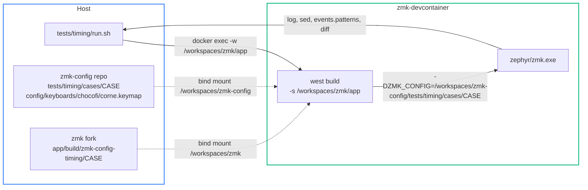
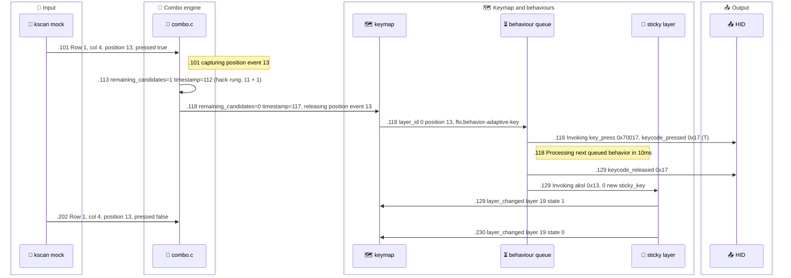

# Tests — how the timing truth was proven

Every 🧪 statement in this folder points at a `native_posix_64` case: ZMK's own test harness, run in the devcontainer, on the fork's firmware. This page is how to re-run them, how to read their logs, and what each one established.

> [!note] The short version
>
> - **184 case dirs** in [`tests/timing/cases/`](../../tests/timing/cases/)
>   - 3 rig templates (`_rig_*`, they do not build) + 181 runnable cases
> - **Two rigs**
>   - **R1** — synthetic 3×4 keymap, real node shapes, 123 cases
>   - **R2** — Flo's live `corne.keymap`, included verbatim, 58 cases
> - **Deterministic** — 1 ms tick, one thread: re-runs are byte-identical
> - **Native ≠ board** — every relative timer fires +1 ms late on native
>   - Subtract +1 per timer hop before quoting a number for the board
> - **Re-run anything** — `tests/timing/run.sh <case>` (PASS / FAIL against the snapshot) or `--raw` (the timestamped evidence)

## Running

### Where things run

The cases live in this repo; the firmware source and the build dirs live in the fork. Both are bind-mounted into `zmk-devcontainer`, so one absolute container path reaches each.



- 📜 `/workspaces/zmk-config` is the **live** host directory, not a copy
  - Docker volume `zmk-config` = `type=none, o=bind, device=/Users/flo/Work/Private/Dev/Keyboard/zmk-config`
  - md5 of `corne.conf` / `corne.keymap` / `CONFIG.h` identical host vs container
- 📜 `-DZMK_CONFIG=<dir>` adds **no** include path
  - It selects `<dir>/native_posix_64.keymap` as the DT overlay
  - It merges `<dir>/native_posix_64.conf` **in addition to** `app/boards/native_posix_64.conf`
  - R2 pulls Flo's keymap in with an absolute `#include "/workspaces/zmk-config/config/keyboards/chocofi/corne.keymap"` (DTS goes through cpp)

### `run.sh`

| Command | Does |
|---|---|
| `./run.sh <case>` | build, run real-time, strip prefix, filter, `diff -auZ` vs snapshot → `PASS` / `FAIL` (`NO-SNAPSHOT` before building when the case has none; `ACCEPTED` when auto-accept wrote one) |
| `./run.sh <case> --raw` | build, then print `zmk.exe --no-rt` stdout+stderr (the timestamped log) |
| `./run.sh all` | every case except `_rig_*`, `J=4` parallel (`J=N` overrides), diffs muted, then `PASS` / `FAIL` / `NO-SNAPSHOT` / `ACCEPTED` counts |
| `ZMK_TESTS_AUTO_ACCEPT=1 ./run.sh <case>` | first run of a new case: writes its `keycode_events.snapshot` |

- Mirrors ZMK's `app/run-test.sh` line for line
  - Build: `west build -s /workspaces/zmk/app -d build/zmk-config-timing/<case> -b native_posix_64 -- -DCONFIG_ASSERT=y -DZMK_CONFIG=<case dir>`
  - Run: `zmk.exe | sed -e "s/.*> //" | tee keycode_events_full.log | sed -n -f events.patterns > keycode_events.log`
  - Check: `diff -auZ keycode_events.snapshot keycode_events.log` (`-Z` ignores trailing whitespace)
- Starts `zmk-devcontainer` if it is not running
- `--raw` stdout is byte-for-byte what `zmk.exe --no-rt > x.raw.log 2>&1` wrote → md5-comparable with `tests/timing/logs/`
- 🧪 `--no-rt` output is byte-identical to real-time output; it only skips real-time pacing
  - T-12-a-alone, 2026-10-01: the real-time `zmk.exe` run and `--no-rt` both md5 `cc322d4bffa71872f568c422361baf0d` = `logs/T-12-a-alone.raw.log`

> [!warning] Harness gotchas
>
> - **A snapshot PASS means "built, ran, same filtered lines"**
>   - Snapshots carry no timestamps: ordering only. The evidence is the `--raw` log
>   - On a new case, auto-accept writes whatever came out as the snapshot (`ACCEPTED`; ZMK's `run-test.sh` prints `PASS`)
> - **Build errors are swallowed** (`> /dev/null 2>&1`, as in `run-test.sh`)
>   - A build failure prints the exact `docker exec … west build …` line to re-run by hand
> - **Templates do not build**: no `events` property → `DT_INST_PROP_LEN` fails
> - **`CACHED_ZMK_CONFIG` is sticky per build dir** (`modules.cmake:26-35`)
>   - Changing a case's config path needs a new build dir or `--pristine`
> - **ZMK's own `run-test.sh` needs a path relative to `app/`**
>   - An absolute path produced `CACHED_ZMK_CONFIG=/workspaces/zmk/app//tmp/aktest` → "did not build"
>   - `run.sh` passes `-DZMK_CONFIG` to `west` directly, so the absolute container path is fine
> - **R2 cases test the keymap as it is now**: a binding change can change their output
> - `T-15-fix-b-hack-noquicktap` was never built (no snapshot, no log) → `NO-SNAPSHOT`

### Making a new case

- Copy a template, never edit `_rig_*` in place
- Append an `&kscan { events = < … >; };` block
- Optional overlays, appended before the `&kscan` block:

| Variant | Overlay |
|---|---|
| R1 hack off | `/delete-node/ &combo_hack;` (log byte-identical to `_rig_R1_nohack`, md5 `848cbcfd351b6ec4dc0b6b4ad00ddb83`) |
| R1 no combos at all | `/delete-node/ &combos;` |
| R2 hack off | `/ { combos { /delete-node/ combo_ak_consistency_hack; }; };` (the real node has no label) |
| R2 anything else | any overlay text after the `#include` |

- First run: `ZMK_TESTS_AUTO_ACCEPT=1 tests/timing/run.sh <case>`, then `tests/timing/run.sh <case> --raw > tests/timing/logs/<case>.raw.log`
- Make the last event's `ms` long enough to see every timer fire (see the harness rules)
- Generators that wrote the existing cases: `tests/timing/tools/*.mkcases.py` (+ `mk_T05_cases.py`, `T-10.mkfix.py`)

## Rigs

> [!tip] Full rig source and the harness research
>
> [`research/RIG.md`](research/RIG.md) and [`research/G-test-harness.md`](research/G-test-harness.md) hold:
>
> - The rig keymaps as built, with every deviation from the test plan
> - The harness source trace (`kscan_mock.c`, `timeout.c`, `modules.cmake`) and every log string by `file:line`

### R1 — synthetic 3×4

- `rows = <3>; columns = <4>;`, no transform → **`position = row * 4 + col`**
  - `ZMK_MOCK_PRESS(p / 4, p % 4, ms)`
  - 🧪 `(0,3)` → `position: 3`, `(0,2)` → `position: 2`

```
            col 0         col 1         col 2         col 3
row 0   pos 0 (0,0)   pos 1 (0,1)   pos 2 (0,2)   pos 3 (0,3)
row 1   pos 4 (1,0)   pos 5 (1,1)   pos 6 (1,2)   pos 7 (1,3)
row 2   pos 8 (2,0)   pos 9 (2,1)   pos 10 (2,2)  pos 11 (2,3)
```

| pos | base (0) | akA (1) | akB (2) | akH (3) | mod (4) | combos with pos → longest k |
|---|---|---|---|---|---|---|
| 0 | `&ak 1 A` 0x04 | – | `&bk P` 0x13 | `&bk U` 0x18 | – | R16 `<0 2>`, hack → 16 |
| 1 | `&ak 2 B` 0x05 | `&bk K` 0x0E | – | `&bk T` 0x17 | – | hack only → 11 |
| 2 | `&kp C` 0x06 | – | – | – | – | R16, hack → 16 |
| 3 | `&kp D` 0x07 | `&bk L` 0x0F | `&bk Q` 0x14 | – | – | hack only → 11 |
| 4 | `&kp E` 0x08 | `&bk N` 0x11 | `&bk R` 0x15 | – | – | S16 `<4 5>`, Q18 `<4 5 6>`, hack → 18 |
| 5 | `&kp F` 0x09 | – | – | – | `&htm LCTRL LCTRL` 0xE0 | S16, Q18, hack → 18 |
| 6 | `&kp G` 0x0A | – | – | – | – | Q18, V16 `<6 11>`, hack → 18 |
| 7 | `&ak 3 H` 0x0B | `&bk O` 0x12 | `&bk S` 0x16 | – | – | W30 `<7 8>`, hack → 30 |
| 8 | `&kp I` 0x0C | – | – | – | – | W30, hack → 30 |
| 9 | `&lk X Y` tap Y 0x1C / linger X 0x1B | – | – | – | – | hack only → 11 |
| 10 | `&blt_akR 5 0` tap → `&ak 3 H` 0x0B / hold `&mo 5` | – | – | – | – | hack only → 11 |
| 11 | `&kp J` 0x0D | `&bk M` 0x10 | – | – | – | V16, hack → 16 |

- `–` = `&trans`; layer 5 (nav) is all `&trans`
- **Combo outputs**
  - R16 `&bk C` 0x06 · S16 `&bk V` 0x19 · Q18 `&bk W` 0x1A · W30 `&bk Z` 0x1D · V16 `&bk Y` 0x1C · hack `&none`
  - Tier combos on layers 0–5 (= `l_all`); hack on 0–3 only (= `l_alpha_aks`, not mod/nav)
- **Hack** = all 12 positions, 11 ms, `&none`, **defined last** (as in the real `combos.dtsi` include order)
- **conf** (additive to the board conf)
  - `MAX_KEYS_PER_COMBO=12`, `MAX_COMBOS_PER_KEY=30`, `MAX_PRESSED_COMBOS=20`, `BEHAVIORS_QUEUE_SIZE=512`
  - `CONFIG_ZMK_HID_SEPARATE_MOD_RELEASE_REPORT=y` left commented (in the real firmware, not in the plan's R1 list)
- **Choices vs the test plan** (real config wins)
  - `label` strings kept on `ak`, `bk`, `aksl`, `lk` → R1 logs name behaviours like R2 does
  - `ak_R_macro` = `&ak 3 H` (thumb shares layer akH); real = `<&ak l_akR R>`
  - `moAndBuffer` hard-codes `&mo 4` (real hard-codes `&mo l_mod`)
  - Tests that need another binding edit their own copy
    - `&mo 4` on a key (T-19)
    - `&htls 4 LSHIFT` on pos 10 (T-17/18)
    - `&kp LSHIFT` on pos 11 (T-20)

### R2 — Flo's real keymap

- Skeleton (🧪 builds and runs unmodified)
  - `#include <dt-bindings/zmk/kscan_mock.h>`, `<dt-bindings/zmk/matrix_transform.h>`, `<layouts/foostan/corne.dtsi>`
  - Both Corne transforms copied verbatim from `app/boards/shields/corne/corne.dtsi`, wired to `&foostan_corne_6col_layout` / `&foostan_corne_5col_layout`
  - `#include "/workspaces/zmk-config/config/keyboards/chocofi/corne.keymap"`, then the `&kscan { events }` block
- 📜 **Why the transforms**
  - Flo's keymap chooses `&foostan_corne_5col_layout`, which **requires** a `transform` phandle
  - The shield normally supplies it; native_posix has no shield
- 🧮 `ZMK_KEYMAP_LEN` = 42 with both layouts present; Flo's 36-binding layers are zero-padded (build passed, no runtime warning)
- **conf** = the five lines the firmware relies on
  - `CONFIG_ZMK_COMBO_MAX_COMBOS_PER_KEY=30` · `CONFIG_ZMK_COMBO_MAX_PRESSED_COMBOS=20` · `CONFIG_ZMK_COMBO_MAX_KEYS_PER_COMBO=36` · `CONFIG_ZMK_BEHAVIORS_QUEUE_SIZE=512` · `CONFIG_ZMK_HID_SEPARATE_MOD_RELEASE_REPORT=y`
  - 🧮 Without `MAX_KEYS_PER_COMBO=36` the hack's 36 `key-positions` overflow their array (`combo.c:30`, `:521-522`); never run that way
    - Expected at boot: `Too many combos for key position …` (`:120`) or `Unable to initialize combo` (`:97`)
- **Position → mock** (`five_column_transform`, `columns = <10>`)
  - `p < 30` → `ZMK_MOCK_PRESS(p / 10, p % 10 + 1, ms)` (col 1..10; col 0 unused)
  - `p 30..35` → `ZMK_MOCK_PRESS(3, p - 27, ms)`
  - 🧪 `T-01-r2-map`: `(0,3)` → 2 → M · `(1,4)` → 13 → T · `(2,3)` → 22 → L · `(1,7)` → 16 → A · `(3,4)` → 31 → sticky LSHIFT (0xE1)

| key | pos | mock | key | pos | mock |
|---|---|---|---|---|---|
| LT4 | 0 | (0,1) | RT0 | 5 | (0,6) |
| LT3 | 1 | (0,2) | RT1 | 6 | (0,7) |
| LT2 | 2 | (0,3) | RT2 | 7 | (0,8) |
| LT1 | 3 | (0,4) | RT3 | 8 | (0,9) |
| LT0 | 4 | (0,5) | RT4 | 9 | (0,10) |
| LM4 | 10 | (1,1) | RM0 | 15 | (1,6) |
| LM3 | 11 | (1,2) | RM1 | 16 | (1,7) |
| LM2 | 12 | (1,3) | RM2 | 17 | (1,8) |
| LM1 | 13 | (1,4) | RM3 | 18 | (1,9) |
| LM0 | 14 | (1,5) | RM4 | 19 | (1,10) |
| LB4 | 20 | (2,1) | RB0 | 25 | (2,6) |
| LB3 | 21 | (2,2) | RB1 | 26 | (2,7) |
| LB2 | 22 | (2,3) | RB2 | 27 | (2,8) |
| LB1 | 23 | (2,4) | RB3 | 28 | (2,9) |
| LB0 | 24 | (2,5) | RB4 | 29 | (2,10) |
| LH2 | 30 | (3,3) | RH0 | 33 | (3,6) |
| LH1 | 31 | (3,4) | RH1 | 34 | (3,7) |
| LH0 | 32 | (3,5) | RH2 | 35 | (3,8) |

#### Keys the plan used (Naquadah alpha, layer 0; status as recorded in RIG.md)

| key | mock | base binding | HID | follower bindings that matter | candidates on layer 0 → solo delivery |
|---|---|---|---|---|---|
| LT2 | (0,3) | `&ak 13 M` | 0x10 | l_akM: LT3 `&bk M`, LT0 `ak_B` (=`&ak 3 B`), LM1 `&bk N` | typeQ(16) typeZ(16) hack → 🧪 +17 |
| LM1 | (1,4) | `&ak 19 T` | 0x17 | l_akT: LB3 `&bk T`, LB0 `TV_to_NV` | entr(16) hack → 🧪 +17 |
| LM4 | (1,1) | `&ak 4 C` | 0x06 | l_akC: LT1 `CP_to_TP`, LB3 `&bk C` | hack only → 🧮 +12 |
| LT1 | (0,4) | `&ak 16 P` | 0x13 | l_akP: LT3 `&bk P`, LM4 `&bk T`, LM2 `&bk D`, LM0 `PB_to_NB`, LB3 `&bk L` | space(16) typeQ(16) hack → 🧮 +17 |
| LB2 | (2,3) | `&ak 12 L` | 0x0F | l_akL: LT4 `&bk G`, LB3 `&bk L` | esc2(16) magicCloseQuitCb(16) hack → 🧪 +17 |
| LT4 | (0,1) | `&ak 23 X` | 0x1B | on l_akL → `&bk G` 0x0A | hack only → 🧮 +12 |
| LT0 | (0,5) | `&ak 11 K` | 0x0E | on l_akM → `ak_B` (B 0x05, then layer 3) | space(16) hack → 🧮 +17 |
| LB3 | (2,2) | `&ak 8 G` | 0x0A | on l_akT → `&bk T`; on l_akB → `&bk L` | magicCloseQuitCb(16) hack → 🧮 +17 |
| LM2 | (1,3) | `&ak 14 N` | 0x11 | – | wispr(16) hack → +17 (G §3 probe) |
| LM0 | (1,5) | `&ak 3 B` | 0x05 | – | entr(16) hack → 🧮 +17 |
| RM1 | (1,7) | `&ak 2 A` | 0x04 | – | entr2(16) bspc(16) delWord(18) capsWord(18) hack → 🧪 +19 |
| LH1 | (3,4) | `&htls 26 LSHIFT` | tap → sticky 0xE1; hold → `moAndBuffer` (layer 26) | – | hack only → 🧪 +12 (hold-tap created at +12) |

- 🧮 = *predicted* in RIG.md (derived from the candidates, not run at that point)
- **AK layer ids**: A 2 · B 3 · C 4 · D 5 · E 6 · F 7 · G 8 · H 9 · hE 10 · K 11 · L 12 · M 13 · N 14 · O 15 · P 16 · R 17 · S 18 · T 19 · U 20 · V 21 · W 22 · X 23 · Y 24 · nav 25 · mod 26 · fn 27 · num 28 · numsym 29 · cfg 30 · nav_linwin 31 · (I/J/Q/Z = 999, no layer)
- HID usage (page 0x07): A 0x04 … Z 0x1D (`0x04 + letter index`), BSPC 0x2A, SPACE 0x2C, RET 0x28, LCTRL 0xE0, LSHIFT 0xE1

## Harness rules (read before quoting any log)

One lone `&ak` key on R2 (`T-01-r2`, LM1 = T, pressed at abs 101; `T-12-a-alone` is the same events, md5-identical log), with every log line where the firmware emits it. Times are native ms (`[00:00:00.mmm]`).



- T↓ at **t+17** = the 16 ms rung + 1, not the hack's 11 ms: the longest live candidate holds the key
- Layer 19 ON at **t+28** = delivery + the 10 ms queue tick + 1
- Layer 19 OFF at **t+129** = ON + 100 + 1
- Board: **+16 / +26 / +126** (one +1 removed per timer hop)

> [!important] The two rules behind every native number
>
> - **Every relative timer fires 1 ms late on native**
>   - Combo rungs, the 10 ms queue tick, sticky release, hold-tap term, macro waits, mock delays
>   - Board = native − 1 per timer hop crossed
> - **Key-driven instants carry no offset**
>   - A press that empties a candidate set, a release, a key with no candidate
>   - Their native ms is the board ms

### Timer and mock arithmetic

| Rule | What the log shows | Proof |
|---|---|---|
| Relative timers fire at intended + 1 | `100 → 101`, `10 → 11`, `1500 → 1501` | 📜 Zephyr `kernel/timeout.c:122` `to->dticks = timeout.ticks + 1 + elapsed();` (absolute timeouts excluded, `:117-120`) · 🧪 T-01-r1 |
| Mock schedule | `[e0.ms+1] e0 [e0.ms+1] e1 [e1.ms+1] e2 … eN [eN.ms+1] exit` | 📜 `kscan_mock.c:52-73` · 🧪 T-01-r1 |
| Event 0's `ms` applies **twice** | boot delay **and** gap after e0: `t(e0) = e0.ms + 1`, `t(e1) = t(e0) + e0.ms + 1` | 📜 handler calls `schedule_next_event` before incrementing `event_index` · 🧪 T-01-r1 D↑ `[00:00:00.202,000]` |
| Mock gap = `ms + 1` (for `ms ≥ 1`) | `t(eN) = t(eN-1) + eN-1.ms + 1` | 🧪 T-01-r1 C↓ `[00:00:00.213,000]` = 202 + 10 + 1 |
| `ms = 0` → next event in the **same** ms (`K_NO_WAIT`) | 1 ms gaps are not producible (0, 2, 3, …) | 🧪 T-08-fix-boundary-rel1 `[00:00:00.012,000]` press + release · HW-01 |
| Lone key = longest live candidate + 1 | hack-only +12 · 16 ms key +17 · 18 ms key +19 · 30 ms key +31 | 🧪 T-11-a/c (all 12 R1 positions), T-12-a `[00:00:00.118,000]`, T-01-r2-map RM1 `[00:00:01.126,000]` |
| `&ak` at delivery D | HID↓ at D, layer ON at D+11, OFF at ON+101 | 🧪 T-12-a `[00:00:00.118,000]` / `[00:00:00.129,000]` / `[00:00:00.230,000]` |
| Rung-delivered `&ak` crosses **two** hops | native layer ON = t + max(11,k) + 1 + 11 | 🧪 T-02 reconciliation `[00:00:00.018,000] … in 10ms` → `[00:00:00.029,000]` (t+23, the plan said t+22) |
| Chained timers add one +1 each | `moAndBuffer` park = two `K_MSEC(130)` → release + 262 native | 🧪 T-18-a `[00:00:00.504,000]` |
| Observation window = last event's `ms` | timers due after `exit(0)` never fire | 📜 `kscan_mock.c:61` · AK window needs ≥ 130 after the last key-up (use 300); a 1500 ms sticky needs ≥ 1600 |
| `msec` is 15 bits | max 32 767 ms per gap; larger spills into the press bit | 📜 `kscan_mock.h:9-14` |

- ⛔ ~~T-01 plan expectations: D↑ `.112`, C↓ `.163`, C↑ `.174`, exit `.185`~~
  - They omitted the doubled first delay, which shifts everything after D↓ by +90 ms; only D↓ `.101` was right
- The odd last line `ev 1 row 1 column 0 state 0` is a one-past-the-array read before `exit(0)`; harmless 📜 `kscan_mock.c:68`

### ⚖️ Same-tick ordering

- 📜 On one tick, expiring timers run in deadline-then-arming order; a key's position event runs **after** them, as a second work item (`timeout.c:125-131`, `work.c:277`, `physical_layouts.c:147-160`)
  - 🧪 Layer ON beats a same-tick key: T-07-d11 `[00:00:00.022,000]`, T-23-e4 `[00:00:00.056,000]`
  - 🧪 A combo rung beats a same-tick key: T-04-d12 `[00:00:00.024,000] … timestamp=23` before `Row: 0, col: 3`; T-22-c
  - 🧪 The hold-tap term beats a same-tick release → HOLD: T-15-c `[00:00:00.202,000]`
  - 🧪 Two timers on one tick run in arming order: T-12-b-d112 `[00:00:00.179,000]` (sticky OFF before the follower's rung)
- Line order == execution order (`CONFIG_LOG_MODE_IMMEDIATE=y`), so same-ms lines are an **ordering** assertion, not a timing one
- Native tie outcomes are **harness facts, never board facts**: on the board every such cell is ⚖️

### 🧩 Combo-engine log arithmetic

- 📜 `filter_timed_out_candidates … timestamp=` prints the **intended** deadline when the timer calls it (`combo.c:477`)
  - The line prefix is execution = deadline + 1: `117@[.118]`, `33@[.034]`, `48@[.049]`, `50@[.051]`, `90@[.091]` 🧪 T-22
  - From a key press it prints the key's own timestamp = the prefix ms: `30@[.030]` 🧪 T-22-a
- 📜 `remaining_candidates=` is printed **before** the position filter (`combo.c:430` then `:431`) → it counts candidates the new key will drop 🧪 T-10-a `[00:00:00.024,000] … remaining_candidates=2 timestamp=24` (only Q18 survives)
- 📜 Strict comparison `candidate->timeout_at > timestamp` (`combo.c:228`) → combo iff `ts2 − ts1 ≤ T − 1`
  - 🧪 16 ms: gap 15 in, 16 out (T-22-a/b) · 30 ms: gap 29 in, 30 out (T-22-e/f)
- No log line when a combo fires: watch the bound behaviour's own line (e.g. `on_keymap_binding_pressed: position <virtual pos> keycode …`)

### What native cannot show

- 📜 **No debounce, no scan latency**: hardware adds 4–6 ms debounce to every press and release (MODEL 🛣️); equal for both keys of a same-half pair, so Δ survives it
- 📜 **No split**: `CONFIG_ZMK_SPLIT` unset; on the board left-half keys are stamped at BLE receipt on the central (`central.c:125-131, 259-266`)
  - 🧮 Left-left gaps are quantised to the ~7.5 ms connection interval (MODEL 📡)
- 📜 **No transport**: every report logs `<err> USB endpoint is not supported`; `hid_listener_keycode_*` lines are the ground truth
- 📜 **One thread**: mock events, msgq, combo timeout, behaviour queue, sticky and hold-tap timers are all `k_work` on the system workqueue; no preemption, no jitter
- 📜 **`position 0`** for anything invoked from the behaviour queue (`behavior_queue.c:53` omits `.position`) — same on hardware
- 🔮 **The Δ = 10 cell**: native shows the quick-tap bypass (❌) because its rung runs 1 ms late; the board is predicted to ⏸ STALL (T-04 verdict, hardware test T-24a)
- 🔮 **The S−1 cell** (the two S3 pairs, S = 16 / 18)
  - Native ❌ MISS: the S-rung runs at S+1, so the follower is still a quick tap
  - Board ⏸ STALL: now_flush = S, the follower is re-captured and strands (MODEL 🟥 S3, [PAIRS](PAIRS.md))
- ⚖️ **Every same-ms timer-vs-key tie**
  - Native runs the timer first (one thread, deadline-then-arming order)
  - The board cell is undetermined (CORRECTIONS-FINAL F1): never "leans to the timer", never a coin flip
  - T-07-d11 · T-12-b-d112 · T-15-b · T-22-b/f · T-23-e4

### Translating to board time

| Native instant | Board instant |
|---|---|
| Timer-driven (rung, tick, sticky, term, macro wait) | native − 1 per hop crossed |
| Key-driven (press, release, emptying press) | unchanged |
| Same-ms tie between a timer and a key | ⚖️ undetermined |

- 📜 Per hop on the board, `K_MSEC(n)` fires n + 0.005–0.061 ms after the instant that armed it (32 768 Hz tick: `K_MSEC(x)` = ceil(x·32.768) ticks + 1)
- Example, T-12-a lone T: native +17 / +28 / +129 → board +16 / +26 / +126

> [!note] Reading the write-ups' board columns
>
> - The `results/T-xx.md` "Board translation" sections quote v1's "deadline + δ, δ ∈ (0.03, 1.05] ms" (and its ≈95 %/5 %, "coin flip" phrasing) — ⛔ struck by [`MODEL.md`](MODEL.md) 🎲 (FIX-LOG RVB-03, CORRECTIONS-FINAL F1 side note)
>   - Read those columns as **native − 1 per timer hop**; their integer board instants stand
>   - Per hop the board is late by ≤ 0.061 ms after arming (📜 `timeout.c:122`, 32 768 Hz); right-hand instants sit on the 1 ms scan grid; left-hand instants add the BLE receipt phase, magnitude ❓
>   - Any same-ms tie they call a "coin flip" or "≈ 97 %" is ⚖️ undetermined

## Log lines that matter

- Prefix: `[hh:mm:ss.mmm,uuu] <lvl> zmk: <function>: <message>`
  - `uuu` is always `000` (1 ms tick); `<lvl>` is `dbg` for everything that matters
  - Time zero = boot; the first position event lands at `e0.ms + 1`; `t` = the first `Row: … pressed: true` line
  - One log module for all of ZMK: filtering is `events.patterns` (sed), not Kconfig

| You want | grep for | Example line (verbatim) |
|---|---|---|
| 🧮 physical press/release (`t`) | `Row:` | `zmk_physical_layouts_kscan_process_msgq: Row: 1, col: 4, position: 13, pressed: true` |
| 🧩 combo captured the key | `capturing position event` | `position_state_down: combo: capturing position event 13` |
| 🧩 rung expired (timer) or re-evaluated (key) | `remaining_candidates` | `filter_timed_out_candidates: after filtering out timed out combo candidates: remaining_candidates=1 timestamp=112` |
| 🧩 key handed to the keymap | `releasing` / `reraising position event` | `release_pressed_keys: combo: releasing position event 13` |
| 🗺️ delivery (which layer resolved it) | `layer_id:` | `zmk_keymap_apply_position_state: layer_id: 0 position: 13, binding name: flo,behavior-adaptive-key` |
| 📤 HID ↓ / ↑ (ground truth) | `hid_listener_keycode_` | `hid_listener_keycode_pressed: usage_page 0x07 keycode 0x17 implicit_mods 0x00 explicit_mods 0x00` |
| 📌 layer on/off | `layer_changed` | `set_layer_state: layer_changed: layer 19 state 1` |
| ⏳ queue step | `Invoking` / `Processing next queued behavior` | `behavior_queue_process_next: Invoking key_press: 0x70017 0x00`, `… in 10ms` |
| ⏳ macro start | `Iterating macro bindings` | `queue_macro: Iterating macro bindings - starting: 0, count: 7` (release branch `starting: 7, count: 0`) |
| 📌 sticky armed / consumed | `new sticky_key` / `Act like a normal key` | `on_sticky_key_binding_pressed: 0 new sticky_key` |
| ✋ hold-tap life | `new undecided hold_tap`, `decided`, `capturing`, `Releasing key position event` | `decide_hold_tap: 31 decided tap (hold-preferred decision moment key-up)` |
| 🧮 mock event / end | `kscan_mock_work_handler_0: ev` / `Exiting` | `kscan_mock_schedule_next_event_0: Exiting` |

- ✋ `decide_hold_tap` strings are status words (HW-05)
  - `decided hold-interrupt (…)`, `decided hold-timer (…)`, `decided tap (…)`, `decided tap (tap-preferred decision moment quick-tap)`
- 📤 `hid_listener_keycode_*` prints the event's own `explicit_mods`; a held or sticky mod shows only as `Modifiers set to 0x0N` (HW-07, 🧪 T-18-d `[00:00:00.381,000]`)
- ⏳ A 0 ms nested tap still logs `Processing next queued behavior in 10ms` between H↓ and H↑ (HW-06, 🧪 T-14-a `[00:00:00.102,000]`)
- 📌 `0 new sticky_key` = reached through the queue; a hold-tap that invokes `&skms` directly logs the real position (`31 new sticky_key`)
- **Noise** to ignore
  - `USB endpoint is not supported`, `Failed to send key report for the released keycode (-95)` (R2 only, from `SEPARATE_MOD_RELEASE_REPORT`)
  - `Modifiers set to 0x00`, `zmk_endpoints_send_report`, `Listener captured/handled the event`
  - `tap_dance_position_state_changed_listener: Ignore upstroke` (R2, from `togMacPc`), `bubble (no undecided hold_tap active)`
- **Snapshot vocabulary** (`events.patterns`, shared by all three rigs)
  - `pos …`, `keymap …`, `kp_pressed/kp_released …`, `layer_changed …`, `after filtering …`, `capturing/releasing/reraising position event N`
  - `ht …` (hold-tap, minus the bubble line), `sk …`, `macro …`, `queue invoke …`, `queue wait Nms`, `Exiting`

#### Timeline helper

```
python3 tests/timing/tools/tl.py <raw.log> [--all] [--abs] [--t0 MS] [--grep REGEX]
```

- Prints `+rel  abs  event`, `rel` from the first `Row: … pressed: true` (override with `--t0`)
- Vocabulary: `POS ↓/↑`, `combo capturing/releasing/reraising`, `combo filter: remaining=N (timestamp=T)`, `deliver pos P on layer L → <behavior>`, `HID ↓/↑ 0xNN <name>`, `LAYER N ON/OFF`, `queue invoke`, `queue wait Nms`, `macro`, `sk`, `ht`, `EXIT`
- Needs the raw exe output; `keycode_events_full.log` has no prefixes and is rejected

## Faithful move (2026-10-01)

The cases ran first under the fork's `app/tests/ak-truth/`. They were copied verbatim (`diff -r` empty) and re-run from this repo with `run.sh`.

| Case | Rig | `./run.sh <case>` | `--raw` md5 vs original log |
|---|---|---|---|
| `T-01-r1` | R1, no combos | PASS | identical `8d51067ca6f769651828aa7afaf2d83b` |
| `T-02-a-spec` | R1 | PASS | identical `b9c587eb1398d09b178e5293448c339d` |
| `T-04-d11` | R1 | PASS | identical `04aed04ffbfd15c87f9596cebe1c3a4d` |
| `T-23-a-MT-d5` | R2 | PASS | identical `b3241efd69d3cebf5661f7a4ce21de65` |
| `S-L_LB3-d14` | R2 | PASS | identical `dc6b066c625a3bd82950969ac8484160` |
| `ARB-F2-press40` | R2 | PASS | identical `46601b833effa7c6e7c276919405ad85` |

- **Full sweep, same day** — `./run.sh all` → **180 PASS · 0 FAIL · 1 NO-SNAPSHOT**
  - The NO-SNAPSHOT is `T-15-fix-b-hack-noquicktap` (never built)
- **Every raw log** — **180 / 180** md5-identical to `tests/timing/logs/<case>.raw.log`
  - 23 cases through `run.sh --raw` itself; the rest by running the same `run.sh` build's `zmk.exe --no-rt`
  - Includes the 5 logs that only existed under `results/CORR-B/` (T-07-fix ×2, T-13-fix ×2, `CB-T15-noquicktap`)
- R2 cases ran against the working-tree `corne.keymap`; its only uncommitted change is a comment in `combos.dtsi`

## 🧪 Case index

Every case dir, by family. `t` = the first key's press; Δ = gap to the second key; times are native unless marked board. **Out** = the native observation: ✅ adapted · ❌ base letter · ⏸ stall · 🟪 a real combo fires · – not a two-key adaptation test; ⚖️ marks a same-ms tie that native resolved timer-first and the board leaves undetermined.

### Baselines — rigs and T-01

| Case | Rig | Scenario | Establishes | Out | Write-up |
|---|---|---|---|---|---|
| `_rig_R1` | R1 template | — | the synthetic 3×4 keymap, hack ON | – | [RIG](research/RIG.md) |
| `_rig_R1_nohack` | R1 template | — | the same without `combo_ak_consistency_hack` | – | [RIG](research/RIG.md) |
| `_rig_R2` | R2 template | — | Flo's `corne.keymap` + both Corne transforms | – | [RIG](research/RIG.md) |
| `T-01-r1` | R1, no combos | D (pos 3), then C (pos 2) | mock schedule: D↓ `.101`, D↑ `.202`, C↓ `.213`, C↑ `.264`, exit `.275` | – | [RIG](research/RIG.md) |
| `T-01-r1-full` | R1 | same events | hack-only D at t+12, R16 key C at t+17; releases pass straight through | – | [RIG](research/RIG.md) |
| `T-01-r1-nohack` | R1 hack off | same events | D immediate `[.101]`, C at `[.230]` | – | [RIG](research/RIG.md) |
| `T-01-r1-delhack` | R1 hack deleted | same events | `/delete-node/ &combo_hack;` ≡ `_rig_R1_nohack` (same md5) | – | [RIG](research/RIG.md) |
| `T-01-r2` | R2 | LM1 (T) alone | `&ak` timeline: T↓ t+17, layer 19 ON t+28, OFF t+129 | – | [RIG](research/RIG.md) |
| `T-01-r2-nohack` | R2 hack off | LM1 alone | only the `timestamp=117` rung remains; T `.118`, ON `.129`, OFF `.230` unchanged | – | [RIG](research/RIG.md) |
| `T-01-r2-map` | R2 | one key per row, 300 ms apart | R2 coordinate map; RM1 +19 (18 ms tier), LH1 hold-tap at +12 | – | [RIG](research/RIG.md) |

### Plan tests — T-02 … T-23

#### T-02 · `&ak` key 1, key 2 < 11 ms later

| Case | Rig | Scenario | Establishes | Out | Write-up |
|---|---|---|---|---|---|
| `T-02-a-spec` | R1 | A → B-key, Δ 6 | both leave at the hack rung t+12; B re-raised as a quick tap → layer 0; B↓ + layer 1 ON at t+23 → `A B` | ❌ | [T-02](results/T-02.md) |
| `T-02-b-nohack` | R1 hack deleted | Δ 6 | A leaves at t+6, B bubbles on base → `A B` | ❌ | [T-02](results/T-02.md) |
| `T-02-c-noquicktap` | R1, hack `require-prior-idle-ms = -100` | Δ 6 | bypass cause = quick-tap check: B re-captured, no timer, delivered at A↑ (t+67) on layer 1 → `A K` | ⏸ → ✅ | [T-02](results/T-02.md) |
| `T-02-fix-a-spec` | R1 | Δ 6, same events | re-run with the corrected expectation: md5 identical to (a), B↓ t+23 | ❌ | [T-02](results/T-02.md) |

#### T-03 · stranded second key behind a raw `&kp`

| Case | Rig | Scenario | Establishes | Out | Write-up |
|---|---|---|---|---|---|
| `T-03` | R1 | `&kp D` → `&ak 2 B`, Δ 6 | key 2 stranded (R9) until D↑ at t+67, then base → `D B` | ⏸ → ❌ | [T-03](results/T-03.md) |
| `T-03-bk` | R1, pos 3 = `&bk D` | same | queue-stamped key 1 → B bypasses at t+12, types at t+23 (R8) | ❌ | [T-03](results/T-03.md) |

#### T-04 · Δ sweep 9–12, hack-only key 1

| Case | Rig | Scenario | Establishes | Out | Write-up |
|---|---|---|---|---|---|
| `T-04-d9` | R1 | B → D-key, Δ 9 | quick-tap bypass, D on base at t+12 → `BD` | ❌ | [T-04](results/T-04.md) |
| `T-04-d10` | R1 | Δ 10 | native = Δ 9; board predicted ⏸ (🔮, T-24a) | ❌ | [T-04](results/T-04.md) |
| `T-04-d11` | R1 | Δ 11 | key-first flush t+11, layer 2 ON t+22, Q t+23 → `BQ`, margin 1 ms | ✅ | [T-04](results/T-04.md) |
| `T-04-d12` | R1 | Δ 12 | timer flush t+12 (rung before the same-tick key), Q t+24 | ✅ | [T-04](results/T-04.md) |

#### T-05 · key 1 in a 16 ms combo, 11 ≤ Δ < 16

| Case | Rig | Scenario | Establishes | Out | Write-up |
|---|---|---|---|---|---|
| `T-05` | R1 | A → D-key, Δ 13 | flush at key 2's press: A at Δ, layer Δ+11, follower Δ+12 → `AL` | ✅ | [T-05](results/T-05.md) |
| `T-05-d11` | R1 | Δ 11 | lower band edge; hack timer cancelled, drop logged from the key path | ✅ | [T-05](results/T-05.md) |
| `T-05-d15` | R1 | Δ 15 | upper band edge | ✅ | [T-05](results/T-05.md) |
| `T-05-d16` | R1 | Δ 16 | key-first flush also at 16 on native (key at t+16, R16 timer at t+17) | ✅ | [T-05](results/T-05.md) |

#### T-06 · key 2 in a 30 ms combo

| Case | Rig | Scenario | Establishes | Out | Write-up |
|---|---|---|---|---|---|
| `T-06a-hack-d21` | R1 | A → H-key, Δ 21 | A↓ t+17, layer 1 t+28, O↓ t+52 (= t+21+30+1) → `A O` | ✅ | [T-06](results/T-06.md) |
| `T-06b-hack-d6` | R1 | Δ 6 | bypass: no second capture, base → `A H`, H↓ t+23 | ❌ | [T-06](results/T-06.md) |
| `T-06c-nohack-d6` | R1 hack deleted | Δ 6 | 30 ms combo holds key 2 past the layer switch → `A O`, O↓ t+37 | ✅ | [T-06](results/T-06.md) |

#### T-07 · key 1 with no combo (k1 = 0), hack off

| Case | Rig | Scenario | Establishes | Out | Write-up |
|---|---|---|---|---|---|
| `T-07-d5` | R1 hack off | B → D-key, Δ 5 | no combo touches either key; D on base at t+5; layer 2 ON t+11 | ❌ | [T-07](results/T-07.md) |
| `T-07-d6` | R1 hack off | Δ 6 | same shape, D at t+6 | ❌ | [T-07](results/T-07.md) |
| `T-07-d11` | R1 hack off | Δ 11 | same-tick: layer ON runs before the key's position event → Q on layer 2 (plan said D) | ✅ native · ⚖️ board | [T-07](results/T-07.md) |
| `T-07-d12` | R1 hack off | Δ 12 | Q at t+12 on layer 2 | ✅ | [T-07](results/T-07.md) |
| `T-07-fix-d10` | R1 hack off | Δ 10 | D on base, layer at t+11 (MR-05) | ❌ | [CORR-A §8](results/CORRECTIONS-A.md) |
| `T-07-fix-d11-rev` | R1 hack off | meant: reversed timeout order at Δ 11 | `ms = 0` gave gap 0 → ran Δ 10 (MISS); goal untested (HW-01) | ❌ | [CORR-A §8](results/CORRECTIONS-A.md) |

#### T-08 · release while buffered

| Case | Rig | Scenario | Establishes | Out | Write-up |
|---|---|---|---|---|---|
| `T-08-a-spec` | R1 | `&ak A` t, `&ak B` t+6, A↑ t+10 | release flushes both on layer 0; B bypasses (no dupe cleanup); B↓ t+21 → `A B` | ❌ | [T-08](results/T-08.md) |
| `T-08-b-b-up-first` | R1 | same, B↑ t+10 | same flush, same bypass → `A B` | ❌ | [T-08](results/T-08.md) |
| `T-08-c-kp-k1up` | R1 | `&kp D` t, `&ak B` t+6, D↑ t+10 | control: re-capture + dupe cleanup (MODEL R6) all at `[.016]` | ❌ | [T-08](results/T-08.md) |
| `T-08-d-kp-k2up` | R1 | same, B↑ t+10 | control, key-2-up order | ❌ | [T-08](results/T-08.md) |
| `T-08-fix-boundary-rel1` | R1 | `T_B = T_rel` (same ms) | re-capture + dupe cleanup | ❌ | [CORR-A §8](results/CORRECTIONS-A.md) |
| `T-08-fix-boundary-rel2` | R1 | `T_rel = T_B + 2` | bypass | ❌ | [CORR-A §8](results/CORRECTIONS-A.md) |

#### T-09 · combo completion under the hack

| Case | Rig | Scenario | Establishes | Out | Write-up |
|---|---|---|---|---|---|
| `T-09-a-d6` | R1 | C-key → A, Δ 6 | R16 completed while the hack lives fires at its own deadline, t+17 | 🟪 | [T-09](results/T-09.md) |
| `T-09-a2-d6-Aup` | R1 | Δ 6, second key up first | identical to (a); combo released on the first key-up | 🟪 | [T-09](results/T-09.md) |
| `T-09-b-d13` | R1 | Δ 13 | hack already expired → fires at completion, t+13 | 🟪 | [T-09](results/T-09.md) |
| `T-09-c-nohack-d6` | R1 hack off | Δ 6 | sole candidate → t+6; hack cost +11 ms native | 🟪 | [T-09](results/T-09.md) |

#### T-10 · late-deadline stall (R10), 3-key combo

| Case | Rig | Scenario | Establishes | Out | Write-up |
|---|---|---|---|---|---|
| `T-10-a-spec` | R1 | E 0 · G 12 · F 16 | F completes Q18, the only candidate → W at t+16 (plan said t+117) | 🟪 | [T-10](results/T-10.md) |
| `T-10-b-ctrl` | R1 | E 0 · F 4 · G 8 | completed while the hack lives → fires at the Q18 rung, t+19 | 🟪 | [T-10](results/T-10.md) |
| `T-10-c-noF-d12` | R1 | E 0 · G 12, no F | R10: Q18 deadline never armed; E, G leave at E↑, t+117 | ⏸ | [T-10](results/T-10.md) |
| `T-10-d-noF-d5` | R1 | E 0 · G 5, no F | control: t+18 rung fires, E at t+19; G stranded by R9 to t+117 | ⏸ | [T-10](results/T-10.md) |
| `T-10-e-sib-spec` | R1 + X18 `<4 5 6 7>` | E 0 · G 12 · F 16 | R10 on a completed combo: Q18 marked, X18 alive → W at E↑, t+117 | ⏸ 🟪 | [T-10](results/T-10.md) |
| `T-10-f-sib-ctrl` | R1 + X18 | E 0 · F 4 · G 8 | control: fires at the rung, t+19 | 🟪 | [T-10](results/T-10.md) |
| `T-10-fix-lateF-d13` | R1 | E 0 · G 12 · F 25 | no rung at t+17 or t+19; E leaves only at F's press, t+25 | ⏸ | [T-10](results/T-10.md) |

#### T-11 · solo-key latency

| Case | Rig | Scenario | Establishes | Out | Write-up |
|---|---|---|---|---|---|
| `T-11-a-hack` | R1 | pos 1, 0, 4, 7 alone | delivery = longest candidate + 1: +12 / +17 / +19 / +31 | – | [T-11](results/T-11.md) |
| `T-11-b-nohack` | R1 hack off | same | +0 / +17 / +19 / +31: the hack costs only hack-only keys | – | [T-11](results/T-11.md) |
| `T-11-c-sweep-hack` | R1 | pos 0 … 11 | +12 only on positions 1, 3, 9, 10 | – | [T-11](results/T-11.md) |
| `T-11-d-sweep-nohack` | R1 hack off | pos 0 … 11 | the 8 combo positions unchanged | – | [T-11](results/T-11.md) |

#### T-12 · `&ak` timeline on the real keymap

| Case | Rig | Scenario | Establishes | Out | Write-up |
|---|---|---|---|---|---|
| `T-12-a-alone` | R2 | LM1 (T) alone | T↓ +17, ↑ + layer 19 ON +28, OFF +129 | – | [T-12](results/T-12.md) |
| `T-12-b-d110` | R2 | LM1 → LB3, Δ 110 | adapted (T again at Δ+17) | ✅ | [T-12](results/T-12.md) |
| `T-12-b-d111` | R2 | Δ 111 | still adapted: native edge between 111 and 112 | ✅ | [T-12](results/T-12.md) |
| `T-12-b-d112` | R2 | Δ 112 | base (G): sticky OFF and the follower's rung on one ms, sticky first | ❌ native · ⚖️ board | [T-12](results/T-12.md) |
| `T-12-c-chain` | R2 | M (LT2) → K (LT0) → G (LB3), 60 ms apart | prints `M B L`; layer 13 OFF + layer 3 ON at K's kp↑ (+88) | ✅ | [T-12](results/T-12.md) |

#### T-13 · sticky layer visible in the same dispatch?

| Case | Rig | Scenario | Establishes | Out | Write-up |
|---|---|---|---|---|---|
| `T-13-a-akflush` | R1 | T-02 (a) events | key flushed with an `&ak` resolves on base; byte-identical to T-02-a | ❌ | [T-13](results/T-13.md) |
| `T-13-b-nested` | R1 | thumb (pos 10) tap, B-key held during it | nested-sync tap: H↓ H↑ layer 3 ON at t+62, B-key on layer 3 → `H T`; T↓ t+73 | ✅ | [T-13](results/T-13.md) |
| `T-13-c-direct` | R1 + `ak_3H_direct` | same | direct `&ak`: B-key on layer 0 → `H B` | ❌ | [T-13](results/T-13.md) |
| `T-13-d-r2-thumb` | R2 | LH0 tap with LT4 held | real thumb behaves like (b): LT4 on `l_akR` → `R R` | ✅ | [T-13](results/T-13.md) |
| `T-13-fix-e-park` | R1 hack off | follower at thumb-up + 5 | layer 3 `&bk T`; HID at thumb-up + 11 (queue parked) (MR-08) | ✅ | [CORR-A §8](results/CORRECTIONS-A.md) |
| `T-13-fix-f-nopark` | R1 hack off | follower at thumb-up + 15 | layer 3, HID immediate | ✅ | [CORR-A §8](results/CORRECTIONS-A.md) |

#### T-14 · nested macro 0 ms tap

| Case | Rig | Scenario | Establishes | Out | Write-up |
|---|---|---|---|---|---|
| `T-14-a-spec` | R1 | thumb (pos 10) alone | H↓, H↑, layer 3 ON all at t+51 (the tap decision); OFF t+152 | – | [T-14](results/T-14.md) |
| `T-14-b-ctrl-direct` | R1, tap = `&ak 3 H` direct | same | no wrapper → normal `&ak`: H↑ + layer ON t+62, OFF t+163 | – | [T-14](results/T-14.md) |
| `T-14-c-r2-LH0` | R2 | LH0 alone | R↓ R↑ + layer 17 ON at t+51, OFF t+152 | – | [T-14](results/T-14.md) |

#### T-15 · linger key boundary and interrupts

| Case | Rig | Scenario | Establishes | Out | Write-up |
|---|---|---|---|---|---|
| `T-15-a-up99` | R1 | linger (pos 9) up at +99 | TAP → `y` | – | [T-15](results/T-15.md) |
| `T-15-b-up100` | R1 | up at +100 | TAP on native → `y`; board cell ⚖️ | – | [T-15](results/T-15.md) |
| `T-15-c-up101` | R1 | up at +101 | term timer beats the same-tick release → HOLD at t+101 → `x` | – | [T-15](results/T-15.md) |
| `T-15-d-interrupt` | R1 | D pressed while undecided, linger up at +82 | captured `&kp D` lands with Y↓ at t+82, before Y↑ (plan said after) → `yd` | – | [T-15](results/T-15.md) |
| `T-15-e-held150` | R1 | held 150, D at +41 | X↓ t+101 then D; created at t+12, decided at t+101 → `xd` | – | [T-15](results/T-15.md) |
| `T-15-f-interrupt-akB` | R1 | queued `&ak B` as interrupt | queued key emits after Y↑, at t+93 → `yb` | – | [T-15](results/T-15.md) |
| `T-15-fix-a-bk-follower` | R1 | captured `&bk D` | D↓ after Y↑ (queued) (MC-03) | – | [CORR-A §8](results/CORRECTIONS-A.md) |
| `T-15-fix-b-hack-noquicktap` | R1, hack `require-prior-idle-ms = -1000` | T-15-d events | never built: no snapshot, no log; same overlay as `CB-T15-noquicktap` | – | [CORR-A §8](results/CORRECTIONS-A.md) |

#### T-16 · linger forced TAP after an `&ak`

| Case | Rig | Scenario | Establishes | Out | Write-up |
|---|---|---|---|---|---|
| `T-16-a-d6` | R1 | `&ak B` → linger (pos 9), Δ 6 | forced TAP (quick-tap) at t+12; Y↓ t+23 behind B's queue; no X | – | [T-16](results/T-16.md) |
| `T-16-b-d12` | R1 | Δ 12 | control: hold-timer → X at t+113 | – | [T-16](results/T-16.md) |
| `T-16-c-d10` | R1 | Δ 10 | forced TAP (bypass) on native | – | [T-16](results/T-16.md) |
| `T-16-d-d11` | R1 | Δ 11 | normal HOLD, X at t+112 | – | [T-16](results/T-16.md) |
| `T-16-fix-a-kptap` | R1, linger tap = `&kp` | Δ 6 | Y↓ moves to t+12: the 11 ms was queue serialisation | – | [T-16](results/T-16.md) |

#### T-17 · `htls` hold-preferred

| Case | Rig | Scenario | Establishes | Out | Write-up |
|---|---|---|---|---|---|
| `T-17-a-interrupt` | R1, pos 10 = `&htls 4 LSHIFT` | thumb + interrupting pos 5 | HOLD at the interrupt, t+31; LCTRL at t+50 (S16/Q18 hold pos 5 on the mod layer) | – | [T-17](results/T-17.md) |
| `T-17-a2-nocombo` | + layer 4 pos 3 `&htm LCTRL LCTRL` | interrupt with a no-combo key | LCTRL at t+31 | – | [T-17](results/T-17.md) |
| `T-17-a3-r2` | R2 | LH1 + LM4 (LCTRL) | LCTRL at t+31 | – | [T-17](results/T-17.md) |
| `T-17-a4-r2-lm1` | R2 | LH1 + LM1 (LSHIFT, in `entr`) | LSHIFT at t+48 | – | [T-17](results/T-17.md) |
| `T-17-b-tap` | R1 htls | tap alone | `decided tap (… key-up)` t+51 → sticky LSHIFT 0xE1 | – | [T-17](results/T-17.md) |
| `T-17-b2-tap-long` | R1 htls | tap alone, 1700 ms tail | sticky LSHIFT expires 1500 ms after the thumb **press** (↑ t+1501) | – | [T-17](results/T-17.md) |
| `T-17-c-hold120` | R1 htls | held 120 alone | hold-timer at t+91; nothing between creation (t+12) and t+91 | – | [T-17](results/T-17.md) |
| `T-17-d-buffered` | R1 htls + mod overlay | key buffered with the thumb, Δ 6 | also forces HOLD, at the flush (t+12) | – | [T-17](results/T-17.md) |
| `T-17-fix-a-tiers-alpha-only` | R1 htls, S16/Q18 on layers 0–3 | (a) events | LCTRL at t+31: cause = the interrupting key's combos on the mod layer | – | [T-17](results/T-17.md) |

#### T-18 · Callum buffer and the queue park

| Case | Rig | Scenario | Establishes | Out | Write-up |
|---|---|---|---|---|---|
| `T-18-a-spec` | R1 htls | thumb up R = t+121, B-key late | layer 4 OFF t+252 (R+131); B delivered t+273 (plan t+274); B↓ t+383 (R+262) | – | [T-18](results/T-18.md) |
| `T-18-a2-bheld` | R1 htls | B held 30 | hack timer delivers B at `[t+274]` | – | [T-18](results/T-18.md) |
| `T-18-b-htm240` | R1 htls | htm pos 5 tapped at 240 | S16/Q18 hold it; delivered t+259 after layer OFF → F on base, no LCTRL | – | [T-18](results/T-18.md) |
| `T-18-b2-htm240-nocombo` | + layer 4 pos 3 `&htm LCTRL LCTRL` | at 240, no combo | LCTRL at t+240 on layer 4 | – | [T-18](results/T-18.md) |
| `T-18-b3-htm240-short` | R1 htls | pos 5 at 240, 10 ms tap | key-up flushes at t+250 → LCTRL on layer 4 | – | [T-18](results/T-18.md) |
| `T-18-c-F262` | R1 htls | F at 262 | raw `&kp` not parked: F at press + 19 (t+281) | – | [T-18](results/T-18.md) |
| `T-18-d-shift-F262` | + layer 4 pos 3 `&htm LSHIFT LSHIFT` | Shift at 100, F at 262 | F shifted: report `Modifiers set to 0x02`, event `explicit_mods 0x00` | – | [T-18](results/T-18.md) |
| `T-18-e-shift-B262` | + shift overlay | Shift at 100, `&ak B` at 262 | shifted **and** parked; sticky Shift survives the park | – | [T-18](results/T-18.md) |
| `T-18-f-r2-page` | R2 | the page's late scenario | `l_mod` 26 OFF t+252; A parked to t+383; sticky Shift survives | – | [T-18](results/T-18.md) |
| `T-18-g-r2-lm1-240` | R2 | LM1 (Shift) at t+240, held 30 | `entr` holds it 16 ms (+1); delivered t+257 after `l_mod` OFF → base `&ak 19 T`, parked to t+383 | – | [T-18](results/T-18.md) |
| `T-18-fix-a-spec` | R1 htls | B-key `PRESS(0,1,12)`, B↑ t+275 | hack timer delivers B at t+274 | – | [T-18](results/T-18.md) |
| `T-18-fix-b-htm232` | R1 htls | pos 5 at t+232, held 30 | rungs t+249/t+251 → LCTRL on layer 4 at t+251; edge = R+130−k | – | [T-18](results/T-18.md) |

#### T-19 · `htm` mechanics

All cases: base pos 3 = `&mo 4`, pressed first (abs 31) and held; `t` = the htm press (pos 5, abs 62), as in T-19.md.

| Case | Rig | Scenario | Establishes | Out | Write-up |
|---|---|---|---|---|---|
| `T-19-a-tap` | R1, base pos 3 = `&mo 4` | htm (pos 5) tap | 0xE0↓ at t+19 (S16/Q18 hold); `kp_released 0xE0` at t+51 = refcount 2→1 | – | [T-19](results/T-19.md) |
| `T-19-b-hold` | same | hold with captured C | C at t+131 by the timer HOLD, ctrl down; `Tried to unregister modifier 0 too often` | – | [T-19](results/T-19.md) |
| `T-19-c-roll` | same | htm↓, C↓, htm↑ < 130, C↑ | captured C delivered with the mod down → Ctrl+C at t+82 | – | [T-19](results/T-19.md) |
| `T-19-d-tap-timeout` | same | tap, then nothing | sticky mod to t+1501: 1500 ms from the htm **press** | – | [T-19](results/T-19.md) |
| `T-19-fix-a-nocombo` | same, S16/Q18 deleted | htm without rig combos | 0xE0 at t+0 (MC-02) | – | [CORR-A §8](results/CORRECTIONS-A.md) |
| `T-19-fix-b-hold-refcount2` | same | 2nd press held 101 ms → TAP (mis-timed) | 2nd tap replaces the 1st sticky, C still Ctrl'd, no error; superseded by fix-c | – | [CORR-A §8](results/CORRECTIONS-A.md) |
| `T-19-fix-c-hold-refcount2` | same | sticky Ctrl armed, then htm HOLD | HOLD release drops count 2 → 0, C plain, later `<err> … too often` (NF-05) | – | [CORR-A §8](results/CORRECTIONS-A.md) |

#### T-20 · held modifier pins the AK layer

| Case | Rig | Scenario | Establishes | Out | Write-up |
|---|---|---|---|---|---|
| `T-20-a-spec` | R1, pos 11 = `&kp LSHIFT`, akA pos 11 `&trans` | Shift after A, follower late | layer 1 stays past t+129, drops with `kp_released 0xE1`; K at t+363 | ✅ | [T-20](results/T-20.md) |
| `T-20-b-ignoremods` | + `&aksl { ignore-modifiers; }` | same | layer drops at t+129, follower types B | ❌ | [T-20](results/T-20.md) |
| `T-20-c-stickyshift` | R1, pos 10 = `&htls 4 LSHIFT` | sticky Shift after A | `skms` pins only until the next letter's key-up | ✅ | [T-20](results/T-20.md) |
| `T-20-d-shiftfirst` | as a | Shift held **before** A | no pin → B on base | ❌ | [T-20](results/T-20.md) |
| `T-20-e-twokeys` | as a | two follower taps under one Shift | both adapted (K, K) | ✅ | [T-20](results/T-20.md) |

#### T-21 · `&bk` vs raw `&kp` after a replace macro

All cases: akA pos 4 = `replace_char_with_bigram_LB`; F = replace start.

| Case | Rig | Scenario | Establishes | Out | Write-up |
|---|---|---|---|---|---|
| `T-21-a-spec-bk` | R1, akA pos 3 `&bk L` | SPEC (D-key at t+47) | ⌫ consumes layer 1; follower on layer 0 at t+59 → `A ⌫ L D B` | ❌ | [T-21](results/T-21.md) |
| `T-21-b-spec-kp` | akA pos 3 `&kp L` | SPEC | byte-identical to (a) | ❌ | [T-21](results/T-21.md) |
| `T-21-c-spec-baseBk` | `&bk L`, base pos 3 `&bk D` | SPEC | D↓ t+80 before B↓ t+91 → `A ⌫ L D B` | ❌ | [T-21](results/T-21.md) |
| `T-21-d-late-kp` | `&bk L`, base `&kp D` | LATE (D-key at t+65) | raw D↓ t+77 jumps ahead of B↓ t+83 | ❌ | [T-21](results/T-21.md) |
| `T-21-e-late-bk` | `&bk L`, base `&bk D` | LATE | D↓ t+94 after B → `A ⌫ L B D` | ❌ | [T-21](results/T-21.md) |
| `T-21-f-win-bk` | `&bk L` | WIN (D-key at E+6) | on layer 1 at t+43; L↓ t+76 before B↓ t+87 → `A ⌫ L L B` | ✅ | [T-21](results/T-21.md) |
| `T-21-g-win-kp` | `&kp L` | WIN | raw same letter not dropped: two L downs, the macro's L↑ releases it | ✅ | [T-21](results/T-21.md) |
| `T-21-h-win-kpM` | `&kp M` | WIN | raw M↓ t+43 before the macro's L↓ t+54 | ✅ | [T-21](results/T-21.md) |

#### T-22 · combo window edge

| Case | Rig | Scenario | Establishes | Out | Write-up |
|---|---|---|---|---|---|
| `T-22-a-gap15` | R1, R16 only | A → C-key, gap 15 | combo fires, C at t+15 | 🟪 | [T-22](results/T-22.md) |
| `T-22-b-gap16` | R1, R16 only | gap 16 | no combo: A t+16, C t+33; filter line from the key path at `[t+16]`; board ⚖️ | – | [T-22](results/T-22.md) |
| `T-22-c-gap17` | R1, R16 only | gap 17 | A's timer runs before C's same-tick event → A t+17, C t+34 | – | [T-22](results/T-22.md) |
| `T-22-d-alone` | R1, R16 only | A alone | timer artefact: `timestamp=117` printed at `[.118]` | – | [T-22](results/T-22.md) |
| `T-22-e-w30-gap29` | R1, W30 only | H → I-key, gap 29 | combo Z at t+29 | 🟪 | [T-22](results/T-22.md) |
| `T-22-f-w30-gap30` | R1, W30 only | gap 30 | no combo: H t+30, I t+61; board ⚖️ | – | [T-22](results/T-22.md) |
| `T-22-fix-g-gap16-nonsib` | R1, R16 only | non-member key at gap 16 | key-path expiry at `[.032]` (HW-04) | – | [CORR-A §8](results/CORRECTIONS-A.md) |
| `T-22-fix-h-gap17-nonsib` | R1, R16 only | non-member key at gap 17 | timer first (NF-01) | – | [CORR-A §8](results/CORRECTIONS-A.md) |

#### T-23 · hero examples on the real keymap

| Case | Rig | Scenario | Establishes | Out | Write-up |
|---|---|---|---|---|---|
| `T-23-a-MT-d5` | R2 | M (LT2) → T (LM1), Δ 5 | both leave at t+12; T on layer 0; `l_akM` ON t+23 → `M T` | ❌ | [T-23](results/T-23.md) |
| `T-23-b-CP-d6` | R2 | C (LM4) → P (LT1), Δ 6 | same shape → `C P` | ❌ | [T-23](results/T-23.md) |
| `T-23-c-CP-d6-nohack` | R2 hack off | Δ 6 | C at t+0, layer 4 ON t+11, P on layer 4 at t+23 → `CP_to_TP` | ✅ | [T-23](results/T-23.md) |
| `T-23-d1-LG-d13` | R2 | L (LB2) → LB3 (`&bk L`), Δ 13 | shared `magicCloseQuitCb`: LB3 re-raised as a quick tap at t+17 → `L G` | ❌ | [T-23](results/T-23.md) |
| `T-23-d2-LG-d5` | R2 | → LB3, Δ 5 | `L G` | ❌ | [T-23](results/T-23.md) |
| `T-23-d3-LX-d13` | R2 | → LT4 (`&bk G`), Δ 13 | hack rescues the hack-only follower: G t+25 → `L G` | ✅ | [T-23](results/T-23.md) |
| `T-23-d4-LX-d5` | R2 | → LT4, Δ 5 | `L X` | ❌ | [T-23](results/T-23.md) |
| `T-23-d5-LG-d15` | R2 | → LB3, Δ 15 | bracket: still `L G` | ❌ | [T-23](results/T-23.md) |
| `T-23-d6-LG-d16` | R2 | → LB3, Δ 16 | bracket: `L L`, L t+33 | ✅ | [T-23](results/T-23.md) |
| `T-23-e1-LG-d20-nohack` | R2 hack off | → LB3, Δ 20 | captured by the shared combo → `L L`, L t+37 | ✅ | [T-23](results/T-23.md) |
| `T-23-e2-LG-d28-nohack` | R2 hack off | → LB3, Δ 28 | `L L`, L t+45 | ✅ | [T-23](results/T-23.md) |
| `T-23-e3-LX-d20-nohack` | R2 hack off | → LT4, Δ 20 | L t+17, X key on base at t+20 → `L X` | ❌ | [T-23](results/T-23.md) |
| `T-23-e4-LX-d28-nohack` | R2 hack off | → LT4, Δ 28 | same-ms tie at t+28, layer first → `L G` | ✅ native · ⚖️ board | [T-23](results/T-23.md) |
| `T-23-e5-LG-d13-nohack` | R2 hack off | → LB3, Δ 13 | bracket: identical to hack on → `L G`; failure band Δ ≤ 15 either way | ❌ | [T-23](results/T-23.md) |

### Pair sweep — S-xx

Name = `S-<trigger letter>_<follower position>-d<Δ>[-nohack]`, all on R2, events `PRESS(A, Δ−1) PRESS(B, h1) RELEASE(A, h2) RELEASE(B, 300)` (h1/h2 = 60/40; 30/28 for the hold-tap followers). Triggers: L = LB2, M = LT2, H = RM4, N = LM2, O = RB2, A = RM1, S = LM3.

| Case | Rig | Scenario | Establishes | Out | Write-up |
|---|---|---|---|---|---|
| `S-L_LB3-d14` | R2 | L → LB3, Δ 14 (shared 16 ms combo) | L t+17, G key on layer 0 → `L G` | ❌ | [PAIRS](PAIRS.md) |
| `S-L_LB3-d17` | R2 | Δ 17 | rung first, layer 12 t+28, LB3 on `l_akL` t+34 → `L L` | ✅ | [PAIRS](PAIRS.md) |
| `S-M_LT3-d5` | R2 | M → LT3, Δ 5 (2-key combo `typeZ`) | Z at the 16 ms rung, t+17; no M, no W | 🟪 | [PAIRS](PAIRS.md) |
| `S-M_LT3-d14` | R2 | Δ 14 | Z at Δ (sole candidate), t+14 | 🟪 | [PAIRS](PAIRS.md) |
| `S-M_LT3-d15` | R2 | Δ 15 | Z t+15 | 🟪 | [PAIRS](PAIRS.md) |
| `S-M_LT3-d15-nohack` | R2 hack off | Δ 15 | Z t+15: hack-independent | 🟪 | [PAIRS](PAIRS.md) |
| `S-M_LT3-d16` | R2 | Δ 16 | key-first M t+16, layer 13 t+27, LT3 on `l_akM` t+33 → `M M` | ✅ | [PAIRS](PAIRS.md) |
| `S-M_LT3-d17` | R2 | Δ 17 | M t+17, 2nd M t+34 → `M M` | ✅ | [PAIRS](PAIRS.md) |
| `S-H_RM2-d16` | R2 | H → RM2, Δ 16 (shared 18 ms `capsWord`) | H t+19, RM2 on layer 0 (`&ak 6 E`) | ❌ | [PAIRS](PAIRS.md) |
| `S-H_RM2-d17` | R2 | Δ 17 | native now_flush = t+19 → 18 > 17 → RM2 on layer 0 | ❌ | [PAIRS](PAIRS.md) |
| `S-H_RM2-d17-nohack` | R2 hack off | Δ 17 | identical to hack on | ❌ | [PAIRS](PAIRS.md) |
| `S-H_RM2-d18` | R2 | Δ 18 | key-first H t+18, RM2 on `l_akH` t+37 | ✅ | [PAIRS](PAIRS.md) |
| `S-H_RM2-d19` | R2 | Δ 19 | H t+19, RM2 on layer 9 t+38 | ✅ | [PAIRS](PAIRS.md) |
| `S-N_LT4-d10` | R2 | N → LT4, Δ 10 (hack-only follower) | N t+12, X key on layer 0 → `N X` | ❌ | [PAIRS](PAIRS.md) |
| `S-N_LT4-d11` | R2 | Δ 11 | key-first N t+11, layer 14 t+22, LT4 t+23 → `N M` (1 ms margin) | ✅ | [PAIRS](PAIRS.md) |
| `S-O_RT3-d10` | R2 | O → RT3, Δ 10 | RT3 on layer 0 `&bk MINUS` → `O -` | ❌ | [PAIRS](PAIRS.md) |
| `S-O_RT3-d11` | R2 | Δ 11 | layer 15 t+22, RT3 t+28 → `O E` | ✅ | [PAIRS](PAIRS.md) |
| `S-A_RT2-d10` | R2 | A → RT2, Δ 10 (hold-tap follower) | RT2 `lk_bk` on layer 0, forced TAP (quick-tap) at t+12, `=` at t+23 | ❌ | [PAIRS](PAIRS.md) |
| `S-A_RT2-d11` | R2 | Δ 11 | A t+11 (key-first despite k1 18), RT2 t+28 → `A U` | ✅ | [PAIRS](PAIRS.md) |
| `S-S_LH0-d10` | R2 | S → LH0 (thumb), Δ 10 | thumb `blt_akR` on layer 0, forced TAP, R at t+23 → `S R` | ❌ | [PAIRS](PAIRS.md) |
| `S-S_LH0-d11` | R2 | Δ 11 | layer 18 t+22, LH0 on `l_akS` (`&bk W`) t+23 → `S W` | ✅ | [PAIRS](PAIRS.md) |

### Follow-ups — ARB, RV, FIX, CB

| Case | Rig | Scenario | Establishes | Out | Write-up |
|---|---|---|---|---|---|
| `ARB-F2-press40` | R2 | RM1 12 · RM3 24 · LM1 52 (unrelated press at t+40) | R10 stall ends at an unrelated press after both deadlines: A `[.052]`, I `[.063]` | ⏸ | [CORR-FINAL F2](results/CORRECTIONS-FINAL.md) |
| `ARB-F2-press14` | R2 | RM1 12 · RM3 24 · LM1 26 (t+14) | ends at a press while candidates still live: `[.026]` / `[.037]` | ⏸ | [CORR-FINAL F2](results/CORRECTIONS-FINAL.md) |
| `ARB-F2-release40` | R2 | RM1 12 · RM3 24 · RM1↑ 52 | ends at the first release: `[.052]` / `[.063]` | ⏸ | [CORR-FINAL F2](results/CORRECTIONS-FINAL.md) |
| `ARB-F3-a-rung-F44` | R1, T-21 overlay + akH pos 3 `&kp Z` | follower rung-delivered at F+44 | resolves on base `[.125]` | ❌ | [CORR-FINAL F3](results/CORRECTIONS-FINAL.md) |
| `ARB-F3-b-key-F44` | R1 hack off, same overlay | key-driven at F+44 | resolves on the new layer 3 `[.125]` | ✅ | [CORR-FINAL F3](results/CORRECTIONS-FINAL.md) |
| `ARB-F3-c-key-F5` | R1 hack off, same overlay | key-driven at F+5 | resolves on the **old** AK layer 1 `[.086]` | ✅ | [CORR-FINAL F3](results/CORRECTIONS-FINAL.md) |
| `ARB-F3-d-key-F11` | R1 hack off, same overlay | key-driven at F+11 | ⌫↑ + layer 1 OFF run first → base `[.092]` | ❌ | [CORR-FINAL F3](results/CORRECTIONS-FINAL.md) |
| `RVA-htls-forcedtap-d5` | R2 | LM1 (T) 5 · LH1 10 (Δ 5) | LH1 forced TAP (quick-tap) at `[.017]` → sticky 0xE1; held 250 ms, never `l_mod` | – | [REVIEW-A](results/REVIEW-A.md) |
| `RVA-callum-relaxed180` | R2 | page "relaxed": RM1 at t+180 | RM1 resolves on `l_mod` (entr2 +17 native) → Shift, no "A" | – | [REVIEW-A](results/REVIEW-A.md) |
| `RVA-callum-close245` | R2 | page "close": RM1 at t+245 | delivered after `l_mod` OFF → base `&ak A`, parked → shifted A at R+262 native | – | [REVIEW-A](results/REVIEW-A.md) |
| `RVA-ex33-cpn` | R2 | C 20 · P 40 (Δ 20) · N 65 (P+25) | P on layer 4 → `bigram-TP`; N on layer 0 → "tpn" (Ex 3.3) | ✅ ❌ | [REVIEW-A](results/REVIEW-A.md) |
| `RVB-pin-akfollower` | R1, pos 11 `&kp LSHIFT`, akA pos 7/11 `&trans` | A 51 · Shift 102 · H-key 151 | pinned layer: H-key → base `&ak` → pin ends at the next `aksl` (layer 1 OFF, layer 3 ON) | – | [REVIEW-B](results/REVIEW-B.md) |
| `RVB-bspc-d12` | R2 | RM1 12 · RM2 24 (gap 12) | `bspc` at t+19 native (board t+18), not t+12 | 🟪 | [REVIEW-B](results/REVIEW-B.md) |
| `RVB-bspc-d5-nohack` | R2 hack off | RM1 5 · RM2 10 (gap 5) | `bspc` at t+19 native, not at completion t+5 | 🟪 | [REVIEW-B](results/REVIEW-B.md) |
| `RVB-strand-join` | R1 | D 6 · B 12 · A 20 · D↑ 73 | a 3rd press joins the stranded set; no line at B's fresh deadline; flush only at D↑ `[.073]` | ⏸ | [REVIEW-B](results/REVIEW-B.md) |
| `RVB-park-two` | R1 + T-18 htls overlay | thumb 121–242 · B 383 · A 415 | park = one letter per tick: B↓ R+262, A↓ R+273; A never saw `l_akB` | ❌ | [REVIEW-B](results/REVIEW-B.md) |
| `FIX-R13-eqmin` | R1 hack off | pos 7 (W30 only) 14 · pos 2 (R16 only) 28 → equal MIN 44 | no strand at equal MIN: `[.045] … timestamp=44`; MODEL R13 ⛔ | – | [FIX-LOG](results/FIX-LOG.md) |
| `FIX-linger-hold-akfollower` | R1 | linger 41–192 (HOLD) · `&ak 2 B` 82 | queued follower on the HOLD path emits after X↑, at the next tick `[.153]` | – | [FIX-LOG](results/FIX-LOG.md) |
| `CB-T15-noquicktap` | R1, `&combo_hack { require-prior-idle-ms = <(-1000)>; }` | T-15-d events | D re-captured at `[.123]` → T-15-d's bypass cause is the quick-tap check | – | [CORR-B](results/CORRECTIONS-B.md) |

### Verifier probes — V-*

- None: no `V-*` case was ever written; the fork's `app/tests/ak-truth/` (where the cases were born) no longer exists (checked 2026-10-01)

## Quick reference

```sh
# run one case against its snapshot / print its timestamped log / run everything
tests/timing/run.sh T-12-a-alone
tests/timing/run.sh T-12-a-alone --raw > T-12-a-alone.raw.log
J=6 tests/timing/run.sh all

# check a fresh log against the investigation's copy
tests/timing/run.sh T-12-a-alone --raw | md5
md5 -q tests/timing/logs/T-12-a-alone.raw.log

# compact timeline
python3 tests/timing/tools/tl.py tests/timing/logs/T-12-a-alone.raw.log

# new case: copy a template, append events, first run writes the snapshot
cp -R tests/timing/cases/_rig_R2 tests/timing/cases/X-my-case
$EDITOR tests/timing/cases/X-my-case/native_posix_64.keymap   # append &kscan { events = <…>; };
ZMK_TESTS_AUTO_ACCEPT=1 tests/timing/run.sh X-my-case
tests/timing/run.sh X-my-case --raw > tests/timing/logs/X-my-case.raw.log

# see a swallowed build error
docker exec -w /workspaces/zmk/app zmk-devcontainer west build -s /workspaces/zmk/app \
  -d build/zmk-config-timing/X-my-case -b native_posix_64 -- -DCONFIG_ASSERT=y \
  -DZMK_CONFIG=/workspaces/zmk-config/tests/timing/cases/X-my-case
```
