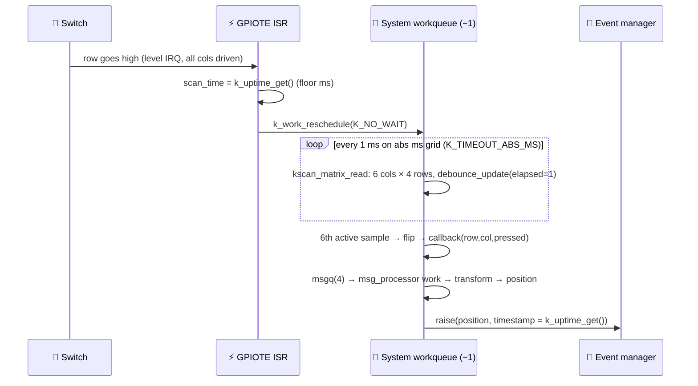
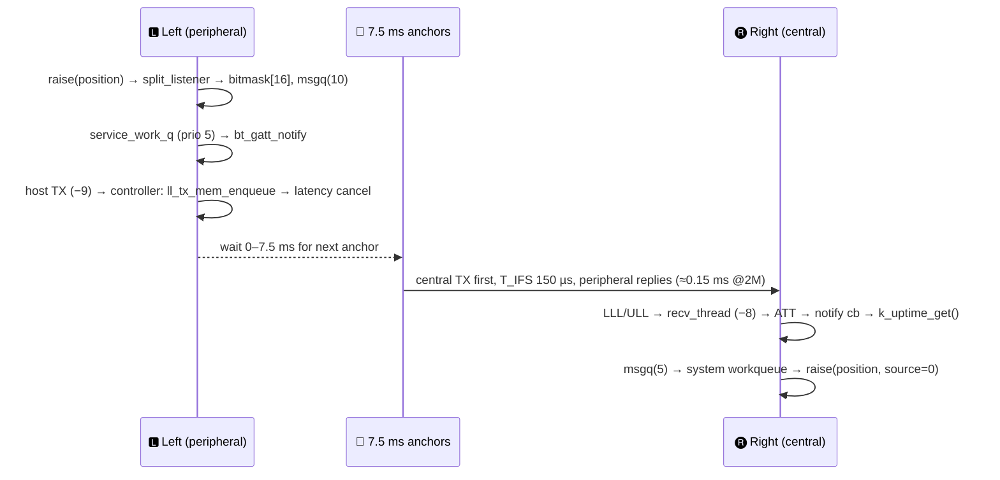

# C — Key press → timestamped position event on the central: latency, jitter, transport

Legend: **[P]** = proven by source/config/empirical run · **[I]** = inferred (reasoning from source, not measured) · **[?]** = ambiguous, test proposed.

Paths: `zmk/` = `/Users/flo/Work/Private/Dev/Keyboard/zmk` (fork HEAD 4211ad7, zero source diffs vs upstream 6e03a0bb — only tooling files differ [P: `git diff --name-only 6e03a0bb..HEAD`]) · `zephyr/` = Zephyr v3.5.0 (zmkfirmware fork, container volume `/workspaces/zmk/zephyr`, commit dacab487) · `cfg/` = `zmk-config/config`. Built firmware config read from `zmk/app/build/{left,right}/zephyr/.config` and `zephyr.dts` (built Sep 27 12:06/12:07, same run as the flashed `zmk.uf2`).

---

## 🎯 TL;DR

- **Timestamps are 1 ms floor values of the central's own clock, stamped at software points, never transmitted** [P]
  - Local key: `k_uptime_get()` in `zmk_physical_layouts_kscan_process_msgq` (`zmk/app/src/physical_layouts.c:178-182`), on the system workqueue.
  - Left-hand key: re-stamped on the right half in the BLE notify callback (`zmk/app/src/split/bluetooth/central.c:259-263`). The payload is a 16-byte position bitmask with no time field (`service.c:242-245, 365-372`).
- **Same-half latency, contact → position event: 4–6 ms** [P by code arithmetic]
  - 5 ms press debounce sampled on a 1 ms grid (`debounce-press-ms 5`, `debounce-scan-period-ms 1`, binding defaults, nothing overridden).
  - From idle (interrupt wake): 4.0–5.0 ms. While any key is already held (1 ms polling): 5.0–6.0 ms.
- **Left-hand keys add 0.5–9 ms (median ≈ 4.5 ms) of BLE latency on top, +7.5 ms per lost/skipped connection event** [I]
  - Split link: connection interval 6 × 1.25 = **7.5 ms**, peripheral latency 30, timeout 4 s, dictated by the central (`central.c:590-593`, `CONFIG_ZMK_SPLIT_BLE_PREF_INT=6`).
  - Peripheral latency is cancelled the moment a packet is queued (`zephyr/subsys/bluetooth/controller/ll_sw/ull_conn.c:253-255` → `ull_periph_latency_cancel`), so the wait is 0–7.5 ms to the next anchor point.
- **Timers are exact to ≤ 61 µs on the board** [P]: tick = 1/32768 s, `K_MSEC(n)` fires in `(⌈n·32.768⌉, ⌈n·32.768⌉+1]` ticks. Timer resolution is NOT a source of ms jitter; the 1 ms floor of timestamps and the BLE grid are.
- **Combo acceptance is a timestamp comparison, not the timer** [P]: `timeout-ms = T` accepts iff `floor(t2) − floor(t1) ≤ T−1` (`zmk/app/src/combo.c:228`). Effective window is T−1…T ms depending on sub-ms phase.
- **Consequence** [I from P parts]: apparent inter-key gap seen by the combo engine ≈ physical gap for R→R (±1.5 ms), **shrunk by 0.5–9 ms for L→R (can invert order)**, stretched by 0.5–9 ms for R→L, and **quantized to the 7.5 ms grid for L→L**. The AK consistency hack has an 11 ms edge (`hold_key_event_delay`); left-hand involvement moves fast bigrams across that edge unpredictably. Yes, transport alone predicts hand-dependent AK inconsistency for bigrams typed ≤ ~20 ms apart.
- **native_posix differs in three ways that matter for tests** [P, empirically confirmed]: tick = 1 ms so every `K_MSEC(n)` fires **n+1 ms** later; the kscan mock adds that +1 to every gap (`ZMK_MOCK_*(…, n)` → n+1 ms); no split/debounce/BLE terms at all.

---

## 📦 Firmware in effect (what the build proves)

- Board/shield: `nice_nano_v2`, `corne_left|corne_right nice_view_adapter nice_view` (`zmk/build_from_docker.sh:28`). Physical layout chosen: `foostan_corne_5col_layout` (built `zephyr.dts` chosen node), 36 positions; left = 0-4,10-14,20-24,30-32, right = 5-9,15-19,25-29,33-35 (`cfg/features/__BASE__/aliases_key_positions.dtsi:21-59`).
- Roles [P]: right central (`cfg/corne_right.conf:4 CONFIG_ZMK_SPLIT_ROLE_CENTRAL=y`), left peripheral (`cfg/corne_left.conf:3 =n`). Both `.config`: `CONFIG_ZMK_SPLIT=y`, `CONFIG_ZMK_SPLIT_BLE=y`.
- Clock [P]: both halves `CONFIG_SYS_CLOCK_TICKS_PER_SEC=32768`, `CONFIG_SYS_CLOCK_HW_CYCLES_PER_SEC=32768`, `CONFIG_NRF_RTC_TIMER=y`, `CONFIG_TICKLESS_KERNEL=y`, `CONFIG_TIMEOUT_64BIT=y`, `CONFIG_CLOCK_CONTROL_NRF_K32SRC_XTAL=y` (50 ppm crystal, `_ACCURACY=50`).
  - Where the default comes from: `zephyr/soc/arm/nordic_nrf/Kconfig.defconfig:21-26`
    ```
    config SYS_CLOCK_HW_CYCLES_PER_SEC
        default 32768
    config SYS_CLOCK_TICKS_PER_SEC
        default 128 if !TICKLESS_KERNEL
        default 32768
    ```
    Nothing in `zmk/app/prj.conf` (one line: `CONFIG_APPLICATION_DEFINED_SYSCALL=y`), the nice_nano board files, or Flo's confs touches it.
- kscan [P]: `zmk,kscan-gpio-matrix`, `diode-direction = "col2row"`, 4 row inputs (pull-down) × 6 col outputs per half (`zmk/app/boards/shields/corne/corne.dtsi:58-70`, `corne_left.overlay:102-111`, `corne_right.overlay:128-137`). No debounce properties in the built `zephyr.dts` kscan node → binding defaults apply.
  - `CONFIG_ZMK_KSCAN_DEBOUNCE_PRESS_MS=-1`, `_RELEASE_MS=-1` → DT values used (`zmk/app/module/drivers/kscan/kscan_gpio_matrix.c:34-46`).
  - `# CONFIG_ZMK_KSCAN_MATRIX_POLLING is not set` → interrupt mode (`kscan_gpio_matrix.c:48-49`).
  - `CONFIG_ZMK_KSCAN_MATRIX_WAIT_BEFORE_INPUTS=0`, `_WAIT_BETWEEN_OUTPUTS=0`, `CONFIG_ZMK_KSCAN_EVENT_QUEUE_SIZE=4`.
- Threads/priorities [P] (`CONFIG_NUM_COOP_PRIORITIES=16`, `K_PRIO_COOP(x) = -(16-x)` at `zephyr/include/zephyr/kernel.h:51`):
  - System workqueue: `CONFIG_SYSTEM_WORKQUEUE_PRIORITY=-1` (lowest cooperative), yields after every item (`# CONFIG_SYSTEM_WORKQUEUE_NO_YIELD is not set`; `zephyr/kernel/work.c:687-694`). Runs: matrix scans, position-event raising, combo/keymap/behaviors, combo & behavior-queue & sticky timers.
  - BT controller `prio_recv_thread` COOP(6) = −10, `recv_thread` COOP(8) = −8 (`zephyr/subsys/bluetooth/controller/hci/hci_driver.c:788-797`); host TX `hci_tx_thread` COOP(7) = −9 (`zephyr/subsys/bluetooth/host/hci_core.c:3999-4002`).
  - `CONFIG_BT_RECV_BLOCKING=y` on both halves → no host RX thread; GATT notify callbacks run directly in `recv_thread` (−8). This is what stamps left-hand keys.
  - Preemptible (positive) prios: `ZMK_SPLIT_BLE_PERIPHERAL_PRIORITY=5` (left notify queue), `ZMK_BLE_THREAD_PRIORITY=5`, display dedicated thread 5, main 0.
- Logging: `CONFIG_ZMK_LOG_LEVEL=4` but `# CONFIG_LOG is not set` → all `LOG_*` compiled out on the board (no log overhead, no on-device timing visibility without `CONFIG_ZMK_USB_LOGGING=y`).
- Peripheral-only sources vs central-only [P] (`zmk/app/CMakeLists.txt:45-74`, `app/src/split/bluetooth/CMakeLists.txt:4-11`): left compiles `split_listener.c`, `service.c`, `peripheral.c`, `physical_layouts.c`; it does NOT compile `keymap.c`, `combo.c`, `behavior_queue.c`, `hid.c`, hold-tap/sticky/macro behaviors. Right compiles `central.c` + everything else.

---

## 1️⃣ Same-half path: contact → `zmk_position_state_changed`



### Scan cadence & debounce [P]
- Defaults (`zmk/app/module/dts/bindings/kscan/zmk,kscan-gpio-matrix.yaml:22-37`): `debounce-press-ms 5`, `debounce-release-ms 5`, `debounce-scan-period-ms 1`, `poll-period-ms 10` (poll period unused: polling mode off).
- Idle: rows armed as `GPIO_INT_LEVEL_ACTIVE` with all columns driven active (`kscan_gpio_matrix.c:153-162`), which nrfx implements as a SENSE/PORT-event level trigger (`zephyr/drivers/gpio/gpio_nrfx.c:230-232` → `NRFX_GPIOTE_TRIGGER_HIGH`).
- ISR (`kscan_gpio_matrix.c:179-191`):
  ```c
  kscan_matrix_interrupt_disable(data->dev);
  data->scan_time = k_uptime_get();
  k_work_reschedule(&data->work, K_NO_WAIT);
  ```
- Scan (`kscan_matrix_read`, `:218-291`): per key `zmk_debounce_update(&state, active, config->debounce_scan_period_ms, &cfg)` (`:247`) — **elapsed is the nominal 1 ms, never measured**.
- Integrator (`zmk/app/module/lib/zmk_debounce/debounce.c:30-54`): counter += 1 while `active != pressed`; flips when `counter < threshold` is false, i.e. on the **6th** consecutive active sample; decrements on non-matching samples (bounce lengthens latency, never shortens it).
- Follow-up scans: `scan_time += 1; k_work_reschedule(&work, K_TIMEOUT_ABS_MS(scan_time))` (`:194-201`) → scans land on **whole-ms boundaries derived from floor(t_irq)**. Absolute timeouts that are already past fire on the next tick (`zephyr/kernel/timeout.c:117-120`, `MAX(1, ticks)`), so a delayed scan catches up rather than drifting.
- Return to interrupt mode only when every key is released and debounced (`:281-288`, `kscan_matrix_read_end :203-216`).

### Latency, contact → position event [P by arithmetic on the above]
- **From idle** (no key held): samples at t_irq (immediate), floor(t_irq)+1 … +5 → flip at `floor(t_irq) + 5 ms` → **4.0–5.0 ms** after contact (plus ISR + context switch, tens of µs).
- **While any key is held or was released < 5 ms ago** (1 ms polling): first sample 0–1 ms after contact, flip 5 scans later → **5.0–6.0 ms**.
- Release: 5.0–6.0 ms after physical release (same integrator, `debounce-release-ms 5`).
- Position event follows the flip by ~10–100 µs: callback → `k_msgq_put` (size 4, `K_NO_WAIT`, return value ignored at `physical_layouts.c:158`; > 4 changes in one 1 ms scan would be dropped silently) → `k_work_submit` → same workqueue, FIFO after the scan item (with a `k_yield()` in between).
- Second key of a bigram is almost always in the polling regime, so **within one half the apparent gap = physical gap + (L2 − L1) with L1 ∈ [4,6], L2 ∈ [5,6]**: −1 … +2 ms, then floor rounding (−1 … 0). Net: apparent ∈ [g−1, g+3] worst case, typically g ± 1.

### Where scan timing can be disturbed [I]
- The scan work item shares the system workqueue with combo/keymap/behavior processing. A long item delays a scan; the absolute schedule then runs the missed scans back-to-back, each still counting 1 ms of debounce → debounce can complete slightly *early* in real time, latency is not extended by more than the stall.
- Cooperative BT threads (−10/−9/−8) can hold the CPU for their packet processing (sub-ms).

---

## 2️⃣ The `timestamp` field

- Struct (`zmk/app/include/zmk/events/position_state_changed.h:23-28`): `uint8_t source; uint32_t position; bool state; int64_t timestamp;` — `source = UINT8_MAX` for local keys, peripheral slot index (0) for left-hand keys.
- **Set where** [P]:
  - Local (both halves): `physical_layouts.c:178-182`
    ```c
    raise_zmk_position_state_changed((struct zmk_position_state_changed){
        .source = ZMK_POSITION_STATE_CHANGE_SOURCE_LOCAL, .state = pressed,
        .position = position, .timestamp = k_uptime_get()});
    ```
    Thread: system workqueue (msg_processor work), i.e. ~µs after the debounce flip.
  - Remote (central only): `central.c:259-263`, inside `split_central_notify_func` running on the controller's `recv_thread` (COOP −8):
    ```c
    struct zmk_position_state_changed ev = {.source = peripheral_slot_index_for_conn(conn),
                                            .position = position, .state = pressed,
                                            .timestamp = k_uptime_get()};
    k_msgq_put(&peripheral_event_msgq, &ev, K_NO_WAIT);
    k_work_submit(&peripheral_event_work);
    ```
    Raised later by `peripheral_event_work_callback` (`:72-78`) on the system workqueue, carrying the recv-thread timestamp.
- **Clock/unit/resolution** [P]: `k_uptime_get()` = `k_ticks_to_ms_floor64(k_uptime_ticks())` (`zephyr/include/zephyr/kernel.h:1757-1760`); ticks come from RTC1 at 32768 Hz (`sys_clock_tick_get` = `curr_tick + elapsed()`, `zephyr/kernel/timeout.c:260-267`, `elapsed()` reads the RTC counter via `sys_clock_elapsed`). Unit = **integer milliseconds, truncated (floor)**, underlying granularity 30.5 µs, crystal-accurate (50 ppm). Two events 0.99 ms apart can show a gap of 0 or 1.
- **Central re-stamps; nothing is trusted from the peripheral** [P]: the peripheral's `split_listener` ignores `pos_ev->timestamp` (`split_listener.c:497-503`) and only sends `position`; the wire format is `uint8_t position_state[16]` (`service.c:242-245`), notified whole (`:365-372`); the central diffs it against its cached copy (`central.c:248-258`). Each half has its own free-running RTC; they are never compared.
- Event dispatch is synchronous in the raising thread, listeners in link order, `CAPTURED`/`HANDLED` stops the chain (`zmk/app/src/event_manager.c:20-46`). Combo re-raises captured events with their **original** timestamps (`combo.c:262-266` copies the event, `:273-288` releases/re-raises).
- Timestamp provenance further down [P] (matters for AK windows): combo behavior press uses the first captured key's timestamp (`combo.c:349`); macro/behavior-queue steps use `k_uptime_get()` at dequeue time (`behavior_queue.c:34-35`); sticky key `release_at = event.timestamp + release_after_ms` (`behavior_sticky_key.c:182`).
- Ordering corner case [I]: a left key stamped in `recv_thread` at A can be *raised* after a right key stamped at B > A if a scan work item was already queued ahead of `peripheral_event_work`. Inversions are bounded by workqueue backlog (sub-ms), so the combo engine can see a timestamp go backwards by ~1 ms.

---

## 3️⃣ BLE split link (left → right)



### Parameters [P]
- Kconfig (`zmk/app/src/split/bluetooth/Kconfig:93-104`): `ZMK_SPLIT_BLE_PREF_INT` default 6, `_PREF_LATENCY` 30, `_PREF_TIMEOUT` 400. Built right `.config`: `CONFIG_ZMK_SPLIT_BLE_PREF_INT=6`, `_LATENCY=30`, `_TIMEOUT=400` → interval **7.5 ms**, peripheral latency 30 (may skip up to 30 events = 225 ms when idle), supervision timeout 4 s.
- Applied by the central at connection creation (`central.c:590-593`):
  ```c
  struct bt_le_conn_param *param = BT_LE_CONN_PARAM(CONFIG_ZMK_SPLIT_BLE_PREF_INT, CONFIG_ZMK_SPLIT_BLE_PREF_INT,
                                                    CONFIG_ZMK_SPLIT_BLE_PREF_LATENCY, CONFIG_ZMK_SPLIT_BLE_PREF_TIMEOUT);
  err = bt_conn_le_create(addr, BT_CONN_LE_CREATE_CONN, param, &slot->conn);
  ```
- Peripheral never renegotiates: left `.config` `# CONFIG_BT_GAP_AUTO_UPDATE_CONN_PARAMS is not set` (forced by `split/bluetooth/Kconfig:127-129`).
- `CONFIG_BT_PERIPHERAL_PREF_MIN_INT=6 / MAX_INT=12 / LATENCY=30 / TIMEOUT=400` (`zmk/app/Kconfig:235-245`) govern the **right half ↔ Mac** link (right has `CONFIG_BT_GAP_AUTO_UPDATE_CONN_PARAMS=y`), not the split link.
- PHY: `CONFIG_BT_CTLR_PHY_2M=y`, `CONFIG_BT_AUTO_PHY_UPDATE=y`, `CONFIG_BT_USER_PHY_UPDATE=y` (selected by `split/Kconfig:18-19`) → split link is expected on 2M PHY [I: auto-update requests it; not observed].
- TX power +8 dBm (`cfg/corne.conf:32`). Queues: peripheral `ZMK_SPLIT_BLE_PERIPHERAL_POSITION_QUEUE_SIZE=10`, central `ZMK_SPLIT_BLE_CENTRAL_POSITION_QUEUE_SIZE=5`. Controller `CONFIG_BT_CTLR_RX_BUFFERS=1`, host `BT_BUF_ACL_RX_COUNT=3`, `BT_BUF_ACL_TX_COUNT=3` (left).

### Transmission mechanics [P]
- Peripheral: `split_listener` (`split_listener.c:494-503`) → `zmk_split_bt_position_pressed/released` (`service.c:402-410`, `WRITE_BIT` into `position_state[position/8]`) → `send_position_state` (`:381-400`): `k_msgq_put(&position_state_msgq, position_state, K_MSEC(100))` then `k_work_submit_to_queue(&service_work_q, …)` → `send_position_state_callback` drains the queue calling `bt_gatt_notify(NULL, &split_svc.attrs[1], &state, 16)` (`:368-377`). One notification per state change; each is a full snapshot.
  - Queue full → oldest snapshot discarded (`:385-389`); `bt_gatt_notify` error → change dropped with only a debug log (`:373-375`), and because the central diffs snapshots, a dropped press whose release is later delivered is lost entirely.
- Controller: `ll_tx_mem_enqueue` → `ull_periph_latency_cancel(conn, handle)` (`zephyr/subsys/bluetooth/controller/ll_sw/ull_conn.c:253-255`; body `ull_peripheral.c:477-495`: `ticker_update(..., lazy=0, ...)` when `latency_event` is active) → the peripheral listens at the next anchor instead of sleeping through latency.
- Multiple PDUs per event: LLL sets `md=1` while more TX is queued and the event continues until both sides have `md=0` (`zephyr/subsys/bluetooth/controller/ll_sw/nordic/lll/lll_conn.c:793-798`, `:326-328`).
- Central: notify callback `split_central_notify_func` (`central.c:230-272`) diffs 16 bytes, emits one event per changed bit, stamps, queues (`K_NO_WAIT`, result ignored `:265`), submits `peripheral_event_work`; raised on the system workqueue (`:72-78`).
- Disconnect: central raises synthetic releases for every held left position with a fresh `k_uptime_get()` (`central.c:120-134`).

### Latency & jitter, left key vs right key [I unless noted]
| Stage | Left-hand key | Right-hand key |
|---|---|---|
| Scan + debounce [P] | 4–6 ms | 4–6 ms |
| Peripheral SW to controller queue | ~0.1–0.5 ms | — |
| Wait for next connection anchor | 0–7.5 ms (uniform) | — |
| Air + central controller + host to `k_uptime_get()` | ~0.3–1 ms | — |
| Central msgq → workqueue → raise | ~0.05–0.5 ms (waits for any running work item) | ~0.01–0.1 ms |
| **Total contact → timestamp** | **≈ 5–15 ms, median ≈ 9.5** | **4–6 ms** |
| Tail | +7.5 ms per CRC-failed event or per event skipped due to overlap with the Mac link (right half is central for the split link and peripheral for the Mac link at 7.5–15 ms; `CONFIG_BT_CTLR_SCHED_ADVANCED=y` resolves overlaps by skipping) | none |

- Differential BLE term **d = (left timestamp latency) − (right timestamp latency) ≈ 0.5–9 ms, median ≈ 4.5**, occasionally +7.5.
- Deep sleep (`ZMK_IDLE_SLEEP_TIMEOUT` right 20 min, left 2 h) is out of band: a press after sleep reboots the half and the first keystroke is consumed by wake/reconnect.

---

## 4️⃣ Timer resolution on this board (`k_work_delayable`) [P]

- `K_MSEC(ms)` → `Z_TIMEOUT_MS` → `k_ms_to_ticks_ceil64` (`zephyr/include/zephyr/sys_clock.h:121`, `TIMEOUT_64BIT=y`) → `⌈ms × 32.768⌉` ticks.
- `z_add_timeout` (`zephyr/kernel/timeout.c:99-122`):
  ```c
  if (IS_ENABLED(CONFIG_TIMEOUT_64BIT) && Z_TICK_ABS(timeout.ticks) >= 0) {
      k_ticks_t ticks = Z_TICK_ABS(timeout.ticks) - curr_tick;
      to->dticks = MAX(1, ticks);            /* absolute: exact tick, or next tick if past */
  } else {
      to->dticks = timeout.ticks + 1 + elapsed();   /* relative: +1 tick */
  }
  ```
  `elapsed()` (`:62-80`) reads the RTC, so relative timeouts expire at `floor(now_ticks) + ⌈ms×32.768⌉ + 1` → real delay ∈ `(⌈ms×32.768⌉, ⌈ms×32.768⌉+1]` ticks.
- RTC programming rounds up to a tick boundary and forces an immediate ISR if the target is already past (`zephyr/drivers/timer/nrf_rtc_timer.c:640-690`, `compare_set_nolocks`). On expiry `work_timeout` submits the item from ISR context (`zephyr/kernel/work.c:810-830`).
- Concrete windows (earliest → latest, unloaded):

| `K_MSEC(n)` | ticks | fires after |
|---|---|---|
| 10 (`ak_tap_time`, `TEMP_macro_tap_time`) | 328 | 10.010–10.040 ms |
| 11 (`hold_key_event_delay`) | 361 | 11.017–11.047 ms |
| 16 (`my_combo_timeout_adjacent`) | 525 | 16.021–16.052 ms |
| 18 (`my_combo_timeout_non_adjc`) | 590 | 18.005–18.036 ms |
| 30 (`my_combo_timeout_two_hnds`) | 984 | 30.029–30.060 ms |
| 100 (`my_ak_window`, `linger_term`) | 3277 | 100.006–100.037 ms |
| 130 / 1000 | 4260 / 32768 | 130.005–130.035 / 1000.000–1000.031 ms |

- Add ISR + context switch (~10–50 µs) and, if the system workqueue is mid-item, the remainder of that item. Loaded worst case is still ≪ 1 ms unless a behavior does something heavy. **Timer jitter is not the ms-scale jitter source.**
- Users and how they combine with floor-ms timestamps:
  - combo: `k_work_schedule(&timeout_task, K_MSEC(first_timeout - k_uptime_get()))` (`combo.c:417`), `timeout_at = timestamp + timeout_ms` (`:155`). Integer-ms arithmetic ⇒ timer fires in `(floor(t1)+T, floor(t1)+T+1]` ms; the handler (`:472-480`) filters with `timestamp = timeout_at`. **The second key's acceptance is decided by `candidate->timeout_at > data->timestamp` (`:228`), i.e. `floor(t2) − floor(t1) ≤ T−1`.**
  - behavior queue (macros): `k_work_schedule(&queue_work, K_MSEC(item.wait))` (`behavior_queue.c:46`); each dequeued step is stamped with a fresh `k_uptime_get()` (`:35`).
  - sticky key (`aksl`): `release_at = event.timestamp + release_after_ms; k_work_schedule(&release_timer, K_MSEC(release_at - k_uptime_get()))` (`behavior_sticky_key.c:182-186`); late events are checked against `release_at` on arrival (`:285`).
  - hold-tap: same pattern (`behavior_hold_tap.c:619-620`, `:636`).

---

## 5️⃣ Consequence: apparent vs physical inter-key gap, per direction

Let g = physical gap (contact-to-contact), d = differential BLE latency of a left key (≈ 0.5–9 ms, median 4.5, tail +7.5). Apparent gap = `floor(t2_stamp) − floor(t1_stamp)`.

| Bigram | Apparent gap | Notes |
|---|---|---|
| **R→R** | g − 1 … g + 3, typically g ± 1 | only debounce phase + 1 ms floor [P] |
| **L→R** | **g − d** (≈ g − 0.5 … g − 9) | shrinks; for g < d the central sees **R before L** (order inversion) [I] |
| **R→L** | **g + d** (≈ g + 0.5 … g + 9) | stretches [I] |
| **L→L** | **k × 7.5 ± 1**, k = ⌊g/7.5⌋ or ⌈g/7.5⌉; possibly ≈ 0–1 if both PDUs ride one connection event | quantized to the anchor grid: a 9 ms physical gap shows as 7–8 or 14–16 ms [I] |

What this does to the thresholds in `cfg/CONFIG.h`:
- `my_combo_timeout_adjacent 16` (accept iff apparent ≤ 15): right hand stable; **left hand coin-flip for physical gaps 8–15 ms** (lands on 7–8 → in, or 14–16 → in/in/out).
- `my_combo_timeout_non_adjc 18` (accept ≤ 17): left-hand grid points 7–8 and 14–16 are all in, 21–23 all out → **stable** on the left despite quantization.
- `my_combo_timeout_two_hnds 30` (accept ≤ 29): effective physical window ≈ 30–38 ms for L→R, ≈ 21–29 ms for R→L. Flo's note "sometimes triggers when I didn't want it to" matches the L→R stretch of the window.
- **AK consistency hack** (`COMBO_AK_CONSISTENCY_HACK` on `ALL_KEYS` with `hold_key_event_delay = 11`, `cfg/features/hands_down/adaptive_keys/combos.dtsi:61-65`): two presses with **apparent gap ≤ 10** are captured together and released back-to-back (`combo.c:273-288`); the second is then processed before the first key's `&aksl` layer activates (activation = `ak_tap_time` 10 ms after the first key's release from the hack combo: `&ak` macro `tap-ms = <ak_tap_time>` then `&macro_tap &aksl`, `cfg/features/hands_down/adaptive_keys/macros.dtsi:25-39`). Flo's own comment calls this the "minor caveat" (`combos.dtsi:56-59`) assuming it only happens for genuinely simultaneous presses. With transport skew it happens for:
  - **L→R** physical gaps up to ~11 + d ≈ 12–20 ms (fast rolls) — pushed under the edge;
  - **L→L** physical gaps 5–15 ms — land on 7–8 (fails) or 14–16 (works) by anchor phase;
  - **R→R** only physical gaps ≤ ~10–11 ms (as designed);
  - **R→L** never (stretched away from the edge), but the same stretch pushes gaps > ~112 ms past the `aksl` upper edge (`release_at` = activation time ≈ floor(t1)+21 + 100).
- **Verdict**: yes, transport alone predicts AK inconsistency, concentrated on fast bigrams (≤ ~20 ms) that involve the left hand, worse for L→R and L→L than R→R. No constant `hold_key_event_delay` can be consistent for the left hand because the whole 0–9 ms band (plus 7.5 ms grid) is inside the decision region. Same-hand right bigrams should feel consistent; if they do not, the cause is elsewhere (combo engine / behavior-queue ordering, other agents' topics).

---

## 🧪 native_posix: what differs (tests must account for this)

- Tick rate 1000 Hz: `zmk/app/boards/native_posix_64.conf:15 CONFIG_SYS_CLOCK_TICKS_PER_SEC=1000` (HW cycles 1 MHz, `zephyr/boards/posix/native_posix/native_posix_64_defconfig:6`). Tick = 1 ms = timestamp resolution.
- Simulated time advances only when the CPU is idle, so `elapsed()` is 0 whenever work handlers schedule timers → **`K_MSEC(n)` fires exactly n+1 ms later** (the `+1` in `timeout.c:122` becomes a full millisecond). On hardware the same `+1` is 30.5 µs.
- Kscan mock (`zmk/app/module/drivers/kscan/kscan_mock.c:47-97`): the delay stored in event i is scheduled **after delivering event i** and again **before event 0** (index is incremented after scheduling, `:71-73`); `ZMK_MOCK_PRESS(r,c,ms)` packs `ms` in bits 16–30 (`zmk/app/module/include/dt-bindings/zmk/kscan_mock.h:10-14`). Net: first event at `events[0].ms + 1`, gap after event i = `events[i].ms + 1`. After the last real event it reads one past the array (`exit_after` byte → phantom `RELEASE(1,0)`), then `exit(0)` (`:59-62`) — the phantom is never processed, but **any timer due after `last.ms + 1` never fires** (pad the last event).
- No split, no debounce, no BLE, single deterministic thread order; every key is `source = LOCAL`; timestamp = the mock's delivery tick (msgq → workqueue runs in the same simulated ms).
- Logging on (`CONFIG_LOG=y`, `CONFIG_ZMK_LOG_LEVEL_DBG=y`); log prefix `[hh:mm:ss.mmm,uuu]` is simulated time; `zmk/app/run-test.sh:35` strips it (`sed -e "s/.*> //"`), so run `zmk.exe` directly to read timings.
- **Empirical confirmation [P]** (throwaway build in the container's `/tmp`, removed afterwards; keymap: combo `timeout-ms = <30>` on positions 0,1; `&kp A &kp B / &kp D &kp E`):
  - events `PRESS(0,0,29) PRESS(0,1,10) RELEASE(0,0,10) RELEASE(0,1,10) PRESS(1,0,100) RELEASE(1,0,10)` → position events at **30, 60, 71, 82, 93, 194** ms; exit at 205. Gap 30 → `filter_timed_out_candidates: remaining_candidates=0 timestamp=60` → A and B typed separately (combo rejected).
  - events `PRESS(0,0,28) PRESS(0,1,10) … RELEASE(0,1,100) PRESS(0,0,100) RELEASE(0,0,50)` → events at **29, 58**: `remaining_candidates=1 timestamp=58` → **C fired** (gap 29 accepted). Lone press at 181 → timer handler logged at **212** with `timestamp=211` (= t1 + 30, handler at t1 + T + 1).
  - Upstream test `zmk/app/tests/combo/overlapping-combos-4-different-timeouts` corroborates: `press_A_and_wait(50)` lands at 51 and its snapshot shows `timestamp=71/81/91` for the 20/30/40 ms combos.
- Translation rule for test authors: a hardware apparent gap G is produced on native_posix by `ZMK_MOCK_*(…, G−1)`; a combo `timeout-ms = T` accepts mock delays ≤ T−2.

---

## ❓ Ambiguities & how to settle them

- **[?] Distribution of d on real hardware** (0–7.5 ms uniform + ~1 ms, or something worse): enable `CONFIG_ZMK_USB_LOGGING=y` on the right half, tap a left key and a right key with a jig/known cadence, compare `Row: … position:` (local) vs `[NOTIFICATION]`/`Trigger key position state change` (remote) log timestamps. Alternatively a logic analyzer on a left row pin vs the USB HID report.
- **[?] Do two left presses < 7.5 ms apart share one connection event** (apparent gap 0–1 ms) or serialize (7–8 ms)? `BT_CTLR_RX_BUFFERS=1` on the central makes single-PDU-per-event plausible. Same USB-logging setup, press two left keys ~3 ms apart repeatedly, histogram the apparent gaps.
- **[?] How often the Mac link steals a split anchor** (+7.5 ms tail): count apparent L→R gaps that exceed g + 9.
- **[?] 2M PHY actually negotiated**: `split_central_process_connection` logs `info.le.phy->rx_phy` (`central.c:550-551`) once logging is on.
- Not ambiguous but untestable on native_posix: everything in sections 1 and 3. native_posix can only test the *consequences* (sections 4–5) by feeding mock gaps that emulate the skew.

---

## ✅ Testable claims (native_posix unless marked HW)

- **C1** `K_MSEC(n)` fires n+1 ms later on native_posix; every mock gap is `ms+1`. Test: `PRESS(0,0,10) PRESS(0,1,16) RELEASE(0,0,10) RELEASE(0,1,10)` → position-event log lines at 11, 28, 39, 50 ms (raw `zmk.exe` output).
- **C2** Combo `timeout-ms = T` accepts iff floor-gap ≤ T−1. Test: T=16, keys 0,1 → `PRESS(0,0,14)` (gap 15) fires combo; `PRESS(0,0,15)` (gap 16) types both keys.
- **C3** Combo timeout handler runs at floor(t1)+T+1 on native_posix (floor(t1)+T + ≤ 1 ms on HW). Test: lone `PRESS(0,0,100)` with T=30 → `filter_timed_out_candidates … timestamp=t1+30` logged at t1+31.
- **C4** AK hack edge = apparent gap 11 (accept ≥ 11, fail ≤ 10). Test with Flo's AK config on a 2-key mock: `&ak`-key then partner key at mock delay 9 (gap 10) → base-layer output; delay 10 (gap 11) → adaptive output.
- **C5** L→R skew emulation: for a physical 15 ms L→R bigram the central sees 6–14 ms; C4 predicts failure below 11. Test: same keymap, sweep delays 4…14 and record which produce the AK output; expect a hard step between 9 and 10.
- **C6** L→L quantization emulation: gaps 7 and 8 (one anchor) vs 14, 15, 16 (two anchors) against the 16 ms adjacent combo: 7, 8, 14, 15 accept; 16 rejects → same physical gesture (9 ms) succeeds or fails by anchor phase.
- **C7 (HW)** Same-half contact→event latency is 4–6 ms and the left/right differential d is 0.5–9 ms with a 7.5 ms tail; requires USB logging or a logic analyzer.
- **C8** Peripheral-side: a left key never carries its own timestamp — on the central the event's `timestamp` equals the receive time (HW log: `Trigger key position state change` time ≈ notification time, not the left half's press time). Native-posix cannot test.
