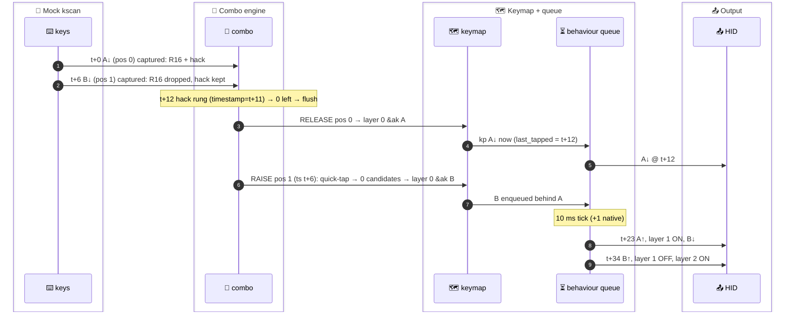

# 🧪 T-02: `&ak` key 1, then key 2 less than 11 ms later → quick-tap bypass (the disputed case)

> **Status: complete.** 3 sub-cases (spec run + 2 controls), all built and ran. The raw logs were re-generated from the built `zmk.exe --no-rt` on 2026-09-30 and came out **byte-identical** (md5 below). Snapshots in `results/` match the case directories.
> **Verdict: `deviates` (timing only).** Two predicted times are 1 ms early: B↓ and `layer 1 state 1` came at **t+23**, the spec said **t+22**. The mechanism, the outcome (MISS, "AB"), every ordering claim and the "no K" claim all hold.

---

## 🎯 Result first

- ❌ **MISS confirmed (R1, hack on, Δ = 6).**
  - A is released by the **hack rung** at t+12 (native), not at Δ.
  - B is re-raised in the same burst. It is **not re-captured** and is resolved on **layer 0** at t+12, which is 11 ms before `layer 1` turns on.
  - HID output: **`A B`**. K (0x0E) is never pressed.
- 🔬 **The mechanism is the quick-tap check. Control (c) shows it.**
  - Control (c) changes one thing: the hack's `require-prior-idle-ms` goes from −1 (default) to −100.
  - Result: the re-raised B is **captured** again, gets **no timer** (stranded), and is delivered only at A's physical release (t+67), on `layer 1` → **`A K`**.
- 🧪 **Hack-off control (b) also MISSes.**
  - A leaves at Δ (t+6) because B shares no combo with it. B has no combo, so it bubbles immediately on base → **`A B`**.
  - This matches MODEL (d) "OFF, k2 = 0, k1 = 16 → ❌ for Δ ≤ 25".
- ⚠️ **Where the only deviation comes from: the spec's arithmetic.**
  - The spec added the native +1 to the combo timer (t+11 → t+12) but not to the 10 ms queue tick.
  - The queue tick also runs +1 on native (G §1 "10 → 11"; RIG baseline "`&ak` layer ON at delivery + 11"; CLAIMS R2 note "layer on at delivery + 11").
  - So the expected native value is 12 + 11 = **t+23**, which is what the log shows.

---

## 📜 Spec (CLAIMS.md, verbatim)

> **T-02 Sub-11-ms bigram, `&ak` key 1 → quick-tap bypass (the disputed case)** — R1, hack on. `PRESS(0,0,5) PRESS(0,1,60) RELEASE(0,0,40) RELEASE(0,1,300)` (A at t, B-key at t+6). Expect at `t+12`: `remaining_candidates=0 timestamp=t+11`, `releasing position event 0`, `kp_pressed 0x04` (A), `reraising position event 1`, **no** `capturing position event 1`, `kp_pressed 0x05` (B) at `t+22` (queued behind A's tap), `layer 1 state 1` at `t+22`, no `kp_pressed 0x0E` (K). Purpose: settle E-29/E-30/E-38 (contradictions 1–3); MISS predicted.

- 🧭 **Checked against RIG.md. No corrections needed for:**
  - Coordinates: pos 0 = (0,0) `&ak 1 A`, candidates R16 + hack (k1 = 16). Pos 1 = (0,1) `&ak 2 B`, hack only (k = 11). Follower on layer 1 at pos 1 = `&bk K`.
  - Keycodes: A 0x04, B 0x05, K 0x0E.
  - Mock timing: e0.ms = 5 is both the boot delay and the gap after e0 → t = abs 6, B at abs 12 = t+6. The spec already accounts for the doubling.
- ⚠️ **One correction: the B↓ / layer-ON time.** The spec says t+22. The RIG native rule (delivery + 11) gives **t+23**.

---

## 🗂️ Sub-cases

| case | dir (`zmk/app/tests/ak-truth/…`) | change vs `_rig_R1` | raw log md5 |
|---|---|---|---|
| **(a) spec** | `T-02-a-spec/` | events block only | `b9c587eb1398d09b178e5293448c339d` |
| **(b) hack off** | `T-02-b-nohack/` | `/delete-node/ &combo_hack;` + same events | `e31638965b7e886a19f687643b016b3e` |
| **(c) quick-tap disabled** | `T-02-c-noquicktap/` | `&combo_hack { require-prior-idle-ms = <(-100)>; };` + same events | `e717043f2be620b3b6af0d7ff31f5032` |

- **Events (identical in all three):**
  ```
  ZMK_MOCK_PRESS(0,0,5)      A↓   abs 6   (t)
  ZMK_MOCK_PRESS(0,1,60)     B↓   abs 12  (t+6)
  ZMK_MOCK_RELEASE(0,0,40)   A↑   abs 73  (t+67)
  ZMK_MOCK_RELEASE(0,1,300)  B↑   abs 114 (t+108), exit abs 415
  ```
- **Diffs vs the template** (`diff _rig_R1/native_posix_64.keymap <case>/native_posix_64.keymap`; `.conf` and `events.patterns` are unchanged in all three):
  - (a): only the appended `&kscan { events = <…>; };` block above.
  - (b):
    ```
    > /* T-02 (b) — control: same events as (a), consistency hack DELETED (R1 idiom from RIG). */
    > /delete-node/ &combo_hack;
    ```
  - (c):
    ```
    > &combo_hack {
    >     require-prior-idle-ms = <(-100)>;
    > };
    ```
- **What was compiled** (from each build's `zephyr.dts` / `devicetree_generated.h`):
  - (a): the hack node has no `require-prior-idle-ms` → `DT_N_S_combos_S_combo_ak_consistency_hack_P_require_prior_idle_ms -1`, the binding default from `dts/bindings/zmk,combos.yaml:21-23`.
  - (b): the hack node is absent.
  - (c): `require-prior-idle-ms = < 0xffffff9c >` → generated `4294967196`. The `int32_t require_prior_idle_ms` field (`combo.c:34`) wraps that to −100. The observed re-capture confirms it took effect.
- **Mechanism under test** (`combo.c:141-143, 153`):
  ```c
  static bool is_quick_tap(struct combo_cfg *combo, int64_t timestamp) {
      return (last_tapped_timestamp + combo->require_prior_idle_ms) > timestamp;
  }
  ...
  if (combo_active_on_layer(combo, highest_active_layer) && !is_quick_tap(combo, timestamp)) {
  ```
  - `last_tapped_timestamp` is updated on every non-modifier keycode down (`combo.c:84-89, 496-502`).
  - A queue-invoked `&kp` is stamped `k_uptime_get()` at execution (`behavior_queue.c:35`). Here that is A's `kp` at abs 18.

---

## (a) `T-02-a-spec`: CLAIMS verbatim, hack ON



### 📜 Relevant log lines (verbatim; noise lines `USB endpoint…`, `bubble…`, `handle_control_binding…` omitted)

```
[00:00:00.006,000] <dbg> zmk: zmk_physical_layouts_kscan_process_msgq: Row: 0, col: 0, position: 0, pressed: true
[00:00:00.006,000] <dbg> zmk: position_state_down: combo: capturing position event 0
[00:00:00.012,000] <dbg> zmk: zmk_physical_layouts_kscan_process_msgq: Row: 0, col: 1, position: 1, pressed: true
[00:00:00.012,000] <dbg> zmk: filter_timed_out_candidates: after filtering out timed out combo candidates: remaining_candidates=2 timestamp=12
[00:00:00.012,000] <dbg> zmk: position_state_down: combo: capturing position event 1
[00:00:00.018,000] <dbg> zmk: filter_timed_out_candidates: after filtering out timed out combo candidates: remaining_candidates=0 timestamp=17
[00:00:00.018,000] <dbg> zmk: release_pressed_keys: combo: releasing position event 0
[00:00:00.018,000] <dbg> zmk: zmk_keymap_apply_position_state: layer_id: 0 position: 0, binding name: flo,behavior-adaptive-key
[00:00:00.018,000] <dbg> zmk: behavior_queue_process_next: Invoking key_press: 0x70004 0x00
[00:00:00.018,000] <dbg> zmk: hid_listener_keycode_pressed: usage_page 0x07 keycode 0x04 implicit_mods 0x00 explicit_mods 0x00
[00:00:00.018,000] <dbg> zmk: behavior_queue_process_next: Processing next queued behavior in 10ms
[00:00:00.018,000] <dbg> zmk: release_pressed_keys: combo: reraising position event 1
[00:00:00.018,000] <dbg> zmk: zmk_keymap_apply_position_state: layer_id: 0 position: 1, binding name: flo,behavior-adaptive-key
[00:00:00.018,000] <dbg> zmk: queue_macro: Iterating macro bindings - starting: 0, count: 7
[00:00:00.029,000] <dbg> zmk: hid_listener_keycode_released: usage_page 0x07 keycode 0x04 implicit_mods 0x00 explicit_mods 0x00
[00:00:00.029,000] <dbg> zmk: behavior_queue_process_next: Invoking flo,behavior-adaptive-key-sticky-layer: 0x01 0x00
[00:00:00.029,000] <dbg> zmk: on_sticky_key_binding_pressed: 0 new sticky_key
[00:00:00.029,000] <dbg> zmk: set_layer_state: layer_changed: layer 1 state 1
[00:00:00.029,000] <dbg> zmk: behavior_queue_process_next: Invoking key_press: 0x70005 0x00
[00:00:00.029,000] <dbg> zmk: hid_listener_keycode_pressed: usage_page 0x07 keycode 0x05 implicit_mods 0x00 explicit_mods 0x00
[00:00:00.029,000] <dbg> zmk: behavior_queue_process_next: Processing next queued behavior in 10ms
[00:00:00.040,000] <dbg> zmk: hid_listener_keycode_released: usage_page 0x07 keycode 0x05 implicit_mods 0x00 explicit_mods 0x00
[00:00:00.040,000] <dbg> zmk: set_layer_state: layer_changed: layer 1 state 0
[00:00:00.040,000] <dbg> zmk: set_layer_state: layer_changed: layer 2 state 1
[00:00:00.073,000] <dbg> zmk: zmk_physical_layouts_kscan_process_msgq: Row: 0, col: 0, position: 0, pressed: false
[00:00:00.073,000] <dbg> zmk: queue_macro: Iterating macro bindings - starting: 7, count: 0
[00:00:00.114,000] <dbg> zmk: zmk_physical_layouts_kscan_process_msgq: Row: 0, col: 1, position: 1, pressed: false
[00:00:00.141,000] <dbg> zmk: set_layer_state: layer_changed: layer 2 state 0
[00:00:00.415,000] <dbg> zmk: kscan_mock_schedule_next_event_0: Exiting
```

- ✅ **No `capturing position event 1` after the re-raise.** The line right after `reraising position event 1` at `[.018]` is `zmk_keymap_apply_position_state: layer_id: 0 position: 1`, in the same ms.
- ✅ **No combo line of any kind between `[.018]` and `[.073]`.**

### ⏱️ Timeline (t = abs 6; `tl.py`)

| rel | abs | event |
|---|---|---|
| +0 | 6 | A↓ pos 0 → captured (R16 + hack) |
| +6 | 12 | B↓ pos 1 → `remaining_candidates=2 timestamp=12` → captured (R16 then dropped by the position filter, not logged) |
| +12 | 18 | hack rung `remaining_candidates=0 timestamp=17` → release pos 0 → layer 0 `&ak A` → **HID ↓ A** → queue wait 10 → **reraise pos 1 → layer 0 `&ak B`** (no capture) |
| +23 | 29 | HID ↑ A → aksl 1 → **LAYER 1 ON** → **HID ↓ B** → queue wait 10 |
| +34 | 40 | HID ↑ B → LAYER 1 OFF (consumed by B) → aksl 2 → LAYER 2 ON |
| +67 | 73 | A↑ physical → `&ak` release branch, count 0 → no output |
| +108 | 114 | B↑ physical → no output |
| +135 | 141 | LAYER 2 OFF (sticky 100 + 1) |
| +409 | 415 | EXIT |

### ⚖️ Line-by-line verdict

| # | expected (spec) | observed | |
|---|---|---|---|
| 1 | at t+12: `remaining_candidates=0 timestamp=t+11` | `[00:00:00.018,000] … remaining_candidates=0 timestamp=17` = t+12, timestamp t+11 | ✅ |
| 2 | at t+12: `releasing position event 0` | `[00:00:00.018,000] … releasing position event 0` | ✅ |
| 3 | at t+12: `kp_pressed 0x04` (A) | `[00:00:00.018,000] … hid_listener_keycode_pressed … keycode 0x04` | ✅ |
| 4 | at t+12: `reraising position event 1` | `[00:00:00.018,000] … reraising position event 1` | ✅ |
| 5 | **no** `capturing position event 1` (at the re-raise) | none after `[.018]`. The only one is `[00:00:00.012,000]`, i.e. B's physical press at t+6, when it shares the hack with A | ✅ (scoped to t+12, as the spec groups it) |
| 6 | `kp_pressed 0x05` (B) at **t+22**, queued behind A's tap | `[00:00:00.029,000] … keycode 0x05` = **t+23**. Letter, base-layer resolution and queue ordering (after A↑) all as predicted | ❌ **+1 ms** |
| 7 | `layer 1 state 1` at **t+22** | `[00:00:00.029,000] … layer 1 state 1` = **t+23** | ❌ **+1 ms** |
| 8 | no `kp_pressed 0x0E` (K) | no `keycode 0x0E` anywhere in the log | ✅ |
| 9 | MISS | HID `A B` | ✅ |

- ➕ **Not in the spec, but observed:**
  - B was resolved on `layer_id: 0` at t+12, **11 ms before** `layer 1 state 1` (t+23).
  - Layer 1 was consumed by B's own keycode and turned off at B↑ (t+34).
  - B's `&ak` then armed `layer 2` (akB) t+34 → t+135.
  - A left at the **hack rung** (t+12), not at R16's deadline (t+17) and not at Δ (t+6). B's press dropped R16 without emptying the set.

### 📤 HID output

```
t+12  A↓   0x04
t+23  A↑   0x04
t+23  B↓   0x05
t+34  B↑   0x05
→ "AB"   (adapted would be "AK")
```

---

## (b) `T-02-b-nohack`: same events, hack deleted

- **Prediction** (MODEL (d), "Hack OFF, k2 = 0, k1 = 16" → ❌ for Δ ≤ 25):
  - A delivered at `min(Δ, k1)` = Δ.
  - B has no combo, so it bubbles at Δ on base.
  - Layer at A's delivery + 10 (+1 native).

```
[00:00:00.006,000] <dbg> zmk: position_state_down: combo: capturing position event 0
[00:00:00.012,000] <dbg> zmk: zmk_physical_layouts_kscan_process_msgq: Row: 0, col: 1, position: 1, pressed: true
[00:00:00.012,000] <dbg> zmk: filter_timed_out_candidates: after filtering out timed out combo candidates: remaining_candidates=1 timestamp=12
[00:00:00.012,000] <dbg> zmk: position_state_down: combo: capturing position event 1
[00:00:00.012,000] <dbg> zmk: release_pressed_keys: combo: releasing position event 0
[00:00:00.012,000] <dbg> zmk: zmk_keymap_apply_position_state: layer_id: 0 position: 0, binding name: flo,behavior-adaptive-key
[00:00:00.012,000] <dbg> zmk: hid_listener_keycode_pressed: usage_page 0x07 keycode 0x04 implicit_mods 0x00 explicit_mods 0x00
[00:00:00.012,000] <dbg> zmk: release_pressed_keys: combo: reraising position event 1
[00:00:00.012,000] <dbg> zmk: zmk_keymap_apply_position_state: layer_id: 0 position: 1, binding name: flo,behavior-adaptive-key
[00:00:00.023,000] <dbg> zmk: hid_listener_keycode_released: usage_page 0x07 keycode 0x04 implicit_mods 0x00 explicit_mods 0x00
[00:00:00.023,000] <dbg> zmk: set_layer_state: layer_changed: layer 1 state 1
[00:00:00.023,000] <dbg> zmk: hid_listener_keycode_pressed: usage_page 0x07 keycode 0x05 implicit_mods 0x00 explicit_mods 0x00
[00:00:00.034,000] <dbg> zmk: hid_listener_keycode_released: usage_page 0x07 keycode 0x05 implicit_mods 0x00 explicit_mods 0x00
[00:00:00.034,000] <dbg> zmk: set_layer_state: layer_changed: layer 1 state 0
[00:00:00.034,000] <dbg> zmk: set_layer_state: layer_changed: layer 2 state 1
[00:00:00.135,000] <dbg> zmk: set_layer_state: layer_changed: layer 2 state 0
```

| rel | abs | event |
|---|---|---|
| +0 | 6 | A↓ captured (R16 only) |
| +6 | 12 | B↓: `remaining_candidates=1` (R16 alive) → B captured, shares nothing → flush: **A↓ HID**, B re-raised → layer 0 `&ak B` |
| +17 | 23 | A↑, **LAYER 1 ON**, **B↓ HID** |
| +28 | 34 | B↑, LAYER 1 OFF, LAYER 2 ON |
| +129 | 135 | LAYER 2 OFF |

| expected (MODEL (d) / R2, R5) | observed | |
|---|---|---|
| A delivered at Δ = t+6 (key-driven flush, no timer) | `[00:00:00.012,000] … keycode 0x04` | ✅ |
| B resolved on base at t+6 | `[00:00:00.012,000] … layer_id: 0 position: 1` | ✅ |
| layer 1 ON at A + 11 = t+17 | `[00:00:00.023,000] … layer 1 state 1` | ✅ |
| B↓ right after A↑ (queue) = t+17 | `[00:00:00.023,000] … keycode 0x05` | ✅ |
| MISS | HID `A B` | ✅ |

- 📤 **HID:** A↓ t+6 · A↑ t+17 · B↓ t+17 · B↑ t+28 → **"AB"**.
- ➕ **What this adds:** for this particular pair (follower on a hack-only position, k2 = 0), removing the hack does **not** rescue Δ = 6. The only differences are timing (everything 6 ms earlier) and the mechanism (flush at Δ instead of the hack rung; B has no combo, so there is no quick-tap check at all).

---

## (c) `T-02-c-noquicktap`: same events, hack ON, hack `require-prior-idle-ms = -100`

- **Prediction** (the previous runner's comment in the case file + MODEL R9):
  - If (a)'s bypass *is* the quick-tap check, B must now be re-captured at the flush.
  - Because that happens inside the combo timer handler, the new timer is refused (CANCELING).
  - B then waits for the next position event.

```
[00:00:00.018,000] <dbg> zmk: filter_timed_out_candidates: after filtering out timed out combo candidates: remaining_candidates=0 timestamp=17
[00:00:00.018,000] <dbg> zmk: release_pressed_keys: combo: releasing position event 0
[00:00:00.018,000] <dbg> zmk: zmk_keymap_apply_position_state: layer_id: 0 position: 0, binding name: flo,behavior-adaptive-key
[00:00:00.018,000] <dbg> zmk: hid_listener_keycode_pressed: usage_page 0x07 keycode 0x04 implicit_mods 0x00 explicit_mods 0x00
[00:00:00.018,000] <dbg> zmk: behavior_queue_process_next: Processing next queued behavior in 10ms
[00:00:00.018,000] <dbg> zmk: release_pressed_keys: combo: reraising position event 1
[00:00:00.018,000] <dbg> zmk: position_state_down: combo: capturing position event 1
[00:00:00.029,000] <dbg> zmk: hid_listener_keycode_released: usage_page 0x07 keycode 0x04 implicit_mods 0x00 explicit_mods 0x00
[00:00:00.029,000] <dbg> zmk: set_layer_state: layer_changed: layer 1 state 1
[00:00:00.073,000] <dbg> zmk: zmk_physical_layouts_kscan_process_msgq: Row: 0, col: 0, position: 0, pressed: false
[00:00:00.073,000] <dbg> zmk: release_pressed_keys: combo: releasing position event 1
[00:00:00.073,000] <dbg> zmk: zmk_keymap_apply_position_state: layer_id: 1 position: 1, binding name: flo,behavior-buffered-key
[00:00:00.073,000] <dbg> zmk: hid_listener_keycode_pressed: usage_page 0x07 keycode 0x0E implicit_mods 0x00 explicit_mods 0x00
[00:00:00.073,000] <dbg> zmk: zmk_keymap_apply_position_state: layer_id: 0 position: 0, binding name: flo,behavior-adaptive-key
[00:00:00.084,000] <dbg> zmk: hid_listener_keycode_released: usage_page 0x07 keycode 0x0E implicit_mods 0x00 explicit_mods 0x00
[00:00:00.084,000] <dbg> zmk: set_layer_state: layer_changed: layer 1 state 0
```

| rel | abs | event |
|---|---|---|
| +0 → +12 | 6 → 18 | identical to (a) up to and including `reraising position event 1` |
| +12 | 18 | **`capturing position event 1`**: B re-captured (fresh set = hack, deadline ts 12 + 11 = 23) |
| +18 | 24 | *(nothing: B's fresh deadline `timestamp=23` would have printed here)* |
| +23 | 29 | A↑, **LAYER 1 ON** (no B keycode, B is still held in the combo buffer) |
| +67 | 73 | A↑ physical → cleanup → `releasing position event 1` → **layer 1 `&bk K`** → **HID ↓ K** |
| +78 | 84 | K↑, LAYER 1 OFF |

| expected | observed | |
|---|---|---|
| B re-captured after the re-raise (quick-tap no longer true) | `[00:00:00.018,000] … capturing position event 1` right after `reraising position event 1` | ✅ |
| no timer for B's fresh set (R9) | no `filter_timed_out_candidates` line between `[.018]` and `[.073]`; `timestamp=23` never appears | ✅ (the log shows that no timer fired, not why; the CANCELING refusal is MODEL R9's source-level explanation) |
| B delivered at the next position event (A↑ t+67), on layer 1 | `[00:00:00.073,000] … layer_id: 1 position: 1, binding name: flo,behavior-buffered-key` | ✅ |
| K typed, not B | `[00:00:00.073,000] … keycode 0x0E`; no `keycode 0x05` in the log | ✅ |

- 📤 **HID:** A↓ t+12 · A↑ t+23 · K↓ t+67 · K↑ t+78 → **"AK"**. It adapts, but 55 ms after the layer came on and only because A was released. If the fingers had stayed down, K would have waited.
- 🔬 **Why this settles the mechanism:** (a) and (c) differ in exactly one compiled value, the hack's `require_prior_idle_ms` (−1 vs −100). That one value flips B from "0 candidates → bubble to base" to "captured". So the bypass in (a) is `is_quick_tap()`: `last_tapped` = abs 18 (A's queue-stamped kp) → 18 − 1 = 17 > 12 (B's timestamp).
- ⚠️ **This is a probe config, not Flo's firmware.** The real hack has no `require-prior-idle-ms`, so it uses the default −1, same as (a).

---

## 🔌 Board translation (nRF52840, per MODEL (a) + (d))

- **Native-only offsets to remove.**
  - Every relative timer fires +1 ms on native_posix. Here that is the hack rung (deadline t+11 ran at t+12) and each 10 ms queue tick (ran at +11).
  - On the board each of these fires `deadline + δ`, δ ∈ (0.03, 1.05] ms, and `k_uptime_get()` floors.
- **(a) on the board:**
  - Flush at T+11+δ, so `now_flush` = T+11 (≈95 %) or T+12.
  - A↓ at ≈T+11. B's timestamp is T+6, and the quick-tap test gives `last_tapped − 1` = T+10 (or T+11) > T+6 → **bypass, same as native**.
  - A↑ + layer 1 ON + B↓ ≈ T+21. B↑ + layer 2 ON ≈ T+31. Layer 2 OFF ≈ T+131.
  - HID **"AB"**. This is exactly MODEL (d)'s board line "HID: A↓ @11, A↑ @21, B↓ @21, B↑ @31".
- **No target-dependent band here.** The bypass band is Δ ≤ 9 on the board (rarely ≤ 10) and Δ ≤ 10 on native, and Δ = 6 is inside both. The Δ = 10 STALL/MISS split between targets is T-04's and T-24a's job.
- **(b) on the board:** A↓ at T+6 (key-driven, no timer), layer 1 ON + B↓ ≈ T+16, B↑ ≈ T+26 → **"AB"**.
- **(c) on the board:** the re-capture happens inside the timer handler, and the refusal in `work.c` does not depend on the target → stranded until the next position event, same as native. Layer 1 ON ≈ T+21.
- **Physical layer.**
  - Both keys are on the same half, so each gets 4–6 ms debounce and the apparent Δ stays physical ±1.
  - On Flo's real board the equivalent pairs are same-hand (MODEL: all 23 compiled AK pairs), so no BLE skew applies.
  - A physical 5–7 ms roll lands in this exact case.

---

## 🧾 Claims this settles

- **E-29 (contradicted, confirmed).** At Δ = 6 key 1 is **not** released at Δ. B shares the hack, so the set is not emptied; A leaves at the hack rung (native t+12, board t+11).
- **E-30 / contradiction 3 (confirmed for Δ ≤ 9).** B is never "delayed 11 ms after its own press". It reaches the keymap in the **same ms** as A (t+12), 6 ms after its own press, via the bypass.
- **Contradiction 1 mechanism (confirmed on R1).**
  - Chain: A's `&ak` stamps its keycode at flush time → B is re-raised with its old timestamp → `is_quick_tap` → 0 candidates → base layer. The layer arrives 11 ms later (native).
  - E-38 (Flo's M→T at 5 ms on the real keymap) has the same shape, but its confirmation on R2 is **T-23**, not this test.
- **E-44 / E-45 (holds\*).** "Released simultaneously" is literally what happens: A↓ and B's keymap resolution are in the same ms. The mechanism is the quick-tap bypass, as (c) proves.
- **MODEL R9 (stranding) additionally observed in (c)** with an `&ak` key 1. Before this, only A2's `&kp`-key observations covered it.

---

## ⚖️ Verdict: **deviates**

- **Deviations (facts):**
  1. **`T-02-a-spec`:** B `kp_pressed 0x05` at `[00:00:00.029,000]` = **t+23**; predicted **t+22**.
  2. **`T-02-a-spec`:** `layer 1 state 1` at `[00:00:00.029,000]` = **t+23**; predicted **t+22**.
     - Both are +1 ms. The spec applied the native +1 to the combo timer (t+11 → t+12) but not to the 10 ms queue tick (10 → 11).
     - The RIG / CLAIMS R2 native rule "layer on at delivery + 11" gives t+23. On the board both collapse to MODEL's T+21.
  3. **Wording:** a `capturing position event 1` line does exist, at `[00:00:00.012,000]` (t+6). It is B's physical press. There is none at or after the t+12 re-raise.
- **Everything else as predicted:**
  - `remaining_candidates=0 timestamp=17` at `[00:00:00.018,000]` (t+12, timestamp t+11).
  - `releasing position event 0`, `kp_pressed 0x04`, `reraising position event 1` all at `[00:00:00.018,000]`.
  - B resolved on `layer_id: 0` at `[00:00:00.018,000]`.
  - No `keycode 0x0E`. HID "AB" = MISS.
- **Controls:**
  - (b) hack off → "AB", A at t+6, layer / B at t+17. Matches MODEL (d).
  - (c) quick-tap disabled → B re-captured at t+12, no timer, "K" at A↑ t+67 on layer 1. The bypass mechanism is confirmed as `is_quick_tap`.

---

## Reconciliation

> **Root cause: TEST** (the CLAIMS T-02 expectation, not the case files). The MODEL is unchanged and already predicts the observed time. The harness behaved exactly as G §1/§5 documents.
> **Corrected verdict for T-02: as predicted** once the spec reads `t+23` instead of `t+22` (all 9 line checks ✅, see below).

### 🎯 What was wrong, in one line

- CLAIMS T-02 applied the native `+1` to the **combo timer** (`t+11 → t+12`) but not to the **behaviour-queue tick** (`10 → 11`), so it wrote `12 + 10 = t+22` where the ledger's own rule (`CLAIMS.md:240` "layer on at delivery + 11", `RIG.md:9-10`, `MODEL.md` §(c) "native_posix offsets: … layer on `D + 11`") gives `12 + 11 = t+23`.
- Nothing about the mechanism, the ordering, the layer used for B, or the HID output was off. The re-run reproduces the log byte for byte.

### 🔍 Why the queue tick is +1 on native (source)

- **Two relative timers in series, both through the same kernel path.**
  - Combo rung: `combo.c:417` `k_work_schedule(&timeout_task, K_MSEC(first_timeout - k_uptime_get()))`.
  - Queue tick: `behavior_queue.c:43-46` → `LOG_DBG("Processing next queued behavior in %dms")` then `k_work_schedule(&queue_work, K_MSEC(item.wait))`; `item.wait = 10` because `&ak`'s `&macro_tap &kp` enqueues the press with `tap_ms` (`behavior_macro.c:172` `zmk_behavior_queue_add(position, binding, true, state.tap_ms)`, `tap-ms = <10>` in the rig `ak` node).
  - Both land in Zephyr `kernel/timeout.c:122` `to->dticks = timeout.ticks + 1 + elapsed();` (container copy, v3.5.0+zmk-fixes). With `CONFIG_SYS_CLOCK_TICKS_PER_SEC=1000` (`build/tests/ak-truth/T-02-a-spec/zephyr/.config:902`) one tick = 1 ms → `K_MSEC(11)` fires at +12, `K_MSEC(10)` fires at +11.
- **So the native `&ak` chain for a timer-delivered key is** `t → D = t + max(11,k) + 1 → D + 11` (kp↑, layer ON, next queued item), **not** `D + 10`. On the board the same two hops are `+11+δ` and `+10+δ`, δ ∈ (0.03, 1.05] ms → `T+11`, `T+21` (MODEL (c)/(d)).

### 📜 Evidence (fresh run, 2026-09-30, `zmk.exe --no-rt`; md5 `b9c587eb1398d09b178e5293448c339d`, identical to the original raw log)

```
[00:00:00.018,000] <dbg> zmk: filter_timed_out_candidates: after filtering out timed out combo candidates: remaining_candidates=0 timestamp=17
[00:00:00.018,000] <dbg> zmk: hid_listener_keycode_pressed: usage_page 0x07 keycode 0x04 implicit_mods 0x00 explicit_mods 0x00
[00:00:00.018,000] <dbg> zmk: behavior_queue_process_next: Processing next queued behavior in 10ms
[00:00:00.018,000] <dbg> zmk: release_pressed_keys: combo: reraising position event 1
[00:00:00.029,000] <dbg> zmk: hid_listener_keycode_released: usage_page 0x07 keycode 0x04 implicit_mods 0x00 explicit_mods 0x00
[00:00:00.029,000] <dbg> zmk: set_layer_state: layer_changed: layer 1 state 1
[00:00:00.029,000] <dbg> zmk: hid_listener_keycode_pressed: usage_page 0x07 keycode 0x05 implicit_mods 0x00 explicit_mods 0x00
[00:00:00.029,000] <dbg> zmk: behavior_queue_process_next: Processing next queued behavior in 10ms
[00:00:00.040,000] <dbg> zmk: hid_listener_keycode_released: usage_page 0x07 keycode 0x05 implicit_mods 0x00 explicit_mods 0x00
```

- `Processing next queued behavior in 10ms` at `[.018]` → next queue item at `[.029]`: **11 ms**, the queue tick measured directly. Same again `[.029] → [.040]`.
- Combo timer: `timestamp=17` printed at `[.018]`: **+1**, as the spec already assumed.
- **Isolation of the queue tick without any combo timer:** control (b) `T-02-b-nohack` is key-driven (flush at B's press, no timer): `[00:00:00.012,000] … keycode 0x04` (A↓) → `[00:00:00.023,000] … keycode 0x04` released, `layer 1 state 1`, `keycode 0x05` pressed: **+11** from a delivery that involved no combo timer at all. Same +11 in G's probe (`RIG.md:185-201`: `queue wait 10ms` at `.118`, kp↑ + layer ON at `.129`) and in G's headline list ("10 → 11").
- **The ledger is internally inconsistent only at T-02.** CLAIMS T-04 (`Δ = 11 → B at t+11, layer 2 state 1 at t+22`; `Δ = 12 → B at t+12, layer t+23`) and T-05 (`A at t+13, layer 1 state 1 at t+24`) all use delivery + 11. T-02 is the one entry that used + 10.

### ✅ Corrected expectation for T-02 (a), native_posix, `t` = A's position event (abs 6)

| when | expected | observed | |
|---|---|---|---|
| `t+12` `[.018]` | `remaining_candidates=0 timestamp=t+11`; `releasing position event 0`; `kp_pressed 0x04`; `reraising position event 1`; B resolved `layer_id: 0 position: 1`; **no** `capturing position event 1` at or after this instant | all at `[00:00:00.018,000]`; next combo line after `reraising` is `[.073]` | ✅ |
| `t+23` `[.029]` | `kp_released 0x04`, `layer 1 state 1`, `kp_pressed 0x05` (B, queued behind A's tap) | all three at `[00:00:00.029,000]` | ✅ (was written `t+22`) |
| `t+34` `[.040]` | `kp_released 0x05`, `layer 1 state 0`, `layer 2 state 1` | `[00:00:00.040,000]` | ✅ |
| never | `keycode 0x0E` | absent | ✅ |
| HID | `A B` (MISS) | `A↓ 18, A↑ 29, B↓ 29, B↑ 40` | ✅ |

- **Wording fix for the "no `capturing position event 1`" clause.** The spec means *no re-capture at the re-raise*. A `capturing position event 1` line at `[00:00:00.012,000]` (`t+6`) is B's **physical** press being captured because it shares the hack with A (`combo.c:436`, MODEL R1/R2) — that capture is required for the mechanism (it is what keeps B out of the keymap until the hack rung). Corrected clause: "no `capturing position event 1` at or after `t+12`; the one at `t+6` is expected".
- **Board translation is unchanged:** A↓ `T+11`, A↑ + layer 1 ON + B↓ `T+21`, B↑ `T+31`, MISS (MODEL (d), hack ON, Δ = 6 ≤ 9).

### 📐 Corrected rule (statement for CLAIMS / RIG; MODEL needs no edit)

- **Native:** every relative `K_MSEC` timer fires at `intended + 1` ms, and an `&ak` key delivered by a combo timer crosses **two** of them in series: the combo rung (`k → k + 1`) and the behaviour-queue tap tick (`10 → 11`). Hence, native: `D = t + max(11,k) + 1`, and `kp↑` / `layer ON` / the next queued keycode all at `D + 11`. For T-02 (a): `D = t+12`, layer + B↓ at `t+23`. For a key-driven delivery (flush at another key's press) only the second timer applies: `D = Δ`, layer at `Δ + 11` (control (b): `t+6`, `t+17`).
- **Board:** `D = T + max(11,k) + δ₁`, layer at `D + 10 + δ₂`, `δ ∈ (0.03, 1.05]` ms each → `T+11`, `T+21` for T-02. MODEL §(c) row "`D + 10` (+δ)" and its "native_posix offsets … layer on `D + 11`" line already say this.
- **Reading rule for every remaining spec line:** native expected time = board engine time **+ (number of relative timers crossed)**, and the `&ak` path crosses two when the delivery itself is timer-driven (combo rung, then queue tick), one when it is key-driven.

### 🔁 Re-run: `T-02-fix-a-spec`

- Dir: `/Users/flo/Work/Private/Dev/Keyboard/zmk/app/tests/ak-truth/T-02-fix-a-spec/` — `events.patterns` and `native_posix_64.conf` byte-identical to `T-02-a-spec`; `native_posix_64.keymap` differs **only in the trailing comment** (the corrected expectation is written into it; the `events` block is unchanged: `PRESS(0,0,5) PRESS(0,1,60) RELEASE(0,0,40) RELEASE(0,1,300)`).
- Built + run with `ZMK_TESTS_AUTO_ACCEPT=1 ./run-test.sh tests/ak-truth/T-02-fix-a-spec` → `PASS` (snapshot created); then `zmk.exe --no-rt`.
- **Result:** raw log md5 `b9c587eb1398d09b178e5293448c339d` = byte-identical to `T-02-a-spec`; snapshot byte-identical (`diff` empty). Key lines: `[00:00:00.029,000] … layer_changed: layer 1 state 1`, `[00:00:00.029,000] … keycode 0x05` pressed = `t+23`, `[00:00:00.040,000] … keycode 0x05` released; no `0x0E`; `Exiting` at `[00:00:00.415,000]`.
- Saved: `results/T-02-fix-a-spec.raw.log`, `results/T-02-fix-a-spec.snapshot`, `results/T-02-a-spec.rerun.raw.log` (fresh re-run of the original binary, same md5).
- Note: the container `zmk-devcontainer` was found `Exited` at the start of this reconciliation and was started with `docker start zmk-devcontainer`; nothing else about the environment was changed.

### 🧾 Downstream

- CLAIMS T-02: replace `kp_pressed 0x05 (B) at t+22` and `layer 1 state 1 at t+22` with **`t+23`**, and scope the "no `capturing position event 1`" clause to `≥ t+12`. With that edit T-02's verdict is **as predicted**.
- MODEL: no change. RIG headline rule "solo delivery = press + longest candidate + 1; layer ON at delivery + 11" stands and now has a direct queue-tick measurement behind it (`[.018] → [.029]`, `[.012] → [.023]`).
- Other specs already consistent with the corrected rule: T-04 (`t+22` for a key-first delivery at `t+11`; `t+23` for a timer delivery at `t+12`), T-05 (`t+24` for delivery at `t+13`).
