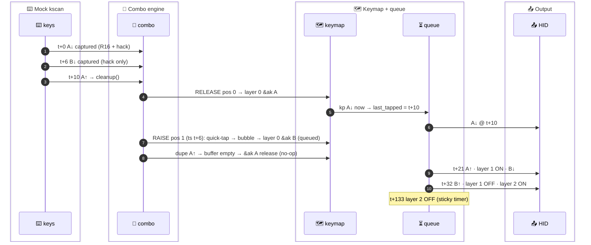

# 🧪 T-08: Release while buffered (both orders)

> **Status: complete.** 4 sub-cases (2 from the spec + 2 controls). All built and ran first time. Raw logs are deterministic: re-running `zmk.exe --no-rt` gave the same md5 for (a) and (c), and `run-test.sh` (without auto-accept) passes against the stored snapshot for (a).
> **Verdict: `deviates`.** The outcome matches the spec's purpose: both keys reach the keymap at the release instant, on the base layer, and the output is `AB` (a MISS). But three of the spec's listed lines for (a) do not match the log. The spec described the **re-capture + dupe-cleanup** path. With an `&ak` key 1 the engine takes the **quick-tap bypass** instead (MODEL R8), and the spec also put the queued `kp` events at t+10. The spec's line sequence does appear, in the same order, in control (c), where key 1 is a raw `&kp`.

---

## 🎯 Result first

- ✅ **"Release-while-buffered → immediate, on base" holds at the keymap.**
  - In both orders, the release at t+10 flushes both buffered keys in the same ms.
  - Both keys resolve on `layer_id: 0`. The hack rung (due at t+12 on native) never fires.
- ❌ **Key 2 is not re-captured when key 1 is `&ak` (no dupe cleanup).**
  - Key 1's `&ak` emits `kp A↓` from the behaviour queue, stamped `k_uptime_get()` = t+10.
  - The re-raised B carries ts t+6. `is_quick_tap` is true (t+10 − 1 > t+6), so B gets 0 candidates and bubbles to the keymap.
  - The dupe A↑ therefore finds an empty buffer and has nothing to clean up.
- ⏳ **HID for key 2 is not immediate. The behaviour queue serialises it.**
  - `kp B↓` comes at **t+21**, after A's 10 ms tap (+1 on native).
  - `kp A↑` and `layer 1 ON` come first, in the same ms.
- ❌ **Adaptation MISS: HID output `A B` in (a) and (b).**
  - The adaptive result `A K` does not happen, because B was resolved on base 11 ms before layer 1 existed.
  - Layer 1 is then "consumed" by B's own keycode. It turns off at B↑ (t+32), not at t+122.
- 🔬 **Controls (c)/(d): key 1 = raw `&kp D`.** These reproduce the spec's exact line shape:
  - `releasing 3`, `D↓`, `reraising 1`, `capturing 1`, `releasing 1` (dupe cleanup), `B↓`, then `D↑` in (c).
  - All of it lands at `[00:00:00.016,000]`.
  - This shows MODEL R6's dupe-cleanup mechanism is real. It just isn't the path an `&ak` key 1 takes.

---

## 📜 Spec (CLAIMS.md, verbatim)

> **T-08 Release while buffered** — R1, hack on. (a) `PRESS(0,0,5) PRESS(0,1,3) RELEASE(0,0,50) RELEASE(0,1,300)` (A t, B t+6, A↑ t+10): expect at `[t+10]` `releasing position event 0`, `kp_pressed 0x04`, `reraising position event 1`, then `releasing position event 1` (dupe cleanup), `kp_pressed 0x05` (B, base), `kp_released 0x04`; no `filter_timed_out` at `t+12` with remaining 0 for these keys. (b) B released first (`RELEASE(0,1,…)` before A↑): B↓ delivered at B↑, base. Purpose: R6, "release-while-buffered → immediate, on base".

- 🧭 **Checked against RIG.md. No corrections needed for:**
  - Coordinates: pos 0 = (0,0) `&ak 1 A` (candidates R16 + hack). Pos 1 = (0,1) `&ak 2 B` (hack only). The akA follower at pos 1 is `&bk K`.
  - Keycodes: A 0x04, B 0x05, D 0x07, K 0x0E.
  - Mock timing: the spec's "A t, B t+6, A↑ t+10" already accounts for the doubled first delay: t = abs 6, B abs 12, A↑ abs 16, B↑ abs 67, exit abs 368.
- 🧩 **MODEL rules exercised:**
  - (b) **R6**: any release → `cleanup()` flushes all; if > 1 flushed, a dupe release is re-raised, and it re-flushes a re-captured key 2.
  - **R8**: quick-tap bypass for a re-raised key whose ts ≤ last queue-stamped keycode − 2.
  - (c): `&ak` = `kp↓` now, then the 10 ms queue tick → `kp↑` + layer ON.
- ⚠️ **Spec gaps:**
  - (b) gave no events. Used `PRESS(0,0,5) PRESS(0,1,3) RELEASE(0,1,50) RELEASE(0,0,300)`: A t, B t+6, **B↑ t+10**, A↑ t+61.

---

## 🗂️ Sub-cases

| case | dir (`zmk/app/tests/ak-truth/…`) | change vs `_rig_R1` | events | raw log md5 |
|---|---|---|---|---|
| **(a) spec, key-1 up first** | `T-08-a-spec/` | events block only | `PRESS(0,0,5) PRESS(0,1,3) RELEASE(0,0,50) RELEASE(0,1,300)` | `c4f2676d8ac3f6835b795912cb5fd8c1` |
| **(b) spec, key-2 up first** | `T-08-b-b-up-first/` | events block only | `PRESS(0,0,5) PRESS(0,1,3) RELEASE(0,1,50) RELEASE(0,0,300)` | `2092be64da6ec99d3ec1c72e70ffc20f` |
| **(c) control: raw `&kp` key 1, key-1 up first** | `T-08-c-kp-k1up/` | events block only (key 1 = pos 3 `&kp D`, hack-only) | `PRESS(0,3,5) PRESS(0,1,3) RELEASE(0,3,50) RELEASE(0,1,300)` | `05dc8ce874df15fa318fb9b98037c1b9` |
| **(d) control: raw `&kp` key 1, key-2 up first** | `T-08-d-kp-k2up/` | events block only | `PRESS(0,3,5) PRESS(0,1,3) RELEASE(0,1,50) RELEASE(0,3,300)` | `12c6ea1b18dba1a7c32b6ba105faac14` |

- **Absolute times, all four:** key 1↓ abs 6 (t), key 2↓ abs 12 (t+6), first release abs 16 (t+10), second release abs 67 (t+61), exit abs 368 (t+362).
- **Diffs vs the template:**
  - `.conf` and `events.patterns` are byte-identical to `_rig_R1` in all four cases.
  - The keymap diff is only the appended block, e.g. (a):
    ```
    > &kscan {
    >     events = <
    >         ZMK_MOCK_PRESS(0,0,5)
    >         ZMK_MOCK_PRESS(0,1,3)
    >         ZMK_MOCK_RELEASE(0,0,50)
    >         ZMK_MOCK_RELEASE(0,1,300)
    >     >;
    > };
    ```
- **Compiled hack prior-idle:** `DT_N_S_combos_S_combo_ak_consistency_hack_P_require_prior_idle_ms -1` (T-08-a-spec `devicetree_generated.h:4673`), which is the binding default.
- **Files:** `results/T-08-<case>.raw.log` (timestamped `--no-rt`), `results/T-08-<case>.snapshot`.
  - Snapshot md5s: a `4d45b5bc…`, b `e7aa13c5…`, c `c3fa17a4…`, d `aac67eed…`.

---

## (a) `T-08-a-spec`: `&ak A` t, `&ak B` t+6, A↑ t+10



### 📜 Log lines (each line verbatim; excerpt: noise (`USB endpoint…`, `bubble…`, `handle_control_binding…`, `Modifiers set…`, `zmk_endpoints_send_report…`) and some queue bookkeeping (`Processing … in 0ms`, `on_keymap_binding_*`, `mo_keymap_binding_pressed`) omitted; full log = `results/T-08-a-spec.raw.log`)

```
[00:00:00.006,000] <dbg> zmk: zmk_physical_layouts_kscan_process_msgq: Row: 0, col: 0, position: 0, pressed: true
[00:00:00.006,000] <dbg> zmk: position_state_down: combo: capturing position event 0
[00:00:00.012,000] <dbg> zmk: zmk_physical_layouts_kscan_process_msgq: Row: 0, col: 1, position: 1, pressed: true
[00:00:00.012,000] <dbg> zmk: filter_timed_out_candidates: after filtering out timed out combo candidates: remaining_candidates=2 timestamp=12
[00:00:00.012,000] <dbg> zmk: position_state_down: combo: capturing position event 1
[00:00:00.016,000] <dbg> zmk: zmk_physical_layouts_kscan_process_msgq: Row: 0, col: 0, position: 0, pressed: false
[00:00:00.016,000] <dbg> zmk: release_pressed_keys: combo: releasing position event 0
[00:00:00.016,000] <dbg> zmk: zmk_keymap_apply_position_state: layer_id: 0 position: 0, binding name: flo,behavior-adaptive-key
[00:00:00.016,000] <dbg> zmk: queue_macro: Iterating macro bindings - starting: 0, count: 7
[00:00:00.016,000] <dbg> zmk: behavior_queue_process_next: Invoking key_press: 0x70004 0x00
[00:00:00.016,000] <dbg> zmk: hid_listener_keycode_pressed: usage_page 0x07 keycode 0x04 implicit_mods 0x00 explicit_mods 0x00
[00:00:00.016,000] <dbg> zmk: behavior_queue_process_next: Processing next queued behavior in 10ms
[00:00:00.016,000] <dbg> zmk: release_pressed_keys: combo: reraising position event 1
[00:00:00.016,000] <dbg> zmk: zmk_keymap_apply_position_state: layer_id: 0 position: 1, binding name: flo,behavior-adaptive-key
[00:00:00.016,000] <dbg> zmk: queue_macro: Iterating macro bindings - starting: 0, count: 7
[00:00:00.016,000] <dbg> zmk: zmk_keymap_apply_position_state: layer_id: 0 position: 0, binding name: flo,behavior-adaptive-key
[00:00:00.016,000] <dbg> zmk: queue_macro: Iterating macro bindings - starting: 7, count: 0
[00:00:00.016,000] <dbg> zmk: zmk_event_manager_handle_from: Listener captured the event
[00:00:00.027,000] <dbg> zmk: behavior_queue_process_next: Invoking key_press: 0x70004 0x00
[00:00:00.027,000] <dbg> zmk: hid_listener_keycode_released: usage_page 0x07 keycode 0x04 implicit_mods 0x00 explicit_mods 0x00
[00:00:00.027,000] <dbg> zmk: behavior_queue_process_next: Invoking flo,behavior-adaptive-key-sticky-layer: 0x01 0x00
[00:00:00.027,000] <dbg> zmk: on_sticky_key_binding_pressed: 0 new sticky_key
[00:00:00.027,000] <dbg> zmk: set_layer_state: layer_changed: layer 1 state 1
[00:00:00.027,000] <dbg> zmk: behavior_queue_process_next: Invoking key_press: 0x70005 0x00
[00:00:00.027,000] <dbg> zmk: hid_listener_keycode_pressed: usage_page 0x07 keycode 0x05 implicit_mods 0x00 explicit_mods 0x00
[00:00:00.027,000] <dbg> zmk: behavior_queue_process_next: Processing next queued behavior in 10ms
[00:00:00.038,000] <dbg> zmk: hid_listener_keycode_released: usage_page 0x07 keycode 0x05 implicit_mods 0x00 explicit_mods 0x00
[00:00:00.038,000] <dbg> zmk: mo_keymap_binding_released: position 0 layer 1
[00:00:00.038,000] <dbg> zmk: set_layer_state: layer_changed: layer 1 state 0
[00:00:00.038,000] <dbg> zmk: behavior_queue_process_next: Invoking flo,behavior-adaptive-key-sticky-layer: 0x02 0x00
[00:00:00.038,000] <dbg> zmk: set_layer_state: layer_changed: layer 2 state 1
[00:00:00.067,000] <dbg> zmk: zmk_physical_layouts_kscan_process_msgq: Row: 0, col: 1, position: 1, pressed: false
[00:00:00.067,000] <dbg> zmk: zmk_keymap_apply_position_state: layer_id: 0 position: 1, binding name: flo,behavior-adaptive-key
[00:00:00.067,000] <dbg> zmk: queue_macro: Iterating macro bindings - starting: 7, count: 0
[00:00:00.139,000] <dbg> zmk: mo_keymap_binding_released: position 0 layer 2
[00:00:00.139,000] <dbg> zmk: set_layer_state: layer_changed: layer 2 state 0
[00:00:00.368,000] <dbg> zmk: kscan_mock_schedule_next_event_0: Exiting
```

- **What the log does not contain:**
  - No `capturing position event 1` after the `reraising` line.
  - No `releasing position event 1` anywhere.
  - No `filter_timed_out_candidates` line after `[00:00:00.012,000]`.

### ⏱️ Timeline (rel = ms after A↓ at abs 6)

| rel | abs | event |
|---|---|---|
| +0 | 6 | A↓ pos 0, captured (R16 + hack) |
| +6 | 12 | B↓ pos 1, `remaining_candidates=2 timestamp=12` (R16 + hack both still in window), captured (position filter leaves hack only) |
| +10 | 16 | A↑ → `releasing 0` → layer 0 `&ak A` → **HID A↓** → `queue wait 10ms` |
| +10 | 16 | `reraising 1` → **layer 0** `&ak B` (bubbled, not captured) → queued |
| +10 | 16 | dupe A↑ → layer 0 `&ak` release (`starting: 7, count: 0`) |
| +21 | 27 | **HID A↑**, `layer 1 state 1`, **HID B↓** (same ms, in that order) |
| +32 | 38 | **HID B↑**, `layer 1 state 0`, `layer 2 state 1` |
| +61 | 67 | B↑ physical → layer 0 `&ak B` release (no-op) |
| +133 | 139 | `layer 2 state 0` (sticky timer: 38 + 100 + 1) |

### ✅/❌ Line-by-line vs the spec

| spec expects | observed | |
|---|---|---|
| `[t+10]` `releasing position event 0` | `[00:00:00.016,000] … releasing position event 0` (t+10) | ✅ |
| `kp_pressed 0x04` at t+10 | `[00:00:00.016,000] … keycode_pressed … 0x04` | ✅ |
| `reraising position event 1` at t+10 | `[00:00:00.016,000] … reraising position event 1` | ✅ |
| `releasing position event 1` (dupe cleanup) | **absent**: B was not re-captured (no `capturing position event 1` after the reraise). The dupe A↑ went straight to the keymap (`layer_id: 0 position: 0 … starting: 7, count: 0`) | ❌ |
| `kp_pressed 0x05` (B, base) at t+10 | B **resolved** on layer 0 at t+10 ✅ (`[00:00:00.016,000] … layer_id: 0 position: 1`). **HID B↓ at t+21** (`[00:00:00.027,000]`), queued behind A's tap | ❌ time |
| `kp_released 0x04` at t+10, after B↓ | `[00:00:00.027,000] … keycode_released … 0x04` at **t+21**, **before** B↓ | ❌ time + order |
| no `filter_timed_out` at t+12 with remaining 0 | no filter line after `[.012]`; the timer was cancelled by `cleanup()` at t+10 | ✅ |
| purpose: immediate, on base | both keys resolved at t+10 on layer 0 ✅; HID output **`A B`** (MISS, no K 0x0E) | ✅ |

- **HID sequence:** `A↓ A↑ B↓ B↑` → **`AB`**.

---

## (b) `T-08-b-b-up-first`: `&ak A` t, `&ak B` t+6, **B↑ t+10**, A↑ t+61

### 📜 Log lines (each line verbatim; excerpt, queue/sticky bookkeeping trimmed further; full log = `results/T-08-b-b-up-first.raw.log`)

```
[00:00:00.006,000] <dbg> zmk: zmk_physical_layouts_kscan_process_msgq: Row: 0, col: 0, position: 0, pressed: true
[00:00:00.006,000] <dbg> zmk: position_state_down: combo: capturing position event 0
[00:00:00.012,000] <dbg> zmk: zmk_physical_layouts_kscan_process_msgq: Row: 0, col: 1, position: 1, pressed: true
[00:00:00.012,000] <dbg> zmk: filter_timed_out_candidates: after filtering out timed out combo candidates: remaining_candidates=2 timestamp=12
[00:00:00.012,000] <dbg> zmk: position_state_down: combo: capturing position event 1
[00:00:00.016,000] <dbg> zmk: zmk_physical_layouts_kscan_process_msgq: Row: 0, col: 1, position: 1, pressed: false
[00:00:00.016,000] <dbg> zmk: release_pressed_keys: combo: releasing position event 0
[00:00:00.016,000] <dbg> zmk: zmk_keymap_apply_position_state: layer_id: 0 position: 0, binding name: flo,behavior-adaptive-key
[00:00:00.016,000] <dbg> zmk: hid_listener_keycode_pressed: usage_page 0x07 keycode 0x04 implicit_mods 0x00 explicit_mods 0x00
[00:00:00.016,000] <dbg> zmk: behavior_queue_process_next: Processing next queued behavior in 10ms
[00:00:00.016,000] <dbg> zmk: release_pressed_keys: combo: reraising position event 1
[00:00:00.016,000] <dbg> zmk: zmk_keymap_apply_position_state: layer_id: 0 position: 1, binding name: flo,behavior-adaptive-key
[00:00:00.016,000] <dbg> zmk: queue_macro: Iterating macro bindings - starting: 0, count: 7
[00:00:00.016,000] <dbg> zmk: zmk_keymap_apply_position_state: layer_id: 0 position: 1, binding name: flo,behavior-adaptive-key
[00:00:00.016,000] <dbg> zmk: queue_macro: Iterating macro bindings - starting: 7, count: 0
[00:00:00.027,000] <dbg> zmk: hid_listener_keycode_released: usage_page 0x07 keycode 0x04 implicit_mods 0x00 explicit_mods 0x00
[00:00:00.027,000] <dbg> zmk: set_layer_state: layer_changed: layer 1 state 1
[00:00:00.027,000] <dbg> zmk: hid_listener_keycode_pressed: usage_page 0x07 keycode 0x05 implicit_mods 0x00 explicit_mods 0x00
[00:00:00.038,000] <dbg> zmk: hid_listener_keycode_released: usage_page 0x07 keycode 0x05 implicit_mods 0x00 explicit_mods 0x00
[00:00:00.038,000] <dbg> zmk: set_layer_state: layer_changed: layer 1 state 0
[00:00:00.038,000] <dbg> zmk: set_layer_state: layer_changed: layer 2 state 1
[00:00:00.067,000] <dbg> zmk: zmk_physical_layouts_kscan_process_msgq: Row: 0, col: 0, position: 0, pressed: false
[00:00:00.067,000] <dbg> zmk: zmk_keymap_apply_position_state: layer_id: 0 position: 0, binding name: flo,behavior-adaptive-key
[00:00:00.067,000] <dbg> zmk: queue_macro: Iterating macro bindings - starting: 7, count: 0
[00:00:00.139,000] <dbg> zmk: set_layer_state: layer_changed: layer 2 state 0
```

### ⏱️ Timeline

| rel | abs | event |
|---|---|---|
| +0 | 6 | A↓ captured |
| +6 | 12 | B↓ `remaining_candidates=2 timestamp=12`, captured |
| +10 | 16 | **B↑** → `releasing 0` → layer 0 `&ak A` → **HID A↓** |
| +10 | 16 | `reraising 1` → **layer 0** `&ak B` (bypass, queued), then the dupe **B↑** → layer 0 `&ak B` release (no-op) |
| +21 | 27 | HID A↑, `layer 1 state 1`, HID B↓ |
| +32 | 38 | HID B↑, `layer 1 state 0`, `layer 2 state 1` |
| +61 | 67 | A↑ physical → `&ak A` release (no-op) |
| +133 | 139 | `layer 2 state 0` |

### ✅/❌ vs the spec

| spec expects | observed | |
|---|---|---|
| B↓ delivered at B↑ | `[00:00:00.016,000] … layer_id: 0 position: 1` at t+10 = B↑ (`[00:00:00.016,000] … position: 1, pressed: false`) | ✅ |
| on base | `layer_id: 0` | ✅ |
| (implied: A also flushed at B↑) | `releasing position event 0` + HID A↓ at `[00:00:00.016,000]`, 51 ms before A's own release | ✅ (not stated in spec) |
| (not in spec) HID B↓ time | `[00:00:00.027,000]` = t+21 (queue) | ℹ️ |

- **HID sequence:** `A↓ A↑ B↓ B↑` → **`AB`** (MISS).
- **Differences from (a):** the dupe release is B↑ (pos 1), not A↑. Every other line and timestamp is identical to (a).

---

## (c) `T-08-c-kp-k1up`: control, raw `&kp D` t, `&ak B` t+6, D↑ t+10

```
[00:00:00.006,000] <dbg> zmk: zmk_physical_layouts_kscan_process_msgq: Row: 0, col: 3, position: 3, pressed: true
[00:00:00.006,000] <dbg> zmk: position_state_down: combo: capturing position event 3
[00:00:00.012,000] <dbg> zmk: zmk_physical_layouts_kscan_process_msgq: Row: 0, col: 1, position: 1, pressed: true
[00:00:00.012,000] <dbg> zmk: filter_timed_out_candidates: after filtering out timed out combo candidates: remaining_candidates=1 timestamp=12
[00:00:00.012,000] <dbg> zmk: position_state_down: combo: capturing position event 1
[00:00:00.016,000] <dbg> zmk: zmk_physical_layouts_kscan_process_msgq: Row: 0, col: 3, position: 3, pressed: false
[00:00:00.016,000] <dbg> zmk: release_pressed_keys: combo: releasing position event 3
[00:00:00.016,000] <dbg> zmk: zmk_keymap_apply_position_state: layer_id: 0 position: 3, binding name: key_press
[00:00:00.016,000] <dbg> zmk: hid_listener_keycode_pressed: usage_page 0x07 keycode 0x07 implicit_mods 0x00 explicit_mods 0x00
[00:00:00.016,000] <dbg> zmk: release_pressed_keys: combo: reraising position event 1
[00:00:00.016,000] <dbg> zmk: position_state_down: combo: capturing position event 1
[00:00:00.016,000] <dbg> zmk: release_pressed_keys: combo: releasing position event 1
[00:00:00.016,000] <dbg> zmk: zmk_keymap_apply_position_state: layer_id: 0 position: 1, binding name: flo,behavior-adaptive-key
[00:00:00.016,000] <dbg> zmk: hid_listener_keycode_pressed: usage_page 0x07 keycode 0x05 implicit_mods 0x00 explicit_mods 0x00
[00:00:00.016,000] <dbg> zmk: behavior_queue_process_next: Processing next queued behavior in 10ms
[00:00:00.016,000] <dbg> zmk: zmk_keymap_apply_position_state: layer_id: 0 position: 3, binding name: key_press
[00:00:00.016,000] <dbg> zmk: hid_listener_keycode_released: usage_page 0x07 keycode 0x07 implicit_mods 0x00 explicit_mods 0x00
[00:00:00.027,000] <dbg> zmk: hid_listener_keycode_released: usage_page 0x07 keycode 0x05 implicit_mods 0x00 explicit_mods 0x00
[00:00:00.027,000] <dbg> zmk: set_layer_state: layer_changed: layer 2 state 1
[00:00:00.067,000] <dbg> zmk: zmk_physical_layouts_kscan_process_msgq: Row: 0, col: 1, position: 1, pressed: false
[00:00:00.128,000] <dbg> zmk: set_layer_state: layer_changed: layer 2 state 0
```

| rel | abs | event |
|---|---|---|
| +0 | 6 | D↓ captured (hack only) |
| +6 | 12 | B↓ `remaining_candidates=1 timestamp=12`, captured |
| +10 | 16 | D↑ → `releasing 3` → **HID D↓** (raw `&kp`, stamped with position ts t+0 → `last_tapped` = abs 6) |
| +10 | 16 | `reraising 1` → **`capturing position event 1`** (not quick-tap: 6 − 1 > 12 is false; fresh hack set, timer scheduled) |
| +10 | 16 | dupe D↑ → `cleanup()` → **`releasing position event 1`** → layer 0 `&ak B` → **HID B↓** (queue idle → synchronous) |
| +10 | 16 | dupe D↑ reaches keymap → **HID D↑** |
| +21 | 27 | HID B↑, `layer 2 state 1` |
| +61 | 67 | B↑ physical (no-op) |
| +122 | 128 | `layer 2 state 0` (27 + 100 + 1) |

- **This is the spec's (a) line list, one for one** (with D in place of A):
  - `releasing 3` → `kp_pressed 0x07` → `reraising 1` → `releasing 1` (dupe cleanup) → `kp_pressed 0x05` (base) → `kp_released 0x07`.
  - All at t+10.
  - Extra line vs the spec: `capturing position event 1` between the reraise and the dupe cleanup.
- The re-captured B's hack timer (deadline abs 23) never fires. There is no filter line at abs 24, so R6's "B's timers never apply" holds.
- **HID sequence:** `D↓ B↓ D↑ B↑` → **`DB`**.

## (d) `T-08-d-kp-k2up`: control, raw `&kp D` t, `&ak B` t+6, **B↑ t+10**, D↑ t+61

```
[00:00:00.016,000] <dbg> zmk: zmk_physical_layouts_kscan_process_msgq: Row: 0, col: 1, position: 1, pressed: false
[00:00:00.016,000] <dbg> zmk: release_pressed_keys: combo: releasing position event 3
[00:00:00.016,000] <dbg> zmk: zmk_keymap_apply_position_state: layer_id: 0 position: 3, binding name: key_press
[00:00:00.016,000] <dbg> zmk: hid_listener_keycode_pressed: usage_page 0x07 keycode 0x07 implicit_mods 0x00 explicit_mods 0x00
[00:00:00.016,000] <dbg> zmk: release_pressed_keys: combo: reraising position event 1
[00:00:00.016,000] <dbg> zmk: position_state_down: combo: capturing position event 1
[00:00:00.016,000] <dbg> zmk: release_pressed_keys: combo: releasing position event 1
[00:00:00.016,000] <dbg> zmk: zmk_keymap_apply_position_state: layer_id: 0 position: 1, binding name: flo,behavior-adaptive-key
[00:00:00.016,000] <dbg> zmk: hid_listener_keycode_pressed: usage_page 0x07 keycode 0x05 implicit_mods 0x00 explicit_mods 0x00
[00:00:00.016,000] <dbg> zmk: zmk_keymap_apply_position_state: layer_id: 0 position: 1, binding name: flo,behavior-adaptive-key
[00:00:00.016,000] <dbg> zmk: queue_macro: Iterating macro bindings - starting: 7, count: 0
[00:00:00.027,000] <dbg> zmk: hid_listener_keycode_released: usage_page 0x07 keycode 0x05 implicit_mods 0x00 explicit_mods 0x00
[00:00:00.027,000] <dbg> zmk: set_layer_state: layer_changed: layer 2 state 1
[00:00:00.067,000] <dbg> zmk: zmk_physical_layouts_kscan_process_msgq: Row: 0, col: 3, position: 3, pressed: false
[00:00:00.067,000] <dbg> zmk: hid_listener_keycode_released: usage_page 0x07 keycode 0x07 implicit_mods 0x00 explicit_mods 0x00
[00:00:00.128,000] <dbg> zmk: set_layer_state: layer_changed: layer 2 state 0
```

- Same flush as (c), triggered by B↑.
  - D↓ and B↓ both reach HID at t+10, with the dupe cleanup.
  - The dupe B↑ reaches the `&ak` release branch (no-op).
  - D stays held in HID until its physical release at t+61 (`[00:00:00.067,000]`).
- **HID sequence:** `D↓ B↓ B↑(t+21) D↑(t+61)` → **`DB`**.

---

## 🧠 Why (a) differs from the spec's line list

- `combo.c:141-143, 153`: a re-raised key gets candidates only if `last_tapped_timestamp − 1 ≤ ts`, i.e. it is not a quick tap.
- **(a)/(b), key 1 = `&ak`:**
  - `kp A↓` runs from the behaviour queue and is stamped `k_uptime_get()` = abs 16 (`bq:34-35`) → `last_tapped` = 16.
  - B (ts 12): 15 > 12 → quick tap → 0 candidates → bubble.
  - So there is no re-capture, and the dupe release has nothing to flush.
- **(c)/(d), key 1 = raw `&kp`:**
  - `kp D↓` keeps the position timestamp abs 6 → `last_tapped` = 6.
  - B: 5 > 12 is false → re-captured → flushed by the dupe release's `cleanup()` (`combo.c:457, 461-467`).
- **Outcome is the same either way:** key 2 resolves at the release instant on the base layer. Only the log lines differ. The spec's HID timing (B↓ and A↑ at t+10) is right only for a raw-`&kp` key 1. With an `&ak` key 1, the queue holds B↓ until A's tap finishes (+10 ms, +1 on native).

---

## 🔧 Board translation (nRF52840)

- 🕐 **The flush is release-driven, not timer-driven.**
  - t+10 is engine time on both native and the board. There is no +1 to remove.
  - `releasing/reraising` and HID A↓ happen at the release's timestamp.
- ⏳ **The queue tick is `K_MSEC(10)`: native +11, board +10+δ (δ ∈ (0.03, 1.05] ms).** Board prediction for (a)/(b):

  | event | native | board |
  |---|---|---|
  | A↓ | t+10 | t+10 |
  | A↑, layer 1 ON, B↓ | t+21 | ≈ t+20+δ |
  | B↑, layer 1 OFF, layer 2 ON | t+32 | ≈ t+30+2δ |
  | layer 2 OFF | t+133 | ≈ t+130+3δ |

  - Controls (c)/(d): layer 2 ON t+21 → ≈ t+20+δ; OFF t+122 → ≈ t+120+2δ.
- 🔀 **Bypass vs re-capture boundary on the board:**
  - B bypasses iff `T_B ≤ T_flush − 2`, where T_flush = `k_uptime_get()` when the release is processed (the release's own ms in practice).
  - If key 2 goes down within 1 ms of key 1's release (`T_B ≥ T_rel − 1`), the board takes the (c) path: re-capture, then dupe cleanup.
  - Both paths deliver key 2 at the release, on base, queued behind an `&ak` key 1. The HID output and times are unchanged.
- ⚖️ **Release at exactly t+11 (not tested here).**
  - Board: the hack timer (deadline t+11, fires t+11+δ) and the release event land in the same ms. The winner depends on sub-ms phase.
  - Native: the release always wins, because the timer runs at t+12.
  - Either winner flushes A first and B on base, so the outcome is the same MISS.
- 🖐️ **Cross-half:** a left-half release is stamped at BLE receipt on the central (MODEL (a)). That changes when "t+10" happens, not what happens.

---

## 🏁 Verdict: `deviates`

**Deviations (facts):**

- **(a)** No `releasing position event 1` line (the "dupe cleanup" the spec lists).
  - The re-raised B at `[00:00:00.016,000]` was not re-captured: there is no `capturing position event 1` after `reraising position event 1`.
  - It went straight to `layer_id: 0 position: 1`.
  - Cause: quick-tap bypass, R8. A's queue-stamped `kp↓` at t+10 set `last_tapped` = t+10, and B's ts is t+6.
- **(a)** `kp_pressed 0x05` (B) came at **t+21** (`[00:00:00.027,000]`). Predicted t+10.
- **(a)** `kp_released 0x04` (A) came at **t+21** (`[00:00:00.027,000]`), **before** B↓ in the same ms. Predicted at t+10, after B↓.
- **(a)** Adaptation: B resolved on layer 0 at t+10. `layer 1 state 1` came only at t+21 → HID `AB`, no K (0x0E). This matches the spec's "on base".
- **(b)** Matches the spec: B's press was delivered at B↑ (t+10) on layer 0. A was flushed in the same ms. HID B↓ at t+21 (the spec gave no time).
- **Controls (c)/(d)**, raw `&kp` key 1: the spec's (a) line sequence appears exactly, at t+10 (`[00:00:00.016,000]`). The extra line `capturing position event 1` sits between the reraise and the dupe cleanup.
- **Expected-time corrections:** none needed for the mock arithmetic. The spec's t / t+6 / t+10 were right.
