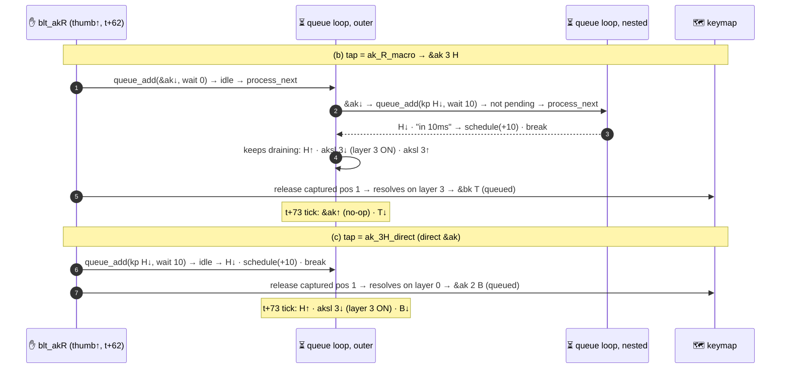

# 🧪 T-13: is the sticky layer visible in the same dispatch? Nested-sync thumb vs direct `&ak` hold-tap tap

> **Status: complete.** 4 sub-cases, all built and ran on 2026-09-30: (a) `&ak` flush reference, (b) spec nested-sync thumb, (c) control with a direct `&ak`, and (d) an extra run of (b) on Flo's real keymap. Timestamped logs come from `zmk.exe --no-rt`.
> **Verdict: `deviates` (one log-line claim only).** Every timing, layer and outcome claim holds. The spec also said there would be no `queue wait 10ms` line between H↓ and H↑, and that line **is** logged, in the same ms. The mechanism works as MODEL (c) says: **the captured key is resolved on the AK layer, so D's T7b claim is wrong and B's is right.**

---

## 🎯 Result first

- ✅ **Nested-sync thumb (b): adapted.**
  - The thumb tap decides at t+62. In that same ms: H↓, H↑, `layer 3 state 1`, and then the captured B-key is re-raised.
  - The B-key resolves on **layer 3** → `&bk T`.
  - HID output: **`H T`**.
- ✅ **Direct `&ak` control (c): not adapted.**
  - At t+62: H↓, then the captured B-key resolves on **layer 0** → `&ak 2 B`.
  - H↑ and `layer 3 state 1` come only at the queue tick (t+73).
  - HID output: **`H B`**.
- ✅ **Flo's real keymap (d) behaves like (b).**
  - LH0 R-thumb tap with LT4 held during it → LT4 resolves on `l_akR` (17) → `&bk R`.
  - HID output: **`R R`**, not `R X`. This settles T7b on the real firmware.
- ✅ **Reference (a).** A key flushed in the same combo burst as an `&ak` key resolves on base. The log is byte-identical to T-02 (a).
- ⚠️ **The one deviation is in the log text, not the timing.**
  - Between H↓ and H↑ there **is** a `Processing next queued behavior in 10ms` line (snapshot: `queue wait 10ms`).
  - The nested inner `behavior_queue_process_next` prints it when it schedules the delayable. The outer loop keeps draining anyway, so H↑ still comes in the same ms.
  - That schedule has a visible effect: the queue stays parked until t+73. So the adapted follower's `&bk T` emits T↓ at **t+73**, not at t+62.
- 🆕 **New fact for the page: a 0 ms tap does not mean a 0 ms queue.**
  - After an R-thumb tap, any macro key resolved within the next 10 ms waits for that tick.
  - Here that is ak_R_macro's leftover `&ak` release, then `&bk T`.

---

## 📜 Spec (CLAIMS.md, verbatim)

> **T-13 Sticky layer visible in the same dispatch?** — R1. (a) `&ak` flush: T-02 already shows the re-raised key resolves on base. (b) nested-sync thumb: `PRESS(2,2,30) PRESS(0,1,30) RELEASE(2,2,10) RELEASE(0,1,300)` (thumb t, B-key t+31 captured by hold-tap, thumb↑ t+62): expect `decided tap (tap-preferred decision moment key-up)` at `[t+62]`, `kp_pressed 0x0B` (H) and `kp_released 0x0B` in the same ms with **no** `queue wait 10ms` between, `layer 3 state 1` same ms, then `Releasing key position event for position 1`, `kp_pressed 0x17` (T = akH follower) — adapted. Control: bind pos 10 to a hold-tap whose tap is `&ak 3 H` directly → `kp_released 0x0B` at `t+73`, layer at `t+73`, and the captured key resolves on base (B). Purpose: settle B vs D on T7b; R-thumb 0 ms tap.

- **MODEL (c), "R thumb" bullet (INFERRED → T-13/T-14):** "the tap runs OUTSIDE the queue work, so `&ak`'s first `zmk_behavior_queue_add` re-enters `behavior_queue_process_next` (`bq:61-63`): `kp R↓`, then the outer loop drains `kp R↑`, `aksl↓`, `aksl↑` immediately → **0 ms tap, layer ON at the decision instant**, so a key captured by the thumb hold-tap is re-raised onto an already-active `l_akR`."
- **Checked against RIG.md. No corrections needed.**
  - Coordinates: pos 10 = (2,2) `&blt_akR 5 0`, hack-only. Pos 1 = (0,1) `&ak 2 B`, hack-only. akH (layer 3) pos 1 = `&bk T`.
  - Keycodes: H 0x0B, T 0x17, B 0x05.
  - Mock timing: e0.ms = 30 is both the boot delay and the gap after e0 → t = abs 31. Pos 1 at abs 62 = t+31, thumb↑ abs 93 = t+62, pos 1↑ abs 104 = t+73. The spec already uses the doubled first gap.
- **How the control was built.** The spec asks for "a hold-tap whose tap is `&ak 3 H` directly".
  - A hold-tap passes only its binding's param2 to the tap behavior as param1 (param2 = 0). The two-param `&ak 3 H` therefore cannot be placed in `bindings`.
  - The control instead uses `ak_3H_direct`: the `&ak` macro with `3`/`H` substituted at build time. It enqueues the same items: `kp H` press (wait 10), `kp H` release (0), `aksl 3` press (0), `aksl 3` release (0).
  - The log confirms this. `queue_macro: … starting: 0, count: 5` appears, and no `Invoking flo,behavior-adaptive-key` line precedes H↓.

---

## 🗂️ Sub-cases

| case | dir (`zmk/app/tests/ak-truth/…`) | template | change | raw log md5 |
|---|---|---|---|---|
| **(a) `&ak` flush ref** | `T-13-a-akflush/` | `_rig_R1` | events only (T-02 (a) events) | `b9c587eb1398d09b178e5293448c339d` (= T-02-a-spec, `cmp` identical) |
| **(b) nested-sync thumb (spec)** | `T-13-b-nested/` | `_rig_R1` | events only | `c4a64169d98a098f916ac2248268391a` |
| **(c) direct `&ak` control** | `T-13-c-direct/` | `_rig_R1` | `ak_3H_direct` macro + `&blt_akR { bindings = <&mo>, <&ak_3H_direct>; };` + events | `bb2b03696eb03baac6d5ca33e1318038` |
| **(d) real keymap, R thumb** (extra) | `T-13-d-r2-thumb/` | `_rig_R2` | events only | `9cd36b135fb7376a462860853ec2ba61` |

- `.conf` and `events.patterns` are unchanged from the template in all four cases (`diff` empty).
- Logs and snapshots are in `results/T-13-<case>.raw.log` and `results/T-13-<case>.snapshot`.

### Events

```
(a)  ZMK_MOCK_PRESS(0,0,5)     A↓ (pos 0, &ak 1 A)        abs 6   = t
     ZMK_MOCK_PRESS(0,1,60)    B↓ (pos 1, &ak 2 B)        abs 12  = t+6
     ZMK_MOCK_RELEASE(0,0,40)  A↑                          abs 73  = t+67
     ZMK_MOCK_RELEASE(0,1,300) B↑                          abs 114 = t+108, exit abs 415

(b)(c) ZMK_MOCK_PRESS(2,2,30)    thumb↓ (pos 10)          abs 31  = t
     ZMK_MOCK_PRESS(0,1,30)    B-key↓ (pos 1)             abs 62  = t+31
     ZMK_MOCK_RELEASE(2,2,10)  thumb↑                      abs 93  = t+62
     ZMK_MOCK_RELEASE(0,1,300) B-key↑                      abs 104 = t+73, exit abs 405

(d)  ZMK_MOCK_PRESS(3,5,30)    LH0↓ (pos 32, &blt_akR 25 0)   abs 31  = t
     ZMK_MOCK_PRESS(0,1,30)    LT4↓ (pos 0, &ak 23 X; l_akR: &bk R)  abs 62 = t+31
     ZMK_MOCK_RELEASE(3,5,10)  LH0↑                        abs 93  = t+62
     ZMK_MOCK_RELEASE(0,1,300) LT4↑                        abs 104 = t+73, exit abs 405
```

### Diff of (c) vs `_rig_R1` (the only case with a keymap change beyond `events`)

```
> / {
>     macros {
>         ak_3H_direct: ak_3H_direct {
>             compatible = "zmk,behavior-macro";
>             #binding-cells = <0>;
>             wait-ms = <0>;
>             tap-ms = <10>;
>             bindings =
>                     <&macro_tap &kp H>,
>
>                     <&macro_tap_time 0>,
>
>                     <&macro_tap &aksl 3>;
>         };
>     };
> };
>
> &blt_akR {
>     bindings = <&mo>, <&ak_3H_direct>;
> };
```

- (b) keeps the template's `ak_R_macro` (`zmk,behavior-macro`, wait 0, tap 0, `bindings = <&ak 3 H>`). This mirrors the real `ak_R_macro` (`<&ak l_akR R>`).

---

## 🔁 Why (b) and (c) differ: queue re-entrancy



- `behavior_queue.c:61-62` runs `process_next` synchronously whenever the delayable is not pending.
  - In (b), the inner call schedules the 10 ms wait and returns.
  - The outer `while (k_msgq_get…)` loop (`:30`) does not check pending, so it drains `kp H↑` and both `aksl` items at once.
- In both cases the captured key is re-raised by `release_captured_events()` **after** `press_tap_binding()` returns (`behavior_hold_tap.c:556-557`).
  - (b): the layer bit is already set when that happens.
  - (c): the layer bit is still clear.

---

## (a) 📋 `&ak` flush reference: re-raised key resolves on base

### Log lines (verbatim, `results/T-13-a-akflush.raw.log`)

```
[00:00:00.006,000] <dbg> zmk: position_state_down: combo: capturing position event 0
[00:00:00.012,000] <dbg> zmk: position_state_down: combo: capturing position event 1
[00:00:00.018,000] <dbg> zmk: filter_timed_out_candidates: after filtering out timed out combo candidates: remaining_candidates=0 timestamp=17
[00:00:00.018,000] <dbg> zmk: release_pressed_keys: combo: releasing position event 0
[00:00:00.018,000] <dbg> zmk: zmk_keymap_apply_position_state: layer_id: 0 position: 0, binding name: flo,behavior-adaptive-key
[00:00:00.018,000] <dbg> zmk: hid_listener_keycode_pressed: usage_page 0x07 keycode 0x04 implicit_mods 0x00 explicit_mods 0x00
[00:00:00.018,000] <dbg> zmk: release_pressed_keys: combo: reraising position event 1
[00:00:00.018,000] <dbg> zmk: zmk_keymap_apply_position_state: layer_id: 0 position: 1, binding name: flo,behavior-adaptive-key
[00:00:00.029,000] <dbg> zmk: hid_listener_keycode_released: usage_page 0x07 keycode 0x04 implicit_mods 0x00 explicit_mods 0x00
[00:00:00.029,000] <dbg> zmk: set_layer_state: layer_changed: layer 1 state 1
[00:00:00.029,000] <dbg> zmk: hid_listener_keycode_pressed: usage_page 0x07 keycode 0x05 implicit_mods 0x00 explicit_mods 0x00
[00:00:00.040,000] <dbg> zmk: hid_listener_keycode_released: usage_page 0x07 keycode 0x05 implicit_mods 0x00 explicit_mods 0x00
[00:00:00.040,000] <dbg> zmk: set_layer_state: layer_changed: layer 1 state 0
```

| rel | abs | event |
|---|---|---|
| +0 | 6 | A↓ pos 0, captured |
| +6 | 12 | B-key↓ pos 1, captured |
| +12 | 18 | hack rung (`timestamp=17`) → A delivered on layer 0, **A↓ HID**; B re-raised, delivered on **layer 0** |
| +23 | 29 | A↑, `layer 1 state 1`, **B↓ HID** |
| +34 | 40 | B↑, `layer 1 state 0` (consumed by B), then layer 2 ON |
| +135 | 141 | layer 2 OFF |

- ✅ Re-raised pos 1 resolves on **layer 0** at t+12, **11 ms before** `layer 1 state 1` (t+23). The layer is not visible in the same dispatch.
- HID: **`A B`**, no K (0x0E).
- Detailed analysis, including the t+22 → t+23 correction to T-02's arithmetic, is in `results/T-02.md`.

---

## (b) 📋 Nested-sync thumb (spec)

### Log lines (verbatim, `results/T-13-b-nested.raw.log`; transport noise and `handle_control_binding` lines omitted)

```
[00:00:00.031,000] <dbg> zmk: zmk_physical_layouts_kscan_process_msgq: Row: 2, col: 2, position: 10, pressed: true
[00:00:00.031,000] <dbg> zmk: position_state_down: combo: capturing position event 10
[00:00:00.043,000] <dbg> zmk: filter_timed_out_candidates: after filtering out timed out combo candidates: remaining_candidates=0 timestamp=42
[00:00:00.043,000] <dbg> zmk: release_pressed_keys: combo: releasing position event 10
[00:00:00.043,000] <dbg> zmk: zmk_keymap_apply_position_state: layer_id: 0 position: 10, binding name: blt_akR
[00:00:00.043,000] <dbg> zmk: on_hold_tap_binding_pressed: 10 new undecided hold_tap
[00:00:00.062,000] <dbg> zmk: zmk_physical_layouts_kscan_process_msgq: Row: 0, col: 1, position: 1, pressed: true
[00:00:00.062,000] <dbg> zmk: position_state_changed_listener: 10 capturing 1 down event
[00:00:00.093,000] <dbg> zmk: zmk_physical_layouts_kscan_process_msgq: Row: 2, col: 2, position: 10, pressed: false
[00:00:00.093,000] <dbg> zmk: position_state_changed_listener: 10 bubble undecided hold-tap keyrelease event
[00:00:00.093,000] <dbg> zmk: zmk_keymap_apply_position_state: layer_id: 0 position: 10, binding name: blt_akR
[00:00:00.093,000] <dbg> zmk: decide_hold_tap: 10 decided tap (tap-preferred decision moment key-up)
[00:00:00.093,000] <dbg> zmk: queue_macro: Iterating macro bindings - starting: 0, count: 1
[00:00:00.093,000] <dbg> zmk: behavior_queue_process_next: Invoking flo,behavior-adaptive-key: 0x03 0x7000b
[00:00:00.093,000] <dbg> zmk: queue_macro: Iterating macro bindings - starting: 0, count: 7
[00:00:00.093,000] <dbg> zmk: behavior_queue_process_next: Invoking key_press: 0x7000b 0x00
[00:00:00.093,000] <dbg> zmk: on_keymap_binding_pressed: position 0 keycode 0x7000B
[00:00:00.093,000] <dbg> zmk: hid_listener_keycode_pressed: usage_page 0x07 keycode 0x0B implicit_mods 0x00 explicit_mods 0x00
[00:00:00.093,000] <dbg> zmk: behavior_queue_process_next: Processing next queued behavior in 10ms
[00:00:00.093,000] <dbg> zmk: behavior_queue_process_next: Processing next queued behavior in 0ms
[00:00:00.093,000] <dbg> zmk: behavior_queue_process_next: Invoking key_press: 0x7000b 0x00
[00:00:00.093,000] <dbg> zmk: on_keymap_binding_released: position 0 keycode 0x7000B
[00:00:00.093,000] <dbg> zmk: hid_listener_keycode_released: usage_page 0x07 keycode 0x0B implicit_mods 0x00 explicit_mods 0x00
[00:00:00.093,000] <dbg> zmk: behavior_queue_process_next: Processing next queued behavior in 0ms
[00:00:00.093,000] <dbg> zmk: behavior_queue_process_next: Invoking flo,behavior-adaptive-key-sticky-layer: 0x03 0x00
[00:00:00.093,000] <dbg> zmk: on_sticky_key_binding_pressed: 0 new sticky_key
[00:00:00.093,000] <dbg> zmk: mo_keymap_binding_pressed: position 0 layer 3
[00:00:00.093,000] <dbg> zmk: set_layer_state: layer_changed: layer 3 state 1
[00:00:00.093,000] <dbg> zmk: behavior_queue_process_next: Processing next queued behavior in 0ms
[00:00:00.093,000] <dbg> zmk: behavior_queue_process_next: Invoking flo,behavior-adaptive-key-sticky-layer: 0x03 0x00
[00:00:00.093,000] <dbg> zmk: behavior_queue_process_next: Processing next queued behavior in 0ms
[00:00:00.093,000] <dbg> zmk: release_captured_events: Releasing key position event for position 1 pressed
[00:00:00.093,000] <dbg> zmk: position_state_changed_listener: 1 bubble (no undecided hold_tap active)
[00:00:00.093,000] <dbg> zmk: zmk_keymap_apply_position_state: layer_id: 3 position: 1, binding name: flo,behavior-buffered-key
[00:00:00.093,000] <dbg> zmk: queue_macro: Iterating macro bindings - starting: 0, count: 3
[00:00:00.093,000] <dbg> zmk: queue_macro: Iterating macro bindings - starting: 1, count: 0
[00:00:00.093,000] <dbg> zmk: on_hold_tap_binding_released: 10 cleaning up hold-tap
[00:00:00.104,000] <dbg> zmk: kscan_mock_work_handler_0: ev 19661056 row 0 column 1 state 0
[00:00:00.104,000] <dbg> zmk: behavior_queue_process_next: Invoking flo,behavior-adaptive-key: 0x03 0x7000b
[00:00:00.104,000] <dbg> zmk: queue_macro: Iterating macro bindings - starting: 7, count: 0
[00:00:00.104,000] <dbg> zmk: behavior_queue_process_next: Processing next queued behavior in 0ms
[00:00:00.104,000] <dbg> zmk: behavior_queue_process_next: Invoking key_press: 0x70017 0x00
[00:00:00.104,000] <dbg> zmk: hid_listener_keycode_pressed: usage_page 0x07 keycode 0x17 implicit_mods 0x00 explicit_mods 0x00
[00:00:00.104,000] <dbg> zmk: behavior_queue_process_next: Processing next queued behavior in 10ms
[00:00:00.104,000] <dbg> zmk: zmk_physical_layouts_kscan_process_msgq: Row: 0, col: 1, position: 1, pressed: false
[00:00:00.104,000] <dbg> zmk: zmk_keymap_apply_position_state: layer_id: 3 position: 1, binding name: flo,behavior-buffered-key
[00:00:00.115,000] <dbg> zmk: hid_listener_keycode_released: usage_page 0x07 keycode 0x17 implicit_mods 0x00 explicit_mods 0x00
[00:00:00.115,000] <dbg> zmk: mo_keymap_binding_released: position 0 layer 3
[00:00:00.115,000] <dbg> zmk: set_layer_state: layer_changed: layer 3 state 0
```

### Timeline (t = abs 31)

| rel | abs | event |
|---|---|---|
| +0 | 31 | thumb↓ pos 10, combo captures it (hack only) |
| +12 | 43 | hack rung (`timestamp=42`) → pos 10 delivered on layer 0 → `10 new undecided hold_tap` |
| +31 | 62 | B-key↓ pos 1 → `10 capturing 1 down event` (hold-tap captures it; the combo never sees it) |
| +62 | 93 | thumb↑ → `decided tap (… key-up)` → `&ak 3 H`↓ → **H↓** → `in 10ms` (nested) → `in 0ms` (outer) → **H↑** → `aksl 3`↓ → **layer 3 ON** → `aksl 3`↑ |
| +62 | 93 | `Releasing key position event for position 1` → combo: no line (quick-tap bypass) → **`layer_id: 3` → `&bk T`** (enqueued; the queue is pending) |
| +62 | 93 | ak_R_macro tap release (`starting: 1, count: 0`), `cleaning up hold-tap` |
| +73 | 104 | mock B-key↑ handler, then queue tick: `&ak 3 H`↑ (`starting: 7, count: 0`) → **T↓** → `in 10ms`; then the pos 1↑ position event → `&bk` release (no-op) |
| +84 | 115 | **T↑** → `layer 3 state 0` (sticky consumed by T) |
| +374 | 405 | exit |

### Verdict line by line

| # | spec expects | observed | |
|---|---|---|---|
| 1 | B-key captured by the hold-tap at t+31 | `[00:00:00.062,000] … 10 capturing 1 down event` | ✅ |
| 2 | `decided tap (tap-preferred decision moment key-up)` at `[t+62]` | `[00:00:00.093,000] … 10 decided tap (tap-preferred decision moment key-up)` = 31 + 62 | ✅ |
| 3 | `kp_pressed 0x0B` and `kp_released 0x0B` in the same ms | both `[00:00:00.093,000]` | ✅ |
| 4 | **no** `queue wait 10ms` between H↓ and H↑ | `[00:00:00.093,000] … Processing next queued behavior in 10ms` sits between them (snapshot lines 17–21: `kp_pressed 0x0B` → `queue wait 10ms` → `queue wait 0ms` → `queue invoke key_press` → `kp_released 0x0B`). The wait is not honoured by the outer loop, but the line is there. | ❌ (log text) / ✅ (timing) |
| 5 | `layer 3 state 1` same ms | `[00:00:00.093,000] … layer_changed: layer 3 state 1`, after H↑ | ✅ |
| 6 | then `Releasing key position event for position 1` | `[00:00:00.093,000] … Releasing key position event for position 1 pressed`, after `layer 3 state 1` | ✅ |
| 7 | `kp_pressed 0x17` (T), adapted | resolution `[00:00:00.093,000] … layer_id: 3 position: 1, binding name: flo,behavior-buffered-key`; HID `[00:00:00.104,000] … keycode 0x17` = **t+73** (spec gives no time) | ✅ adapted; ⚠️ HID at t+73 |

- **HID output: `H T`** (H↓ +62, H↑ +62, T↓ +73, T↑ +84).
- The combo logs no line for the re-raised pos 1: no `capturing position event 1`, no filter line.
  - This is consistent with the quick-tap bypass: `last_tapped` = H↓ stamped abs 93, `93 − 1 > 62`.
  - Pos 1's only candidate (the hack) is active on layer 3.
  - The bypass itself is never logged. T-02 (c) is the control that isolates it.

---

## (c) 📋 Direct `&ak` control

### Log lines (verbatim, `results/T-13-c-direct.raw.log`; noise omitted)

```
[00:00:00.043,000] <dbg> zmk: on_hold_tap_binding_pressed: 10 new undecided hold_tap
[00:00:00.062,000] <dbg> zmk: position_state_changed_listener: 10 capturing 1 down event
[00:00:00.093,000] <dbg> zmk: decide_hold_tap: 10 decided tap (tap-preferred decision moment key-up)
[00:00:00.093,000] <dbg> zmk: queue_macro: Iterating macro bindings - starting: 0, count: 5
[00:00:00.093,000] <dbg> zmk: behavior_queue_process_next: Invoking key_press: 0x7000b 0x00
[00:00:00.093,000] <dbg> zmk: hid_listener_keycode_pressed: usage_page 0x07 keycode 0x0B implicit_mods 0x00 explicit_mods 0x00
[00:00:00.093,000] <dbg> zmk: behavior_queue_process_next: Processing next queued behavior in 10ms
[00:00:00.093,000] <dbg> zmk: release_captured_events: Releasing key position event for position 1 pressed
[00:00:00.093,000] <dbg> zmk: position_state_changed_listener: 1 bubble (no undecided hold_tap active)
[00:00:00.093,000] <dbg> zmk: zmk_keymap_apply_position_state: layer_id: 0 position: 1, binding name: flo,behavior-adaptive-key
[00:00:00.093,000] <dbg> zmk: queue_macro: Iterating macro bindings - starting: 0, count: 7
[00:00:00.093,000] <dbg> zmk: queue_macro: Iterating macro bindings - starting: 5, count: 0
[00:00:00.093,000] <dbg> zmk: on_hold_tap_binding_released: 10 cleaning up hold-tap
[00:00:00.104,000] <dbg> zmk: behavior_queue_process_next: Invoking key_press: 0x7000b 0x00
[00:00:00.104,000] <dbg> zmk: hid_listener_keycode_released: usage_page 0x07 keycode 0x0B implicit_mods 0x00 explicit_mods 0x00
[00:00:00.104,000] <dbg> zmk: behavior_queue_process_next: Invoking flo,behavior-adaptive-key-sticky-layer: 0x03 0x00
[00:00:00.104,000] <dbg> zmk: on_sticky_key_binding_pressed: 0 new sticky_key
[00:00:00.104,000] <dbg> zmk: set_layer_state: layer_changed: layer 3 state 1
[00:00:00.104,000] <dbg> zmk: behavior_queue_process_next: Invoking key_press: 0x70005 0x00
[00:00:00.104,000] <dbg> zmk: hid_listener_keycode_pressed: usage_page 0x07 keycode 0x05 implicit_mods 0x00 explicit_mods 0x00
[00:00:00.115,000] <dbg> zmk: hid_listener_keycode_released: usage_page 0x07 keycode 0x05 implicit_mods 0x00 explicit_mods 0x00
[00:00:00.115,000] <dbg> zmk: set_layer_state: layer_changed: layer 3 state 0
[00:00:00.115,000] <dbg> zmk: set_layer_state: layer_changed: layer 2 state 1
[00:00:00.216,000] <dbg> zmk: set_layer_state: layer_changed: layer 2 state 0
```

### Timeline (t = abs 31)

| rel | abs | event |
|---|---|---|
| +0 / +12 / +31 | 31 / 43 / 62 | identical to (b): capture, hold-tap created, B-key captured by the hold-tap |
| +62 | 93 | `decided tap` → `ak_3H_direct` (count 5) → **H↓** → `in 10ms` → loop breaks |
| +62 | 93 | `Releasing key position event for position 1` → combo: no line → **`layer_id: 0` → `&ak 2 B`** (enqueued) |
| +73 | 104 | queue tick: **H↑** → `aksl 3`↓ → **layer 3 ON** → `aksl 3`↑ → **B↓** (`&ak 2 B`'s kp, consumes the layer-3 sticky) → `in 10ms` |
| +84 | 115 | **B↑** → `layer 3 state 0`; `aksl 2`↓ → `layer 2 state 1` |
| +185 | 216 | `layer 2 state 0` (sticky timeout, +101 after arming) |

### Verdict line by line

| # | spec expects | observed | |
|---|---|---|---|
| 1 | `kp_released 0x0B` at t+73 | `[00:00:00.104,000] … released … keycode 0x0B` = 31 + 73 | ✅ |
| 2 | layer at t+73 | `[00:00:00.104,000] … layer 3 state 1` | ✅ |
| 3 | captured key resolves on base (B) | `[00:00:00.093,000] … layer_id: 0 position: 1, binding name: flo,behavior-adaptive-key` → `[00:00:00.104,000] … pressed … keycode 0x05` | ✅ |

- **HID output: `H B`** (H↓ +62, H↑ +73, B↓ +73, B↑ +84).
- Side effect: B's `kp↓` is the first keycode after `aksl 3` armed, so it **consumes and wastes** layer 3. Layer 3 turns off at B↑ and layer 2 (B's own AK layer) turns on at the same moment.

---

## (d) 📋 Extra: Flo's real keymap, LH0 R-thumb with LT4 held during the tap

### Log lines (verbatim, `results/T-13-d-r2-thumb.raw.log`; noise omitted)

```
[00:00:00.043,000] <dbg> zmk: zmk_keymap_apply_position_state: layer_id: 0 position: 32, binding name: blt_akR
[00:00:00.043,000] <dbg> zmk: on_hold_tap_binding_pressed: 32 new undecided hold_tap
[00:00:00.062,000] <dbg> zmk: position_state_changed_listener: 32 capturing 0 down event
[00:00:00.093,000] <dbg> zmk: decide_hold_tap: 32 decided tap (tap-preferred decision moment key-up)
[00:00:00.093,000] <dbg> zmk: behavior_queue_process_next: Invoking flo,behavior-adaptive-key: 0x11 0x70015
[00:00:00.093,000] <dbg> zmk: hid_listener_keycode_pressed: usage_page 0x07 keycode 0x15 implicit_mods 0x00 explicit_mods 0x00
[00:00:00.093,000] <dbg> zmk: behavior_queue_process_next: Processing next queued behavior in 10ms
[00:00:00.093,000] <dbg> zmk: behavior_queue_process_next: Processing next queued behavior in 0ms
[00:00:00.093,000] <dbg> zmk: hid_listener_keycode_released: usage_page 0x07 keycode 0x15 implicit_mods 0x00 explicit_mods 0x00
[00:00:00.093,000] <dbg> zmk: set_layer_state: layer_changed: layer 17 state 1
[00:00:00.093,000] <dbg> zmk: release_captured_events: Releasing key position event for position 0 pressed
[00:00:00.093,000] <dbg> zmk: zmk_keymap_apply_position_state: layer_id: 17 position: 0, binding name: flo,behavior-buffered-key
[00:00:00.104,000] <dbg> zmk: hid_listener_keycode_pressed: usage_page 0x07 keycode 0x15 implicit_mods 0x00 explicit_mods 0x00
[00:00:00.115,000] <dbg> zmk: hid_listener_keycode_released: usage_page 0x07 keycode 0x15 implicit_mods 0x00 explicit_mods 0x00
[00:00:00.115,000] <dbg> zmk: set_layer_state: layer_changed: layer 17 state 0
```

| rel | abs | event |
|---|---|---|
| +12 | 43 | LH0 hack rung → `blt_akR` hold-tap created (LH0 hack-only ✓ RIG/D-config) |
| +31 | 62 | LT4↓ captured by the hold-tap |
| +62 | 93 | tap → **R↓, R↑, layer 17 ON** → LT4 re-raised → **`layer_id: 17` → `&bk R`** |
| +73 | 104 | queue tick → **R↓** (LT4's `&bk R`) |
| +84 | 115 | **R↑**, `layer 17 state 0` |

- **HID output: `R R`.** Base would have given `R X` (LT4 = `&ak 23 X`, 0x1B). No 0x1B appears in the log.
- The line order and timing are identical to (b), with R1's synthetic nodes replaced by the real `blt_akR 25 0` / `ak_R_macro` → `&ak 17 R`.

---

## 🔤 HID output summary

| case | letters | ms (rel) |
|---|---|---|
| (a) `&ak` flush | **A B** | A↓ +12, A↑ +23, B↓ +23, B↑ +34 |
| (b) nested-sync thumb | **H T** | H↓ +62, H↑ +62, T↓ +73, T↑ +84 |
| (c) direct `&ak` | **H B** | H↓ +62, H↑ +73, B↓ +73, B↑ +84 |
| (d) real R thumb | **R R** | R↓ +62, R↑ +62, R↓ +73, R↑ +84 |

---

## 🔧 Board translation (native +1 ms removed; MODEL §(a))

- **Hack rung → hold-tap creation:** native t+12 → board **t+11+δ** (δ ∈ (0.03, 1.05] ms). The tapping term (200) counts from the original timestamp t in both cases.
- **The whole nested-sync burst is event-driven, not timer-driven.**
  - The tap decision, H/R↓, H/R↑, layer ON and the captured key's resolution all run inside the thumb-release handler. They land at the **same engine instant on the board**: the thumb-up timestamp. No offset to remove.
  - Verdict (b)/(d) = **adapted on the board too**.
- **(c) control on the board:** H↑ + layer ON at thumb-up **+10+δ** (native +11). The captured key is resolved on base at thumb-up, before that → **not adapted on the board either**.
- **Follower HID time:**
  - (b)/(d): the follower's `&bk` emits at thumb-up **+10+δ** (native +11), and its ↑ with layer OFF comes 10+δ later.
  - (c): B↓ at +10+δ, B↑ at +20+2δ.
- **Real hardware transport:** LH0 and LT4 are both on the **left** half (peripheral). Both arrive over BLE, stamped at receipt on the central, and same-half order is preserved.
  - The captured key's own timestamp does not affect the outcome here: the tap-preferred decision happens at thumb↑, and the resolution runs right after the layer is set.
- **INFERRED, not observed: bypass edge.**
  - If the held key's timestamp were ≥ H↓ stamp − 1 (pressed within ~1 ms of the thumb release), `is_quick_tap` would be false. The combo would then re-capture it (hack/16/18 ms).
  - (b): still adapted, because the layer is already on and the sticky lasts 100 ms.
  - (c): it would reach the keymap at ≥ +11, after the layer (+10+δ) → it would adapt with about a 1 ms margin.
  - Not reachable on native with integer-ms mock gaps ≥ 1 in this event shape.
- **Also not covered:**
  - The follower pressed within the thumb's first 11 ms, while the thumb is still in the combo buffer. The combo would re-raise it into the new hold-tap, and the same outcome is expected (INFERRED).
  - Whether a 0 ms H↓/H↑ pair survives BLE HOG on the host. That is T-14's subject.

---

## 🏁 Verdict: `deviates`

Deviations, stated as facts:

- **(b), claim "no `queue wait 10ms` between H↓ and H↑":**
  - `[00:00:00.093,000] <dbg> zmk: behavior_queue_process_next: Processing next queued behavior in 10ms` is logged between `kp_pressed 0x0B` and `kp_released 0x0B` (snapshot lines 17–18: `kp_pressed … 0x0B` → `queue wait 10ms`).
  - It comes from the nested `process_next` call, which scheduled the delayable (`behavior_queue.c:46`) and returned. The outer loop then drained H↑ / aksl↓ / aksl↑ in the same ms anyway.
  - The timing claim (same ms, 0 ms tap) holds. The log-text claim does not.
- **(b), consequence the spec did not state:**
  - The follower's HID `kp_pressed 0x17` comes at `[00:00:00.104,000]` = **t+73**, not at t+62.
  - It is resolved on layer 3 at t+62, then waits behind ak_R_macro's leftover `&ak` release for the 10 ms tick the nested call scheduled.
  - Same in (d): `kp_pressed 0x15` (second R) at `[00:00:00.104,000]` = t+73.
- **Everything else holds:**
  - (a) base resolution, and a log byte-identical to T-02 (a).
  - (b) decision at `[t+62]`, 0 ms H tap, `layer 3 state 1` before `Releasing key position event for position 1`, T (adapted).
  - (c) `kp_released 0x0B` and `layer 3 state 1` at t+73, captured key on base (B).
  - (d) real keymap → `R R`.
- **T7b settled:**
  - D's "R thumb then held key → not adapted" is **refuted**. B's "adapted" is **confirmed**, on R1 and on Flo's real keymap.
  - The MODEL (c) R-thumb bullet can move from INFERRED to PROVEN (observed). One addition: the queue stays parked 10 ms after the 0 ms tap.
