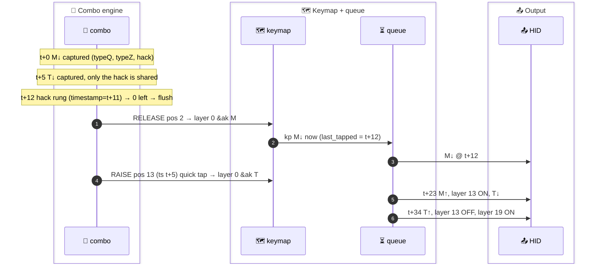
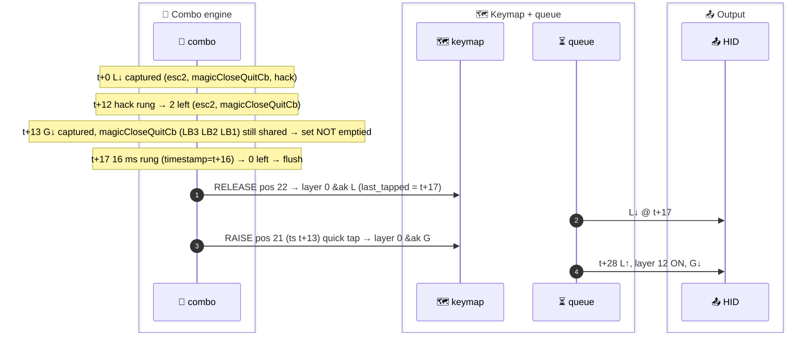

# 🧪 T-23: Flo's hero examples on the real keymap (R2): M→T@5, C→P@6 on/off, L→G@13/@5, hack-off L→G@20/@28

> **Status: complete.** 14 sub-cases: 7 spec cases (a, b, c, and (d)/(e) with the follower the spec names, LB3), 4 alternate-follower cases ((d)/(e) with LT4, whose timings the spec used), and 3 bracket controls, all built and ran on `_rig_R2` copies. Timestamped raw logs were produced by the previous runner; this runner verified them (see 🔁) and wrote the analysis. No rebuild was needed.
> **Verdict: `deviates`.** The two hero misses (M→T@5, C→P@6 with the hack) and the hack-off C→P hit are confirmed. Deviations: follower HID↓ comes at t+23, not t+22 (native queue tick). C is delivered at t+0, not t+1. And **the L→G(LB3) pair does not behave as the spec says**. L (LB2) and the G key (LB3) share the real combo `magicCloseQuitCb`. So with the hack at Δ = 13 the G key is bypassed to base ("LG", MISS). Without the hack at Δ = 20 it is captured by that combo and adapts ("LL", HIT). The spec's numbers hold only for the other `l_akL` follower, LT4 (`&bk G`).

---

## 🎯 Result first

- ❌ **Hero example 1, M→T at Δ = 5, hack on: MISS confirmed** (contradiction 1 / E-38).
  - M and T share only the hack. Both leave at the hack rung (t+12). T is re-raised with its old timestamp → quick-tap bypass → resolved on **layer 0** at t+12. `l_akM` (layer 13) comes on at t+23.
  - HID **"MT"**. No N.
- ❌ **Hero example 2, C→P at Δ = 6, hack on: MISS confirmed** (E-39).
  - Same shape: C at t+12, P resolved on layer 0 at t+12, `l_akC` (layer 4) ON at t+23.
  - HID **"CP"**. No BSPC or T.
- ✅ **C→P at Δ = 6, hack off: HIT confirmed** (E-21/E-22 contradicted, as CLAIMS said).
  - C has no combo left → delivered at t+0. Layer 4 ON at t+11. P waits for its own 16 ms combos → delivered on **layer 4** at t+23 → `CP_to_TP`.
  - HID **C, BSPC, T, P** = on-screen "TP".
- ⚠️ **L→G: the spec mixes two followers.** On `l_akL`, **LT4** (the X key) = `&bk G` and **LB3** (the G key) = `&bk L`. Both were run.
  - **LT4 follower (k2 = 0, hack-only position): matches MODEL (d) exactly.**
    - Δ = 13 hack on → L t+13, G t+25, HIT.
    - Δ = 5 → "LX", MISS.
    - Hack off Δ = 20 → L t+17, X key on base at t+20, MISS.
    - Hack off Δ = 28 → HIT (native same-ms tie, resolved layer-first).
  - **LB3 follower (shares `magicCloseQuitCb` = LB3 LB2 LB1, 16 ms, with L): outside MODEL (d)'s precondition "sharing no real combo".**
    - The G key keeps L's set alive until L's 16 ms rung (t+17). It is then re-raised as a quick tap → base layer.
    - Hack on: Δ = 5, 13, 15 → **MISS "LG"**. Δ = 16 → HIT "LL".
    - Hack off: Δ = 13 → **MISS "LG"** (identical to hack on). Δ = 20 and 28 → HIT "LL".
    - Native failure band for this pair = **Δ ≤ 15, with or without the hack**.
- 🧾 **Consequence for contradiction 4 / MODEL headline "every follower in a real combo already adapted for ALL Δ without the hack":** it does not hold for a follower whose real combo is **shared with its trigger**. That statement needs MODEL (d)'s "sharing no real combo" precondition. A static scan (not executed, see 🧮) finds 6 such pairs.

---

## 📜 Spec (CLAIMS.md, verbatim)

> **T-23 Flo's hero examples on the real keymap** — R2. (a) M→T Δ = 5: `PRESS(0,3,4) PRESS(1,4,60) RELEASE(0,3,40) RELEASE(1,4,300)` → `kp_pressed 0x10` (M) at `t+12`, `kp_pressed 0x17` (T) at `t+22`, no N (0x11). (b) C→P Δ = 6 with hack → C at `t+12`, P (0x13) at `t+22`, no BSPC/T. (c) C→P Δ = 6 hack off (comment the `COMBO_AK_CONSISTENCY_HACK` line in a copy of `combos.dtsi` via a test overlay `#undef`/delete-node `/delete-node/ &combo_ak_consistency_hack;`) → C at `t+1`, P delivered `t+23` → BSPC, T, P sequence. (d) L→G Δ = 13 with hack → `kp_pressed 0x0F` at `t+13`, `0x0F` again (G-follower `&bk L`) at `t+25`; Δ = 5 → L then G (0x0A). (e) hack off L→G Δ = 20 → L at `t+17`, G base at `t+20` (MISS); Δ = 28 → adapted. Purpose: contradictions 1, 4; the page's actual example numbers.

- 🧭 **Checked against RIG.md and the real config. Corrections:**
  - **Hack-off idiom.** The real combo has no label, so `/delete-node/ &combo_ak_consistency_hack;` cannot work. Used the RIG R2 idiom `/ { combos { /delete-node/ combo_ak_consistency_hack; }; };`. Compiled `zephyr.dts` of every `-nohack` case has 0 `combo_ak_consistency_hack` nodes; hack-on cases have 1.
  - **Coordinates** (RIG R2 table): M = LT2 pos 2 (0,3) · T = LM1 pos 13 (1,4) · C = LM4 pos 10 (1,1) · P = LT1 pos 3 (0,4) · L = LB2 pos 22 (2,3) · G key = LB3 pos 21 (2,2) · X key = LT4 pos 0 (0,1). All match the spec's mock coordinates for (a).
  - **`l_akL` followers** (`layers_B_NAQUADAH_adaptive_keys.dtsi:112-120`): row 0 col 0 (LT4) = `&bk G`, row 2 col 1 (LB3) = `&bk L`. The spec's "(G-follower `&bk L`)" + "0x0F again" is LB3; its times t+13/t+25 are the k2 = 0 (LT4) arithmetic from MODEL (d) ("L(16)→G(0) at Δ=13: L@13, layer@23, G@24"). → both followers run as separate sub-cases.
  - **Shared combo.** `magicCloseQuitCb` = `COMBO_ANY_ONE_HAND(magicCloseQuitCb, magicCloseQuit, LB3 LB2 LB1)` (`combos.dtsi:45`). Compiled: `key-positions = < 0x15 0x16 0x17 >; timeout-ms = < 0x10 >;`. LB2 also has `esc2` (LB2 LB1, 16 ms). RIG's R2 table already lists magicCloseQuitCb for both LB2 and LB3, but neither CLAIMS nor MODEL flags that they are shared.
  - **Mock timing** (RIG rule: e0.ms is both boot delay and gap after e0): event 0 `ms = Δ − 1` → t = abs Δ, key 2 at abs 2Δ = t+Δ. Key 1 up at t+Δ+61, key 2 up at t+Δ+102, exit t+Δ+403.

---

## 🔁 Resume + evidence integrity

- **State found:** 14 case dirs under `zmk/app/tests/ak-truth/T-23-*`, each with `keycode_events.snapshot` and a build dir. 14 `results/T-23-*.raw.log` + `.snapshot` files. Helper scripts `T-23.mkcases.py` (case generator), `T-23.hidseq.py`, `T-23.rawfilter.py`, `T-23.snapcheck.sh`. **No `T-23.md`.** → analysis only, no rebuild.
- **Integrity checks (this runner):**
  - `sed 's/.*> //' raw.log | md5` == `md5 build/tests/ak-truth/<case>/keycode_events_full.log` for **all 14** → the raw logs are the output of the built exes.
  - `T-23.snapcheck.sh` (re-applies `events.patterns` to each raw log) == the case dir's `keycode_events.snapshot` for **all 14**.
  - Re-running the exes was not possible: `docker ps -a` showed `zmk-devcontainer Exited (0) 3 hours ago`. It was not restarted, because no build was needed.
  - Spot-checked timestamps against the raw files: (a) `[00:00:00.028,000] … keycode 0x17` (T↓), (d1) `[00:00:00.041,000] … keycode 0x0A` (G↓). Both are exactly as in the tables below.

## 🗂️ Sub-cases

| case | follower | Δ | hack | raw log md5 | HID | outcome |
|---|---|---|---|---|---|---|
| `T-23-a-MT-d5` | LM1 T (l_akM: `&bk N`) | 5 | on | `b3241efd69d3cebf5661f7a4ce21de65` | M T | ❌ MISS |
| `T-23-b-CP-d6` | LT1 P (l_akC: `CP_to_TP`) | 6 | on | `2329ac283dab120b011a502a8d2ff100` | C P | ❌ MISS |
| `T-23-c-CP-d6-nohack` | LT1 P | 6 | **off** | `45b78bb087b93c96182b4c0b32bf8a99` | C BSPC T P | ✅ HIT |
| `T-23-d1-LG-d13` | LB3 G key (l_akL: `&bk L`) | 13 | on | `28f469f98f661ca64f17b7321773b389` | L G | ❌ MISS |
| `T-23-d2-LG-d5` | LB3 | 5 | on | `929242ee6d66cb043352a837af6f35e0` | L G | ❌ MISS |
| `T-23-d3-LX-d13` | LT4 X key (l_akL: `&bk G`) | 13 | on | `866047d2ed2239ae4f52d7cc4bea1167` | L G | ✅ HIT |
| `T-23-d4-LX-d5` | LT4 | 5 | on | `911de8bfcd66c0b205547c7216eb0ed8` | L X | ❌ MISS |
| `T-23-d5-LG-d15` *(bracket)* | LB3 | 15 | on | `4bfce57dd2ec28b06bcfa92ae27304ea` | L G | ❌ MISS |
| `T-23-d6-LG-d16` *(bracket)* | LB3 | 16 | on | `ca09d9ca4979157977a6ede606b5a6de` | L L | ✅ HIT |
| `T-23-e1-LG-d20-nohack` | LB3 | 20 | **off** | `b4e04ec0f8376a4a010d8a449f444685` | L L | ✅ HIT |
| `T-23-e2-LG-d28-nohack` | LB3 | 28 | **off** | `09e836379fa6cd114723abf658283126` | L L | ✅ HIT |
| `T-23-e3-LX-d20-nohack` | LT4 | 20 | **off** | `329b6664513ecc07fde577aeef336a89` | L X | ❌ MISS |
| `T-23-e4-LX-d28-nohack` | LT4 | 28 | **off** | `e6401649108c71683055c6a1e29d9e44` | L G | ✅ HIT |
| `T-23-e5-LG-d13-nohack` *(bracket)* | LB3 | 13 | **off** | `909bda57929dff5d11a3cbfae1bb43c0` | L G | ❌ MISS |

- **Events** (generated by `T-23.mkcases.py`; `k1`/`k2` = mock coords of key 1 / key 2):
  ```
  ZMK_MOCK_PRESS(k1, Δ-1)    key 1 ↓  abs Δ        (t)
  ZMK_MOCK_PRESS(k2, 60)     key 2 ↓  abs 2Δ       (t+Δ)
  ZMK_MOCK_RELEASE(k1, 40)   key 1 ↑  abs 2Δ+61    (t+Δ+61)
  ZMK_MOCK_RELEASE(k2, 300)  key 2 ↑  abs 2Δ+102   (t+Δ+102), exit abs 2Δ+403
  ```
  - (a) is the spec's block verbatim: `PRESS(0,3,4) PRESS(1,4,60) RELEASE(0,3,40) RELEASE(1,4,300)`.
- **Diff vs `_rig_R2/native_posix_64.keymap`** (`.conf`, `events.patterns` unchanged in all 14):
  - hack-on cases: only the appended `&kscan { events = <…>; };` block (plus a `/* ===== T-23 case … ===== */` comment).
  - `-nohack` cases additionally:
    ```
    > /* T-23: hack OFF (RIG.md R2 idiom; the real combo has no label) */
    > / { combos { /delete-node/ combo_ak_consistency_hack; }; };
    ```

---

## (a) `T-23-a-MT-d5`: M (LT2) → T (LM1), Δ = 5, hack on

```
ZMK_MOCK_PRESS(0,3,4)      M↓ pos 2   abs 5   (t)
ZMK_MOCK_PRESS(1,4,60)     T↓ pos 13  abs 10  (t+5)
ZMK_MOCK_RELEASE(0,3,40)   M↑         abs 71  (t+66)
ZMK_MOCK_RELEASE(1,4,300)  T↑         abs 112 (t+107), exit abs 413
```



```
[00:00:00.005,000] <dbg> zmk: zmk_physical_layouts_kscan_process_msgq: Row: 0, col: 3, position: 2, pressed: true
[00:00:00.005,000] <dbg> zmk: position_state_down: combo: capturing position event 2
[00:00:00.010,000] <dbg> zmk: zmk_physical_layouts_kscan_process_msgq: Row: 1, col: 4, position: 13, pressed: true
[00:00:00.010,000] <dbg> zmk: filter_timed_out_candidates: after filtering out timed out combo candidates: remaining_candidates=3 timestamp=10
[00:00:00.010,000] <dbg> zmk: position_state_down: combo: capturing position event 13
[00:00:00.017,000] <dbg> zmk: filter_timed_out_candidates: after filtering out timed out combo candidates: remaining_candidates=0 timestamp=16
[00:00:00.017,000] <dbg> zmk: release_pressed_keys: combo: releasing position event 2
[00:00:00.017,000] <dbg> zmk: zmk_keymap_apply_position_state: layer_id: 0 position: 2, binding name: flo,behavior-adaptive-key
[00:00:00.017,000] <dbg> zmk: hid_listener_keycode_pressed: usage_page 0x07 keycode 0x10 implicit_mods 0x00 explicit_mods 0x00
[00:00:00.017,000] <dbg> zmk: release_pressed_keys: combo: reraising position event 13
[00:00:00.017,000] <dbg> zmk: zmk_keymap_apply_position_state: layer_id: 0 position: 13, binding name: flo,behavior-adaptive-key
[00:00:00.028,000] <dbg> zmk: hid_listener_keycode_released: usage_page 0x07 keycode 0x10 implicit_mods 0x00 explicit_mods 0x00
[00:00:00.028,000] <dbg> zmk: set_layer_state: layer_changed: layer 13 state 1
[00:00:00.028,000] <dbg> zmk: hid_listener_keycode_pressed: usage_page 0x07 keycode 0x17 implicit_mods 0x00 explicit_mods 0x00
[00:00:00.039,000] <dbg> zmk: hid_listener_keycode_released: usage_page 0x07 keycode 0x17 implicit_mods 0x00 explicit_mods 0x00
[00:00:00.039,000] <dbg> zmk: set_layer_state: layer_changed: layer 13 state 0
[00:00:00.039,000] <dbg> zmk: set_layer_state: layer_changed: layer 19 state 1
[00:00:00.071,000] <dbg> zmk: zmk_physical_layouts_kscan_process_msgq: Row: 0, col: 3, position: 2, pressed: false
[00:00:00.071,000] <dbg> zmk: zmk_keymap_apply_position_state: layer_id: 0 position: 2, binding name: flo,behavior-adaptive-key
[00:00:00.112,000] <dbg> zmk: zmk_physical_layouts_kscan_process_msgq: Row: 1, col: 4, position: 13, pressed: false
[00:00:00.112,000] <dbg> zmk: zmk_keymap_apply_position_state: layer_id: 0 position: 13, binding name: flo,behavior-adaptive-key
[00:00:00.140,000] <dbg> zmk: set_layer_state: layer_changed: layer 19 state 0
[00:00:00.413,000] <dbg> zmk: kscan_mock_schedule_next_event_0: Exiting
```

| rel | abs | event |
|---|---|---|
| +0 | 5 | M↓ pos 2 → captured (typeQ 16, typeZ 16, hack 11) |
| +5 | 10 | T↓ pos 13 → `remaining_candidates=3 timestamp=10` (M's set before the position filter) → captured; only the hack contains pos 13 |
| +12 | 17 | hack rung `remaining_candidates=0 timestamp=16` → release pos 2 → layer 0 `&ak M` → **HID ↓ M** → reraise pos 13 → **layer 0 `&ak T`** (no re-capture) |
| +23 | 28 | HID ↑ M → **LAYER 13 ON** → **HID ↓ T** (queued behind M) |
| +34 | 39 | HID ↑ T → LAYER 13 OFF (consumed) → LAYER 19 ON |
| +66 / +107 | 71 / 112 | M↑ / T↑ physical → `&ak` release branch, no output |
| +135 | 140 | LAYER 19 OFF |

| # | expected (spec) | observed | |
|---|---|---|---|
| 1 | `kp_pressed 0x10` (M) at t+12 | `[00:00:00.017,000] … keycode 0x10` = t+12 | ✅ |
| 2 | `kp_pressed 0x17` (T) at **t+22** | `[00:00:00.028,000] … keycode 0x17` = **t+23** | ❌ +1 ms |
| 3 | no N (0x11) | no `keycode 0x11` in the log (grep count 0) | ✅ |
| 4 | *(implied)* MISS, T on base | `[00:00:00.017,000] … layer_id: 0 position: 13` 11 ms before `layer 13 state 1` `[00:00:00.028,000]` | ✅ |

- ⚠️ **Row 2 is the same arithmetic slip as T-02.** The spec put +1 on the combo rung but not on the 10 ms queue tick. MODEL (c) native rule "layer on at D + 11" gives 12 + 11 = t+23.
- 📤 **HID:** M↓ t+12 · M↑ t+23 · T↓ t+23 · T↑ t+34 → **"MT"** (adapted would be "MN").

---

## (b) `T-23-b-CP-d6`: C (LM4) → P (LT1), Δ = 6, hack on

```
ZMK_MOCK_PRESS(1,1,5)      C↓ pos 10  abs 6   (t)
ZMK_MOCK_PRESS(0,4,60)     P↓ pos 3   abs 12  (t+6)
ZMK_MOCK_RELEASE(1,1,40)   C↑         abs 73  (t+67)
ZMK_MOCK_RELEASE(0,4,300)  P↑         abs 114 (t+108), exit abs 415
```

```
[00:00:00.006,000] <dbg> zmk: zmk_physical_layouts_kscan_process_msgq: Row: 1, col: 1, position: 10, pressed: true
[00:00:00.006,000] <dbg> zmk: position_state_down: combo: capturing position event 10
[00:00:00.012,000] <dbg> zmk: zmk_physical_layouts_kscan_process_msgq: Row: 0, col: 4, position: 3, pressed: true
[00:00:00.012,000] <dbg> zmk: filter_timed_out_candidates: after filtering out timed out combo candidates: remaining_candidates=1 timestamp=12
[00:00:00.012,000] <dbg> zmk: position_state_down: combo: capturing position event 3
[00:00:00.018,000] <dbg> zmk: filter_timed_out_candidates: after filtering out timed out combo candidates: remaining_candidates=0 timestamp=17
[00:00:00.018,000] <dbg> zmk: release_pressed_keys: combo: releasing position event 10
[00:00:00.018,000] <dbg> zmk: zmk_keymap_apply_position_state: layer_id: 0 position: 10, binding name: flo,behavior-adaptive-key
[00:00:00.018,000] <dbg> zmk: hid_listener_keycode_pressed: usage_page 0x07 keycode 0x06 implicit_mods 0x00 explicit_mods 0x00
[00:00:00.018,000] <dbg> zmk: release_pressed_keys: combo: reraising position event 3
[00:00:00.018,000] <dbg> zmk: zmk_keymap_apply_position_state: layer_id: 0 position: 3, binding name: flo,behavior-adaptive-key
[00:00:00.029,000] <dbg> zmk: hid_listener_keycode_released: usage_page 0x07 keycode 0x06 implicit_mods 0x00 explicit_mods 0x00
[00:00:00.029,000] <dbg> zmk: set_layer_state: layer_changed: layer 4 state 1
[00:00:00.029,000] <dbg> zmk: hid_listener_keycode_pressed: usage_page 0x07 keycode 0x13 implicit_mods 0x00 explicit_mods 0x00
[00:00:00.040,000] <dbg> zmk: hid_listener_keycode_released: usage_page 0x07 keycode 0x13 implicit_mods 0x00 explicit_mods 0x00
[00:00:00.040,000] <dbg> zmk: set_layer_state: layer_changed: layer 4 state 0
[00:00:00.040,000] <dbg> zmk: set_layer_state: layer_changed: layer 16 state 1
[00:00:00.073,000] <dbg> zmk: zmk_physical_layouts_kscan_process_msgq: Row: 1, col: 1, position: 10, pressed: false
[00:00:00.073,000] <dbg> zmk: zmk_keymap_apply_position_state: layer_id: 0 position: 10, binding name: flo,behavior-adaptive-key
[00:00:00.114,000] <dbg> zmk: zmk_physical_layouts_kscan_process_msgq: Row: 0, col: 4, position: 3, pressed: false
[00:00:00.114,000] <dbg> zmk: zmk_keymap_apply_position_state: layer_id: 0 position: 3, binding name: flo,behavior-adaptive-key
[00:00:00.141,000] <dbg> zmk: set_layer_state: layer_changed: layer 16 state 0
[00:00:00.415,000] <dbg> zmk: kscan_mock_schedule_next_event_0: Exiting
```

| rel | abs | event |
|---|---|---|
| +0 | 6 | C↓ pos 10 → captured (hack only) |
| +6 | 12 | P↓ pos 3 → `remaining_candidates=1 timestamp=12` → captured (shares the hack) |
| +12 | 18 | hack rung `remaining_candidates=0 timestamp=17` → release pos 10 → layer 0 `&ak C` → **HID ↓ C** → reraise pos 3 → **layer 0 `&ak P`** |
| +23 | 29 | HID ↑ C → **LAYER 4 ON** → **HID ↓ P** |
| +34 | 40 | HID ↑ P → LAYER 4 OFF → LAYER 16 ON |
| +135 | 141 | LAYER 16 OFF |

| # | expected (spec) | observed | |
|---|---|---|---|
| 1 | C at t+12 | `[00:00:00.018,000] … keycode 0x06` = t+12 | ✅ |
| 2 | P (0x13) at **t+22** | `[00:00:00.029,000] … keycode 0x13` = **t+23** | ❌ +1 ms |
| 3 | no BSPC / T | no `keycode 0x2A` / `0x17` in the log (grep count 0) | ✅ |
| 4 | *(implied)* MISS | P resolved `layer_id: 0` at `[00:00:00.018,000]`, layer 4 ON at `[00:00:00.029,000]` | ✅ |

- 📤 **HID:** C↓ t+12 · C↑ t+23 · P↓ t+23 · P↑ t+34 → **"CP"** (adapted would be "TP").

---

## (c) `T-23-c-CP-d6-nohack`: C → P, Δ = 6, hack deleted

- Same events as (b). Keymap diff: the `/ { combos { /delete-node/ combo_ak_consistency_hack; }; };` line.

```
[00:00:00.006,000] <dbg> zmk: zmk_physical_layouts_kscan_process_msgq: Row: 1, col: 1, position: 10, pressed: true
[00:00:00.006,000] <dbg> zmk: zmk_keymap_apply_position_state: layer_id: 0 position: 10, binding name: flo,behavior-adaptive-key
[00:00:00.006,000] <dbg> zmk: hid_listener_keycode_pressed: usage_page 0x07 keycode 0x06 implicit_mods 0x00 explicit_mods 0x00
[00:00:00.012,000] <dbg> zmk: zmk_physical_layouts_kscan_process_msgq: Row: 0, col: 4, position: 3, pressed: true
[00:00:00.012,000] <dbg> zmk: position_state_down: combo: capturing position event 3
[00:00:00.017,000] <dbg> zmk: hid_listener_keycode_released: usage_page 0x07 keycode 0x06 implicit_mods 0x00 explicit_mods 0x00
[00:00:00.017,000] <dbg> zmk: set_layer_state: layer_changed: layer 4 state 1
[00:00:00.029,000] <dbg> zmk: filter_timed_out_candidates: after filtering out timed out combo candidates: remaining_candidates=0 timestamp=28
[00:00:00.029,000] <dbg> zmk: release_pressed_keys: combo: releasing position event 3
[00:00:00.029,000] <dbg> zmk: zmk_keymap_apply_position_state: layer_id: 4 position: 3, binding name: flo-macro-replace-char-with-bigram-TP
[00:00:00.029,000] <dbg> zmk: hid_listener_keycode_pressed: usage_page 0x07 keycode 0x2A implicit_mods 0x00 explicit_mods 0x00
[00:00:00.040,000] <dbg> zmk: hid_listener_keycode_released: usage_page 0x07 keycode 0x2A implicit_mods 0x00 explicit_mods 0x00
[00:00:00.040,000] <dbg> zmk: set_layer_state: layer_changed: layer 4 state 0
[00:00:00.040,000] <dbg> zmk: hid_listener_keycode_pressed: usage_page 0x07 keycode 0x17 implicit_mods 0x00 explicit_mods 0x00
[00:00:00.051,000] <dbg> zmk: hid_listener_keycode_released: usage_page 0x07 keycode 0x17 implicit_mods 0x00 explicit_mods 0x00
[00:00:00.051,000] <dbg> zmk: hid_listener_keycode_released: usage_page 0x07 keycode 0xE1 implicit_mods 0x00 explicit_mods 0x00
[00:00:00.051,000] <dbg> zmk: hid_listener_keycode_released: usage_page 0x07 keycode 0xE5 implicit_mods 0x00 explicit_mods 0x00
[00:00:00.062,000] <dbg> zmk: hid_listener_keycode_pressed: usage_page 0x07 keycode 0x13 implicit_mods 0x00 explicit_mods 0x00
[00:00:00.073,000] <dbg> zmk: hid_listener_keycode_released: usage_page 0x07 keycode 0x13 implicit_mods 0x00 explicit_mods 0x00
[00:00:00.073,000] <dbg> zmk: set_layer_state: layer_changed: layer 16 state 1
[00:00:00.073,000] <dbg> zmk: zmk_physical_layouts_kscan_process_msgq: Row: 1, col: 1, position: 10, pressed: false
[00:00:00.073,000] <dbg> zmk: zmk_keymap_apply_position_state: layer_id: 0 position: 10, binding name: flo,behavior-adaptive-key
[00:00:00.114,000] <dbg> zmk: zmk_physical_layouts_kscan_process_msgq: Row: 0, col: 4, position: 3, pressed: false
[00:00:00.114,000] <dbg> zmk: zmk_keymap_apply_position_state: layer_id: 4 position: 3, binding name: flo-macro-replace-char-with-bigram-TP
[00:00:00.174,000] <dbg> zmk: set_layer_state: layer_changed: layer 16 state 0
[00:00:00.415,000] <dbg> zmk: kscan_mock_schedule_next_event_0: Exiting
```

| rel | abs | event |
|---|---|---|
| +0 | 6 | C↓ pos 10 → **no candidate** → no capture line → layer 0 `&ak C` → **HID ↓ C** (same ms as the `Row:` line) |
| +6 | 12 | P↓ pos 3 → captured (space 16, typeQ 16) |
| +11 | 17 | HID ↑ C → **LAYER 4 ON** |
| +23 | 29 | P's rung `remaining_candidates=0 timestamp=28` (= P's ts 12 + 16) → release pos 3 → **layer 4 `flo-macro-replace-char-with-bigram-TP`** → **HID ↓ BSPC** |
| +34 | 40 | HID ↑ BSPC → LAYER 4 OFF (consumed) → **HID ↓ T** |
| +45 | 51 | HID ↑ T, `↑ 0xE1` / `↑ 0xE5` (`Unable to release keycode`, i.e. no-op shift releases inside the macro) → nested `&ak P` queued |
| +56 | 62 | **HID ↓ P** |
| +67 | 73 | HID ↑ P → LAYER 16 ON; C↑ physical in the same ms |
| +168 | 174 | LAYER 16 OFF |

| # | expected (spec) | observed | |
|---|---|---|---|
| 1 | C at **t+1** | `[00:00:00.006,000] … keycode 0x06` = **t+0** | ❌ −1 ms |
| 2 | P delivered t+23 | `[00:00:00.029,000] … layer_id: 4 position: 3, binding name: flo-macro-replace-char-with-bigram-TP` = t+23 | ✅ |
| 3 | → BSPC, T, P sequence | BSPC↓ `[00:00:00.029,000]` t+23 · T↓ `[00:00:00.040,000]` t+34 · P↓ `[00:00:00.062,000]` t+56 | ✅ |
| 4 | *(implied)* HIT | on-screen "TP" | ✅ |

- ⚠️ **Row 1.** Nothing delays C: no combo contains LM4 once the hack is gone, and `&ak`'s first `kp` is synchronous. MODEL (d) says the same ("A delivered … immediately if k1 = 0"). The spec's t+1 has no mechanism behind it.
- 📤 **HID:** C↓ t+0 · C↑ t+11 · BSPC↓ t+23 · BSPC↑ t+34 · T↓ t+34 · T↑ t+45 · P↓ t+56 · P↑ t+67 → keystrokes **C ⌫ T P** → text **"TP"**.

---

## (d) L → follower on `l_akL`, hack on

### (d1) `T-23-d1-LG-d13`: L (LB2) → G key (LB3, `&bk L`), Δ = 13. The follower the spec names

```
ZMK_MOCK_PRESS(2,3,12)     L↓ pos 22  abs 13  (t)
ZMK_MOCK_PRESS(2,2,60)     G↓ pos 21  abs 26  (t+13)
ZMK_MOCK_RELEASE(2,3,40)   L↑         abs 87  (t+74)
ZMK_MOCK_RELEASE(2,2,300)  G↑         abs 128 (t+115), exit abs 429
```



```
[00:00:00.013,000] <dbg> zmk: zmk_physical_layouts_kscan_process_msgq: Row: 2, col: 3, position: 22, pressed: true
[00:00:00.013,000] <dbg> zmk: position_state_down: combo: capturing position event 22
[00:00:00.025,000] <dbg> zmk: filter_timed_out_candidates: after filtering out timed out combo candidates: remaining_candidates=2 timestamp=24
[00:00:00.026,000] <dbg> zmk: zmk_physical_layouts_kscan_process_msgq: Row: 2, col: 2, position: 21, pressed: true
[00:00:00.026,000] <dbg> zmk: filter_timed_out_candidates: after filtering out timed out combo candidates: remaining_candidates=2 timestamp=26
[00:00:00.026,000] <dbg> zmk: position_state_down: combo: capturing position event 21
[00:00:00.030,000] <dbg> zmk: filter_timed_out_candidates: after filtering out timed out combo candidates: remaining_candidates=0 timestamp=29
[00:00:00.030,000] <dbg> zmk: release_pressed_keys: combo: releasing position event 22
[00:00:00.030,000] <dbg> zmk: zmk_keymap_apply_position_state: layer_id: 0 position: 22, binding name: flo,behavior-adaptive-key
[00:00:00.030,000] <dbg> zmk: hid_listener_keycode_pressed: usage_page 0x07 keycode 0x0F implicit_mods 0x00 explicit_mods 0x00
[00:00:00.030,000] <dbg> zmk: release_pressed_keys: combo: reraising position event 21
[00:00:00.030,000] <dbg> zmk: zmk_keymap_apply_position_state: layer_id: 0 position: 21, binding name: flo,behavior-adaptive-key
[00:00:00.041,000] <dbg> zmk: hid_listener_keycode_released: usage_page 0x07 keycode 0x0F implicit_mods 0x00 explicit_mods 0x00
[00:00:00.041,000] <dbg> zmk: set_layer_state: layer_changed: layer 12 state 1
[00:00:00.041,000] <dbg> zmk: hid_listener_keycode_pressed: usage_page 0x07 keycode 0x0A implicit_mods 0x00 explicit_mods 0x00
[00:00:00.052,000] <dbg> zmk: hid_listener_keycode_released: usage_page 0x07 keycode 0x0A implicit_mods 0x00 explicit_mods 0x00
[00:00:00.052,000] <dbg> zmk: set_layer_state: layer_changed: layer 12 state 0
[00:00:00.052,000] <dbg> zmk: set_layer_state: layer_changed: layer 8 state 1
[00:00:00.087,000] <dbg> zmk: zmk_physical_layouts_kscan_process_msgq: Row: 2, col: 3, position: 22, pressed: false
[00:00:00.087,000] <dbg> zmk: zmk_keymap_apply_position_state: layer_id: 0 position: 22, binding name: flo,behavior-adaptive-key
[00:00:00.128,000] <dbg> zmk: zmk_physical_layouts_kscan_process_msgq: Row: 2, col: 2, position: 21, pressed: false
[00:00:00.128,000] <dbg> zmk: zmk_keymap_apply_position_state: layer_id: 0 position: 21, binding name: flo,behavior-adaptive-key
[00:00:00.153,000] <dbg> zmk: set_layer_state: layer_changed: layer 8 state 0
[00:00:00.429,000] <dbg> zmk: kscan_mock_schedule_next_event_0: Exiting
```

| rel | abs | event |
|---|---|---|
| +0 | 13 | L↓ pos 22 → captured (esc2 16, magicCloseQuitCb 16, hack 11) |
| +12 | 25 | hack rung `remaining_candidates=2 timestamp=24` → 2 left, no flush |
| +13 | 26 | G↓ pos 21 → `remaining_candidates=2 timestamp=26` → captured; magicCloseQuitCb contains 21 → set not empty |
| +17 | 30 | 16 ms rung `remaining_candidates=0 timestamp=29` → release pos 22 → layer 0 `&ak L` → **HID ↓ L** → reraise pos 21 → **layer 0 `&ak G`** (no re-capture: 30 − 1 = 29 > 26) |
| +28 | 41 | HID ↑ L → LAYER 12 ON → **HID ↓ G** |
| +39 | 52 | HID ↑ G → LAYER 12 OFF → LAYER 8 ON (`l_akG`) |
| +140 | 153 | LAYER 8 OFF |

| # | expected (spec) | observed | |
|---|---|---|---|
| 1 | `kp_pressed 0x0F` at **t+13** | `[00:00:00.030,000] … keycode 0x0F` = **t+17** | ❌ +4 ms |
| 2 | `0x0F` again (G-follower `&bk L`) at **t+25** | `[00:00:00.041,000] … keycode 0x0A` = **G at t+28**; no second `0x0F` | ❌ |
| 3 | *(implied)* adapted "LL" | G key resolved `layer_id: 0` at `[00:00:00.030,000]`, 11 ms before `layer 12 state 1` | ❌ MISS |

- 🔬 **Why.** The spec's arithmetic assumes G's press empties L's set (MODEL (d) "11 ≤ Δ < dA"). It doesn't, because `magicCloseQuitCb` contains both LB2 and LB3. L therefore leaves at its own 16 ms rung, and the G key is flushed in the same burst → quick-tap bypass (MODEL R8), exactly as in the Δ ≤ 9 case but with `now_flush` = t+17 instead of t+12.
- 📤 **HID:** L↓ t+17 · L↑ t+28 · G↓ t+28 · G↑ t+39 → **"LG"** (adapted would be "LL").

### (d2) `T-23-d2-LG-d5`: L → G key (LB3), Δ = 5

```
[00:00:00.005,000] <dbg> zmk: zmk_physical_layouts_kscan_process_msgq: Row: 2, col: 3, position: 22, pressed: true
[00:00:00.005,000] <dbg> zmk: position_state_down: combo: capturing position event 22
[00:00:00.010,000] <dbg> zmk: zmk_physical_layouts_kscan_process_msgq: Row: 2, col: 2, position: 21, pressed: true
[00:00:00.010,000] <dbg> zmk: filter_timed_out_candidates: after filtering out timed out combo candidates: remaining_candidates=3 timestamp=10
[00:00:00.010,000] <dbg> zmk: position_state_down: combo: capturing position event 21
[00:00:00.017,000] <dbg> zmk: filter_timed_out_candidates: after filtering out timed out combo candidates: remaining_candidates=1 timestamp=16
[00:00:00.022,000] <dbg> zmk: filter_timed_out_candidates: after filtering out timed out combo candidates: remaining_candidates=0 timestamp=21
[00:00:00.022,000] <dbg> zmk: release_pressed_keys: combo: releasing position event 22
[00:00:00.022,000] <dbg> zmk: zmk_keymap_apply_position_state: layer_id: 0 position: 22, binding name: flo,behavior-adaptive-key
[00:00:00.022,000] <dbg> zmk: hid_listener_keycode_pressed: usage_page 0x07 keycode 0x0F implicit_mods 0x00 explicit_mods 0x00
[00:00:00.022,000] <dbg> zmk: release_pressed_keys: combo: reraising position event 21
[00:00:00.022,000] <dbg> zmk: zmk_keymap_apply_position_state: layer_id: 0 position: 21, binding name: flo,behavior-adaptive-key
[00:00:00.033,000] <dbg> zmk: hid_listener_keycode_released: usage_page 0x07 keycode 0x0F implicit_mods 0x00 explicit_mods 0x00
[00:00:00.033,000] <dbg> zmk: set_layer_state: layer_changed: layer 12 state 1
[00:00:00.033,000] <dbg> zmk: hid_listener_keycode_pressed: usage_page 0x07 keycode 0x0A implicit_mods 0x00 explicit_mods 0x00
[00:00:00.044,000] <dbg> zmk: hid_listener_keycode_released: usage_page 0x07 keycode 0x0A implicit_mods 0x00 explicit_mods 0x00
[00:00:00.044,000] <dbg> zmk: set_layer_state: layer_changed: layer 12 state 0
[00:00:00.044,000] <dbg> zmk: set_layer_state: layer_changed: layer 8 state 1
[00:00:00.071,000] <dbg> zmk: zmk_physical_layouts_kscan_process_msgq: Row: 2, col: 3, position: 22, pressed: false
[00:00:00.071,000] <dbg> zmk: zmk_keymap_apply_position_state: layer_id: 0 position: 22, binding name: flo,behavior-adaptive-key
[00:00:00.112,000] <dbg> zmk: zmk_physical_layouts_kscan_process_msgq: Row: 2, col: 2, position: 21, pressed: false
[00:00:00.112,000] <dbg> zmk: zmk_keymap_apply_position_state: layer_id: 0 position: 21, binding name: flo,behavior-adaptive-key
[00:00:00.145,000] <dbg> zmk: set_layer_state: layer_changed: layer 8 state 0
[00:00:00.413,000] <dbg> zmk: kscan_mock_schedule_next_event_0: Exiting
```

| rel | abs | event |
|---|---|---|
| +0 | 5 | L↓ captured |
| +5 | 10 | G↓ → `remaining_candidates=3 timestamp=10` → captured (magicCloseQuitCb + hack shared) |
| +12 | 17 | hack rung `remaining_candidates=1 timestamp=16` → magicCloseQuitCb still alive, **no flush** |
| +17 | 22 | 16 ms rung `remaining_candidates=0 timestamp=21` → **HID ↓ L**, G re-raised → layer 0 `&ak G` |
| +28 | 33 | L↑, LAYER 12 ON, **HID ↓ G** |

| # | expected | observed | |
|---|---|---|---|
| 1 | spec: "L then G (0x0A)" | L↓ `[00:00:00.022,000]`, G↓ `[00:00:00.033,000]` | ✅ |
| 2 | MODEL (d) "Δ ≤ 9 → both leave at T_A + 11" (native t+12) | both leave at **t+17** (`timestamp=21` = t+16) | ⚠️ +5 ms, the shared 16 ms combo outlives the hack rung |

- 📤 **HID:** L↓ t+17 · L↑ t+28 · G↓ t+28 · G↑ t+39 → **"LG"**, MISS.

### (d3) `T-23-d3-LX-d13`: L → X key (LT4, `&bk G`), Δ = 13. The follower whose timing the spec used

```
[00:00:00.013,000] <dbg> zmk: zmk_physical_layouts_kscan_process_msgq: Row: 2, col: 3, position: 22, pressed: true
[00:00:00.013,000] <dbg> zmk: position_state_down: combo: capturing position event 22
[00:00:00.025,000] <dbg> zmk: filter_timed_out_candidates: after filtering out timed out combo candidates: remaining_candidates=2 timestamp=24
[00:00:00.026,000] <dbg> zmk: zmk_physical_layouts_kscan_process_msgq: Row: 0, col: 1, position: 0, pressed: true
[00:00:00.026,000] <dbg> zmk: filter_timed_out_candidates: after filtering out timed out combo candidates: remaining_candidates=2 timestamp=26
[00:00:00.026,000] <dbg> zmk: position_state_down: combo: capturing position event 0
[00:00:00.026,000] <dbg> zmk: release_pressed_keys: combo: releasing position event 22
[00:00:00.026,000] <dbg> zmk: zmk_keymap_apply_position_state: layer_id: 0 position: 22, binding name: flo,behavior-adaptive-key
[00:00:00.026,000] <dbg> zmk: hid_listener_keycode_pressed: usage_page 0x07 keycode 0x0F implicit_mods 0x00 explicit_mods 0x00
[00:00:00.026,000] <dbg> zmk: release_pressed_keys: combo: reraising position event 0
[00:00:00.026,000] <dbg> zmk: position_state_down: combo: capturing position event 0
[00:00:00.037,000] <dbg> zmk: hid_listener_keycode_released: usage_page 0x07 keycode 0x0F implicit_mods 0x00 explicit_mods 0x00
[00:00:00.037,000] <dbg> zmk: set_layer_state: layer_changed: layer 12 state 1
[00:00:00.038,000] <dbg> zmk: filter_timed_out_candidates: after filtering out timed out combo candidates: remaining_candidates=0 timestamp=37
[00:00:00.038,000] <dbg> zmk: release_pressed_keys: combo: releasing position event 0
[00:00:00.038,000] <dbg> zmk: zmk_keymap_apply_position_state: layer_id: 12 position: 0, binding name: flo,behavior-buffered-key
[00:00:00.038,000] <dbg> zmk: hid_listener_keycode_pressed: usage_page 0x07 keycode 0x0A implicit_mods 0x00 explicit_mods 0x00
[00:00:00.049,000] <dbg> zmk: hid_listener_keycode_released: usage_page 0x07 keycode 0x0A implicit_mods 0x00 explicit_mods 0x00
[00:00:00.049,000] <dbg> zmk: set_layer_state: layer_changed: layer 12 state 0
[00:00:00.087,000] <dbg> zmk: zmk_physical_layouts_kscan_process_msgq: Row: 2, col: 3, position: 22, pressed: false
[00:00:00.087,000] <dbg> zmk: zmk_keymap_apply_position_state: layer_id: 0 position: 22, binding name: flo,behavior-adaptive-key
[00:00:00.128,000] <dbg> zmk: zmk_physical_layouts_kscan_process_msgq: Row: 0, col: 1, position: 0, pressed: false
[00:00:00.128,000] <dbg> zmk: zmk_keymap_apply_position_state: layer_id: 12 position: 0, binding name: flo,behavior-buffered-key
[00:00:00.429,000] <dbg> zmk: kscan_mock_schedule_next_event_0: Exiting
```

| rel | abs | event |
|---|---|---|
| +0 | 13 | L↓ captured |
| +12 | 25 | hack rung `remaining_candidates=2 timestamp=24` |
| +13 | 26 | X↓ pos 0 → `remaining_candidates=2 timestamp=26` → captured, shares nothing → cleanup: release pos 22 → layer 0 `&ak L` → **HID ↓ L**; reraise pos 0 → **captured again** (fresh set: hack; no quick tap, since last_tapped 26 − 1 = 25 < 26) |
| +24 | 37 | HID ↑ L → **LAYER 12 ON** |
| +25 | 38 | pos 0 hack rung `remaining_candidates=0 timestamp=37` (= 26 + 11) → **layer 12 `&bk G`** → **HID ↓ G** |
| +36 | 49 | HID ↑ G → LAYER 12 OFF |

| # | expected | observed | |
|---|---|---|---|
| 1 | spec: `kp_pressed 0x0F` at t+13 | `[00:00:00.026,000] … keycode 0x0F` = t+13 | ✅ |
| 2 | spec: second key at t+25 | `[00:00:00.038,000] … keycode 0x0A` = t+25 | ✅ time |
| 3 | spec: second keycode `0x0F` | `0x0A` (G). LT4 on `l_akL` is `&bk G` | ⚠️ spec described LB3's binding |
| 4 | MODEL (d) example "L@13, layer@23, G@24" (board) → native L@13, layer@24, G@25 | L t+13, layer 12 ON t+24, G t+25 | ✅ exact |

- 📤 **HID:** L↓ t+13 · L↑ t+24 · G↓ t+25 · G↑ t+36 → **"LG" produced by the X key = adapted (HIT)**. Layer-to-follower margin: 1 ms.

### (d4) `T-23-d4-LX-d5`: L → X key (LT4), Δ = 5

```
[00:00:00.005,000] <dbg> zmk: zmk_physical_layouts_kscan_process_msgq: Row: 2, col: 3, position: 22, pressed: true
[00:00:00.005,000] <dbg> zmk: position_state_down: combo: capturing position event 22
[00:00:00.010,000] <dbg> zmk: zmk_physical_layouts_kscan_process_msgq: Row: 0, col: 1, position: 0, pressed: true
[00:00:00.010,000] <dbg> zmk: filter_timed_out_candidates: after filtering out timed out combo candidates: remaining_candidates=3 timestamp=10
[00:00:00.010,000] <dbg> zmk: position_state_down: combo: capturing position event 0
[00:00:00.017,000] <dbg> zmk: filter_timed_out_candidates: after filtering out timed out combo candidates: remaining_candidates=0 timestamp=16
[00:00:00.017,000] <dbg> zmk: release_pressed_keys: combo: releasing position event 22
[00:00:00.017,000] <dbg> zmk: zmk_keymap_apply_position_state: layer_id: 0 position: 22, binding name: flo,behavior-adaptive-key
[00:00:00.017,000] <dbg> zmk: hid_listener_keycode_pressed: usage_page 0x07 keycode 0x0F implicit_mods 0x00 explicit_mods 0x00
[00:00:00.017,000] <dbg> zmk: release_pressed_keys: combo: reraising position event 0
[00:00:00.017,000] <dbg> zmk: zmk_keymap_apply_position_state: layer_id: 0 position: 0, binding name: flo,behavior-adaptive-key
[00:00:00.028,000] <dbg> zmk: hid_listener_keycode_released: usage_page 0x07 keycode 0x0F implicit_mods 0x00 explicit_mods 0x00
[00:00:00.028,000] <dbg> zmk: set_layer_state: layer_changed: layer 12 state 1
[00:00:00.028,000] <dbg> zmk: hid_listener_keycode_pressed: usage_page 0x07 keycode 0x1B implicit_mods 0x00 explicit_mods 0x00
[00:00:00.039,000] <dbg> zmk: hid_listener_keycode_released: usage_page 0x07 keycode 0x1B implicit_mods 0x00 explicit_mods 0x00
[00:00:00.039,000] <dbg> zmk: set_layer_state: layer_changed: layer 12 state 0
[00:00:00.039,000] <dbg> zmk: set_layer_state: layer_changed: layer 23 state 1
[00:00:00.071,000] <dbg> zmk: zmk_physical_layouts_kscan_process_msgq: Row: 2, col: 3, position: 22, pressed: false
[00:00:00.071,000] <dbg> zmk: zmk_keymap_apply_position_state: layer_id: 0 position: 22, binding name: flo,behavior-adaptive-key
[00:00:00.112,000] <dbg> zmk: zmk_physical_layouts_kscan_process_msgq: Row: 0, col: 1, position: 0, pressed: false
[00:00:00.112,000] <dbg> zmk: zmk_keymap_apply_position_state: layer_id: 0 position: 0, binding name: flo,behavior-adaptive-key
[00:00:00.140,000] <dbg> zmk: set_layer_state: layer_changed: layer 23 state 0
[00:00:00.413,000] <dbg> zmk: kscan_mock_schedule_next_event_0: Exiting
```

| rel | abs | event |
|---|---|---|
| +5 | 10 | X↓ → `remaining_candidates=3` → captured (only the hack shared) |
| +12 | 17 | hack rung `remaining_candidates=0 timestamp=16` → **HID ↓ L**, X re-raised → **layer 0 `&ak X`** |
| +23 | 28 | L↑, LAYER 12 ON, **HID ↓ X** |
| +34 | 39 | X↑, LAYER 12 OFF, LAYER 23 ON |

| # | expected | observed | |
|---|---|---|---|
| 1 | spec "Δ = 5 → L then G (0x0A)" (read for LT4: MISS, L then the base letter) | L↓ `[00:00:00.017,000]` t+12, X↓ `[00:00:00.028,000]` t+23 (0x1B) | ✅ MISS (letter is X for this key) |
| 2 | MODEL (d) Δ ≤ 9 native: L t+12, follower t+23 | as stated | ✅ |

- 📤 **HID:** **"LX"**, MISS.

### (d5) `T-23-d5-LG-d15` *(bracket, not in spec)*: L → G key (LB3), Δ = 15

```
[00:00:00.015,000] <dbg> zmk: zmk_physical_layouts_kscan_process_msgq: Row: 2, col: 3, position: 22, pressed: true
[00:00:00.015,000] <dbg> zmk: position_state_down: combo: capturing position event 22
[00:00:00.027,000] <dbg> zmk: filter_timed_out_candidates: after filtering out timed out combo candidates: remaining_candidates=2 timestamp=26
[00:00:00.030,000] <dbg> zmk: zmk_physical_layouts_kscan_process_msgq: Row: 2, col: 2, position: 21, pressed: true
[00:00:00.030,000] <dbg> zmk: filter_timed_out_candidates: after filtering out timed out combo candidates: remaining_candidates=2 timestamp=30
[00:00:00.030,000] <dbg> zmk: position_state_down: combo: capturing position event 21
[00:00:00.032,000] <dbg> zmk: filter_timed_out_candidates: after filtering out timed out combo candidates: remaining_candidates=0 timestamp=31
[00:00:00.032,000] <dbg> zmk: release_pressed_keys: combo: releasing position event 22
[00:00:00.032,000] <dbg> zmk: zmk_keymap_apply_position_state: layer_id: 0 position: 22, binding name: flo,behavior-adaptive-key
[00:00:00.032,000] <dbg> zmk: hid_listener_keycode_pressed: usage_page 0x07 keycode 0x0F implicit_mods 0x00 explicit_mods 0x00
[00:00:00.032,000] <dbg> zmk: release_pressed_keys: combo: reraising position event 21
[00:00:00.032,000] <dbg> zmk: zmk_keymap_apply_position_state: layer_id: 0 position: 21, binding name: flo,behavior-adaptive-key
[00:00:00.043,000] <dbg> zmk: hid_listener_keycode_released: usage_page 0x07 keycode 0x0F implicit_mods 0x00 explicit_mods 0x00
[00:00:00.043,000] <dbg> zmk: set_layer_state: layer_changed: layer 12 state 1
[00:00:00.043,000] <dbg> zmk: hid_listener_keycode_pressed: usage_page 0x07 keycode 0x0A implicit_mods 0x00 explicit_mods 0x00
[00:00:00.054,000] <dbg> zmk: hid_listener_keycode_released: usage_page 0x07 keycode 0x0A implicit_mods 0x00 explicit_mods 0x00
[00:00:00.054,000] <dbg> zmk: set_layer_state: layer_changed: layer 12 state 0
[00:00:00.054,000] <dbg> zmk: set_layer_state: layer_changed: layer 8 state 1
[00:00:00.091,000] <dbg> zmk: zmk_physical_layouts_kscan_process_msgq: Row: 2, col: 3, position: 22, pressed: false
[00:00:00.091,000] <dbg> zmk: zmk_keymap_apply_position_state: layer_id: 0 position: 22, binding name: flo,behavior-adaptive-key
[00:00:00.132,000] <dbg> zmk: zmk_physical_layouts_kscan_process_msgq: Row: 2, col: 2, position: 21, pressed: false
[00:00:00.132,000] <dbg> zmk: zmk_keymap_apply_position_state: layer_id: 0 position: 21, binding name: flo,behavior-adaptive-key
[00:00:00.155,000] <dbg> zmk: set_layer_state: layer_changed: layer 8 state 0
[00:00:00.433,000] <dbg> zmk: kscan_mock_schedule_next_event_0: Exiting
```

- G↓ at t+15 (`remaining_candidates=2 timestamp=30`) is still inside L's 16 ms set. The rung at t+17 (`timestamp=31`) flushes both. The G key's timestamp is abs 30, and last_tapped is abs 32 → 32 − 1 = 31 > 30 → quick tap → layer 0.
- 📤 **HID:** L↓ t+17 · G↓ t+28 → **"LG"**, MISS. The native bypass band for this pair reaches Δ = 15.

### (d6) `T-23-d6-LG-d16` *(bracket, not in spec)*: L → G key (LB3), Δ = 16

```
[00:00:00.016,000] <dbg> zmk: zmk_physical_layouts_kscan_process_msgq: Row: 2, col: 3, position: 22, pressed: true
[00:00:00.016,000] <dbg> zmk: position_state_down: combo: capturing position event 22
[00:00:00.028,000] <dbg> zmk: filter_timed_out_candidates: after filtering out timed out combo candidates: remaining_candidates=2 timestamp=27
[00:00:00.032,000] <dbg> zmk: zmk_physical_layouts_kscan_process_msgq: Row: 2, col: 2, position: 21, pressed: true
[00:00:00.032,000] <dbg> zmk: filter_timed_out_candidates: after filtering out timed out combo candidates: remaining_candidates=0 timestamp=32
[00:00:00.032,000] <dbg> zmk: position_state_down: combo: capturing position event 21
[00:00:00.032,000] <dbg> zmk: release_pressed_keys: combo: releasing position event 22
[00:00:00.032,000] <dbg> zmk: zmk_keymap_apply_position_state: layer_id: 0 position: 22, binding name: flo,behavior-adaptive-key
[00:00:00.032,000] <dbg> zmk: hid_listener_keycode_pressed: usage_page 0x07 keycode 0x0F implicit_mods 0x00 explicit_mods 0x00
[00:00:00.032,000] <dbg> zmk: release_pressed_keys: combo: reraising position event 21
[00:00:00.032,000] <dbg> zmk: position_state_down: combo: capturing position event 21
[00:00:00.043,000] <dbg> zmk: hid_listener_keycode_released: usage_page 0x07 keycode 0x0F implicit_mods 0x00 explicit_mods 0x00
[00:00:00.043,000] <dbg> zmk: set_layer_state: layer_changed: layer 12 state 1
[00:00:00.044,000] <dbg> zmk: filter_timed_out_candidates: after filtering out timed out combo candidates: remaining_candidates=1 timestamp=43
[00:00:00.049,000] <dbg> zmk: filter_timed_out_candidates: after filtering out timed out combo candidates: remaining_candidates=0 timestamp=48
[00:00:00.049,000] <dbg> zmk: release_pressed_keys: combo: releasing position event 21
[00:00:00.049,000] <dbg> zmk: zmk_keymap_apply_position_state: layer_id: 12 position: 21, binding name: flo,behavior-buffered-key
[00:00:00.049,000] <dbg> zmk: hid_listener_keycode_pressed: usage_page 0x07 keycode 0x0F implicit_mods 0x00 explicit_mods 0x00
[00:00:00.060,000] <dbg> zmk: hid_listener_keycode_released: usage_page 0x07 keycode 0x0F implicit_mods 0x00 explicit_mods 0x00
[00:00:00.060,000] <dbg> zmk: set_layer_state: layer_changed: layer 12 state 0
[00:00:00.093,000] <dbg> zmk: zmk_physical_layouts_kscan_process_msgq: Row: 2, col: 3, position: 22, pressed: false
[00:00:00.093,000] <dbg> zmk: zmk_keymap_apply_position_state: layer_id: 0 position: 22, binding name: flo,behavior-adaptive-key
[00:00:00.134,000] <dbg> zmk: zmk_physical_layouts_kscan_process_msgq: Row: 2, col: 2, position: 21, pressed: false
[00:00:00.134,000] <dbg> zmk: zmk_keymap_apply_position_state: layer_id: 12 position: 21, binding name: flo,behavior-buffered-key
[00:00:00.435,000] <dbg> zmk: kscan_mock_schedule_next_event_0: Exiting
```

| rel | abs | event |
|---|---|---|
| +16 | 32 | G↓ → `remaining_candidates=0 timestamp=32` (every L candidate has `timeout_at` ≤ 32; the native rung would only run at abs 33) → captured → cleanup → **HID ↓ L** at t+16 → G re-raised → **captured again** (fresh set: magicCloseQuitCb + hack) |
| +27 | 43 | L↑, **LAYER 12 ON** |
| +28 | 44 | G's hack rung `remaining_candidates=1 timestamp=43` |
| +33 | 49 | G's 16 ms rung `remaining_candidates=0 timestamp=48` → **layer 12 `&bk L`** → **HID ↓ L** |
| +44 | 60 | L↑, LAYER 12 OFF |

- 📤 **HID:** L↓ t+16 · L↓ t+33 → **"LL"**, HIT. This is the first Δ at which the pair adapts on native (with the hack).

---

## (e) L → follower on `l_akL`, hack deleted

### (e3) `T-23-e3-LX-d20-nohack`: L → X key (LT4), Δ = 20. The spec's case

```
[00:00:00.020,000] <dbg> zmk: zmk_physical_layouts_kscan_process_msgq: Row: 2, col: 3, position: 22, pressed: true
[00:00:00.020,000] <dbg> zmk: position_state_down: combo: capturing position event 22
[00:00:00.037,000] <dbg> zmk: filter_timed_out_candidates: after filtering out timed out combo candidates: remaining_candidates=0 timestamp=36
[00:00:00.037,000] <dbg> zmk: release_pressed_keys: combo: releasing position event 22
[00:00:00.037,000] <dbg> zmk: zmk_keymap_apply_position_state: layer_id: 0 position: 22, binding name: flo,behavior-adaptive-key
[00:00:00.037,000] <dbg> zmk: hid_listener_keycode_pressed: usage_page 0x07 keycode 0x0F implicit_mods 0x00 explicit_mods 0x00
[00:00:00.040,000] <dbg> zmk: zmk_physical_layouts_kscan_process_msgq: Row: 0, col: 1, position: 0, pressed: true
[00:00:00.040,000] <dbg> zmk: zmk_keymap_apply_position_state: layer_id: 0 position: 0, binding name: flo,behavior-adaptive-key
[00:00:00.048,000] <dbg> zmk: hid_listener_keycode_released: usage_page 0x07 keycode 0x0F implicit_mods 0x00 explicit_mods 0x00
[00:00:00.048,000] <dbg> zmk: set_layer_state: layer_changed: layer 12 state 1
[00:00:00.048,000] <dbg> zmk: hid_listener_keycode_pressed: usage_page 0x07 keycode 0x1B implicit_mods 0x00 explicit_mods 0x00
[00:00:00.059,000] <dbg> zmk: hid_listener_keycode_released: usage_page 0x07 keycode 0x1B implicit_mods 0x00 explicit_mods 0x00
[00:00:00.059,000] <dbg> zmk: set_layer_state: layer_changed: layer 12 state 0
[00:00:00.059,000] <dbg> zmk: set_layer_state: layer_changed: layer 23 state 1
[00:00:00.101,000] <dbg> zmk: zmk_physical_layouts_kscan_process_msgq: Row: 2, col: 3, position: 22, pressed: false
[00:00:00.101,000] <dbg> zmk: zmk_keymap_apply_position_state: layer_id: 0 position: 22, binding name: flo,behavior-adaptive-key
[00:00:00.142,000] <dbg> zmk: zmk_physical_layouts_kscan_process_msgq: Row: 0, col: 1, position: 0, pressed: false
[00:00:00.142,000] <dbg> zmk: zmk_keymap_apply_position_state: layer_id: 0 position: 0, binding name: flo,behavior-adaptive-key
[00:00:00.160,000] <dbg> zmk: set_layer_state: layer_changed: layer 23 state 0
[00:00:00.443,000] <dbg> zmk: kscan_mock_schedule_next_event_0: Exiting
```

| rel | abs | event |
|---|---|---|
| +0 | 20 | L↓ captured (esc2, magicCloseQuitCb) |
| +17 | 37 | 16 ms rung `remaining_candidates=0 timestamp=36` → layer 0 `&ak L` → **HID ↓ L** |
| +20 | 40 | X↓ pos 0 → **no candidate** → **layer 0 `&ak X`** immediately (queued behind L) |
| +28 | 48 | L↑, LAYER 12 ON, **HID ↓ X** |
| +39 | 59 | X↑, LAYER 12 OFF, LAYER 23 ON |

| # | expected (spec) | observed | |
|---|---|---|---|
| 1 | L at t+17 | `[00:00:00.037,000] … keycode 0x0F` = t+17 | ✅ |
| 2 | "G base at t+20 (MISS)" = follower resolved on base at t+20 | `[00:00:00.040,000] … layer_id: 0 position: 0` = t+20 | ✅ |
| 3 | *(letter)* | base binding of LT4 is `&ak X` → HID `0x1B` at `[00:00:00.048,000]` t+28 (queued behind L's tick) | ⚠️ the spec's "G base" is the X letter |

- 📤 **HID:** **"LX"**, MISS.

### (e4) `T-23-e4-LX-d28-nohack`: L → X key (LT4), Δ = 28

```
[00:00:00.028,000] <dbg> zmk: zmk_physical_layouts_kscan_process_msgq: Row: 2, col: 3, position: 22, pressed: true
[00:00:00.028,000] <dbg> zmk: position_state_down: combo: capturing position event 22
[00:00:00.045,000] <dbg> zmk: filter_timed_out_candidates: after filtering out timed out combo candidates: remaining_candidates=0 timestamp=44
[00:00:00.045,000] <dbg> zmk: release_pressed_keys: combo: releasing position event 22
[00:00:00.045,000] <dbg> zmk: zmk_keymap_apply_position_state: layer_id: 0 position: 22, binding name: flo,behavior-adaptive-key
[00:00:00.045,000] <dbg> zmk: hid_listener_keycode_pressed: usage_page 0x07 keycode 0x0F implicit_mods 0x00 explicit_mods 0x00
[00:00:00.056,000] <dbg> zmk: hid_listener_keycode_released: usage_page 0x07 keycode 0x0F implicit_mods 0x00 explicit_mods 0x00
[00:00:00.056,000] <dbg> zmk: set_layer_state: layer_changed: layer 12 state 1
[00:00:00.056,000] <dbg> zmk: zmk_physical_layouts_kscan_process_msgq: Row: 0, col: 1, position: 0, pressed: true
[00:00:00.056,000] <dbg> zmk: zmk_keymap_apply_position_state: layer_id: 12 position: 0, binding name: flo,behavior-buffered-key
[00:00:00.056,000] <dbg> zmk: hid_listener_keycode_pressed: usage_page 0x07 keycode 0x0A implicit_mods 0x00 explicit_mods 0x00
[00:00:00.067,000] <dbg> zmk: hid_listener_keycode_released: usage_page 0x07 keycode 0x0A implicit_mods 0x00 explicit_mods 0x00
[00:00:00.067,000] <dbg> zmk: set_layer_state: layer_changed: layer 12 state 0
[00:00:00.117,000] <dbg> zmk: zmk_physical_layouts_kscan_process_msgq: Row: 2, col: 3, position: 22, pressed: false
[00:00:00.117,000] <dbg> zmk: zmk_keymap_apply_position_state: layer_id: 0 position: 22, binding name: flo,behavior-adaptive-key
[00:00:00.158,000] <dbg> zmk: zmk_physical_layouts_kscan_process_msgq: Row: 0, col: 1, position: 0, pressed: false
[00:00:00.158,000] <dbg> zmk: zmk_keymap_apply_position_state: layer_id: 12 position: 0, binding name: flo,behavior-buffered-key
[00:00:00.459,000] <dbg> zmk: kscan_mock_schedule_next_event_0: Exiting
```

- At `[00:00:00.056,000]` (t+28) the log has `layer 12 state 1` first, then the X key's `Row:` line, then `layer_id: 12 position: 0, binding name: flo,behavior-buffered-key`.
  - This is a **same-ms tie** on native: layer ON = L's delivery t+17 + 11.
  - Native resolved it layer-first (the queue work item ran before the kscan work item).

| # | expected (spec) | observed | |
|---|---|---|---|
| 1 | Δ = 28 → adapted | `[00:00:00.056,000] … keycode 0x0A` (G) at t+28 on layer 12 | ✅ |

- 📤 **HID:** L↓ t+17 · G↓ t+28 → **"LG"**, HIT (0 ms margin on native).

### (e1) `T-23-e1-LG-d20-nohack`: L → G key (LB3), Δ = 20

```
[00:00:00.020,000] <dbg> zmk: zmk_physical_layouts_kscan_process_msgq: Row: 2, col: 3, position: 22, pressed: true
[00:00:00.020,000] <dbg> zmk: position_state_down: combo: capturing position event 22
[00:00:00.037,000] <dbg> zmk: filter_timed_out_candidates: after filtering out timed out combo candidates: remaining_candidates=0 timestamp=36
[00:00:00.037,000] <dbg> zmk: release_pressed_keys: combo: releasing position event 22
[00:00:00.037,000] <dbg> zmk: zmk_keymap_apply_position_state: layer_id: 0 position: 22, binding name: flo,behavior-adaptive-key
[00:00:00.037,000] <dbg> zmk: hid_listener_keycode_pressed: usage_page 0x07 keycode 0x0F implicit_mods 0x00 explicit_mods 0x00
[00:00:00.040,000] <dbg> zmk: zmk_physical_layouts_kscan_process_msgq: Row: 2, col: 2, position: 21, pressed: true
[00:00:00.040,000] <dbg> zmk: position_state_down: combo: capturing position event 21
[00:00:00.048,000] <dbg> zmk: hid_listener_keycode_released: usage_page 0x07 keycode 0x0F implicit_mods 0x00 explicit_mods 0x00
[00:00:00.048,000] <dbg> zmk: set_layer_state: layer_changed: layer 12 state 1
[00:00:00.057,000] <dbg> zmk: filter_timed_out_candidates: after filtering out timed out combo candidates: remaining_candidates=0 timestamp=56
[00:00:00.057,000] <dbg> zmk: release_pressed_keys: combo: releasing position event 21
[00:00:00.057,000] <dbg> zmk: zmk_keymap_apply_position_state: layer_id: 12 position: 21, binding name: flo,behavior-buffered-key
[00:00:00.057,000] <dbg> zmk: hid_listener_keycode_pressed: usage_page 0x07 keycode 0x0F implicit_mods 0x00 explicit_mods 0x00
[00:00:00.068,000] <dbg> zmk: hid_listener_keycode_released: usage_page 0x07 keycode 0x0F implicit_mods 0x00 explicit_mods 0x00
[00:00:00.068,000] <dbg> zmk: set_layer_state: layer_changed: layer 12 state 0
[00:00:00.101,000] <dbg> zmk: zmk_physical_layouts_kscan_process_msgq: Row: 2, col: 3, position: 22, pressed: false
[00:00:00.101,000] <dbg> zmk: zmk_keymap_apply_position_state: layer_id: 0 position: 22, binding name: flo,behavior-adaptive-key
[00:00:00.142,000] <dbg> zmk: zmk_physical_layouts_kscan_process_msgq: Row: 2, col: 2, position: 21, pressed: false
[00:00:00.142,000] <dbg> zmk: zmk_keymap_apply_position_state: layer_id: 12 position: 21, binding name: flo,behavior-buffered-key
[00:00:00.443,000] <dbg> zmk: kscan_mock_schedule_next_event_0: Exiting
```

| rel | abs | event |
|---|---|---|
| +17 | 37 | L's 16 ms rung → **HID ↓ L** |
| +20 | 40 | G↓ pos 21 → **captured** (fresh set: magicCloseQuitCb) |
| +28 | 48 | L↑, **LAYER 12 ON** |
| +37 | 57 | G's rung `remaining_candidates=0 timestamp=56` (= 40 + 16) → **layer 12 `&bk L`** → **HID ↓ L** |

| # | expected (spec) | observed | |
|---|---|---|---|
| 1 | L at t+17 | `[00:00:00.037,000] … keycode 0x0F` = t+17 | ✅ |
| 2 | G base at t+20 (MISS) | G key captured at t+20, delivered at `[00:00:00.057,000]` = **t+37** on **layer 12** → `0x0F` | ❌ HIT, not MISS |

- 📤 **HID:** **"LL"**, HIT. The prediction was built for a k2 = 0 follower; the LB3 key has k2 = 16.

### (e2) `T-23-e2-LG-d28-nohack`: L → G key (LB3), Δ = 28

```
[00:00:00.028,000] <dbg> zmk: zmk_physical_layouts_kscan_process_msgq: Row: 2, col: 3, position: 22, pressed: true
[00:00:00.028,000] <dbg> zmk: position_state_down: combo: capturing position event 22
[00:00:00.045,000] <dbg> zmk: filter_timed_out_candidates: after filtering out timed out combo candidates: remaining_candidates=0 timestamp=44
[00:00:00.045,000] <dbg> zmk: release_pressed_keys: combo: releasing position event 22
[00:00:00.045,000] <dbg> zmk: zmk_keymap_apply_position_state: layer_id: 0 position: 22, binding name: flo,behavior-adaptive-key
[00:00:00.045,000] <dbg> zmk: hid_listener_keycode_pressed: usage_page 0x07 keycode 0x0F implicit_mods 0x00 explicit_mods 0x00
[00:00:00.056,000] <dbg> zmk: hid_listener_keycode_released: usage_page 0x07 keycode 0x0F implicit_mods 0x00 explicit_mods 0x00
[00:00:00.056,000] <dbg> zmk: set_layer_state: layer_changed: layer 12 state 1
[00:00:00.056,000] <dbg> zmk: zmk_physical_layouts_kscan_process_msgq: Row: 2, col: 2, position: 21, pressed: true
[00:00:00.056,000] <dbg> zmk: position_state_down: combo: capturing position event 21
[00:00:00.073,000] <dbg> zmk: filter_timed_out_candidates: after filtering out timed out combo candidates: remaining_candidates=0 timestamp=72
[00:00:00.073,000] <dbg> zmk: release_pressed_keys: combo: releasing position event 21
[00:00:00.073,000] <dbg> zmk: zmk_keymap_apply_position_state: layer_id: 12 position: 21, binding name: flo,behavior-buffered-key
[00:00:00.073,000] <dbg> zmk: hid_listener_keycode_pressed: usage_page 0x07 keycode 0x0F implicit_mods 0x00 explicit_mods 0x00
[00:00:00.084,000] <dbg> zmk: hid_listener_keycode_released: usage_page 0x07 keycode 0x0F implicit_mods 0x00 explicit_mods 0x00
[00:00:00.084,000] <dbg> zmk: set_layer_state: layer_changed: layer 12 state 0
[00:00:00.117,000] <dbg> zmk: zmk_physical_layouts_kscan_process_msgq: Row: 2, col: 3, position: 22, pressed: false
[00:00:00.117,000] <dbg> zmk: zmk_keymap_apply_position_state: layer_id: 0 position: 22, binding name: flo,behavior-adaptive-key
[00:00:00.158,000] <dbg> zmk: zmk_physical_layouts_kscan_process_msgq: Row: 2, col: 2, position: 21, pressed: false
[00:00:00.158,000] <dbg> zmk: zmk_keymap_apply_position_state: layer_id: 12 position: 21, binding name: flo,behavior-buffered-key
[00:00:00.459,000] <dbg> zmk: kscan_mock_schedule_next_event_0: Exiting
```

- L t+17. Layer 12 ON at t+28, logged before the G key's `Row:` line in the same ms. G captured → rung `timestamp=72` → `layer_id: 12 … behavior-buffered-key` at `[00:00:00.073,000]` t+45 → HID `0x0F`.

| # | expected (spec) | observed | |
|---|---|---|---|
| 1 | Δ = 28 → adapted | "LL" (second L at t+45) | ✅ |

### (e5) `T-23-e5-LG-d13-nohack` *(bracket, not in spec)*: L → G key (LB3), Δ = 13, hack off

```
[00:00:00.013,000] <dbg> zmk: zmk_physical_layouts_kscan_process_msgq: Row: 2, col: 3, position: 22, pressed: true
[00:00:00.013,000] <dbg> zmk: position_state_down: combo: capturing position event 22
[00:00:00.026,000] <dbg> zmk: zmk_physical_layouts_kscan_process_msgq: Row: 2, col: 2, position: 21, pressed: true
[00:00:00.026,000] <dbg> zmk: filter_timed_out_candidates: after filtering out timed out combo candidates: remaining_candidates=2 timestamp=26
[00:00:00.026,000] <dbg> zmk: position_state_down: combo: capturing position event 21
[00:00:00.030,000] <dbg> zmk: filter_timed_out_candidates: after filtering out timed out combo candidates: remaining_candidates=0 timestamp=29
[00:00:00.030,000] <dbg> zmk: release_pressed_keys: combo: releasing position event 22
[00:00:00.030,000] <dbg> zmk: zmk_keymap_apply_position_state: layer_id: 0 position: 22, binding name: flo,behavior-adaptive-key
[00:00:00.030,000] <dbg> zmk: hid_listener_keycode_pressed: usage_page 0x07 keycode 0x0F implicit_mods 0x00 explicit_mods 0x00
[00:00:00.030,000] <dbg> zmk: release_pressed_keys: combo: reraising position event 21
[00:00:00.030,000] <dbg> zmk: zmk_keymap_apply_position_state: layer_id: 0 position: 21, binding name: flo,behavior-adaptive-key
[00:00:00.041,000] <dbg> zmk: hid_listener_keycode_released: usage_page 0x07 keycode 0x0F implicit_mods 0x00 explicit_mods 0x00
[00:00:00.041,000] <dbg> zmk: set_layer_state: layer_changed: layer 12 state 1
[00:00:00.041,000] <dbg> zmk: hid_listener_keycode_pressed: usage_page 0x07 keycode 0x0A implicit_mods 0x00 explicit_mods 0x00
[00:00:00.052,000] <dbg> zmk: hid_listener_keycode_released: usage_page 0x07 keycode 0x0A implicit_mods 0x00 explicit_mods 0x00
[00:00:00.052,000] <dbg> zmk: set_layer_state: layer_changed: layer 12 state 0
[00:00:00.052,000] <dbg> zmk: set_layer_state: layer_changed: layer 8 state 1
[00:00:00.087,000] <dbg> zmk: zmk_physical_layouts_kscan_process_msgq: Row: 2, col: 3, position: 22, pressed: false
[00:00:00.087,000] <dbg> zmk: zmk_keymap_apply_position_state: layer_id: 0 position: 22, binding name: flo,behavior-adaptive-key
[00:00:00.128,000] <dbg> zmk: zmk_physical_layouts_kscan_process_msgq: Row: 2, col: 2, position: 21, pressed: false
[00:00:00.128,000] <dbg> zmk: zmk_keymap_apply_position_state: layer_id: 0 position: 21, binding name: flo,behavior-adaptive-key
[00:00:00.153,000] <dbg> zmk: set_layer_state: layer_changed: layer 8 state 0
[00:00:00.429,000] <dbg> zmk: kscan_mock_schedule_next_event_0: Exiting
```

- Identical to (d1) except that the hack rung line (`remaining_candidates=2 timestamp=24`) is missing.
  - The flush happens at the same t+17 (`timestamp=29`).
  - The G key is re-raised as a quick tap → `layer_id: 0` → HID G at `[00:00:00.041,000]` t+28.

| # | expected (MODEL (d) "Hack OFF, k2 > 0 → HIT for every Δ ≥ 0"; headline "every follower that is in a real combo … adapted for ALL Δ") | observed | |
|---|---|---|---|
| 1 | HIT | **"LG" MISS** | ❌ (precondition "sharing no real combo" is violated by this pair) |

---

## 📈 L→G summary (native, observed)

| Δ | hack ON, LB3 (`&bk L`) | hack OFF, LB3 | hack ON, LT4 (`&bk G`) | hack OFF, LT4 |
|---|---|---|---|---|
| 5 | ❌ LG (L t+17) | · | ❌ LX (L t+12) | · |
| 13 | ❌ LG (L t+17) | ❌ LG (L t+17) | ✅ LG (G t+25) | · |
| 15 | ❌ LG | · | · | · |
| 16 | ✅ LL (L t+33) | · | · | · |
| 20 | · | ✅ LL (L t+37) | · | ❌ LX (X on base t+20) |
| 28 | · | ✅ LL (L t+45) | · | ✅ LG (tie t+28, layer first) |

- **LB3 follower.** Failure band = Δ ≤ 15 (native) **regardless of the hack**. The hack changes nothing here except adding one no-op rung.
- **LT4 follower.** This is MODEL (d)'s k2 = 0 case. The hack rescues Δ = 13. Without it, Δ = 20 misses and Δ = 28 hits.

## 🧮 Static cross-check (not executed): AK pairs whose follower shares a real combo with the trigger

- Method: parsed `layers_B_NAQUADAH_adaptive_keys.dtsi` (follower positions per `l_ak*`) against the compiled combos' key sets on layer 0 (`combos.dtsi` / `zephyr.dts`). Trigger = the `ak_*` position on `l_alpha`.

| trigger → follower | follower binding | shared real combo |
|---|---|---|
| L (LB2) → LB3 | `&bk L` | magicCloseQuitCb (LB3 LB2 LB1, 16 ms, 3-key) **← observed here** |
| H (RM4) → RM2 | `ak_hE` | capsWord (RM1–RM4, 18 ms, 4-key) |
| M (LT2) → LT3 | `&bk M` | typeZ (LT3 LT2, 16 ms, **2-key**) |
| W (LT3) → LT2 | `WM_to_LM` | typeZ (2-key) |
| D (LB1) → LB0 | `DV_to_LV` | tab (LB1 LB0, 16 ms, **2-key**) |
| V (LB0) → LB1 | `&bk L` | tab (2-key) |

- The 3- and 4-key rows should behave like (d1)/(e5): a bypass band Δ ≤ k − 1 on native, with or without the hack. INFERRED.
- The 2-key rows are a different case: the follower **completes** the combo. With the hack alive this marks a pending combo (R7), so the likely output is Z / Tab instead of any AK. INFERRED, untested → candidate follow-up test.

---

## 🔌 Board translation (nRF52840, MODEL (a) + (d))

- **Native-only offsets.** Every relative timer runs +1 ms here. That covers combo rungs (deadline t+11 / t+16 ran at t+12 / t+17), the 10 ms queue tick (ran at +11) and the 100 ms sticky release (ran at +101). On the board each fires `deadline + δ`, δ ∈ (0.03, 1.05] ms, `k_uptime_get()` floors. Key-driven events (a press emptying a set, a key with no candidate) carry no offset.

| case | native (observed) | board (INFERRED from MODEL rules) | outcome change? |
|---|---|---|---|
| (a) M→T 5 | M t+12, layer + T t+23 | M ≈ t+11, layer + T ≈ t+21 (MODEL (d) "A↓ @11, A↑ @21, B↓ @21") | no, MISS "MT" (T's ts t+5 ≤ now_flush − 2 = t+9) |
| (b) C→P 6 | C t+12, P t+23 | C ≈ t+11, P ≈ t+21 | no, MISS "CP" |
| (c) C→P 6 off | C t+0, layer t+11, P deliv. t+23, BSPC t+23, T t+34, P t+56 | C t+0, layer ≈ t+10, P ≈ t+22, BSPC ≈ t+22, T ≈ t+32, P ≈ t+52, layer 16 ≈ t+62 | no, HIT "TP" |
| (d1) L→LB3 13 | both leave t+17, bypass | both leave ≈ t+16; G ts t+13 ≤ t+14 → bypass | no, MISS "LG" |
| (d2) L→LB3 5 | t+17 | ≈ t+16 | no, MISS |
| (d3) L→LT4 13 | L t+13, layer t+24, G t+25 | L t+13, layer ≈ t+23, G ≈ t+24 (1 ms margin) | no, HIT |
| (d4) L→LT4 5 | L t+12, X t+23 | L ≈ t+11, X ≈ t+21 | no, MISS "LX" |
| (d5) L→LB3 15 | bypass (now_flush t+17 → ts ≤ t+15) | now_flush ≈ t+16 → t+15 is **not** a quick tap → G re-captured inside the timer handler → **STALL** (R9) until the next position event (L↑ ≈ t+76) → then on `l_akL` → "LL", G ≈ 60 ms late | **yes**: native MISS → board STALL (usually); MISS only when now_flush = t+17 (≈5 %) |
| (d6) L→LB3 16 | key-first flush, L t+16, G t+33 | key vs rung in the same ms (sub-ms order); either order gives a fresh set for G → G ≈ t+32 | no, HIT "LL" |
| (e1) L→LB3 20 off | L t+17, layer t+28, G t+37 | L ≈ t+16, layer ≈ t+26, G ≈ t+36 | no, HIT |
| (e2) L→LB3 28 off | G t+45 | G ≈ t+44 | no, HIT |
| (e3) L→LT4 20 off | L t+17, X on base t+20 | L ≈ t+16, X at t+20 < layer ≈ t+26 | no, MISS |
| (e4) L→LT4 28 off | same-ms tie, layer first | layer ≈ t+26 < X at t+28 (2 ms margin, no tie) | no, HIT |
| (e5) L→LB3 13 off | both t+17, bypass | both ≈ t+16, bypass | no, MISS |

- **Board band for a trigger/follower pair sharing a k-ms real combo:** bypass MISS for Δ ≤ k − 2, STALL at Δ = k − 1, HIT from Δ = k. Native: MISS for Δ ≤ k − 1, HIT from Δ = k. INFERRED from MODEL R8/R9 with `now_flush` = T_A + k (board) / T_A + k + 1 (native). For LB2→LB3 (k = 16): board MISS Δ ≤ 14, STALL 15. Hack-independent.
- **Physical layer:** every pair here is on the **left** half, which is the BLE peripheral on Flo's board (right = central).
  - Both keys cross the split link, so the engine sees gaps quantised to the 7.5 ms connection anchor (MODEL (d) cross-hand table, "L→L across anchors": 9 ms physical → 7–8 or 14–16).
  - Example: a physical 13 ms L→LT4 roll can arrive as ≈ 7.5 ms (MISS) or ≈ 15 ms (HIT).
  - The L→LB3 band (board Δ ≤ 15) swallows most rolls under ~15 ms regardless.
  - Hardware-only → T-24.

---

## 🧾 Claims this settles

- **Contradiction 1 / E-38 / E-39: confirmed on the real keymap.** M→T@5 and C→P@6 are MISSES with the hack ("MT", "CP"). C→P@6 without the hack is a HIT ("TP", P on `l_akC` at t+23).
- **E-20 (M→T at Δ = 5 *without* the hack, "T re-raised with its own timer 16 → 21"): not covered.** It is not one of T-23's spec sub-cases, so no case was built. With the hack (a), T is flushed in M's hack burst and bypassed; it gets no timer of its own.
- **E-21 (C→P hack off): confirmed.** C delivered at 0 (no combo), P waits for its own 16 ms → t+23 native / 22 board, on `l_akC`.
- **Contradiction 4: partly contradicted.**
  - Holds: the hack rescues a hack-only follower (LT4) at Δ = 13 (d3 HIT). Without the hack, LT4 misses at Δ = 20 (e3) and hits at 28 (e4).
  - Does not hold: "every follower in a real combo already adapted for all Δ without it". The LB3 follower is in a real combo, and misses at Δ = 13 without the hack (e5), because that combo is shared with its trigger.
- **MODEL (d) theorem:** holds within its stated precondition. The page must carry the precondition: "trigger and follower share no real combo". At least 6 compiled pairs violate it (static scan).

---

## ⚖️ Verdict: **deviates**

- **Deviations (facts):**
  1. **(a)** T `kp_pressed 0x17` at `[00:00:00.028,000]` = **t+23**; predicted **t+22**. Native queue tick is 11 ms; letters and MISS as predicted.
  2. **(b)** P `kp_pressed 0x13` at `[00:00:00.029,000]` = **t+23**; predicted **t+22**. Same cause; letters and MISS as predicted.
  3. **(c)** C `kp_pressed 0x06` at `[00:00:00.006,000]` = **t+0**, in the same ms as its `Row:` line; predicted **t+1**.
  4. **(d), Δ = 13, the spec's follower (LB3, `&bk L`):** L `kp_pressed 0x0F` at `[00:00:00.030,000]` = **t+17**; predicted t+13. The G key was re-raised and resolved on `layer_id: 0` at the same instant, with no capture line. HID `0x0A` (G) at `[00:00:00.041,000]` = t+28; predicted `0x0F` at t+25. Outcome **MISS "LG"**; predicted adapted.
  5. **(d), Δ = 13, LT4 follower (`&bk G`):** L at t+13 and the second key at t+25, as the spec's times say. The second keycode is `0x0A` (G), not `0x0F`. The spec's "0x0F again" is LB3's binding.
  6. **(d), Δ = 5, LB3:** letters "LG" as predicted. Both keys left at **t+17**, not at the hack rung t+12 (MODEL (d) Δ ≤ 9 line). `remaining_candidates=1 timestamp=16` at `[00:00:00.017,000]` shows the shared 16 ms combo surviving the hack rung.
  7. **(e), Δ = 20, hack off, LB3:** the G key was captured and delivered at `[00:00:00.057,000]` = **t+37** on `layer_id: 12` → `0x0F` → **HIT "LL"**; predicted "G base at t+20 (MISS)". The prediction holds for LT4 (e3): `layer_id: 0 position: 0` at `[00:00:00.040,000]` = t+20. LT4's base letter is X (`0x1B`, HID at t+28).
  8. **Bracket (e5), hack off, Δ = 13, LB3:** **MISS "LG"** (G `0x0A` at `[00:00:00.041,000]`). This contradicts MODEL (d) "Hack OFF, k2 > 0 → HIT for every Δ ≥ 0" and the MODEL headline / contradiction 4 "every follower in a real combo already adapted for ALL Δ", for pairs sharing a real combo with the trigger.
  9. **Brackets (d5)/(d6):** with the hack, LB3 misses at Δ = 15 (bypass, `timestamp=31` flush, G ts abs 30) and first adapts at Δ = 16. Native failure band for L→LB3 = Δ ≤ 15, not Δ ≤ 10.
- **As predicted:**
  - M at t+12, no N, MISS "MT".
  - C at t+12, no BSPC/T, MISS "CP".
  - Hack-off C→P: P delivered t+23 on layer 4, BSPC→T→P, HIT.
  - LT4 follower: t+13/t+25 HIT at Δ = 13; MISS at Δ = 5; hack-off L t+17 + follower on base t+20 MISS at Δ = 20; adapted at Δ = 28.
  - LB3 hack-off Δ = 28 adapted.
